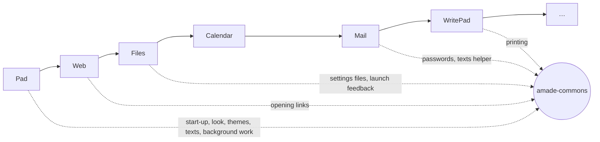

# 1. Why Swing and Our Own Library

Java offers several ways to build a desktop application, and some come with large frameworks around them. So why are the amadeOS applications written with plain Swing and a small library of their own? This chapter compares the options honestly, explains the decision, and says what it costs. If you ever start a program where another toolkit fits better, you will know which one to pick.

## What a desktop application needs

Strip any desktop program down and the same jobs appear:

- **Windows and widgets**: menus, buttons, text fields, lists, tables, dialogs.
- **A look** that fits the desktop it runs on, including the colours the user chose.
- **Texts in the user's language**, and dates and numbers written the way that language writes them.
- **Work in the background**: reading a large file or fetching mail must not freeze the window.
- **Settings and files** in the places the desktop expects them.
- **Desktop integration**: open a link in the browser, keep a password in the keyring, appear in the menu.
- **Packaging**: one command installs it, one removes it.

A toolkit does the first job. The question is where the other jobs come from.

## The candidates

| Toolkit | What it is | Strong at | Why not for amadeOS |
|---|---|---|---|
| **JavaFX** | Java's newer UI toolkit, separate from the JDK since Java 11 | Modern widgets, CSS styling, animation, media | A second toolkit next to the Swing desktop, with its own look and threading; an extra dependency (OpenJFX) with native parts per platform. |
| **SWT / Eclipse RCP** | Java bindings to the native widgets of each system, with the Eclipse platform on top | Native look on Windows and macOS, huge plug-in ecosystem | Native libraries per platform, and on Linux the look is GTK, not CDE. RCP is a framework you learn for years. |
| **NetBeans Platform** | Application framework on Swing | Modules, window system, actions, updates | Built for IDE-sized programs; a text editor would carry the weight of an IDE. |
| **Electron, Tauri** | A web page in a browser window | Web developers feel at home, rich layouts | Not Java. A browser engine per program, hundreds of megabytes of memory for a text editor. |
| **Qt Jambi, GTK bindings** | Java on top of a C++ or C toolkit | The look of KDE or GNOME | Native libraries, bindings that lag behind, and again not the CDE look. |
| **Swing** | The UI toolkit in every JDK since 1998 | Always there, fully customisable look, Java2D for drawing | Old-fashioned defaults, little help with application structure. |

Each of them is a good choice for someone. If you write a cross-platform program that must look native on Windows and macOS, SWT is worth a look; if your team knows the web, Electron saves them learning a toolkit.

## Why amadeOS uses Swing

### 1. The whole desktop is Swing

The amadeOS desktop is written in Java: the window manager, the Front Panel, the Style Manager, the login screen. An application built with the same toolkit shares their look exactly: the same bevels, the same fonts, the same colours. When the user picks another theme in the Style Manager, the desktop and every application change together, because they read the same file and run the same code.

### 2. The look is ours

Swing draws every widget itself, in Java. Nothing comes from the operating system. That sounds like a weakness, and on Windows it is. For amadeOS it is the point: the CDE look of the 1990s workstations, with its chiselled 3D borders and its palettes, is not available from any native toolkit today. In Swing it is a *look and feel*, about five hundred lines of Java that amade-commons installs before the first window opens.

### 3. Nothing to install, nothing to break

Swing and Java2D are part of every JDK. An amadeOS application needs Java, amade-commons and its own libraries, and that is all. It needs no graphics drivers, no OpenGL, no native libraries per platform. It runs in a virtual machine without 3D acceleration, over a remote X connection and on old hardware. Swing programs written in 2005 still run today.

### 4. Structure is something you can learn

Frameworks like Eclipse RCP give you structure: where code goes, how parts talk to each other. Swing gives you none, and many Swing programs are one class of 3,000 lines. This book teaches structure instead of a framework: four packages, a presenter that decides and a window that shows (chapter 2). You will understand every line, because there is nothing hidden below your own code except Swing and the JDK.

## Why Guice, not Spring

The parts of an application need each other: the presenter needs the window and the file service, the file service needs a thread pool. Someone has to build them in the right order. That is *dependency injection*, and Java has two well-known libraries for it.

| | Spring | Guice |
|---|---|---|
| Size | A large ecosystem: web, data, security, cloud | One library, with Google's Guava underneath |
| How parts are found | Scans the class path for annotated classes | Lists them in a *module*, in Java code |
| Start-up | Noticeable on a desktop program | A few milliseconds |
| Made for | Servers | Anything |

A desktop program starts often and should appear at once. Spring's scanning and its server heritage cost time and bring concepts a text editor never needs. Guice does one job, wiring, and does it in plain Java that you can read and step through with a debugger. You will meet it in chapter 2.

## Why a library of our own

Every amadeOS application starts the same way: decide the language, install the look, follow the theme, open the window on the right thread. Every one of them reads texts from translation files, keeps settings under `~/.config/amadeos`, and runs file and network work in the background. Writing that ten times would be ten times the bugs.

So these parts live in **amade-commons**, one library that every application, every game and the desktop itself depend on. It grows by a strict rule:

> A part moves into amade-commons when a **second** program needs it.

The first program that needs something writes it for itself. Only when the second one needs the same thing do we know what is really shared and what was particular to the first. Then it moves into the library, and both programs use it from there. This book follows that growth chapter by chapter.

## What it costs

Honesty demands the other side too:

- **Swing's age shows.** Fractional screen scaling (150 %) is weaker than in newer toolkits, there is no native file dialog, and on a Wayland desktop Swing programs run through XWayland.
- **Accessibility** depends on the Java Access Bridge and is not as good as in GTK or Qt programs.
- **More work.** No visual designer, no ready-made docking windows; layouts are written in code.
- **A small community.** Answers to your questions are in this book and the source code, not on many forums.

If a future program hits one of these walls, the design keeps the door open: the **rules and the services of every application are plain Java without Swing**. Only the window touches the toolkit. Moving a program to another toolkit would mean rewriting its windows, not the program.

In the next chapter we look at how an application is organised inside, so that this growth stays tidy.
