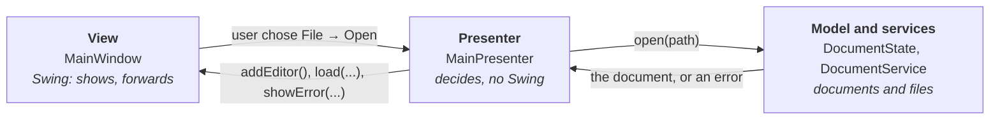

# 2. How an Application Is Built

A small Swing program fits into one class: a `JFrame` with a text area, a menu, and the file handling in the menu's action listeners. Many first programs are written that way. It works until you want to test the saving, add a second window, run something in the background or find a bug in a 1,500-line class.

The amadeOS programs share one structure that avoids this. This chapter explains it with the text editor Pad as the example. You will meet the same packages in every application of this book, in every game and in the desktop's own tools.

## The repositories

| Repository | Contains | Depends on |
|---|---|---|
| `amade-commons` | The shared library of all amadeOS programs: start-up, CDE look and themes, texts in five languages, settings directories, desktop integration | the JDK, Guice |
| `amade-<app>` | One application each: `amade-pad`, `amade-mail`, `amade-writepad`, … | `amade-commons`, and libraries of its own (a mail library for Mail, a decoder for Audio) |

Dependencies point one way only: an application uses amade-commons, amade-commons never knows a particular application. That is what makes it a library.

## The packages of an application

All code of the editor is under `eu.amadeos.apps.pad`:

| Package | Job | Classes in Pad |
|---|---|---|
| `bootstrap` | Start-up and wiring | `AmadePadApplication`, `PadModule` |
| `domain` | What the program is about, no user interface | `TextDocument`, `TextFormat`, `DocumentState` |
| `repository` | Files on disk | `DocumentRepository`, `FileSystemDocumentRepository`, `TextCodec` |
| `service` | Work that is neither rules nor storage | `DocumentService`, `SearchService` |
| `ui.main` | The main window and its presenter | `MainView`, `MainPresenter`, `MainWindow`, `MainMenuBar` |
| `ui.editor`, `ui.search` | Components and dialogs | `EditorTab`, `LineNumberMargin`, `FindReplaceDialog` |

Each package has one job:

### `domain`: what the program is about

For a text editor, that is a document: its text, how it is stored on disk, whether it has unsaved changes. For a mail program it is accounts, folders and messages; for a calendar, appointments and their repetitions.

**The domain knows nothing about windows.** It does not import `java.awt` or `javax.swing`. Its classes are often `record`s: values that never change once made. They can be tested with plain JUnit tests that run in milliseconds and need no screen.

### `repository`: files and storage

Documents, settings and caches are read and written here, and nowhere else. If a file format changes, only this package changes. The rest of the program sees an interface like `DocumentRepository` with `read` and `write`, and never a byte.

### `service`: the work in between

Searching a text, fetching mail, calculating a fractal, talking to a scanner. Services often run in the background and return their result later (more on that [below](#two-threads)). Like the domain, they never touch Swing.

### `ui`: what the user sees

Everything with Swing lives under `ui`. In `ui.main` the main window is assembled, and the **presenter** decides what to show. That is the next topic.

### `bootstrap`: putting it together

The `main` method and the wiring of all parts. More on that [below](#wiring-it-together-guice).

## Model-View-Presenter

How do the documents and the window talk to each other? Pad uses **Model-View-Presenter** (MVP), like all amadeOS applications:



- The **model** is the domain, together with the services that work on it.
- The **view** is the window. It shows what it is told and reports what the user does. It decides nothing.
- The **presenter** sits between them. It receives the user's actions, asks the services and tells the view what to show. It is plain Java, **without Swing**.

The key is that the presenter does not know the window class. It only knows an interface, which lists exactly what the presenter needs from a view:

```java title="amade-pad · ui/main/MainView.java"
--8<-- "amade-pad/src/main/java/eu/amadeos/apps/pad/ui/main/MainView.java"
```

Notice what the interface does not say: nothing about `JFileChooser`, `JOptionPane` or tabs. "Ask for a file to open" is one method, `chooseOpenPath()`; how the question looks is the window's business. A test can answer it with a fixed path, and the whole open-edit-save cycle runs without a screen. Chapter 10 shows such a test.

!!! tip "Tip: a rule of thumb"
    If you are about to write an `if` in the window, stop and ask whether it is a decision. Decisions belong in the presenter or the model, where tests can reach them.

MVP is not free. Pad needs a view interface with fifteen methods, and in the window a few lines that forward each menu choice to the presenter. For a program of a few hundred lines this feels like ceremony. It pays back as soon as you change something and the tests tell you within seconds that the program still works.

## Two threads

A desktop program has a problem a command-line program does not have: while it works, the window must stay alive. If Pad read a 50 MB log file on the thread that paints the window, the window would freeze until the file was read.

Swing has one thread for everything visible, the **event dispatch thread** (EDT). Mouse clicks, key presses, menu actions and painting all run there, one after the other. Two rules follow:

1. **Every access to a Swing component happens on the EDT.** Swing is not thread-safe; touching a component from another thread causes rare, random errors that are hard to find.
2. **Nothing slow happens on the EDT.** Files, network, long calculations go to another thread.

amadeOS applications do slow work on **virtual threads**, the light threads Java has had since version 21: thousands of them cost less than ten ordinary ones. The service starts the work and returns a `CompletableFuture`, a promise of a result. The presenter tells the future to continue on the EDT, with an `Executor` from amade-commons that runs a task there:

```text
EDT                                   virtual thread
───                                   ──────────────
presenter.open(path)
  documents.open(path) ─────────────▶ read the bytes, decode them
  (EDT is free: painting, typing)       ...
                       ◀───────────── TextDocument
  .handleAsync(..., edt)
  editor.load(path, document)
```

Data that crosses between the threads is **immutable**: a `record` like `TextDocument`, which neither side can change under the other's feet. Chapter 10 builds this step by step.

## Wiring it together: Guice

The presenter needs a view, the document service, the background executor, the EDT executor, the texts and the language settings. The window needs the search service and the texts. Someone has to create all these objects in the right order and hand each one what it needs. That someone is [Guice](https://github.com/google/guice), a small *dependency injection* library.

You describe once which class to use for what, in a **module**:

```java title="amade-pad · bootstrap/PadModule.java"
--8<-- "amade-pad/src/main/java/eu/amadeos/apps/pad/bootstrap/PadModule.java"
```

- `bind(DocumentRepository.class).to(FileSystemDocumentRepository.class)`: whoever needs a `DocumentRepository` gets the one that works on the file system. A test can bind another.
- `bind(MainView.class).to(MainWindow.class)` together with `in(Scopes.SINGLETON)`: there is one window, and whoever needs a view gets that one.
- `@Provides` methods build objects that need a little code, like the texts in the right language.
- Classes whose constructor is marked `@Inject` (the presenter, the window, the services) are built by Guice, which fills in the constructor's parameters.

The `main` method then only asks for the finished objects:

```java title="amade-pad · bootstrap/AmadePadApplication.java"
--8<-- "amade-pad/src/main/java/eu/amadeos/apps/pad/bootstrap/AmadePadApplication.java"
```

`AmadeApplication.launch` comes from amade-commons. It does what every amadeOS program needs before its first window: it picks the language, installs the CDE look in the current colour theme and follows the theme when the user changes it, switches to the EDT and creates the injector. Besides the application's own module it adds the `CommonsModule`, which provides the shared objects:

```java title="amade-commons · app/CommonsModule.java"
--8<-- "amade-commons/src/main/java/eu/amadeos/commons/app/CommonsModule.java:configure"
```

That is where the presenter's `ExecutorService` (the virtual threads) and `EdtExecutor` come from, without Pad saying a word about them.

## Texts and languages

No visible text is written in Java code. Texts live in `messages.properties` (English) and its translations `messages_de.properties`, `_fr`, `_es` and `_it`, read through the `Messages` class of amade-commons:

```properties title="amade-pad · messages.properties (excerpt)"
--8<-- "amade-pad/src/main/resources/eu/amadeos/apps/pad/messages.properties:menu"
```

The `&` marks the **mnemonic**, the underlined letter that opens a menu with the keyboard (Alt+F). Each language chooses its own letter: `&Datei` in German, `&Fichier` in French. Chapter 10 shows how the texts are loaded, formatted and tested.

## Summary

- Every application is its own repository with the same packages: `bootstrap`, `domain`, `repository`, `service`, `ui`.
- The domain and the services never touch Swing, so plain tests cover them.
- Model-View-Presenter: the presenter decides, the view shows, and a test can stand in for the view.
- Two threads: the EDT for everything visible, virtual threads for everything slow; immutable values cross between them.
- Guice wires the parts; `AmadeApplication` starts the program in the desktop's language and theme.

Now you know the map. In the next chapter we walk it: we build Pad from the document up.
