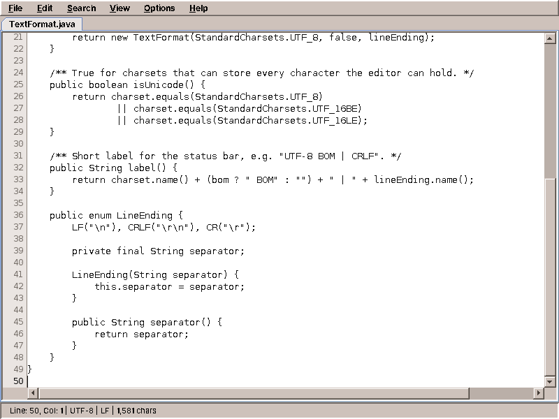
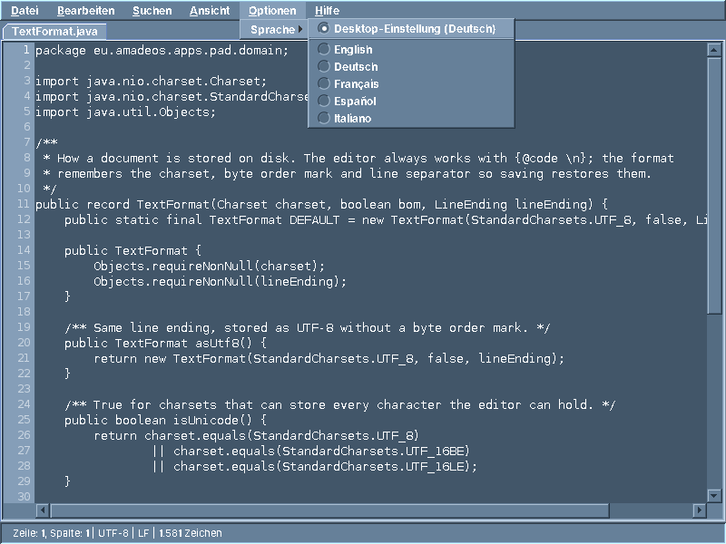
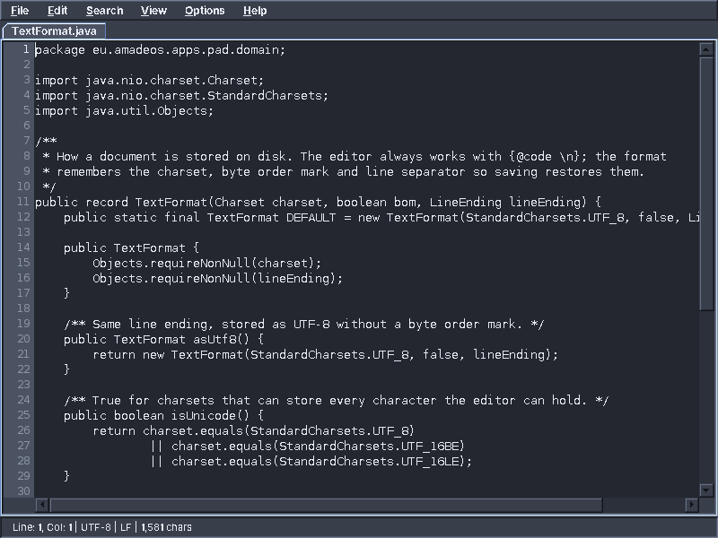

# 10. Pad

The first application of amadeOS is the one every desktop needs before any other: a text editor. Configuration files, notes, shell scripts, a quick README: Pad opens them, lets you change them and saves them back exactly as they were, only with your changes.

A text editor looks simple. A text area, a menu, open and save. But behind *open* hides the question of how the bytes on disk become letters; behind *save*, how to replace a file without ever losing it; and behind both, how to keep the window alive while the disk works. Pad answers these questions, and on the way it meets everything amade-commons offers an application: start-up, the CDE look, colour themes, five languages and the background threads.

## What you build



- Several documents in **tabs**, with a `*` after the name of a changed one, and a question before a changed document is closed.
- **Line numbers** in a margin, and optional word wrap.
- **Find and replace**, in a dialog that stays open while you edit.
- **Encodings and line endings**: Pad recognises UTF-8, UTF-16, Windows-1252 and ISO-8859-1, and Windows, Unix and old Mac line endings, and saves every file in the format it came in.
- **Safe saving**: a crash or a full disk during saving never leaves a half-written file behind.
- **Undo and redo**, cut, copy and paste.
- **Five languages**, and colours that follow the desktop theme.

The whole program is about 1,600 lines of Java, and another 1,100 lines of tests.

## What you will learn

- To model a document as immutable values plus a small piece of state that counts changes.
- How text files are encoded, and how to read one when nobody tells you its encoding.
- How to write a file *atomically*.
- How to do slow work on virtual threads and bring the result back to the EDT with `CompletableFuture`.
- How a presenter coordinates open, save and close when all of them can overlap.
- How to test a presenter without a window, and test that it only touches the window on the EDT.
- How texts are translated, formatted and checked, and how an application chooses its language.
- How an application follows the desktop's colour theme.
- How a Debian package and a desktop entry put the editor into the Front Panel.

## The document

What is a document, for a text editor? First of all its text. Then, less obviously, the way that text is stored on disk: which character encoding, whether the file starts with a byte order mark, and which characters end a line. The editor works with one kind of line end, `\n`; the **format** remembers what the file had, so that saving restores it:

```java title="amade-pad · domain/TextFormat.java"
--8<-- "amade-pad/src/main/java/eu/amadeos/apps/pad/domain/TextFormat.java"
```

Text and format together are a `TextDocument`. Both are records: values that never change once made. That will matter as soon as a second thread is involved.

```java title="amade-pad · domain/TextDocument.java"
--8<-- "amade-pad/src/main/java/eu/amadeos/apps/pad/domain/TextDocument.java"
```

The rest of what the editor knows about a document changes all the time: its file, and whether it has unsaved changes. That is `DocumentState`:

```java title="amade-pad · domain/DocumentState.java"
--8<-- "amade-pad/src/main/java/eu/amadeos/apps/pad/domain/DocumentState.java"
```

Why a counter and not a simple `boolean modified`? Because saving takes time. Imagine:

1. The user presses Ctrl+S. Pad takes the text as it is now, revision 7, and starts writing it to disk.
2. While the disk works, the user types another letter. Revision 8.
3. The disk is done. With a `boolean`, Pad would now set `modified = false`, and the letter typed in step 2 would be lost the moment the user closes the tab without being asked.

With the counter, Pad remembers *which* revision was saved: `saved(path, 7, format)`. Revision 8 is not 7, so the document is still modified, and the tab keeps its `*`. Small detail, real bug.

## Reading a text file

A file is bytes. To turn bytes into letters you need to know the **encoding**, and a plain text file does not say which one it uses. Pad has to guess, and guess well:

```java title="amade-pad · repository/TextCodec.java"
--8<-- "amade-pad/src/main/java/eu/amadeos/apps/pad/repository/TextCodec.java:decode"
```

Step by step:

1. **A byte order mark** (BOM) at the start settles it. Windows programs often write `EF BB BF` before UTF-8 text, and UTF-16 files always start with `FE FF` or `FF FE`.
2. **NUL bytes** in the first 8 KB mean the file is not text at all, but an image or a program. Pad refuses it with a clear message instead of showing garbage, and instead of destroying the file when the user saves.
3. **Strict UTF-8.** UTF-8 has rules: certain byte sequences can never appear in it. A decoder told to *report* errors (instead of replacing them with `?`) tells you whether the file is valid UTF-8. Today almost every text file is.
4. **Windows-1252, then ISO-8859-1**, the encodings of older Western files. ISO-8859-1 maps every possible byte to a character, so this last step always succeeds.

Then the line ends are counted, the most frequent one is remembered in the `TextFormat`, and all of them become `\n`.

!!! warning "Pitfall: `Files.readString` and silent replacement"
    `Files.readString(path)` assumes UTF-8 and throws on anything else. `new String(bytes, charset)` is worse: it silently replaces what it cannot decode with `�`, and saving writes the replacement characters back. Your user's file is damaged, and nobody noticed. When the content matters, use a `CharsetDecoder` with `CodingErrorAction.REPORT`, as `TextCodec` does, both for decoding and for encoding.

Encoding reverses the steps, and it, too, refuses to replace characters: if the user typed `€` into an ISO-8859-1 file, which has no euro sign, encoding throws an `UnencodableTextException`. What then? That is a decision, so it belongs to the presenter. We will get there.

## Saving without losing anything

The obvious way to save a file is to open it and write the new content. But opening a file for writing **empties it first**. If the program crashes, the power fails or the disk fills up halfway through, the file is gone: the old content is deleted, the new one incomplete.

Pad never writes into the file it saves. It writes into a new file next to it, and only when that one is complete, swaps it in:

```java title="amade-pad · repository/FileSystemDocumentRepository.java"
--8<-- "amade-pad/src/main/java/eu/amadeos/apps/pad/repository/FileSystemDocumentRepository.java:atomic-write"
```

- **Encode first.** If the text cannot be stored in the file's encoding, nothing on disk has been touched yet.
- **Follow symbolic links.** If `~/.bashrc` is a link to `~/dotfiles/bashrc`, the real file is saved, and the link stays a link.
- **A temporary file in the same directory.** `Files.move` can only swap files atomically within one file system, and the same directory is sure to be one.
- **`channel.force(true)`** waits until the bytes are really on the disk, not just in the operating system's cache.
- **Copy the permissions.** An executable script stays executable after saving.
- **`ATOMIC_MOVE`**: the rename is one step for the file system. Every other program sees either the old file or the new one, never something in between.

This pattern, *write to a temporary file, then rename*, is how careful programs save everything: documents, settings, databases. You will meet it again in amade-commons, where `PropertiesFile` saves settings the same way.

## Work in the background

Reading a file of a few kilobytes takes no time. Reading a 200 MB log file from a network drive takes seconds, and for those seconds the window would be frozen: no painting, no typing, a grey rectangle. So Pad reads and writes in the background:

```java title="amade-pad · service/DocumentService.java"
--8<-- "amade-pad/src/main/java/eu/amadeos/apps/pad/service/DocumentService.java:open"
```

`CompletableFuture.supplyAsync` runs the reading on the `executor` and immediately returns a future, a promise of the document. The executor comes from amade-commons, which creates one for every application: `Executors.newVirtualThreadPerTaskExecutor()`, a new virtual thread for every task. Virtual threads are cheap; a program can have thousands of them waiting for disks and networks.

The checked `IOException` cannot leave the lambda, so it is wrapped into a `CompletionException`; whoever looks at the future's error later unwraps it again.

Note what `DocumentService` does *not* do: it does not show an error, does not change a tab, does not touch Swing at all. It returns a future, and the presenter decides what happens with the result.

## The presenter

`MainPresenter` coordinates everything the user can do with documents. Its constructor gets, from Guice, the view, the document service, the background executor, the texts and the language settings, and one more thing from amade-commons: the `EdtExecutor`.

```java title="amade-commons · swing/EdtExecutor.java"
--8<-- "amade-commons/src/main/java/eu/amadeos/commons/swing/EdtExecutor.java"
```

It is an `Executor` that runs its tasks on the EDT. A future continued with `...Async(..., edt)` continues on the EDT, where it may touch the window. And `requireEdt()` is a guard that Pad's window and presenter call at the start of their methods: if anyone ever calls them from another thread, the program fails at once and loudly, instead of rarely and mysteriously.

### Opening

```java title="amade-pad · ui/main/MainPresenter.java"
--8<-- "amade-pad/src/main/java/eu/amadeos/apps/pad/ui/main/MainPresenter.java:open"
```

- A file that is already open is not opened twice; its tab is selected. Paths are made absolute and normalised first, so that `./notes.txt` and `/home/alex/notes.txt` are recognised as the same file.
- A file that is *being* opened (the user double-clicked twice) is not opened again either: `opening` remembers it until the result is there.
- `handleAsync(..., edt)` receives either the document or the error, on the EDT. On success a new tab gets the document; on failure the user gets a message, and if that leaves the window without any tab, an empty one.

### Saving

Saving is where the threads really meet. The user can keep typing while a file is written, can press Ctrl+S twice, or can close the tab while it is being saved:

```java title="amade-pad · ui/main/MainPresenter.java"
--8<-- "amade-pad/src/main/java/eu/amadeos/apps/pad/ui/main/MainPresenter.java:save"
```

The `snapshot` is taken on the EDT: the text and the format as they are at this moment, as an immutable `TextDocument`, together with the revision number. Only the snapshot travels to the background thread. The tab can change freely meanwhile; the file gets exactly the text the user saw when pressing Ctrl+S.

`saves` holds one future per tab that is being saved. A second Ctrl+S during saving gets the same future instead of starting a second write, and closing a tab waits for it.

Then the writing itself, and the question from the section on encodings, what to do with a `€` in an ISO-8859-1 file:

```java title="amade-pad · ui/main/MainPresenter.java"
--8<-- "amade-pad/src/main/java/eu/amadeos/apps/pad/ui/main/MainPresenter.java:write"
```

Pad asks the user whether to save the file as UTF-8 instead, which can store every character. If yes, `write` calls itself with the format changed. The original encoding is never "fixed" silently, and a character is never replaced by a question mark.

`thenCompose(next -> next)` flattens the result: the handler returns a future (the retry may be another write), and the caller wants a single `CompletableFuture<Boolean>`, not a future of a future.

### Telling the user what went wrong

An error message should say what happened in the user's language. Java's exceptions speak English and are written for programmers (`java.nio.file.AccessDeniedException: /etc/hosts`). The presenter translates the usual ones and falls back to the exception's message for the rest:

```java title="amade-pad · ui/main/MainPresenter.java"
--8<-- "amade-pad/src/main/java/eu/amadeos/apps/pad/ui/main/MainPresenter.java:describe"
```

## The window

`MainWindow` implements `MainView`: tabs in the middle, a status bar at the bottom, the menu bar on top. Each tab is an `EditorTab`, a `JTextArea` in a scroll pane with a `LineNumberMargin` as its row header. Every change of the text counts as a revision:

```java title="amade-pad · ui/editor/EditorTab.java"
--8<-- "amade-pad/src/main/java/eu/amadeos/apps/pad/ui/editor/EditorTab.java:changes"
```

`onStateChanged` is how the tab tells the window to update the tab title (`notes.txt *`) and the status bar.

The window's methods are short, because the presenter has already decided everything. Showing an error is one of them, with one subtle detail:

```java title="amade-pad · ui/main/MainWindow.java"
--8<-- "amade-pad/src/main/java/eu/amadeos/apps/pad/ui/main/MainWindow.java:show-error"
```

!!! warning "Pitfall: Swing renders HTML"
    A Swing label, button or dialog message whose text starts with `<html>` is rendered as HTML, images from the web included. "Failed to open file: …" does not start with it, but a translation may well put the file name first, and an exception's message may be nothing but text from outside. A file called `<html>` would then make the error dialog fetch a picture from a stranger's server. Show text that came from outside (file names, mail subjects, server messages) in a non-editable `JTextArea`, which never interprets HTML.

### The menu bar

```java title="amade-pad · ui/main/MainMenuBar.java (File menu)"
--8<-- "amade-pad/src/main/java/eu/amadeos/apps/pad/ui/main/MainMenuBar.java:menus"
```

```java title="amade-pad · ui/main/MainMenuBar.java"
--8<-- "amade-pad/src/main/java/eu/amadeos/apps/pad/ui/main/MainMenuBar.java:helpers"
```

Every menu entry is a key into the texts, a keyboard shortcut and a method of the presenter. That is all a menu entry should be. The menu titles get their mnemonic letter from the text (`&File`), through `Mnemonics` from amade-commons, which we look at with the languages below.

### Searching

The find dialog is not modal: it stays open while you edit, like in every good editor. The searching itself is `SearchService`, plain Java without Swing, with one trap worth knowing:

```java title="amade-pad · service/SearchService.java"
--8<-- "amade-pad/src/main/java/eu/amadeos/apps/pad/service/SearchService.java:search"
```

The obvious way to search without case is `text.toLowerCase().indexOf(query.toLowerCase())`. But changing the case can change the length of a string: the German `ß` becomes `SS` in upper case, and `İ` (Turkish capital I with dot) becomes two characters in lower case. The position found in the converted text is then not the position in the editor, and Pad would select the wrong letters. `regionMatches(true, ...)` compares character by character without converting the string.

## Testing the presenter

The presenter is plain Java, so a test can create it with a fake view. Pad uses [Mockito](https://site.mockito.org) for the fakes, and adds one check that a hand-written fake could not do as easily: **every call to the view must happen on the EDT**.

```java title="amade-pad · test/ui/main/MainPresenterTest.java (set-up)"
--8<-- "amade-pad/src/test/java/eu/amadeos/apps/pad/ui/main/MainPresenterTest.java:edt-view"
```

The mock answers every call with a default value, but first it asserts that it was called on the event dispatch thread. If any code path in the presenter ever forgets the `edt` executor, a test fails.

With the document service mocked too, a test controls exactly when the "disk" is done. Here, the scenario from the beginning of the chapter, typing during saving:

```java title="amade-pad · test/ui/main/MainPresenterTest.java"
--8<-- "amade-pad/src/test/java/eu/amadeos/apps/pad/ui/main/MainPresenterTest.java:snapshot"
```

`io` is a future that the test completes by hand. Between starting the save and completing it, the test changes the document. After saving, the editor was told that revision 1 was saved, and the document is still modified.

A second test class, `PadModuleTest`, does the opposite: no mocks, the real Guice wiring, a real window and real files in a temporary directory. It only needs the theme and settings directories pointed at that directory:

```java title="amade-pad · test/bootstrap/PadModuleTest.java"
--8<-- "amade-pad/src/test/java/eu/amadeos/apps/pad/bootstrap/PadModuleTest.java:wiring"
```

Many fast tests of the presenter with fakes, and a few slow ones of the whole program: that mix catches the most bugs for the least waiting.

## Five languages

amadeOS speaks English, German, French, Spanish and Italian, and so does every application. Pad's texts are in `src/main/resources/eu/amadeos/apps/pad/messages.properties`, with a file per translation next to it:

```properties title="amade-pad · messages.properties (excerpts)"
--8<-- "amade-pad/src/main/resources/eu/amadeos/apps/pad/messages.properties:status"
--8<-- "amade-pad/src/main/resources/eu/amadeos/apps/pad/messages.properties:replaced"
```

The module loads them once, in the language the application runs in (`Messages.load(PadModule.class, MESSAGES, locale)`, shown in chapter 2). Then:

- `msg.get("menu.file")` returns a text as it is.
- `msg.format("status.position", line, column, format, length)` fills in `{0}`, `{1}`, … with Java's `MessageFormat`, in the language's way: `1,234 chars` in English, `1.234 Zeichen` in German.
- `{0,choice,1#…|1<…}` picks a text by number, so that English says *1 occurrence* and *3 occurrences*. Every language writes its own rule.
- A missing text shows as `!key!` and is logged once, instead of crashing the program.

!!! info "Behind the scenes: apostrophes"
    Plain `MessageFormat` treats `'` as a quote character, so translators would have to write `l''eau` to get `l'eau`. That mistake is made in every project that uses it. `Messages` doubles every apostrophe before formatting, so translators simply write French.

### Testing the translations

A forgotten translation is found by users, in the worst case in a dialog that appears once a year. Pad finds it at build time instead:

```java title="amade-pad · test/ui/main/TranslationTest.java"
--8<-- "amade-pad/src/test/java/eu/amadeos/apps/pad/ui/main/TranslationTest.java"
```

`TranslationCheck` from amade-commons compares every translation with the English file. It reports texts that are missing, texts that English does not have (often a typo in a key), and texts that use other `{n}` arguments than English. The expected result is an empty map. The second test checks a few formatted texts as a native speaker would read them.

### Mnemonics

`&Datei`, `&Fichier`, `&Archivo`: the letter after `&` is underlined and opens the menu with Alt. Because it is part of the text, each language picks a letter of its own word. `Mnemonics` turns the marked text into a Swing text and a key code:

```java title="amade-commons · i18n/Mnemonics.java"
--8<-- "amade-commons/src/main/java/eu/amadeos/commons/i18n/Mnemonics.java:apply"
```

### Which language?

When Pad starts, `AmadeApplication` decides its language. There are four places to look, and the first one that names a language amadeOS is translated into wins:

```java title="amade-commons · i18n/LocaleResolution.java"
--8<-- "amade-commons/src/main/java/eu/amadeos/commons/i18n/LocaleResolution.java:resolve"
```

1. The application's own setting, `~/.config/amadeos/pad/language.conf`.
2. The desktop's language, `~/.config/amadeos/locale.conf`.
3. The environment, as other Linux programs read it: `LANGUAGE`, `LC_ALL`, `LC_MESSAGES`, `LANG`. That is how Pad speaks the right language on a desktop that is not amadeOS.
4. English.

The region is kept: on an Austrian desktop (`de_AT`), Pad speaks German and writes dates the Austrian way.

The first place, the application's own language, is set in Pad under *Options → Language*:



```java title="amade-pad · ui/main/MainMenuBar.java"
--8<-- "amade-pad/src/main/java/eu/amadeos/apps/pad/ui/main/MainMenuBar.java:language-menu"
```

The first entry follows the desktop and says which language that is now. Every language is listed in its own name, *Français*, not *French*: a user who accidentally switched to a language they cannot read must still find their own. The texts of this menu come from amade-commons itself (`Messages.commons`), because every application shows the same menu.

```java title="amade-pad · ui/main/MainPresenter.java"
--8<-- "amade-pad/src/main/java/eu/amadeos/apps/pad/ui/main/MainPresenter.java:language"
```

The choice is stored, and takes effect at the next start. Changing the language of a running Swing program would mean rebuilding every window, menu and dialog, including the JDK's own file chooser. Restarting is simpler, and the user is told.

## Following the desktop theme

The user picks a colour theme in the Style Manager, and the desktop changes at once: window frames, Front Panel, backdrop. So does Pad, while it runs. Here is the same window after switching to *Dark Slate*:



Pad has not a single line of code for this. When the application starts, `AmadeApplication` installs the CDE look with the current theme's colours and then follows the theme:

```java title="amade-commons · swing/AmadeUI.java"
--8<-- "amade-commons/src/main/java/eu/amadeos/commons/swing/AmadeUI.java:follow"
```

`ThemeStore` watches `~/.config/amadeos/theme.conf`. When the file changes, the new theme is applied on the EDT: Swing's colour table is filled with the new colours, and every open window is updated.

That works for every colour that comes from Swing's colour table: panels, menus, text areas, lists, the status bar. It does **not** work for colours a program sets itself:

```java
statusBar.setBackground(AmadeUI.theme().softHighlight());   // wrong: stays after a theme change
```

The component keeps that colour forever, and after switching to Dark Slate one bright bar remains. For colours beyond the standard ones, amade-commons has `AmadeUI.style`:

```java title="amade-commons · swing/AmadeUI.java"
--8<-- "amade-commons/src/main/java/eu/amadeos/commons/swing/AmadeUI.java:style"
```

The *styler* is a function from theme to colours; it runs now and again after every theme change. Pad does not need one: its text area takes `TextArea.background` from the theme. The line number margin paints itself and simply asks for `AmadeUI.theme()` each time it paints, which is the other correct way: a component that draws its own pixels reads the theme while drawing, and the repaint after a theme change does the rest. Files, Calendar, Mail and WritePad use `style`, and you will see them in their chapters.

## Starting it

Now every part is there, and `main` from chapter 2 starts them. Here is what `AmadeApplication.launch` does for it:

```java title="amade-commons · app/AmadeApplication.java"
--8<-- "amade-commons/src/main/java/eu/amadeos/commons/app/AmadeApplication.java:launch"
```

In order:

1. **The language**, before any Swing class is loaded, so that the JDK's own dialogs (the file chooser, *OK* and *Cancel*) speak it too.
2. **On the EDT**, everything else: the look and the theme, then the Guice injector with `CommonsModule` and the application's modules, then the application's own start code.
3. **If start-up fails**, a message box says so in the user's language, instead of a program that silently does not appear when clicked in the Front Panel.

`AppInfo` names the application three times, for three audiences: `amade-pad` for the system (package name, keyring entries), `Text Editor` for people, and `pad` for the directory `~/.config/amadeos/pad`.

## Shipping it

On amadeOS, programs are installed as Debian packages. `./gradlew deb` builds one; it contains the jar in `/opt/amade-pad`, a start script `/usr/bin/amade-pad`, an icon, the licence, and a **desktop entry**:

```groovy title="amade-pad · build.gradle (excerpt of the deb task)"
--8<-- "amade-pad/build.gradle:desktop"
```

The desktop entry is a small file in the [freedesktop format](https://specifications.freedesktop.org/desktop-entry-spec/latest/) that every Linux desktop reads:

- `Categories=Utility;TextEditor;` puts Pad into the *Text & Office* drawer of the amadeOS Front Panel, and into the right menu on other desktops.
- `MimeType=text/plain;...` tells file managers that Pad can open text files, so *Open With* lists it.
- `Exec=/usr/bin/amade-pad %F` passes the chosen files as arguments, which `main` opens.

The amadeOS image is built from many such packages. Every application has the same task to put its package where the image build finds it:

```groovy title="amade-pad · build.gradle"
--8<-- "amade-pad/build.gradle:install"
```

## What amade-commons gives Pad

Pad is the first application of this book, but not the first program on amadeOS: the desktop's own tools and the games were there before it. So the parts every program needs were already in amade-commons, and Pad uses them:

| Part | Package | What it does for Pad |
|---|---|---|
| `AmadeApplication`, `AppInfo` | `app` | Starts the program: language, look, theme, EDT, Guice |
| `CommonsModule` | `app` | Binds the background executor, `EdtExecutor`, language settings, directories |
| `EdtExecutor` | `swing` | Continues futures on the EDT; `requireEdt()` guards |
| `AmadeUI`, `DesktopTheme`, `ThemeStore` | `swing`, `theme` | The CDE look in the desktop's colours, following changes |
| `Messages`, `Mnemonics` | `i18n` | Texts in five languages, formatted; menu letters |
| `TranslationCheck` | `i18n` | A test that every translation is complete |
| `LocaleSettings`, `LocaleResolution`, `Language` | `i18n` | Which language; *Options → Language* |
| `XdgDirectories` | `config` | Where settings live |

And what stays in Pad? Everything about text files: `TextCodec`, the atomic writing of documents, the line number margin, find and replace. No other application of the book reads plain text files with unknown encodings, so these stay where they are, until one does.

!!! tip "Tip: resist the shared library"
    It is tempting to put `TextCodec` into amade-commons right away, "because it is useful". Wait. When the second program needs it, you will know which parts of it are general and which are Pad's. A library that only contains what two programs really share stays small enough to understand.

## Exercises

1. **Line endings.** Add *View → Line Ending* with LF, CRLF and CR, which changes the `TextFormat` of the current document. Where does the decision go: menu, presenter or `DocumentState`? Write the presenter test first.
2. **Recent files.** Remember the last eight opened files in `~/.config/amadeos/pad/recent.txt` and list them in the *File* menu. Write them with the temporary-file pattern of this chapter. Which class reads and writes the file, and how does the presenter get it?
3. **Large files.** Ask before opening a file larger than 20 MB. The question is a new `MainView` method; the size check belongs in the presenter.
4. **Zoom.** Ctrl++ and Ctrl+- change the font size of all tabs, and the line numbers follow.
5. **A sixth language.** Translate Pad into Dutch. You will find that `TranslationCheck` does not know Dutch yet: the list of languages lives in amade-commons (`Language`). What else would have to change for the whole desktop to speak Dutch?

## Summary

- A document is an immutable value (`TextDocument`) plus state that counts revisions, so a save in the background cannot lose later changes.
- Read text with strict decoders and a clear order of guesses; never replace characters silently, neither when reading nor when writing.
- Save by writing a temporary file and renaming it atomically.
- Slow work runs on virtual threads and returns a `CompletableFuture`; the presenter continues on the EDT with `EdtExecutor`, and only immutable snapshots cross between the threads.
- A mock view that asserts the EDT finds threading mistakes in tests.
- Texts live in five `.properties` files, checked by a test; the language comes from the application, the desktop or the environment.
- The look and the theme come from amade-commons; never set theme colours directly.
- A Debian package with a desktop entry puts the program into the Front Panel.

Pad has shown everything that the start of an application needs. The next application, a small web browser, needs something new: opening a link in another program, safely.
