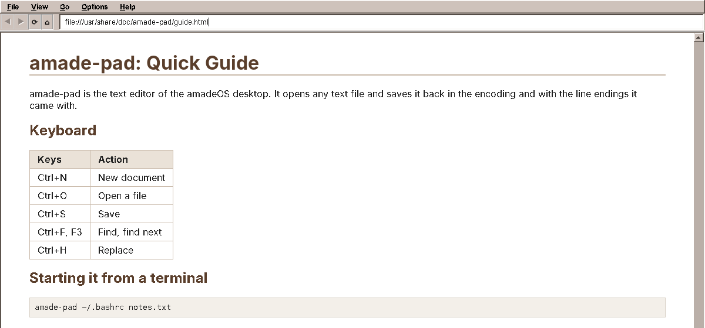
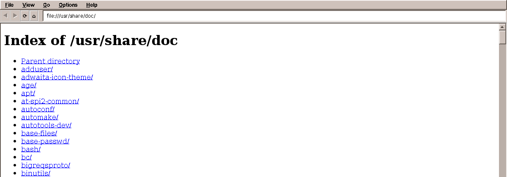

# 11. Web

Every Debian package brings documentation: a README, a changelog, often a manual in HTML. It sits in `/usr/share/doc`, and most people never see it, because opening it takes a terminal or a full web browser. amade-web is the second application of the book: a small viewer for that documentation. It shows local HTML pages, text files and directories, in the look of the desktop, without a network.

And when a page links to the web? Then amade-web does not try to be a browser. It hands the link to the real one. Doing that safely is the new part of amade-commons in this chapter.

## What you build



- **Local HTML** with CSS: headings, tables, lists, images, style sheets next to the page.
- **Text files**, also compressed ones (`README.Debian.gz`, `changelog.gz`), shown as preformatted text.
- **Directories** as a list of links, with the folders first.
- **Back, forward, reload, home** (the home page is `/usr/share/doc`), and an address field.
- **Zoom** with Ctrl++ and Ctrl+-.
- **Links to the web** open in the web browser, **PDFs and office documents** in their applications.
- **No scripts, no network**: a page can load its style sheet and pictures from the disk, nothing else.



The program is about 850 lines of Java. Almost all the hard work, turning HTML into pixels, is done by two libraries.

## What you will learn

- How to show HTML in a Swing program, and why "show HTML" does not mean "write a browser".
- How to model "what a URL leads to" with a sealed interface and records, and handle every case with a `switch`.
- How to keep a slow load from overwriting a later one.
- How to make a viewer that never goes online by itself.
- How to start another program for a link or a file, and which files never to start.
- When a program is small enough to do without a presenter, and what that costs.

## Two libraries do the drawing

Writing an HTML renderer is a project of years. amade-web uses two libraries that have done it:

| Library | Job |
|---|---|
| [jsoup](https://jsoup.org) | Reads HTML as browsers do: it repairs missing end tags, wrong nesting and other mistakes that real pages are full of, and gives a clean document tree. |
| [Flying Saucer](https://github.com/flyingsaucerproject/flyingsaucer) (`xhtmlrenderer`) | Lays out and draws XHTML with CSS 2.1 in a Swing component. No JavaScript, no CSS 3. |

Why not Swing's own `JEditorPane`, which can show HTML too? It understands HTML 3.2 from 1997 and very little CSS. Documentation written since then looks broken in it. Flying Saucer handles the layout of a modern manual page (tables, floats, margins, fonts from a style sheet) well, and it is plain Java like the rest of the program.

Why not a real browser engine (JavaFX's WebView, or the Chromium Embedded Framework)? Both are large native components with their own threading, and both bring JavaScript and the network with them, which a documentation viewer should not have. For the web there is a web browser on the desktop already.

!!! info "Behind the scenes: the amadeOS handbooks"
    The handbooks of amadeOS, this book included, are built with MkDocs and need JavaScript for their search and navigation. That is why the Help drawer opens them in Firefox, not in amade-web.

## What a URL leads to

When the user clicks a link, three different things can happen: amade-web shows a page, the web browser opens, or another application opens a file. The loader decides which, and says so with its return type:

```java title="amade-web · document/DocumentLoader.java"
--8<-- "amade-web/src/main/java/eu/amadeos/apps/web/document/DocumentLoader.java:results"
```

`sealed` means: these three, and no others. The compiler knows it, so a `switch` over a `Result` must handle all three, and adding a fourth one later makes every incomplete `switch` fail to compile. That is a much stronger promise than returning `null` for "not a page", or throwing an exception for "open it elsewhere".

The loader itself goes from the URL to the bytes and from the bytes to the kind of document:

```java title="amade-web · document/DocumentLoader.java"
--8<-- "amade-web/src/main/java/eu/amadeos/apps/web/document/DocumentLoader.java:load"
```

- Everything that is not a `file:` URL is a `WebLink`: `https:`, `http:`, `mailto:`.
- A directory shows its `index.html`, or a generated list of its entries.
- `.gz` files are unpacked in memory first; Debian compresses most of its documentation.
- HTML goes to jsoup. Images, text and directories become small generated pages, so that one component shows all of them.
- What is left (PDFs, office documents, binary files) is an `OtherFile`.

The loader reads files and builds documents, but it never touches a window. It runs on a background thread, and the tests call it directly:

```java title="amade-web · test/document/DocumentLoaderTest.java"
--8<-- "amade-web/src/test/java/eu/amadeos/apps/web/document/DocumentLoaderTest.java:repaired"
```

```java title="amade-web · test/document/DocumentLoaderTest.java"
--8<-- "amade-web/src/test/java/eu/amadeos/apps/web/document/DocumentLoaderTest.java:elsewhere"
```

Look at the PDF in the second test: it starts with `%PDF-1.4`, readable characters, so a check for binary bytes alone would show it as text. The list of formats that have their own applications comes first.

### From HTML to XHTML

Flying Saucer only understands XHTML, the strict XML form of HTML. jsoup has already repaired the page; two small steps finish it:

```java title="amade-web · document/DocumentLoader.java"
--8<-- "amade-web/src/main/java/eu/amadeos/apps/web/document/DocumentLoader.java:page"
```

Every `<script>` is removed, so that nothing in a page can ever run, even if a future version of the renderer learned JavaScript. And the root element gets the XHTML namespace, without which Flying Saucer's default style sheet does not apply: headings would look like plain text.

## Never online by itself

A documentation page can ask for more than its text: a style sheet, pictures, fonts. Flying Saucer fetches them through a *user agent*. The default one would fetch them from anywhere, so a page in `/usr/share/doc` could load a picture from a web server, and that server would learn that someone just read this page, when, and from which address.

amade-web gives Flying Saucer a user agent that refuses:

```java title="amade-web · ui/main/DocumentView.java"
--8<-- "amade-web/src/main/java/eu/amadeos/apps/web/ui/main/DocumentView.java:local-only"
```

Files from the disk (`file:`) and from the program itself (`jar:`) load; everything else fails, and the page shows without it. A documentation viewer has no business online.

Links are the same. Flying Saucer would follow a clicked link itself. amade-web takes that job away from it and hands every click to the window, which asks the loader what the link leads to:

```java title="amade-web · ui/main/DocumentView.java"
--8<-- "amade-web/src/main/java/eu/amadeos/apps/web/ui/main/DocumentView.java:links"
```

## Loading in the background

The window starts every load on a virtual thread, like Pad. But a documentation viewer has a problem that Pad does not: the user clicks a link, the page is slow (a large compressed changelog on a network drive), the user gets impatient and clicks another link. Now two loads run. If the first one finishes last, it would replace the page the user asked for last.

amade-web counts its navigations:

```java title="amade-web · ui/main/BrowserWindow.java"
--8<-- "amade-web/src/main/java/eu/amadeos/apps/web/ui/main/BrowserWindow.java:navigate"
```

Every navigation gets the next number, `generation`. When a load finishes, its result is only shown if no later navigation has started meanwhile (`thisLoad == generation`). The old load is not cancelled, which would be complicated; its result is simply thrown away. The same trick works for search fields that search while you type, and for any "latest request wins" situation.

Note also the first `if`: a link to an anchor in the same page (`#install`) does not load anything; it only scrolls.

When the result is there, the `switch` over the sealed `Result` decides what happens, with one case per kind, and the compiler checking that none is missing:

```java title="amade-web · ui/main/BrowserWindow.java"
--8<-- "amade-web/src/main/java/eu/amadeos/apps/web/ui/main/BrowserWindow.java:show"
```

## Opening links in other programs

Two of the three cases leave amade-web: a web link goes to the web browser, a PDF to the PDF viewer. Which programs are those? That is the desktop's business, not the program's. The user may prefer Firefox or another browser, and on another desktop the choice is made elsewhere. Every Linux desktop has one command for it, `xdg-open`, which looks up the user's choice for a link or a file type and starts the right program.

Starting a program is something many applications need: Mail opens links in messages and attachments, Calendar opens links in appointments, Files opens every file the user double-clicks. That makes it a part for amade-commons, and amade-web is the first to use it: `DesktopLauncher`.

```java title="amade-commons · desktop/DesktopLauncher.java"
--8<-- "amade-commons/src/main/java/eu/amadeos/commons/desktop/DesktopLauncher.java:browse"
```

```java title="amade-commons · desktop/DesktopLauncher.java"
--8<-- "amade-commons/src/main/java/eu/amadeos/commons/desktop/DesktopLauncher.java:xdg-open"
```

- `xdg-open` first. Java has its own way, `java.awt.Desktop`, but on Linux it only works when GNOME's libraries are installed, which amadeOS does not have.
- `java.awt.Desktop` as the fallback, which is the right way on Windows and macOS.
- `LaunchFeedback.announce()` tells the amadeOS window manager that a program is starting, so it shows the busy cursor until the new window appears. Chapter 20 looks at it closely.
- The started program's output is discarded, and amade-web does not wait for it to end.

`CommonsModule` binds a `DesktopLauncher`, so the window simply asks for one in its constructor. A test can bind a subclass that only records what it was asked to open.

In the window, starting the other program happens in the background too, because `xdg-open` can take a moment, and a failure becomes a line in the status bar:

```java title="amade-web · ui/main/BrowserWindow.java"
--8<-- "amade-web/src/main/java/eu/amadeos/apps/web/ui/main/BrowserWindow.java:open-elsewhere"
```

### Files that are never opened

`xdg-open` on a shell script or a `.desktop` file can *run* it. For a link in a documentation page that the user clicked on purpose, that is the user's decision. For an attachment in a mail from a stranger it is how computers get infected. So `DesktopLauncher` also knows which files are dangerous to open:

```java title="amade-commons · desktop/DesktopLauncher.java"
--8<-- "amade-commons/src/main/java/eu/amadeos/commons/desktop/DesktopLauncher.java:risky"
```

A file without any extension counts as risky too: on Linux a program does not need one. amade-web does not use this check, because it only opens files the user can see on their own disk. The mail program in chapter 22 does, for every attachment: a risky one is never opened, only saved.

## The address field

What can a user type into the address field? A full URL, a path, `~/notes.html`, a host name. `Addresses` turns each into a URL:

```java title="amade-web · ui/main/Addresses.java"
--8<-- "amade-web/src/main/java/eu/amadeos/apps/web/ui/main/Addresses.java:to-url"
```

`localhost` gets `http://`, because local development servers rarely have certificates; every other host name gets `https://`. It is a small class of plain Java, and `AddressesTest` checks each rule.

## Where is the presenter?

Chapter 2 said that every amadeOS application uses Model-View-Presenter. amade-web has no presenter: `BrowserWindow` decides and shows. Why?

Look at what there is to decide: which result to show (a `switch` over three cases), whether a load is stale (one comparison), the history (a list and a position). The real logic, what a URL leads to and how an address becomes a URL, is already outside the window, in `DocumentLoader` and `Addresses`, both plain Java and both tested. What is left in the window is mostly Swing.

A presenter would move a few dozen lines out of the window and add a view interface with a dozen methods. For a program this size, that is the ceremony chapter 2 warned about. The price is real, though: the history, the stale-load check and the choice between the three results are not tested, because they cannot be reached without a window.

!!! tip "Tip: where the rule bends"
    Put the logic that matters into plain classes first, even without a presenter: loaders, parsers, converters. They are what tests need to reach. A presenter pays off once the window's own decisions grow beyond what you can check by looking at the screen. That is where you are when you add a feature that needs a test you cannot write.

Exercise 1 asks you to add the presenter anyway, which is the best way to feel both sides.

## Languages, actions and the menu

The texts work as in Pad: `messages.properties` and four translations, loaded in `WebModule`, checked by `TranslationTest`. The language menu is the same code as Pad's.

What is new is how the window builds its menus and toolbar. Each command (back, forward, reload, zoom, ...) is a Swing `Action`, created once with its text, mnemonic and shortcut from the texts, and used for both a menu entry and a toolbar button:

```java title="amade-web · ui/main/BrowserWindow.java"
--8<-- "amade-web/src/main/java/eu/amadeos/apps/web/ui/main/BrowserWindow.java:action"
```

`back.setEnabled(false)` then greys out the menu entry and the button together. One `Action` per command, shared by every place that offers it, is the Swing way to keep them consistent.

## What amade-commons gives Web

Everything Pad used: start-up, look, themes, texts, the language menu, the background executor and `EdtExecutor`. And the new part:

| Part | Package | What it does |
|---|---|---|
| `DesktopLauncher` | `desktop` | Opens links and files with the user's programs (`xdg-open`, or `java.awt.Desktop` elsewhere); knows which files are risky to open |

### Two programs, two decoders

amade-web reads text files too, and like Pad it has to guess the encoding: valid UTF-8, or else ISO-8859-1. That is the second program that decodes text with a guess. By the rule of chapter 1, should a text decoder move into amade-commons now?

Compare the two. Pad's `TextCodec` recognises byte order marks, tries Windows-1252 before ISO-8859-1, detects line endings and remembers all of it, because Pad writes the file back exactly as it was. amade-web only reads, and for a README one decoding line is enough. The shared part is "decode strictly as UTF-8, else fall back", about five lines. A library class for five lines that both programs would use differently would cost more than it saves.

So nothing moves. The rule is not "two programs do something similar", but "two programs need the *same* thing". When a third program needs to read text files of unknown encoding, we will look again.

## Exercises

1. **A presenter.** Move the decisions out of `BrowserWindow` into a `BrowserPresenter` with a `BrowserView` interface, as in Pad. Then write the tests that were impossible before: back and forward, the stale load, a web link that opens the browser and leaves the page as it was.
2. **Find in page.** Ctrl+F searches the shown page. Flying Saucer's `Box` tree knows where each text is; how do you scroll to it?
3. **Bookmarks.** Keep a list of bookmarks in `~/.config/amadeos/web/bookmarks.txt`, shown in a *Bookmarks* menu. Write them the safe way from chapter 10.
4. **Man pages.** Teach the loader the `man:` scheme (`man:ls`), which runs `man -Thtml ls` and shows the result. Where in `load` does it go, and which kind of `Result` is it?
5. **Risky links.** A page links to `file:///usr/share/doc/foo/install.sh`. Today amade-web hands it to `xdg-open`. Should it ask first? Use `DesktopLauncher.isRisky` and write the test.

## Summary

- Showing HTML in Swing does not mean writing a browser: jsoup repairs the page, Flying Saucer draws it, and links to the web go to the web browser.
- A sealed interface with records says exactly what a URL can lead to, and a `switch` over it must handle every case.
- A counter of navigations makes sure a slow load never replaces a later one.
- A user agent that only loads local files keeps the viewer offline; scripts are removed before a page is shown.
- `DesktopLauncher` in amade-commons opens links and files with the user's programs, and knows which files must never be opened directly.
- A small program can do without a presenter if its logic lives in plain, tested classes; the window's own decisions then stay untested.
- Similar is not the same: two text decoders with different needs stay where they are.

Part I is done: two applications, and every part an application needs to start. Part II brings programs that keep data of their own, starting with a file manager.
