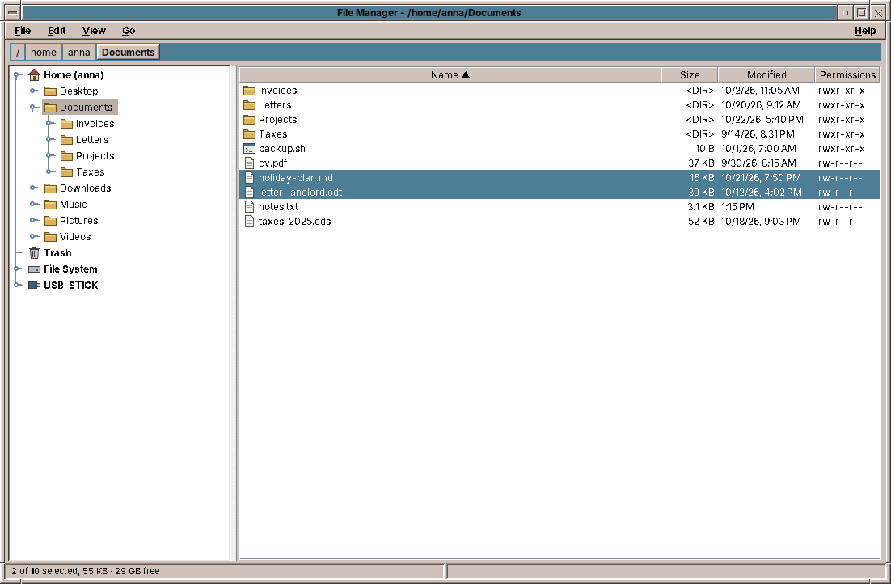
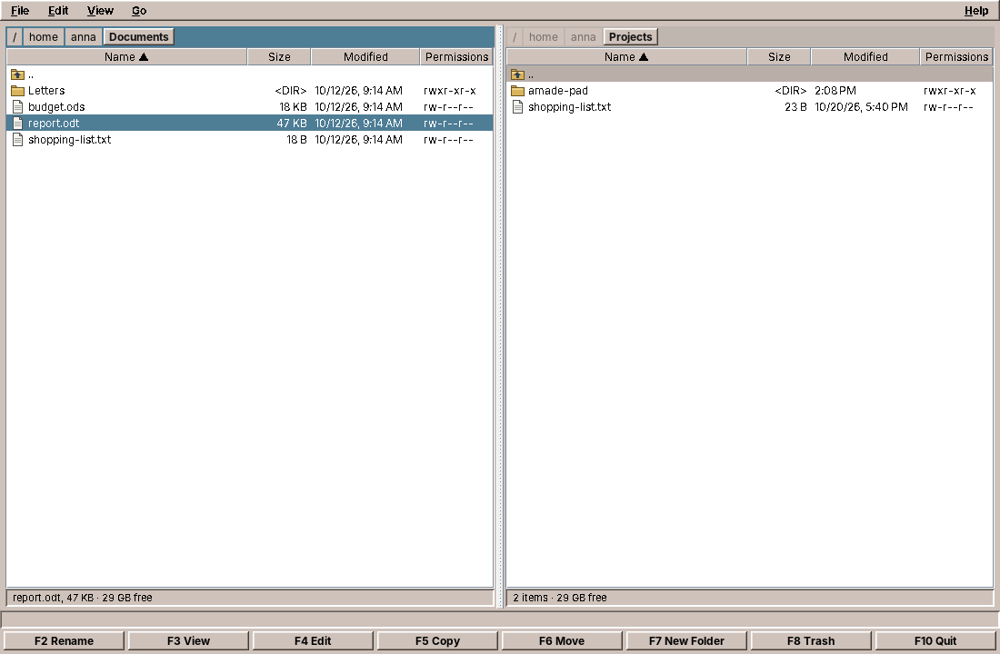
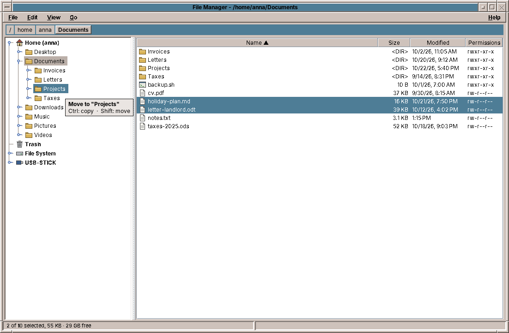
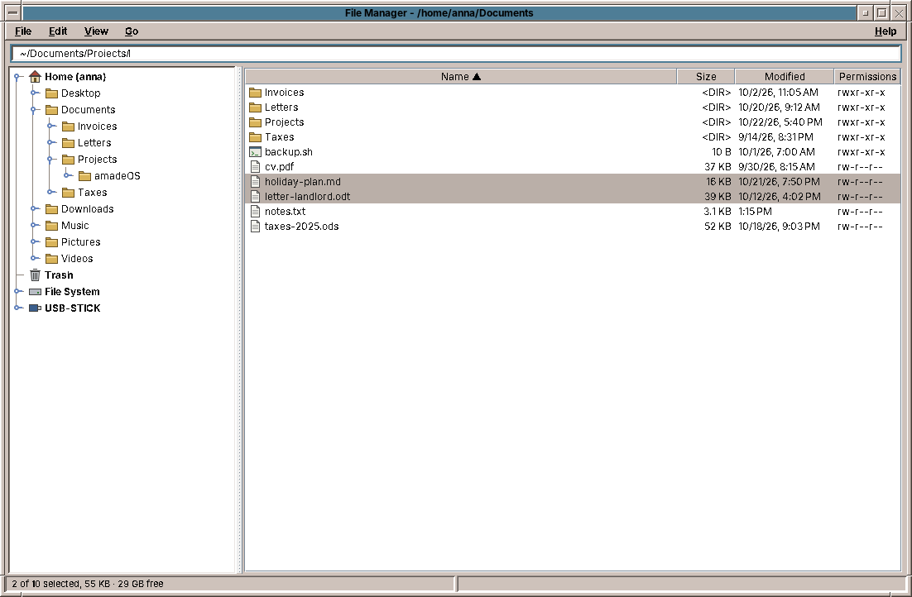
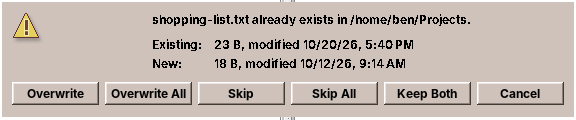
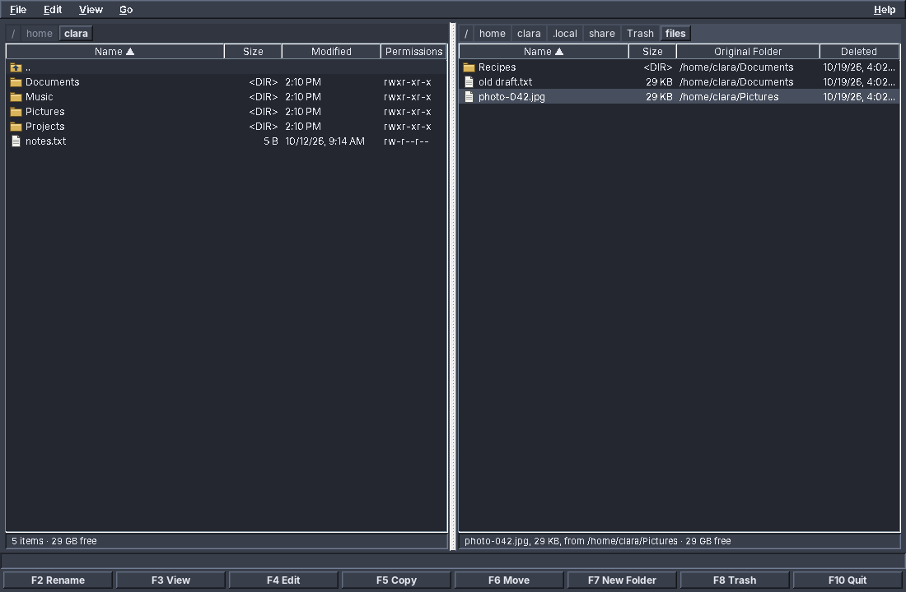

# 20. Files

Pad and Web read files the user picked. The File Manager is about the files themselves: it lists folders, copies and moves whole trees, puts things into the trash and gets them back. That brings three problems the first two programs did not have. Work can take minutes, and the user must see it progress and be able to stop it. Work can need an answer halfway through ("this file exists already, what now?"), while it runs on another thread. And mistakes destroy data, so every step must leave the disk in a state the user understands, even when it is cancelled or fails.

amade-files is also the first application in this book that remembers something between two runs: which folders were open and how the user likes to see them. And it is the first that exchanges data with other programs in both directions: files go to the clipboard and come from it, and they are dragged in and out of the window.

## What you build



- **Two views of the same files.** The *tree view*, the default, has a folder tree on the left (home, trash, the file system and USB sticks at the top) and the contents of the chosen folder on the right, as most file managers today have it. Its commands are on the right mouse button, in the Edit menu and in drag and drop. The *two-panel view* shows two folders side by side, with the row of function keys below, in the tradition of the two-panel file managers of the 1980s and 1990s. *View → Tree* (Ctrl+1) and *View → Two Panels* (Ctrl+2) switch.

    

- **The keyboard first** in both views: Enter opens, Backspace goes up, Insert or Space marks lines; F2 renames, F3 views, F4 edits, F5 copies, F6 moves, F7 makes a folder, F8 moves to the trash.
- **Cut, Copy and Paste** of files, through the clipboard of the desktop: files copied here can be pasted in other file managers, and the other way round.
- **Drag and drop**: onto a folder in the tree or the table, from and to other programs. Without a key, files move on the same disk and are copied onto another one; Ctrl copies, Shift moves.
- **A path bar** with a button per folder; a click on its free space turns it into a text field, to type or paste a path, with Tab completing folder names.
- **Copy and move** of files and whole folders, with a progress window, Cancel, and a question when a file exists in the target.
- **The trash**, compatible with other Linux desktops: what amade-files trashes, they can restore, and the other way round. Inside the trash the panel shows where each file came from.
- **Opening files**: plain text goes to Pad, everything else to the application the desktop has for its type, with the busy cursor while it starts. Programs and launchers are not started without asking.
- **Settings** that survive: the view, hidden files on or off, one or two panels, and the folders of both panels.

The program is about 6,000 lines of Java and 1,500 lines of tests: the largest so far. Most of it is in two services, file operations and the trash, and in the Swing classes that make the tree and drag and drop work.

## What you will learn

- How to show a folder in a `JTable`, and how to take keys away from a component that has its own ideas about them.
- How to save settings in a file the safe way, with what amade-commons provides.
- How to run an operation that takes minutes: progress, cancellation, and a worker thread that has to ask the user a question.
- How to copy a file so that a cancelled or failed copy never leaves a broken file behind.
- How the freedesktop.org trash works, and how to test code that depends on the clock.
- How a program starts another one, and how the window manager learns about it.
- How to build a `JTree` that reads its folders only when they are opened, and update it without closing what the user opened.
- How files travel on the X11 clipboard and in drag and drop, in formats that other programs understand.
- How a `TransferHandler` decides between copy and move, and what Swing does not tell it.

## The packages

Files follows the structure of chapter 2:

| Package | Classes |
|---|---|
| `domain` | `FileEntry` (one line of a panel), `FilePreferences`, `ViewMode`, `Place`, `ClipboardFiles`, `DropMode`, `Progress`, `Resolution`, `SortOrder`, `TrashInfo`, `Side` |
| `repository` | `PreferencesRepository` |
| `service` | `FileSystemService` (list, create, rename, places), `FileOperations` (copy, move, delete), `TrashService`, `Opener`, `FileUris`, `PathCompletion`, `Formats` |
| `ui.main` | `MainView`, `MainPresenter`, `MainWindow`, `MainMenuBar`, `ContextMenus`, `DropHint` |
| `ui.panel`, `ui.dialogs` | `FilePanel`, `FileTableModel`, `FolderTree`, `IconicPathBar`, `FileTransfer`, `FileDropHandler`, `ProgressDialog`, `ConflictDialog` |

Unlike Web, Files has a presenter again, and it is the biggest class of the program. It has a lot to decide: what each panel shows, which lines a command acts on, where a drop goes, what to ask before deleting, what to say afterwards. `MainPresenterTest` checks all of it without a window, with the fake view of chapter 10.

## Settings that survive

When the File Manager closes, it writes down five things: the view (tree or two panels), whether hidden files are shown, whether there are two panels, and the folder of each panel. They form a record, as everything in the domain does:

```java title="amade-files · domain/FilePreferences.java"
--8<-- "amade-files/src/main/java/eu/amadeos/apps/files/domain/FilePreferences.java"
```

A record cannot change, so changing one setting makes a new record with the *with-er* methods: `preferences.withShowHidden(true)`. The presenter keeps the current record in a field and replaces it.

The repository turns the record into a file and back:

```java title="amade-files · repository/PreferencesRepository.java"
--8<-- "amade-files/src/main/java/eu/amadeos/apps/files/repository/PreferencesRepository.java"
```

Two parts of amade-commons do the work:

- **`AppDirectories`** knows where the application keeps its files. `CommonsModule` binds it for every application, built from the `configName` in the application's `AppInfo` (`"files"`), so the file is `~/.config/amadeos/files/files.conf`. The XDG variables (`XDG_CONFIG_HOME`, `XDG_CACHE_HOME`) are respected.

    ```java title="amade-commons · config/AppDirectories.java"
    --8<-- "amade-commons/src/main/java/eu/amadeos/commons/config/AppDirectories.java"
    ```

- **`PropertiesFile`** reads and writes a `.properties` file in UTF-8. Writing uses the pattern of chapter 10: a temporary file in the same folder, then an atomic rename, so a crash never leaves half a settings file. The file is readable by its owner only (`rw-------`), because some applications keep things there that are nobody else's business: Mail keeps its accounts in such a file, with servers and user names (the passwords go to the keyring, chapter 22).

    ```java title="amade-commons · config/PropertiesFile.java"
    --8<-- "amade-commons/src/main/java/eu/amadeos/commons/config/PropertiesFile.java"
    ```

Why a properties file and not JSON or XML? Settings are a handful of keys and values. A properties file is in the JDK, a user can read and fix it with a text editor, and a missing or unknown key is no error: `load` simply falls back to the default for each key it does not find. That makes new versions of the program easy, which add keys, and old versions, which ignore them.

Files is the first application in this book to use these two parts, but not their first user: they were in amade-commons already, and Calendar and Mail have a `PreferencesRepository` built the same way. Three programs with the same need is the reason the parts are in the library.

!!! warning "Pitfall: settings that stop the program"
    A settings file can be broken: a disk full while another program wrote it, an edit by hand. If reading it throws and the exception reaches `main`, the program does not start, and the user has no idea why. `MainPresenter.start` catches the error, logs it and goes on with the defaults; `exit` does the same when saving fails. Settings are a convenience, never a reason to stop.

## A folder in a table

Each panel is a `JTable` over a `FileTableModel`, a list of `FileEntry` records. Reading a folder goes to the background, as everything that touches the disk does, and the presenter uses the generation counter you know from Web: a listing that arrives after the user went on to another folder is dropped.

```java title="amade-files · ui/main/MainPresenter.java (load)"
--8<-- "amade-files/src/main/java/eu/amadeos/apps/files/ui/main/MainPresenter.java:load"
```

Two details are new. The error handler falls back to an existing parent folder if the folder to show is gone, for example a USB stick that was removed since the last run. And the trash is just a folder for `load`: if `TrashService` recognises it, the entries get their origin, and the view switches the last two columns from *Modified* and *Permissions* to *Original Folder* and *Deleted*.

### Keys the table wants for itself

`JTable` comes with key bindings: F2 starts editing a cell, Ctrl+A selects all rows, Enter moves to the next row, Tab to the next cell. A file manager needs every one of these keys for something else. Swing finds a key in the focused component's *input map* before it looks at the menu's accelerators, so the table must be told:

```java title="amade-files · ui/panel/FilePanel.java"
--8<-- "amade-files/src/main/java/eu/amadeos/apps/files/ui/panel/FilePanel.java:keys"
```

Binding a key to the action name `"none"`, which no action map contains, removes the table's binding, and the key goes on to the menu bar, where F2 means *Rename*.

The *marks* (Insert, Space) are kept in the model, separate from the table's selection, which serves as the cursor. That is how two-panel file managers work: you mark ten files, move the cursor somewhere else to look, and the marks stay.

## Two views, one presenter

The tree view looks like a different program, but it is not one. Its right side is the left `FilePanel` of the two-panel view, in *explorer mode*: no ".." line, a plain click selects one line and drops the marks, Ctrl+click and Shift+click add to them. The tree on the left is new. Switching the view only rearranges components in `MainWindow` and hides the function keys; the presenter keeps its two `PanelState`s and does not care where they are shown.

There is one new thing the presenter has to know. In the two-panel view, a command works on the marked lines or the line under the cursor. In the tree view, the user can also choose a folder in the tree and press F2 or Ctrl+C there. So the presenter remembers that folder while the tree has the focus, and every command asks one method what it works on:

```java title="amade-files · ui/main/MainPresenter.java (targets)"
--8<-- "amade-files/src/main/java/eu/amadeos/apps/files/ui/main/MainPresenter.java:targets"
```

Because all commands go through `targets`, *Rename*, *Copy*, *Move to Trash* and the others work in the tree without a line of extra code. Some folders in the tree must not be touched at all: Home, the trash, the file system and the mounted media are *places*, and the presenter refuses to rename, move or delete them, with a message instead of an error.

## A tree of folders



A folder tree cannot be read in one go: the file system has hundreds of thousands of folders, and a network share or a sleeping disk can take seconds to answer. So `FolderTree` reads a folder when it is opened for the first time, on a worker thread like every listing. Until then, the node has one child, a placeholder "…", so that `JTree` draws the handle that lets the user open it:

```java title="amade-files · ui/panel/FolderTree.java (FolderNode)"
--8<-- "amade-files/src/main/java/eu/amadeos/apps/files/ui/panel/FolderTree.java:lazy-node"
```

A `TreeWillExpandListener` asks the presenter for the sub-folders (`expandFolder`), which reads them in the background and answers with `view.showFolders(dir, folders)`. The trash has no placeholder: it is a place for files, not for folders.

Reading a folder again, after a copy or when hidden files are switched on, is harder than reading it the first time. The easy way, removing all children and adding the new ones, closes every folder the user had opened below, and for a moment leaves the node without children, which makes `JTree` close the node itself. `update` changes only what changed, and it inserts before it removes:

```java title="amade-files · ui/panel/FolderTree.java (update)"
--8<-- "amade-files/src/main/java/eu/amadeos/apps/files/ui/panel/FolderTree.java:update"
```

Nodes that stay are the same objects, with their own children and their open or closed state. The model's `insertNodeInto` and `removeNodeFromParent` tell the tree exactly which rows changed, so it keeps the selection and the scroll position too.

The top level is updated the same way. `MainWindow` asks the presenter for the places every three seconds; the media come from `/proc/self/mounts`, everything mounted below `/media`, `/run/media` and `/mnt`. A USB stick appears in the tree a moment after it is plugged in, and disappears when it is removed, without a library that watches the hardware.

!!! warning "Pitfall: the tree and the table want the same keys"
    `JTree` has its own bindings for F2 (edit the node), Ctrl+C, Ctrl+X and Ctrl+V (Swing's own clipboard of nodes) and Ctrl+A. As in the table, `FolderTree` maps them to `"none"`, so they reach the Edit menu, and Rename or Copy work on the folder the tree has chosen.

## Files on the clipboard

Ctrl+C on a file does not copy the file. It puts its *name* on the clipboard, with the promise that a later Paste copies the file, wherever that is. On X11, the clipboard is not a store but a conversation: the program that copied keeps the data and answers when another program asks for it, in a format the other one names. For files, the Linux desktops agree on two formats:

- `text/uri-list`, defined in RFC 2483: one `file:///home/anna/Documents/report.odt` per line. Java offers a list of `File`s as `DataFlavor.javaFileListFlavor`, and AWT converts it to this format when another program asks.
- `x-special/gnome-copied-files`: the word `copy` or `cut`, then the same URIs. It is how the GTK file managers tell Cut from Copy, and the others read it too.

`FileUris` writes and reads both formats, and has its own tests, as a service without Swing. `FileTransfer` offers them, with the plain paths as text for programs like Pad that only take text. AWT knows nothing about the GNOME format, and by default it would announce a Java flavour under an encoded name that no other program asks for. One registration gives it the plain name:

```java title="amade-files · ui/panel/FileTransfer.java"
--8<-- "amade-files/src/main/java/eu/amadeos/apps/files/ui/panel/FileTransfer.java:flavor-map"
```

Reading goes the other way round: the GNOME format first, because it knows Cut, then the Java file list, then any `text/uri-list` as text. Paste then goes through the same operation as F5 and F6, with progress, cancel and the conflict question:

```java title="amade-files · ui/main/MainPresenter.java (pasteInto)"
--8<-- "amade-files/src/main/java/eu/amadeos/apps/files/ui/main/MainPresenter.java:paste"
```

Cut files are pasted once: afterwards the presenter empties the clipboard, because the files are no longer where it says. Pasting into the folder the files came from makes copies beside them, *report (2).odt*, as the conflict rule *Keep Both* does.

To test this you need a second program on the clipboard. On any X11 desktop `xclip` is enough: copy a file in amade-files, then `xclip -selection clipboard -t TARGETS -o` lists the formats offered, and `xclip -selection clipboard -t x-special/gnome-copied-files -o` shows the text another file manager receives.

## Drag and drop

Swing's drag and drop is built on one class, `TransferHandler`. A component that has one can be a drag source (`createTransferable`) and a drop target (`canImport`, `importData`). The table and the tree each need one, and the two differ only in where a drop goes and which files a drag takes along, so the common part is the abstract `FileDropHandler`, with `dropTarget` and `dragged` for the two subclasses. The transferable it creates is the same `FileTransfer` as the clipboard's, which is why files dragged into another program arrive there.

### Copy or move?

Every file manager has the same rule, and users rely on it: without a key, files dragged onto a folder *move* when the folder is on the same disk, and are *copied* to another disk, such as a USB stick; Ctrl forces a copy and Shift a move. Swing has the idea, but not quite this rule: a drop target sees the *user drop action*, which is MOVE without a key, and it cannot tell Shift from no key at all. The drag source can: while the drag runs, AWT tells every `DragSourceListener` which modifier keys are held. `FileDropHandler` listens once, for the whole program, and turns the keys into a `DropMode`:

```java title="amade-files · ui/panel/FileDropHandler.java (mode)"
--8<-- "amade-files/src/main/java/eu/amadeos/apps/files/ui/panel/FileDropHandler.java:mode"
```

For files from another program there is no drag source in our process, so Ctrl is all we can know. *AUTO* then decides by the disk, just as for our own drags.

### Asking before the drop

While the mouse moves, Swing calls `canImport` again and again. Its answer decides the mouse cursor, and here it also decides the hint next to the mouse: *Move to "Projects"*, *Copy to "USB-STICK"*, *Move to Trash*. The text comes from the presenter, which also says where a drop is not possible: a folder into itself, files back to where they are. `canImport` only asks and remembers:

```java title="amade-files · ui/panel/FileDropHandler.java (canImport)"
--8<-- "amade-files/src/main/java/eu/amadeos/apps/files/ui/panel/FileDropHandler.java:can-import"
```

Two details matter here. The answer is cached per target and mode, because `canImport` comes many times a second and reading a transfer from another program goes through the X server. And a drop from another program is always reported as COPY, whatever we do with the files: a program that receives MOVE deletes its own copy after the drop, and if our move then failed or was cancelled, the files would be gone. The presenter does the move itself, with the same care as F6.

The presenter's side is short, because the operations are there already:

```java title="amade-files · ui/main/MainPresenter.java (drop)"
--8<-- "amade-files/src/main/java/eu/amadeos/apps/files/ui/main/MainPresenter.java:drop"
```

`importData` does not call `drop` directly but with `SwingUtilities.invokeLater`. The drop is still running when `importData` is called, and the operation may open a dialog, the conflict question: a modal dialog inside a drop blocks the drag of the other program until it is closed. After `invokeLater`, the drop is finished first.

### Folders that open by themselves

To drag a file into a folder deep down in the tree, the user would have to open the folders first, and then find the file again. Other file managers open a closed folder when the mouse rests on it during a drag, and so does `FolderTree`: its drop handler restarts an 800 ms `Timer` whenever the row under the mouse changes, and when it fires, the row expands. Escape cancels the drag, as everywhere in AWT.

!!! warning "Pitfall: the hint must go when the drag leaves"
    `TransferHandler` tells a component when a drag comes in (`canImport`), but not when it leaves or is cancelled. Without care, the hint stays on the screen. `FileDropHandler.install` adds a `DropTargetListener` to the component's drop target, which does get `dragExit` and `drop`. The hint is drawn in the `DRAG_LAYER` of the window's `JLayeredPane`, above everything else, and that listener removes it.

## Typing a path



`IconicPathBar` has a button for each folder above the current one, as the CDE File Manager had. Sometimes a path is quicker to type, or comes from somewhere else, a mail or a terminal. A click on the free space of the bar, or Ctrl+L, replaces the buttons with a `JTextField` that holds the path, selected. Enter goes there, Escape goes back, and Tab completes the last folder name, as a shell does: `PathCompletion.complete` lists the folder, takes the folders whose name starts with what was typed, and completes as far as they agree. It knows `~` and paths relative to the shown folder, and shows hidden folders only after a dot was typed. Its context menu has *Copy Path*, which puts the path on the clipboard as text.

The text field takes Tab for itself with `setFocusTraversalKeysEnabled(false)`, the same thing `FolderTree` does to make Tab go from the tree to the contents.

## Long operations

Copying 20 GB of photos to a USB stick takes minutes. During that time the user wants to see how far it is, be able to stop it, and decide what happens when a file exists in the target. All of this crosses the line between the EDT and the worker thread, in both directions. The design starts with an interface the service talks to while it works:

```java title="amade-files · service/OperationListener.java"
--8<-- "amade-files/src/main/java/eu/amadeos/apps/files/service/OperationListener.java"
```

`FileOperations` knows nothing about windows: it calls `progress` now and then, `conflict` when a file is in the way, and asks `isCancelled` between files and between blocks of a large file. A test passes a listener that records; the presenter passes one that talks to the user.

### Reporting, but not too often

A copy of many small files finishes thousands of files a second. If each one became a progress report, and each report a task on the EDT, the event queue would fill faster than the EDT can paint, and the window would freeze precisely while it is supposed to show progress. So the reports are throttled:

```java title="amade-files · service/FileOperations.java (reporting)"
--8<-- "amade-files/src/main/java/eu/amadeos/apps/files/service/FileOperations.java:report"
```

At most twenty reports a second reach the window, which is as fast as anyone can read. The last report always goes out, so the bar ends full. Each report is a `Progress` record, immutable, so it can cross to the EDT safely.

The dialog itself waits before it appears:

```java title="amade-files · ui/dialogs/ProgressDialog.java"
--8<-- "amade-files/src/main/java/eu/amadeos/apps/files/ui/dialogs/ProgressDialog.java:delay"
```

Copying three small files takes a few milliseconds. A window that flashes up and vanishes in that time looks like an error. With a delay of 400 ms, quick operations show only the result in the status line, and slow ones get their progress window.

### Cancelling

Java has no safe way to stop a thread from outside. Cancelling is a request: the Cancel button sets an `AtomicBoolean`, `isCancelled` reads it, and the service checks it at points where stopping is safe. When it finds the flag set, it throws `OperationCancelledException`, which unwinds the whole operation and ends in the presenter with "Copying cancelled." What was copied stays copied; what was not, is not. The interesting case is the file in the middle.

### A copy that is never half a file

If a copy of a 4 GB video is cancelled at 60 %, the target folder must not contain a file with the right name and 2.4 GB of content: the user would find it a month later and think it is the video. `copyContent` writes into a hidden temporary file and gives it the real name only when it is complete:

```java title="amade-files · service/FileOperations.java (copyContent)"
--8<-- "amade-files/src/main/java/eu/amadeos/apps/files/service/FileOperations.java:copy-content"
```

- `FileChannel.transferTo` lets the operating system copy the bytes, often without them ever passing through Java. It copies in blocks of 4 MB, so cancellation and progress get a chance between blocks.
- `CREATE_NEW` fails if the temporary file exists; with a random name it never does, unless something is badly wrong.
- The rename with `ATOMIC_MOVE` also replaces an existing file in one step. When the user chose *Overwrite*, the old file is there until the new one is complete, then the name points to the new one. There is no moment without either.
- Every way out, an `IOException` or the cancellation (a `RuntimeException`), deletes the temporary file.

It is the same pattern Pad uses to save, and `PropertiesFile` to write settings: a careful program never writes over the only copy of something.

Moving has its own rule. Within one file system, a move is a rename, which takes no time even for a folder of 100,000 files, so `FileOperations` tries that first. Across file systems, it copies each file and deletes the source only after its copy is complete. A cancelled move leaves every file in exactly one complete place.

### Asking a question from the worker

A file exists in the target. The service is on a worker thread, deep inside a folder tree; the dialog must open on the EDT. The worker has to wait for the answer, because what it does next depends on it. Here is the presenter's side:

```java title="amade-files · ui/main/MainPresenter.java (runOperation)"
--8<-- "amade-files/src/main/java/eu/amadeos/apps/files/ui/main/MainPresenter.java:run-operation"
```



`onEdtAndWait` hands the question to the EDT with `CompletableFuture.supplyAsync(question, edt)` and blocks the worker in `join()` until the user answers. Meanwhile the EDT is free: it shows the dialog, and it paints and reacts as usual. Nothing on the EDT ever waits for the worker, only the other way round.

The listener also remembers *Overwrite All* and *Skip All* in `forAll`. That field lives in the anonymous class and is only touched by the worker thread, so it needs no synchronisation. The answers the user can give are a `Resolution` (`OVERWRITE`, `SKIP`, `KEEP_BOTH`, `CANCEL`), from the domain, so the service can act on them without knowing a dialog exists.

!!! warning "Pitfall: waiting for the EDT on the EDT"
    `onEdtAndWait` must only be called from a worker. Called on the EDT, it would put the question at the end of the EDT's queue and then block the EDT until the question is answered: the question never runs, and the program hangs for good. Swing's own `SwingUtilities.invokeAndWait` throws an `Error` in that case, which is at least a clear message. When you write a method that waits for the EDT, write down in its comment which thread may call it, as `OperationListener` does ("Called on the worker thread").

The presenter also allows only one operation at a time (`busy`). Two copies running into the same folder would ask about each other's half-finished files, and the user would not know which question belongs to which.

## The trash

Deleting a file is the one operation a user cannot undo. So F8 does not delete: it moves the file to the trash, without asking, because that can be undone. Only Shift+F8 deletes for good, and it asks first. The confirmations follow a simple rule: ask before what cannot be undone, never before what can.

Linux desktops share one trash, described by the [freedesktop.org Trash specification](https://specifications.freedesktop.org/trash-spec/latest/). It is a folder with two subfolders:

```text
~/.local/share/Trash/
├── files/
│   └── report.odt                ← the trashed file itself
└── info/
    └── report.odt.trashinfo      ← where it came from and when
```



The `.trashinfo` file is three lines of text:

```java title="amade-files · service/TrashService.java (trashInfo)"
--8<-- "amade-files/src/main/java/eu/amadeos/apps/files/service/TrashService.java:trash-info"
```

Because every desktop follows the same specification, a file trashed in amade-files appears in the trash of any other desktop and of `gio trash --list`, and the other way round. Here is how a file gets in:

```java title="amade-files · service/TrashService.java (trash)"
--8<-- "amade-files/src/main/java/eu/amadeos/apps/files/service/TrashService.java:trash"
```

- **The info file comes first, with `CREATE_NEW`.** Creating a file that must not exist is an atomic operation of the file system. If two programs trash a `report.odt` at the same moment, exactly one of them gets `report.odt.trashinfo`, and the other gets `FileAlreadyExistsException` and tries `report.2.odt`. The info file reserves the name; only then is the file moved.
- **If the move fails, the info file is removed again**, so the trash never lists a file that is not there.
- **Every file system has its own trash.** A file on a USB stick does not go to the home folder's trash: that would copy gigabytes, and the space would not be freed on the stick. `locate` finds the stick's own trash, `.Trash-1000` at its top (1000 being the user's id), and the path in the info file is then relative to the stick, so it stays right wherever the stick is mounted next time.

Restoring reads the info file and moves the file back, creating missing folders on the way. It refuses to overwrite a file that is there now: a restore must never destroy something new.

### Testing with a clock

The deletion date in the info file comes from `LocalDateTime.now(clock)`. The production constructor passes the system clock; the test constructor takes any `Clock`, and the test passes one that stands still:

```java title="amade-files · TrashServiceTest.java"
--8<-- "amade-files/src/test/java/eu/amadeos/apps/files/service/TrashServiceTest.java:home-trash"
```

`setUp` builds the service with `Clock.fixed(Instant.parse("2026-10-13T18:15:30Z"), ZoneOffset.UTC)` and a trash in the test's temporary folder, so the test can compare the whole info file, byte for byte. Any code that reads the time, in any application, can be tested like this: take a `Clock` in the constructor instead of calling `now()` yourself.

## Opening files

Double-click a file, and it should open in the right program. `Opener` decides which:

```java title="amade-files · service/Opener.java (open)"
--8<-- "amade-files/src/main/java/eu/amadeos/apps/files/service/Opener.java:open"
```

Plain text goes to Pad, as the CDE File Manager opened text in its own editor. "Plain text" means: the file name suggests `text/plain` or nothing at all (log files, `.bashrc`, a `README` without extension), and the first 8 KB contain no NUL byte and hardly any control characters. HTML, SVG or CSV are text too, but they have a program of their own. Everything else goes to `DesktopLauncher.open` from chapter 11, which asks `xdg-open`.

Before any of this, the presenter checks whether the file could run a program:

```java title="amade-files · ui/main/MainPresenter.java (canRunProgram)"
--8<-- "amade-files/src/main/java/eu/amadeos/apps/files/ui/main/MainPresenter.java:can-run"
```

An executable file, a shell script, a `.desktop` launcher: double-clicking it would *run* it. Mail never opens such files at all (chapter 11). A file manager must be able to, since starting programs is part of its job, but only after a question. `DesktopLauncher.isRisky` is the same list in both programs, kept in amade-commons, so the two cannot disagree about what is dangerous.

### The busy cursor

Starting Pad takes a second or two: the JVM starts, Swing loads, the theme is read. Without a sign, the user double-clicks again and gets two editors. The front panel solves this for the programs it starts: the window manager shows a busy cursor until the new window appears. For a program started by another program, the window manager has to be told:

```java title="amade-files · service/Opener.java (start)"
--8<-- "amade-files/src/main/java/eu/amadeos/apps/files/service/Opener.java:start"
```

`LaunchFeedback` is in amade-commons, and `DesktopLauncher` calls it too, so Web, Mail and Calendar get the busy cursor for every link they open. It sends one X11 message, `_AMADEOS_LAUNCH`, to the root window, where the amadeOS window manager listens. The window manager shows the busy cursor until the next new window, or for 20 seconds at most.

```java title="amade-commons · desktop/LaunchFeedback.java (announce)"
--8<-- "amade-commons/src/main/java/eu/amadeos/commons/desktop/LaunchFeedback.java:announce"
```

Java has no API for X11 messages, so `LaunchFeedback` calls five functions of the C library `libX11` directly, through the *foreign function and memory API* that Java has had since version 22: it looks up `XOpenDisplay`, `XSendEvent` and the others, and fills the C structure of the event in a `MemorySegment`. No JNI, no C compiler, no native library of our own.

Calling C code can crash the JVM, so Java asks the application for permission: native access must be enabled, or the JDK prints a warning on the first call. An application allows it in its jar's manifest:

```groovy title="amade-files · build.gradle (jar manifest)"
--8<-- "amade-files/build.gradle:native-access"
```

`announce` checks first whether the permission was given, and does nothing otherwise. A program that does not know about `LaunchFeedback`, or runs without X11, loses nothing but the cursor. *Never throws* is the contract: the busy cursor is a nicety, and a nicety must never stop a file from opening.

## Testing

The service tests work in a temporary folder (JUnit's `@TempDir`) on the real file system: copying, merging folders, links copied as links, moving across file systems. Their listener answers conflicts from a list and records every report:

```java title="amade-files · FileOperationsTest.java (Recorder)"
--8<-- "amade-files/src/test/java/eu/amadeos/apps/files/service/FileOperationsTest.java:recorder"
```

With it, the promise of the temporary file becomes a test: cancel after the first block of a 12 MB file, and the target folder must be empty, not even a `.part` file left.

```java title="amade-files · FileOperationsTest.java"
--8<-- "amade-files/src/test/java/eu/amadeos/apps/files/service/FileOperationsTest.java:cancel-copy"
```

The presenter tests use the fake view of chapter 10 and an executor that runs tasks at once on the test's thread, both for the background and for the EDT. The whole copy with its conflict question then runs in a straight line, and the test can count the questions:

```java title="amade-files · MainPresenterTest.java"
--8<-- "amade-files/src/test/java/eu/amadeos/apps/files/ui/main/MainPresenterTest.java:conflict-all"
```

Two files exist in the target, the user answers *Overwrite All* once, and the second file is not asked about. The test checks the files on disk, not just what the view was told.

Drag and drop is hard to test with a mouse, but most of it is not in the mouse. The presenter decides what a drop does, and the test asks it, as the hint does, before dropping:

```java title="amade-files · MainPresenterTest.java"
--8<-- "amade-files/src/test/java/eu/amadeos/apps/files/ui/main/MainPresenterTest.java:drop-test"
```

What stays for a person to try is the Swing part: the hint, the keys, folders opening while dragging, and files dragged to and from another program.

## What amade-commons gives Files

| Part | Since | Files uses it for |
|---|---|---|
| `AmadeApplication`, `CommonsModule`, `EdtExecutor` | chapter 10 | start-up, wiring, the two threads |
| `AmadeUI.style`, `AmadeUI.sunken` | chapter 10 | the panels' colours in every theme, the sunken border of the tables |
| `XdgDirectories`, `AppDirectories` | **this chapter** | the settings file; the home trash under `$XDG_DATA_HOME` |
| `PropertiesFile` | **this chapter** | reading and writing `files.conf` safely |
| `DesktopLauncher` | chapter 11 | opening files with their application; `isRisky` |
| `LaunchFeedback` | **this chapter** | the busy cursor while Pad starts |

### And what stays in Files

The file operations and the trash are a large part of the program, and they are good, tested code. Do they belong in amade-commons? Not by the rule of chapter 1: no second program copies, moves or trashes files. When the front panel's Trash Can is clicked, it does not open a trash of its own: it starts `amade-files trash:`, and the File Manager shows the trash. One program that does a job well, and others that start it, is often better sharing than a library.

There is one thing Files does not do that Pad does: it speaks only English. Its texts are still in the Java code. That is a debt, and the first exercise pays it.

## Exercises

1. **Five languages.** Move the File Manager's texts into `messages.properties` with translations, as in chapter 10, including the column titles and the buttons of the conflict dialog. Which texts contain numbers ("3 of 12 selected") and need `MessageFormat`? Add a `TranslationCheck` test.
2. **Free space first.** Before copying 20 GB to a stick with 8 GB free, warn the user instead of failing at 40 %. `FileOperations` already measures the total; where does the check belong, and what if the target is on the same file system as the source?
3. **Speed and time left.** Show "12 MB/s, about 2 minutes left" in the progress window. Which class computes it, and how do you test it without waiting?
4. **Undo for Move.** After a move, *Edit → Undo* moves the files back. What must the presenter remember, and what happens if a file was changed in the meantime?
5. **Ask on drop.** Some file managers show a small menu when files are dropped with Alt held: *Move Here*, *Copy Here*, *Link Here*, *Cancel*. Add it. Which class knows that Alt was held, where does the menu open, and why must it open after the drop has ended?
6. **A watched folder.** When another program creates a file in a shown folder, the panel should update by itself. Look at `java.nio.file.WatchService`. Which thread waits for its events, and how do they reach the panel?

## Summary

- Settings are a record in the domain and a properties file on disk. `AppDirectories` says where, `PropertiesFile` writes atomically and for the owner only, and a broken file never stops the program.
- A component's input map can take keys away from the menu; mapping them to `"none"` gives them back.
- Long operations talk to a listener: progress throttled to what a person can read, cancellation as a flag checked at safe points, conflicts as a question the worker waits for while the EDT stays free.
- A copy goes into a temporary file and is renamed into place when complete, so no cancel or failure ever leaves half a file.
- The freedesktop.org trash is shared by all desktops; an info file created with `CREATE_NEW` reserves the name, and each file system has its own trash.
- Code that reads the time takes a `Clock`, so tests can stop it.
- A tree of folders reads each folder when it is opened, and updates its nodes in place, inserting before removing, so nothing the user opened closes.
- Files travel between programs as `text/uri-list` and `x-special/gnome-copied-files`. Java offers the first by itself; the second needs a name in the `SystemFlavorMap`.
- A `TransferHandler` cannot see Shift; a `DragSourceListener` can. Drops from other programs are reported as copies, so the other program never deletes anything.
- `LaunchFeedback` calls Xlib through the foreign function API to show the busy cursor; the application must allow native access in its manifest.
- Code with one user stays with that user. Sometimes the best way to share a feature is to start the program that has it.

The next chapter keeps settings too, but its data is time itself: Calendar, with time zones, repeating appointments and the first printed page.
