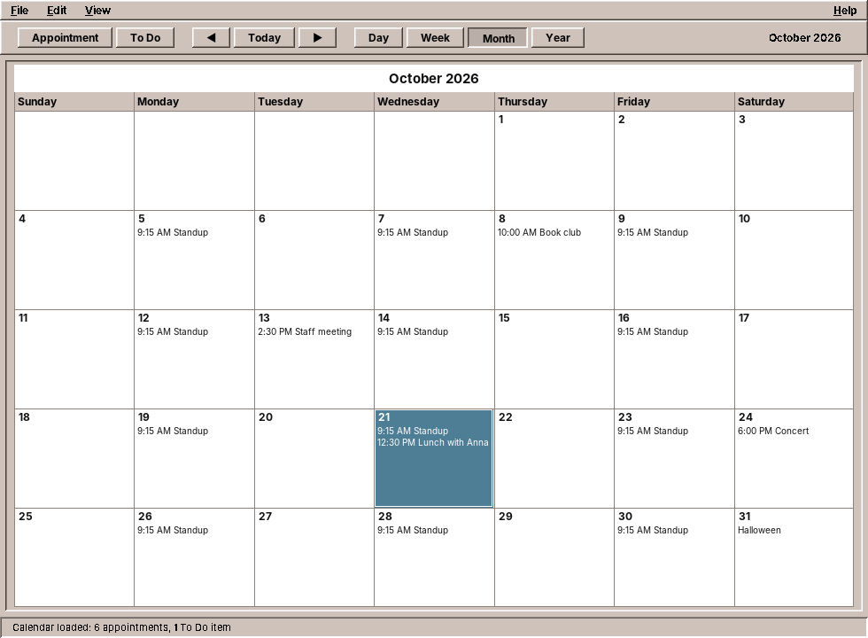
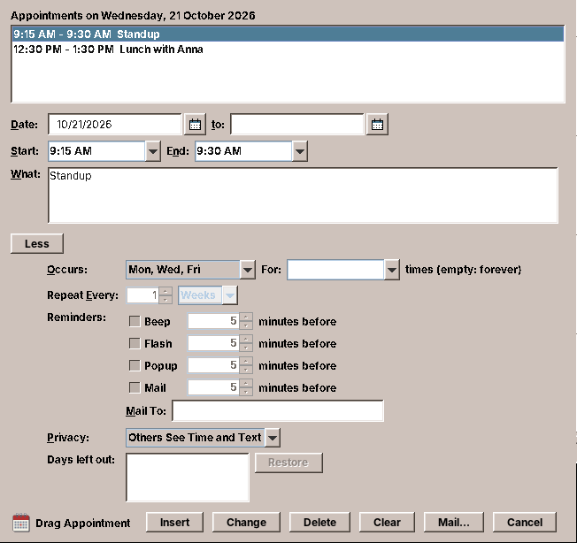
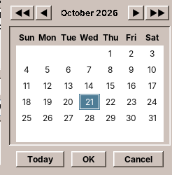
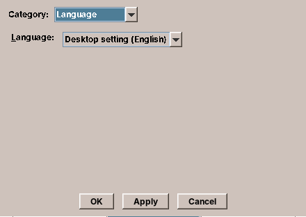
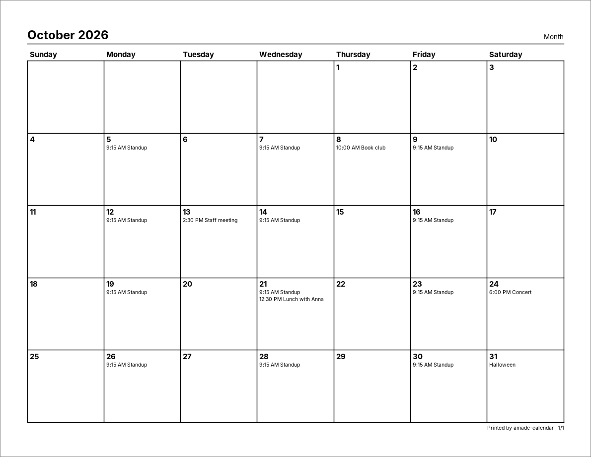

# 21. Calendar

A calendar looks like a simple program: a grid of days with some text in it. The difficulty is hidden in the data. "Every second Tuesday" has to be turned into dates. "Every 31st" meets February. One meeting of a weekly series moves to Thursday, and the series must not move with it. A colleague sends an invitation in another time zone. And everything has to be stored in a file that other calendar programs can read.

amade-calendar is modelled on the CDE Calendar (`dtcm`): four views, an Appointment Editor with *More* options, reminders, and printed pages. This chapter follows the data from the record in memory to the file on disk and the sheet of paper, and adds two parts of amade-commons for dialogs: a date chooser and a language chooser.

## What you build



- **Day, Week, Month and Year views**, drawn with Java2D in the colours of the theme.
- **The Appointment Editor**: date, start, end, text; behind *More* the repeat ("Occurs"), reminders and privacy.
- **Repeating appointments**: daily, weekly on chosen days, monthly by date or by weekday ("second Tuesday"), yearly, every *n* days, weeks or months; for a number of times or for ever.
- **Changing one occurrence** of a series, this one and the following ones, or all of them, as dtcm asked.
- **Reminders**: a beep, a flashing window, a popup or a mail, some minutes before.
- **One iCalendar file** that other programs can read, and import of `.ics` files and dtcm text.
- **Printing** of the day, week, month and year, and of appointment and To Do lists.
- **Options**: defaults for new appointments, the date format, the printer, the language.

The program is about 7,000 lines of Java and 1,700 lines of tests, a big step up from Files. Most of the size is in the editor dialog, the four views and the printed pages; the core of this chapter, the domain and its services, is about a fifth of it.

## What you will learn

- How to model dates and times with `java.time`, and when a time needs no time zone.
- How to turn a repeat rule into dates, including the dates that do not exist.
- How to change one occurrence of a series without changing the others.
- How to read and write iCalendar, and keep what you do not understand.
- How to save in the background so that the newest state always wins.
- How to check reminders with a Swing `Timer`, and test them with a clock you control.
- How to print with `java.awt.print`, and test printing without a printer.

## Time without a time zone

Java has two date libraries. The old one, `java.util.Date` and `Calendar`, has mutable objects, months counted from 0 and a time zone hidden inside every value. Do not use it in new code. The new one, `java.time` (Java 8 and later), separates what the old one mixed up:

| Class | Holds | Example |
|---|---|---|
| `LocalDate` | A day | 2026-10-21 |
| `LocalTime` | A time of day | 09:15 |
| `LocalDateTime` | Both, on no particular clock | 2026-10-21T09:15 |
| `ZonedDateTime` | Both, in a time zone | 2026-10-21T09:15+02:00[Europe/Berlin] |
| `Instant` | A moment, the same everywhere | 2026-10-21T07:15:00Z |
| `Duration` | A length of time | 15 minutes |

Which one is right for an appointment? dtcm stored local wall-clock times: "dentist at 9:15" means 9:15 wherever you are. iCalendar calls these *floating* times. amade-calendar does the same, so an appointment is a `LocalDate` with an optional `LocalTime`:

```java title="amade-calendar · domain/Appointment.java"
--8<-- "amade-calendar/src/main/java/eu/amadeos/apps/calendar/domain/Appointment.java:record"
```

Notice what the record says by its types and its compact constructor:

- `start == null` is an appointment without a time, a note on a day such as "Halloween". It cannot have an end, so the constructor clears `end`.
- An end that is not after the start is no end.
- The lists and the set are copied with `List.copyOf` and `Set.copyOf`: the record cannot be changed through a list someone else still holds.
- `excluded` and `recurrenceId` belong to repeating appointments; we come back to them below.

The constructor *normalises* instead of throwing: a record that exists is always valid, whatever the editor or a file handed it. Code that uses an `Appointment` never has to check whether `end` makes sense.

!!! note "Note: floating times and travel"
    Floating times are simple, and they are what a personal calendar needs most: lunch is at 12:30 on holiday too. They are wrong for a video call with someone in another zone, which should move when you travel. A calendar for teams would store such appointments as `ZonedDateTime`. amade-calendar converts zoned times from other programs to the local zone when it reads them (see [below](#reading-what-others-wrote)), and the exercises ask how to keep the zone instead.

## Repeating appointments



A repeat is another record, the part of the iCalendar `RRULE` that dtcm's *Occurs* menu can express:

```java
public record Repeat(Frequency frequency, int interval, Set<DayOfWeek> byDay,
                     boolean byWeekdayOfMonth, int count, LocalDate until)
```

The calendar never stores the dates of a series, only the rule. To show October, the views ask: on which days between October 1 and October 31 does this appointment take place?

```java title="amade-calendar · domain/Repeat.java (occurrences)"
--8<-- "amade-calendar/src/main/java/eu/amadeos/apps/calendar/domain/Repeat.java:occurrences"
```

The loop walks the series from its first date, counts each occurrence (for `count`), and keeps those in the range. Two details make it robust:

- **`MAX_STEPS`.** A rule with a bug in it, or from a broken file, must never make the program loop for ever. 100,000 steps are 270 years of a daily appointment.
- **Dates that do not exist.** The nth repetition comes from `nth`, which returns `null` when the period has no such day:

```java title="amade-calendar · domain/Repeat.java (nth)"
--8<-- "amade-calendar/src/main/java/eu/amadeos/apps/calendar/domain/Repeat.java:nth"
```

"Monthly on the 31st" has no date in February, April, June, September and November. Should it move to the 30th, or the last day of the month? dtcm skipped those months, and so does amade-calendar; iCalendar says the same. Note `first.withDayOfMonth(1).plusMonths(n)`: adding months to January 31 itself would give February 28 in `java.time`, which silently clamps, and from then on the series would be on the 28th. Always compute the nth date from the first one, never from the previous one.

The tests check exactly these edges:

```java title="amade-calendar · RepeatTest.java"
--8<-- "amade-calendar/src/test/java/eu/amadeos/apps/calendar/domain/RepeatTest.java:skips"
```

!!! tip "Tip: test the calendar's corners"
    Date code is right on 364 days and wrong on one. When you write it, test the 29th of February, the 31st, the last week of a month (is there a fifth Tuesday?), the change to and from daylight saving time, and a year that starts on a Sunday. The domain has no Swing, so each test runs in a millisecond.

### All occurrences of a period

`CalendarService` holds the appointments in memory and answers the views' questions. Here it turns rules into the list a view draws:

```java title="amade-calendar · service/CalendarService.java (occurrencesBetween)"
--8<-- "amade-calendar/src/main/java/eu/amadeos/apps/calendar/service/CalendarService.java:occurrences-between"
```

An `Occurrence` is a small record of an appointment and one date. The days a series leaves out (`excluded`) and the days with an exception (below) are skipped; an appointment that spans several days is put on each of them. Then the list is sorted with one `Comparator`: day, then appointments without a time first, then start time.

## Changing one occurrence

The weekly team meeting moves to Thursday this week only. The user opens it, changes the day and presses *Change*. Like dtcm, the editor asks: **This One**, **Forward** (this one and the following) or **All**? The answer is an `EditScope`, and `CalendarService.change` carries it out:

```java title="amade-calendar · service/CalendarService.java (change)"
--8<-- "amade-calendar/src/main/java/eu/amadeos/apps/calendar/service/CalendarService.java:change"
```

- **This One** makes an *exception*: a one-time appointment with the UID of the series and a `recurrenceId`, the day of the occurrence it replaces. The series stays as it is; `occurrencesBetween` skips its occurrence on that day because an exception exists for it. This is exactly how iCalendar stores it (`RECURRENCE-ID`), so other programs understand it.
- **Forward** ends the series the day before (`until`) and starts a new one with a new UID. Exceptions after the split belong to the old series and are removed.
- **All** changes the series, and moves its first day by as many days as the user moved this occurrence.

Each case is a few lines on immutable records: `withRepeat`, `withExcluded`, `asExceptionOf` make new appointments, and `put` replaces the old one under its key. The test reads like the story above:

```java title="amade-calendar · RecurrenceEditTest.java"
--8<-- "amade-calendar/src/test/java/eu/amadeos/apps/calendar/service/RecurrenceEditTest.java:this-one"
```

## iCalendar

Where should a calendar keep its data? A database would be fast, but only this program could read it. amade-calendar keeps one text file in the format every calendar program speaks, iCalendar ([RFC 5545](https://www.rfc-editor.org/rfc/rfc5545)):

```text
BEGIN:VCALENDAR
VERSION:2.0
PRODID:-//datazuul//amade-calendar//EN
BEGIN:VEVENT
UID:a1
DTSTART:20261005T091500
DTEND:20261005T093000
RRULE:FREQ=WEEKLY;BYDAY=MO,WE,FR
SUMMARY:Standup
END:VEVENT
END:VCALENDAR
```

A calendar of a person holds a few thousand appointments at most, a few hundred kilobytes. Reading the whole file at start-up and writing the whole file after each change takes milliseconds. A database would solve a problem the program does not have.

`IcsCodec` reads and writes the format without a library. The format is simple, with a few traps, and the codec is 560 lines including everything the editor can express. Two of the traps:

**Long lines are folded.** A line may be at most 75 *octets* long; longer lines continue on the next line, which starts with a space. Octets, not characters: "ü" is two octets in UTF-8, "€" three. A writer that counts characters produces lines that are too long for strict readers; a writer that cuts at byte 75 can cut a character in half. The codec counts the bytes of each character and folds between characters:

```java title="amade-calendar · repository/IcsCodec.java (fold)"
--8<-- "amade-calendar/src/main/java/eu/amadeos/apps/calendar/repository/IcsCodec.java:fold"
```

**What the program does not understand, it keeps.** Another program may have written attendees, categories, a location or whole components (time zone definitions, journal entries) into the file. If amade-calendar dropped them on its next save, using two calendar programs on one file would destroy data. So every property the codec does not know goes into the appointment's `extra` list as a raw line, every unknown component into `CalendarData.extra`, and both are written back unchanged.

The round-trip test writes appointments, checks some lines of the text and reads it back; what comes back must equal what went in:

```java title="amade-calendar · IcsCodecTest.java"
--8<-- "amade-calendar/src/test/java/eu/amadeos/apps/calendar/repository/IcsCodecTest.java:round-trip"
```

`assertEquals` on records compares all fields, so one line catches any field that does not survive.

### Reading what others wrote

Other programs write times in UTC (`20261012T070000Z`) or with a time zone (`DTSTART;TZID=Europe/Berlin:20261012T090000`). amade-calendar converts both to the local wall-clock time of the computer:

```java title="amade-calendar · repository/IcsCodec.java (parseDateTime)"
--8<-- "amade-calendar/src/main/java/eu/amadeos/apps/calendar/repository/IcsCodec.java:parse-date-time"
```

`withZoneSameInstant` is the key method: the same moment, seen from another zone. 9:00 in Berlin is 8:00 in London. An unknown zone name is no reason to lose the appointment; its time is taken as it is.

### The file

The calendar lives in `~/.local/share/amadeos/calendar/calendar.ics`. That is the XDG *data* directory, not the *config* directory: the calendar is the user's data, not a setting, and backup tools treat the two differently. `AppDirectories` has only config and cache, so the repository takes `XdgDirectories` and builds the path itself:

```java title="amade-calendar · repository/IcsCalendarRepository.java"
--8<-- "amade-calendar/src/main/java/eu/amadeos/apps/calendar/repository/IcsCalendarRepository.java"
```

The `save` method should look familiar: temporary file, owner-only permissions, atomic rename. It is `PropertiesFile.store` from chapter 20, written out a second time. We come back to that at the end of the chapter.

## Saving in the background, in order

Every change in the editor saves the whole calendar. Writing takes a few milliseconds, which is too long for the EDT if the disk is slow or a network folder. So the presenter takes a snapshot on the EDT and writes it on a background thread:

```java title="amade-calendar · ui/main/MainPresenter.java (save)"
--8<-- "amade-calendar/src/main/java/eu/amadeos/apps/calendar/ui/main/MainPresenter.java:save"
```

`calendar.data()` makes an immutable `CalendarData` on the EDT. The background thread writes that snapshot, while the user goes on changing the calendar in memory.

Look at `saving.thenRunAsync`. The first version of this method, written while the program was young, simply did `executor.execute(...)`. With the virtual-thread executor of amade-commons, every task gets its own thread, and two threads started one after the other can run in either order. Insert an appointment and quickly delete another: two saves start, and if the first one, the older state, happens to finish last, the file holds the calendar without the deletion. The `synchronized` on `IcsCalendarRepository.save` does not help. It makes sure the two writes do not mix, not which one comes last.

The bug was found while this chapter was written. The fix chains the saves: each one starts when the previous one has finished, so they finish in the order of the changes. Exiting waits for the chain, with a limit of five seconds:

```java title="amade-calendar · ui/main/MainPresenter.java (exit)"
--8<-- "amade-calendar/src/main/java/eu/amadeos/apps/calendar/ui/main/MainPresenter.java:exit"
```

A race like this does not show up in a test that runs tasks at once. The test for it uses an executor that only queues tasks, so the test decides when each one runs:

```java title="amade-calendar · MainPresenterTest.java"
--8<-- "amade-calendar/src/test/java/eu/amadeos/apps/calendar/ui/main/MainPresenterTest.java:save-order"
```

With the old `save`, both tasks are in the queue at once, and the test fails on its first assertion.

!!! warning "Pitfall: \"background\" is not \"in order\""
    An executor with many threads promises that your tasks run, not in which order they finish. Whenever later work depends on earlier work, as a newer file version on an older one, put the tasks in a chain (`thenRunAsync`), or use an executor with a single thread for them. Files of chapter 20 avoids the problem differently: it allows only one file operation at a time.

## Reminders

Five minutes before the meeting, the window flashes. Something has to look at the clock regularly. The main window starts a Swing `Timer` that calls the presenter every 30 seconds:

```java
reminderTimer = new Timer(30_000, e -> presenter.checkReminders());
```

A Swing `Timer` fires on the EDT, so the presenter can talk to the view directly. (`java.util.Timer` fires on a thread of its own, and every view call would need `invokeLater`.) The presenter asks a small service which reminders became due since the last check:

```java title="amade-calendar · service/ReminderCheck.java"
--8<-- "amade-calendar/src/main/java/eu/amadeos/apps/calendar/service/ReminderCheck.java"
```

- **The window between two checks** is what counts, not "now" exactly: a check that comes late, because the computer was busy, still finds the reminder.
- **Each reminder fires once.** The `fired` set remembers it; a reminder is identified by the appointment, the day, the type and the lead time.
- **No catching up.** Reminders that were due before the program started are not shown, as in dtcm: ten popups for yesterday's meetings help nobody.

The time comes from outside: `check(now)` takes it as a parameter, and the presenter gets a `Supplier<LocalDateTime>` in its constructor, `LocalDateTime::now` in the program and a fixed value in the tests. That is the `Clock` idea of chapter 20 again.

## Drawing the views

The four views are components that paint themselves. There are no `JLabel`s per day: Month view paints a grid with `drawString` and `fillRect`, Week view paints columns and shaded hours. Painting is faster than hundreds of components, and the layout is exactly the one dtcm had.

The colours come from the theme at the moment of painting, as Pad's line number margin does (chapter 10): each `paintComponent` starts with `AmadeUI.theme()` and uses `fieldBackground()`, `selectionBackground()` and the other colours of the palette. When the user picks another theme, amade-commons repaints all windows, and the views are in the new colours without any code of their own.

## Typing and picking dates

Every date field accepts what the user types in the order and separator of the *Date Format* options (`10/21/2026`, `21.10.2026` or `2026-10-21`), and leniently: one-digit days and months, a two-digit year. Next to it is a small button with a calendar icon that opens a date chooser:



The chooser is a part of amade-commons. Calendar's `DateField` is a text field plus the button:

```java title="amade-calendar · ui/common/DateField.java"
--8<-- "amade-calendar/src/main/java/eu/amadeos/apps/calendar/ui/common/DateField.java:field"
```

```java title="amade-commons · swing/DateChooser.java (button)"
--8<-- "amade-commons/src/main/java/eu/amadeos/commons/swing/DateChooser.java:button"
```

`button` takes three functions instead of a field: where the current date comes from, where the chosen one goes, and the locale. The chooser knows nothing about Calendar's `DateField`, its date format or its options, so any program with any kind of date field can use it. The chooser shows month names and weekdays in the locale's language, starts the week on the locale's first day, and brings its own texts ("Today", "OK") from amade-commons' translations.

## Options and the language

*File → Options* opens a dialog with five pages: editor defaults, display settings, date format, printer settings and language. The first four are Calendar's own `CalendarPreferences`, a record saved with `PropertiesFile` as in chapter 20. The fifth is the same in every program with an options dialog, so it comes from amade-commons:



```java title="amade-calendar · ui/options/OptionsDialog.java (applyLanguage)"
--8<-- "amade-calendar/src/main/java/eu/amadeos/apps/calendar/ui/options/OptionsDialog.java:language"
```

`LanguageChooser` is a combo box: "Desktop setting (English)" first, then the five languages, each under its own name ("Deutsch", "Français"), so a user who chose a language they cannot read can still find their own. `LocaleSettings` stores the choice for this application and says whether a restart is needed: the texts are loaded at start-up, and Swing has no way to rebuild every open window in another language.

The texts of the chooser and of the restart message come from `Messages.commons(locale)`, a translation file inside amade-commons. A shared component that shows text must bring its translations along; otherwise every application would have to translate "Desktop setting" again.

Pad changes its language in a menu (chapter 10). Calendar and Mail have options dialogs, and both use `LanguageChooser`.

## Printing

dtcm printed what you saw, a day, a week, a month or a year, on paper. amade-calendar does too:



Java's printing API (`java.awt.print`) asks for two things. A **`Printable`** paints one page into a `Graphics2D`, just as `paintComponent` paints a component; the printer driver turns the drawing into whatever the printer needs. A **`Pageable`** says how many pages there are and in which format each one is. `ReportPages` is both:

```java title="amade-calendar · service/print/ReportPages.java"
--8<-- "amade-calendar/src/main/java/eu/amadeos/apps/calendar/service/print/ReportPages.java:pages"
```

The pages are built in the constructor, so the page count is known before printing starts and can be shown ("Printing 3 pages"). The page size comes from the locale: Letter in the United States, Canada and Mexico, A4 elsewhere. Pages are drawn in points (1/72 inch), in black on white whatever the theme, with their own fonts.

How do the pages get to the printer? Like dtcm, amade-calendar asks the JDK to write PostScript into a file and hands the file to the system's print command `lp`, with the printer name, the number of copies and the options the user typed (`-o sides=two-sided-long-edge`):

```java title="amade-calendar · service/print/CalendarPrinter.java"
--8<-- "amade-calendar/src/main/java/eu/amadeos/apps/calendar/service/print/CalendarPrinter.java:print"
```

The `Destination` attribute makes `PrinterJob` write into a file instead of printing. Going through `lp` instead of the JDK's own printing gives the user every option of the print system, and the same "Print to File" that dtcm had.

### Testing printing without a printer

No test machine has a printer. Two tests make printing testable anyway. The first paints every report into a `BufferedImage` and counts dark pixels: a page that paints nothing, or throws, fails.

```java title="amade-calendar · ReportPagesTest.java"
--8<-- "amade-calendar/src/test/java/eu/amadeos/apps/calendar/service/print/ReportPagesTest.java:paints"
```

The second replaces the `lp` command. `CalendarPrinter` takes a `Command` in its constructor, a function from the command line to its output, and the test passes one that records the command line and checks that the PostScript file exists while "lp" runs:

```java title="amade-calendar · CalendarPrinterTest.java"
--8<-- "amade-calendar/src/test/java/eu/amadeos/apps/calendar/service/print/CalendarPrinterTest.java:lp"
```

That is the same idea as the fake view: whatever leaves the program, a window, a process, a printer, goes through an interface the test can replace.

Calendar is the first application that prints. WritePad is the second, and in chapter 23 the parts both need move into amade-commons.

## Texts in five languages

Calendar has its texts in five languages, like Pad. It reads them through a small class of its own:

```java title="amade-calendar · i18n/Texts.java"
--8<-- "amade-calendar/src/main/java/eu/amadeos/apps/calendar/i18n/Texts.java"
```

With a static import, a text is `tr("status.loaded", 6, 1)` anywhere in the program, in dialogs too, without passing a `Messages` object through every constructor. Pad gets its `Messages` through Guice instead (chapter 10); for a program with dozens of dialogs, the static helper is easier.

Look at it closely: apart from the name of the bundle, nothing in it is about Calendar. Mail, Audio and Video have the same class, line for line. Four copies of one class is a clear case for amade-commons, and it moves there in the next chapter.

## What amade-commons gives Calendar

| Part | Since | Calendar uses it for |
|---|---|---|
| `AmadeApplication`, `CommonsModule`, `EdtExecutor` | chapter 10 | start-up, wiring, the two threads |
| `Messages`, `Mnemonics`, `LocaleSettings` | chapter 10 | five languages, menu letters, the language setting |
| `AmadeUI`, `DesktopTheme` | chapter 10 | the theme's colours in the painted views |
| `DesktopLauncher` | chapter 11 | mailing an appointment through the user's mail program |
| `AppDirectories`, `PropertiesFile`, `XdgDirectories` | chapter 20 | the options file; the calendar in the data directory |
| `DateChooser` | **this chapter** | the button next to every date field |
| `LanguageChooser` | **this chapter** | the language page of the options |

### The third atomic write

`IcsCalendarRepository.save` and `PropertiesFile.store` are the same twenty lines: temporary file, permissions, write, atomic rename with a fallback. Pad has a third version, which also keeps the permissions of the file it replaces. That is three users of one idea, and the rule of chapter 1 says it belongs in amade-commons. Is it the same thing, though? Pad must keep the permissions of an existing file, Calendar and `PropertiesFile` make files private. A shared method would need an option for that, and options are how a helper grows into a framework. The first exercise asks you to decide.

## Exercises

1. **One atomic write.** Design `AtomicFiles.write(Path, byte[], ...)` for amade-commons that `PropertiesFile`, Calendar and Pad could all use. What does it need to know about permissions? Write its tests first, then decide whether the three programs are better off with it.
2. **Appointments with a zone.** Keep the `TZID` of an imported appointment and show it at the right local time wherever the computer is. Which record gets a new field, what does `occurrencesBetween` return, and what happens to an appointment at 2:30 on the night the clocks go forward?
3. **The fifth Friday.** Add "last Friday of the month" to the repeats (`BYDAY=-1FR`). Write the tests for a month with four and with five Fridays first.
4. **Catch up on reminders.** Offer to show the reminders that were missed while the computer was asleep, in one window. How does `ReminderCheck` notice a jump of the clock?
5. **Print preview.** Show the pages in a window before printing. `ReportPages` already paints into any `Graphics2D`; which class draws them, and at what scale?

## Summary

- `java.time` separates dates, times, zones and moments; an appointment with floating local times is a `LocalDate` and a `LocalTime`.
- A record that normalises its fields in the compact constructor is always valid, whatever it was built from.
- A repeat is a rule, not a list of dates. Compute the nth date from the first, skip dates that do not exist, and limit every loop.
- One occurrence of a series is changed by an exception that shares the series' UID, as iCalendar does it.
- iCalendar folds lines at 75 octets, not characters; a program that shares a file keeps what it does not understand.
- Background saves must finish in the order of the changes: chain them.
- A Swing `Timer` runs on the EDT; a clock passed in from outside makes time-dependent code testable.
- Printing is painting into a `Graphics2D`, page by page; a replaceable command and an image make it testable without a printer.
- `DateChooser` and `LanguageChooser` come from amade-commons with their own translations. Printing moves in with WritePad, and the `Texts` helper with Mail, next.
