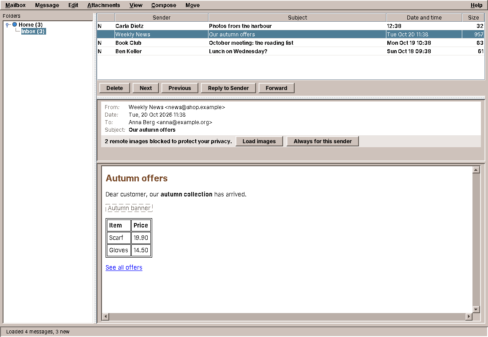
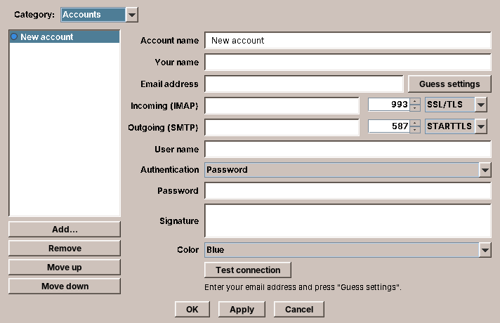
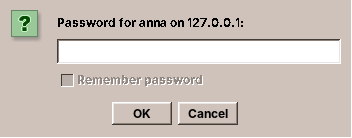

# 22. Mail

Every program so far has worked with things on the user's own computer: text files, folders, a calendar file. A mail program works with someone else's computer. The mail is on a server, behind a password, over a network that is sometimes slow and sometimes gone. And what arrives is written by strangers: an HTML message can try to find out when you read it, and an attachment can try to run.

amade-mail is modelled on the CDE Mailer (`dtmail`): folders on the left, the message list, the message below it, and a compose window. It reads mail over IMAP and sends it over SMTP with Jakarta Mail. This chapter is about the three things that make a network program different: secrets, waiting, and content you cannot trust. And it moves a small class into amade-commons that four programs have copied: the `Texts` helper.

## What you build



- **Several accounts**, each with its own colour in the folder tree, set up in *Mail Options* with a *Guess settings* button.
- **Passwords in the desktop keyring**, never in a configuration file; asked for when needed.
- **Signing in through the web browser** (OAuth2) for providers that no longer accept passwords.
- **Folders and messages** from IMAP: unread counts, read and unread, move, delete.
- **Plain text or HTML** for each message, the HTML cleaned and drawn by Flying Saucer, remote images blocked until you allow them.
- **Attachments**: save, open with their program, but never open one that could run.
- **Compose, reply, forward**, sent over SMTP with a copy in the *Sent* folder.

The program is about 6,200 lines of Java and 1,250 lines of tests. A third of it is the window and its dialogs; the gateway to the servers is under 500 lines.

## What you will learn

- How to keep passwords out of files, in the desktop keyring, and what to do when there is no keyring.
- How a background thread asks the user a question and waits for the answer.
- How to share one network connection between threads.
- How a desktop program signs in through the web browser with OAuth2 and PKCE.
- How to show HTML from strangers without letting it phone home.
- How the `Texts` helper moves into amade-commons, and why the application declares its texts in a file.

## Accounts without passwords

An account is a record like the appointment of chapter 21: it normalises its fields in the compact constructor, so an `Account` that exists is valid. What it does not have is just as important:

```java title="amade-mail · domain/Account.java (the components)"
public record Account(String id, String name, String displayName, String email, String username,
                      ServerSettings imap, ServerSettings smtp, String signature, AccountColor color,
                      AuthMethod auth) {
```

There is no password. The accounts are stored in `~/.config/amadeos/mail/accounts.conf` through `PropertiesFile` from chapter 20, and a configuration file is the wrong place for a secret. It ends up in backups, in a dotfiles repository on the web, in a screenshot of an editor, in a bug report. The `id` is the key under which the password is kept elsewhere:

```java title="amade-mail · repository/FileAccountRepository.java"
--8<-- "amade-mail/src/main/java/eu/amadeos/apps/mail/repository/FileAccountRepository.java:save"
```

Even the comment at the top of the file says where the passwords are, so a user who opens it does not wonder. A test makes sure it stays that way, whatever field someone adds to the record later:

```java title="amade-mail · FileAccountRepositoryTest.java"
--8<-- "amade-mail/src/test/java/eu/amadeos/apps/mail/repository/FileAccountRepositoryTest.java:never-writes"
```



On first start Mail opens its options on the account page. *Guess settings* fills in the servers from the address: a small table of well-known providers, otherwise the convention `imap.<domain>` and `smtp.<domain>`. *Test connection* logs in to both servers in the background and says what went wrong in words the user can act on.

## The keyring

The Linux desktop has a place for secrets: the *Secret Service*, a D-Bus interface that gnome-keyring, KDE Wallet and KeePassXC all offer. It keeps the secrets encrypted and unlocks them with the login password. Java has no API for it, and a D-Bus library would be a large dependency for three calls. There is a small command, `secret-tool` from the Debian package `libsecret-tools`, that does exactly the three calls. amade-commons wraps it behind an interface:

```java title="amade-commons · desktop/PasswordStore.java"
--8<-- "amade-commons/src/main/java/eu/amadeos/commons/desktop/PasswordStore.java"
```

`CommonsModule` binds it to a `SecretToolPasswordStore` named after the application, so every program can inject a `PasswordStore` and its secrets are filed under its own name (`secret-tool search service amade-mail` lists them). Storing a password looks like this:

```java title="amade-commons · desktop/SecretToolPasswordStore.java"
--8<-- "amade-commons/src/main/java/eu/amadeos/commons/desktop/SecretToolPasswordStore.java:store"
```

The password goes into a session cache first, so it works for the rest of the session even if the keyring refuses it. Then `secret-tool` is started, and here is the detail that matters most in this chapter. Look at how `run` gets the password to the program:

```java title="amade-commons · desktop/SecretToolPasswordStore.java"
--8<-- "amade-commons/src/main/java/eu/amadeos/commons/desktop/SecretToolPasswordStore.java:run"
```

!!! warning "Pitfall: secrets on the command line"
    Never pass a secret as a command-line argument. The arguments of every process are readable by every user on the computer, in `/proc/<pid>/cmdline` and in the output of `ps`. `secret-tool store` reads the password from its standard input, and `run` writes it there. The label and the attributes are not secret, so they may be arguments.

`run` also waits at most 30 seconds. A locked keyring shows an unlock dialog, and a user who walks away must not leave Mail hanging for good; after the timeout, the password is simply not stored, and the cache keeps it for the session.

### When there is no keyring

A minimal desktop may have no Secret Service at all, and `secret-tool` is then missing or fails. `SecretToolPasswordStore` notices that the command is missing and says so through `isPersistent()`. Mail shows it honestly instead of pretending:



The *Remember password* box is off and greyed out, with a tooltip that explains why. The alternative, falling back to a file "just this once", is how passwords end up in plain text: there is no such fallback.

## Asking for a password from a worker

When does Mail need a password? Not at start-up: when the gateway opens a connection, which happens on a worker thread in the middle of "load the folders" or "send this message". So the worker has to ask the user. `PromptingCredentialProvider` does it:

```java title="amade-mail · ui/common/PromptingCredentialProvider.java"
--8<-- "amade-mail/src/main/java/eu/amadeos/apps/mail/ui/common/PromptingCredentialProvider.java:password"
```

The order is: the session's own memory, then the keyring, then the user. A password the server rejected is skipped in the first two places, so the user is asked again instead of being sent the same wrong password in a loop. The method is `synchronized`: when three workers need the password of the same account at the same moment (folders, counts, the open message), only the first one asks, and the other two find the answer in `session` when they get their turn.

The dialog itself must run on the EDT. The worker hands it over and waits:

```java title="amade-mail · ui/common/PromptingCredentialProvider.java"
--8<-- "amade-mail/src/main/java/eu/amadeos/apps/mail/ui/common/PromptingCredentialProvider.java:on-edt"
```

This is the same idea as `onEdtAndWait` in Files (chapter 20), written differently. Files used `CompletableFuture.supplyAsync(question, edt).join()`; Mail uses `SwingUtilities.invokeAndWait` and first checks whether it already is on the EDT, in which case it simply calls the dialog. That check makes Mail's version safe to call from anywhere, where Files' version hangs the program when called on the EDT. Two programs with the same twelve lines would normally mean "move it to amade-commons", and the third exercise asks you to do it. But note how small the difference is that decides between a helper that is safe and one that hangs.

!!! note "Note: who may call what"
    `CredentialProvider` says in its comment that `password` is only called from background threads. That is a rule the compiler cannot check. Mail checks it where it can: the `onEdt` fallback means a mistake costs a frozen window for as long as the dialog is open, not a dead program.

## One connection per account

Logging in to an IMAP server takes a TLS handshake and a few round trips, easily a second on a slow line. Mail keeps one open connection (a Jakarta Mail `Store`) per account and lends it to whoever needs it:

```java title="amade-mail · service/JakartaMailGateway.java"
--8<-- "amade-mail/src/main/java/eu/amadeos/apps/mail/service/JakartaMailGateway.java:with-store"
```

Every IMAP operation in the gateway is a small lambda passed to `withStore`. Three things happen around it:

- **One at a time.** An IMAP connection is a conversation: a command, its answer, the next command. Two threads talking over one connection at once would mix up the answers. The `ReentrantLock` of the account makes the second thread wait. Different accounts have different locks, so a slow server does not hold up a fast one.
- **Reconnect once.** Servers close idle connections after some minutes. The first operation after a coffee break then fails with `StoreClosedException`; `withStore` reconnects and tries again, once. A second failure is a real failure.
- **A rejected password is forgotten.** `AuthenticationFailedException` tells the credential provider, which asks the user next time.

Why a `ReentrantLock` and not `synchronized`? Mail runs its background work on virtual threads (chapter 10's executor). A virtual thread that blocks inside a `synchronized` block used to pin its carrier thread in older Java versions; a `ReentrantLock` never did. With JDK 25 both are fine, but the lock also makes the intent visible: it is a lock for *this* connection, held across network calls.

The connections themselves are configured in `MailSessions`. With TLS or STARTTLS, Mail sets `ssl.checkserveridentity`, so the server's certificate must name the server Mail asked for, and `starttls.required`, so a server (or someone in between) cannot quietly skip the encryption. The third choice, no encryption, exists for local test servers, such as the one used for the pictures in this chapter.

## Signing in through the browser

More and more mail providers do not accept passwords from mail programs any more. They want *OAuth2*: the user signs in on the provider's web page, in the browser, and the program receives a token that allows mail access and nothing else. A desktop program has no web server to receive the answer, so it starts one, for a minute, on the loopback address:

```java title="amade-mail · service/OAuth2Service.java"
--8<-- "amade-mail/src/main/java/eu/amadeos/apps/mail/service/OAuth2Service.java:sign-in"
```

Step by step:

1. Mail starts an `HttpServer` (it is part of the JDK) on `127.0.0.1` with port `0`, which lets the operating system choose a free port. Loopback means no other computer can reach it.
2. It opens the provider's sign-in page in the browser, through `DesktopLauncher` from chapter 11. The URL carries the redirect address `http://127.0.0.1:<port>/`, a random `state`, and a *challenge*.
3. The user signs in and agrees. The provider sends the browser to the redirect address, with a one-time code.
4. Mail's little server receives the code, shows "Signed in, you can close this window", and completes the future.
5. Mail exchanges the code for tokens, sending the *verifier* that belongs to the challenge.

The redirect handler only accepts the answer it is waiting for:

```java title="amade-mail · service/OAuth2Service.java"
--8<-- "amade-mail/src/main/java/eu/amadeos/apps/mail/service/OAuth2Service.java:redirect"
```

### PKCE: why a challenge?

Any program on the computer can listen on a loopback port, and a desktop program cannot keep a secret from its users: its "client secret" is in the jar. So an intercepted code must be useless to anyone else. *PKCE* (Proof Key for Code Exchange, RFC 7636) does that. Mail makes up a random *verifier*, sends only its SHA-256 hash, the *challenge*, with the sign-in, and sends the verifier itself only with the code exchange. Whoever steals the code does not have the verifier:

```java title="amade-mail · service/OAuth2Service.java"
--8<-- "amade-mail/src/main/java/eu/amadeos/apps/mail/service/OAuth2Service.java:challenge"
```

The RFC prints an example verifier with its challenge, and that makes a perfect test:

```java title="amade-mail · OAuth2ServiceTest.java"
--8<-- "amade-mail/src/test/java/eu/amadeos/apps/mail/service/OAuth2ServiceTest.java:rfc7636"
```

The sign-in waits at most five minutes and can be cancelled: while it waits, a small window tells the user to look at the browser, and closing it cancels the sign-in. What comes back is an access token, usually valid for an hour, and a *refresh token*, which gets new access tokens without asking the user again. The refresh token is a long-lived secret, so it goes where passwords go: into the `PasswordStore`. The access token is sent to the server through SASL `XOAUTH2`, and `MailSessions` turns the other login methods off for such accounts, so the token is never sent as if it were a password.

!!! tip "Tip: test the browser by playing it"
    `signIn` takes the browser as a `Consumer<URI>`. In the program it is `DesktopLauncher.browse`; in the test it is a lambda that reads the redirect address from the URI and calls it with an `HttpClient`, first with a wrong `state` (expecting 400), then with the right one. The whole flow, including the local server, is tested without a browser and without a provider.

## HTML from strangers

Chapter 11 showed HTML pages with jsoup and Flying Saucer, and refused to load anything from the network. Documentation from `/usr/share/doc` is written by people you trust, more or less. Mail is written by anyone. A newsletter contains an image of one pixel whose address is unique to you: when your mail program loads it, the sender learns that you opened the message, when, and from where. That is the *tracking pixel*, and it is in most commercial mail.

So the HTML of a message goes through a stricter cleaner first:

```java title="amade-mail · service/HtmlSanitizer.java"
--8<-- "amade-mail/src/main/java/eu/amadeos/apps/mail/service/HtmlSanitizer.java:sanitize"
```

- jsoup's `Cleaner` keeps only what a `Safelist` allows: text formatting, tables, links, images, the `style` attribute. Scripts, forms, frames, `<object>` and event handlers such as `onload` are gone.
- An image whose source is on the web loses its source, and is counted. Images that came with the message (`cid:` addresses) stay; so do `data:image/` ones. A `data:` address with any other type is removed.
- CSS can load images too (`background-image: url(...)`). Those addresses become `none`, and the remote ones are counted.
- `target` attributes of links are removed: a link opens in the browser, never in a "new window" of the mail program.
- The XHTML namespace and a small base style sheet are added, as in chapter 11.

The count is what the bar above the message shows: "2 remote images blocked to protect your privacy", with *Load images* and *Always for this sender*.

### A black box

The first screenshot for this chapter showed a big black rectangle in the newsletter, where the banner should be. Flying Saucer draws an `` without a source as a black box of its `width` and `height`, and the tracking pixel was a black dot. The sanitizer had done its job, and the result still looked broken. The fix replaces an image that lost its source with its alternative text, or with nothing:

```java title="amade-mail · service/HtmlSanitizer.java"
--8<-- "amade-mail/src/main/java/eu/amadeos/apps/mail/service/HtmlSanitizer.java:alt-text"
```

A tracking pixel never has an alternative text, so it disappears; the banner becomes "Autumn banner" in a dashed frame, as you see in the picture at the top. Look at the picture you produce, not only at the tests: a test checks what you thought of.

The test for the blocking is a small catalogue of the tricks:

```java title="amade-mail · HtmlSanitizerTest.java"
--8<-- "amade-mail/src/test/java/eu/amadeos/apps/mail/service/HtmlSanitizerTest.java:blocks-remote"
```

### Loading images when the user says so

When the user clicks *Load images*, the renderer still does not touch the network. The presenter prepares the message again in the background, this time downloading the images itself, and hands them to the renderer as bytes:

```java title="amade-mail · ui/main/MainPresenter.java"
--8<-- "amade-mail/src/main/java/eu/amadeos/apps/mail/ui/main/MainPresenter.java:prepare"
```

Mail's user agent for Flying Saucer works like the one in chapter 11, but it answers only from this map of resources: the images that came with the message, and the ones downloaded here. Downloading before rendering has a second advantage: Flying Saucer would load images one by one, on the thread that lays out the page, which is the EDT. `RemoteImageLoader` loads them in parallel on virtual threads, at most 60 images of at most 5 MB, with timeouts, and leaves out the ones that fail.

## Showing the right message

Clicking through the message list fast starts many loads. The one for the third message may finish before the one for the second, and the window must show the third. Chapter 11 solved this for pages with a counter of navigations, and Mail does the same with a counter of selections:

```java title="amade-mail · ui/main/MainPresenter.java"
--8<-- "amade-mail/src/main/java/eu/amadeos/apps/mail/ui/main/MainPresenter.java:message-selected"
```

Every selection increments `messageGeneration`. The background load remembers the number it started with, and when it finishes it shows its message only if no newer selection has happened since. Slow answers to old questions are dropped. It is the same pattern as in Web, and it is the reverse of the Calendar's save queue: there, every save had to happen, in order; here, only the last one counts.

## Attachments that could run

An attachment called `invoice.pdf.desktop` is a desktop entry, and opening it runs whatever command it names. Mail does not open such files at all:

```java title="amade-mail · ui/main/MainPresenter.java"
--8<-- "amade-mail/src/main/java/eu/amadeos/apps/mail/ui/main/MainPresenter.java:open-attachment"
```

`DesktopLauncher.isRisky` from chapter 11 knows the endings that can run something: scripts, desktop entries, executables, Java archives, packages. The user can still save such a file and decide what to do with it; Mail just refuses to be the one that starts it. Everything else is written to a new temporary directory that only the user can read and opened with its program through `DesktopLauncher.open`.

## The Texts helper moves into amade-commons

Chapter 21 ended with an observation: Calendar, Mail, Audio and Video each have a class `Texts` that differs only in the name of the bundle. With this chapter, it moves. Here is the core of the shared version:

```java title="amade-commons · i18n/Texts.java"
--8<-- "amade-commons/src/main/java/eu/amadeos/commons/i18n/Texts.java:messages"
```

The texts are loaded on first use in the default locale, which `AmadeApplication` has set to the resolved language (chapter 10). If the default locale changes, as it does in tests that try all five languages, they are loaded again. The two `volatile` fields hold immutable records, so a thread either sees the old texts or the new ones, never a mix.

But where does the shared class learn the name of the bundle, `eu.amadeos.apps.mail.messages`?

### A call or a file?

The obvious answer is a call: `Texts.use(AmadeMailApplication.class, "eu.amadeos.apps.mail.messages")` at the start of `main`. That was the first version, and it broke 50 tests across the four programs. A test that creates a dialog does not run `main`, so `tr` had no bundle. Every test class would need a set-up line, and every new test class would fail until someone remembered it.

The version in amade-commons asks the class path instead. Each application declares its bundle in a resource with a fixed name:

```properties title="amade-mail · src/main/resources/META-INF/amadeos/texts.properties"
# The application's texts for eu.amadeos.commons.i18n.Texts.tr: messages.properties and its translations.
bundle=eu.amadeos.apps.mail.messages
```

```java title="amade-commons · i18n/Texts.java"
--8<-- "amade-commons/src/main/java/eu/amadeos/commons/i18n/Texts.java:declared"
```

The program and its tests have the same class path, so they find the texts the same way, with no set-up at all. It is the same trick as the `META-INF/services` files of Java's `ServiceLoader`, and it has the same rule: there must be exactly one. Two declarations on the class path mean two applications in one program, which is an error worth a clear message. `Texts.use` still exists for the one case where there is no application: the tests of amade-commons itself, and of other libraries.

### Moving it

For each of the four programs, the move is the same:

1. Delete `i18n/Texts.java`.
2. Change `import static eu.amadeos.apps.<app>.i18n.Texts.tr` to `import static eu.amadeos.commons.i18n.Texts.tr` (a search and replace over the sources).
3. Add `META-INF/amadeos/texts.properties`.
4. Let the translation test ask `Texts.bundle()` instead of writing the name a second time.
5. Pin the amade-commons commit that has the new class, and run all tests.

The diff of each program is mostly import lines, which is what a good move looks like: the code that uses the texts does not change at all. Calendar, Audio and Video went through the same five steps as Mail.

## What amade-commons gives Mail

| Part | Since | Mail uses it for |
|---|---|---|
| `AmadeApplication`, `CommonsModule`, `EdtExecutor` | chapter 10 | start-up, wiring, the two threads |
| `Messages`, `LocaleSettings`, `AmadeUI` | chapter 10 | five languages, the language setting, the theme's colours |
| `DesktopLauncher` | chapter 11 | the browser for OAuth2 and links; opening attachments; `isRisky` |
| `AppDirectories`, `PropertiesFile`, `LaunchFeedback` | chapter 20 | `accounts.conf` and the preferences; the busy cursor when an invitation opens Calendar |
| `LanguageChooser` | chapter 21 | the language page of the options |
| `PasswordStore`, `SecretToolPasswordStore` | **this chapter** | passwords and refresh tokens in the keyring |
| `Texts` | **this chapter** | `tr(...)` everywhere, declared in `texts.properties` |
| `ContactDirectory`, `AddressCompletion` | chapter 25 | completing To, Cc and Bcc from the address books ([how](25-contacts.md#completing-an-address)) |

### And what stays in Mail

- **`Json`**, a small reader for the token answers of OAuth2, 140 lines. Audio has one too, for its music metadata. That makes two, and it moves with Audio in chapter 33, when the second user is written about.
- **The HTML cleaning.** Web and Mail both run jsoup and then add the XHTML namespace. But their rules are different (Web keeps local pictures and drops scripts; Mail keeps far less and blocks the network), and the shared part is five lines. Sharing it would mean a class with options for every difference.
- **`onEdt`**, the worker's way to ask the user. It is the third exercise.

## Exercises

1. **A real server in the tests.** The gateway is tested only through the presenter's fake. Add GreenMail, a mail server written in Java for tests, as a test dependency, and test `JakartaMailGateway` against it: list folders, load a message, send one and find the copy in *Sent*. Then stop the server in the middle and check that `withStore` reconnects once.
2. **Autoconfiguration.** *Guess settings* knows a few providers. Many providers publish their settings as DNS `SRV` records (RFC 6186, `_imaps._tcp.example.org`) or as an XML file at `autoconfig.example.org`. Look them up in the background, and keep the table as the fallback. Which result wins when they disagree?
3. **One onEdtAndWait.** Move a method that runs a `Supplier` on the EDT and waits for its result into `EdtExecutor`. It must be safe on the EDT (like Mail's) and handle interruption. Change Files and Mail to use it, and write a test that calls it from the EDT.
4. **Tracking links.** Remote images are blocked, but a link can track too: `https://news.example/click?id=8f3a...`. Show the real address of a link in the status line when the mouse is over it, and warn when the text of a link is an address that differs from its target.
5. **A keyring per account?** Today a password is filed under the account's random id. A user who deletes `accounts.conf` leaves orphaned passwords in the keyring. Add a "Forget all passwords" button to the options that removes every entry of `service=amade-mail`. What does `secret-tool` offer for that, and how do you test it without a keyring?

## Summary

- A configuration file is no place for a secret. Store passwords in the desktop keyring, behind an interface, and say honestly when there is no keyring.
- Pass a secret to another program on its standard input, never as an argument.
- A worker asks the user by handing a dialog to the EDT and waiting; make the helper safe for a call that is already on the EDT.
- One connection per account, lent out under a lock, reconnected once when the server dropped it.
- OAuth2 for a desktop program: a loopback server for the redirect, a random `state`, and PKCE, because a desktop program cannot keep a client secret.
- HTML from strangers is cleaned with a safelist; remote images are blocked and counted, and downloaded by the program only when the user agrees. Look at the result, not only at the tests.
- A counter of selections drops slow answers to old questions; attachments that could run are not opened.
- `Texts` moves into amade-commons. The application declares its texts in `META-INF/amadeos/texts.properties`, so the program and its tests find them without set-up code.
