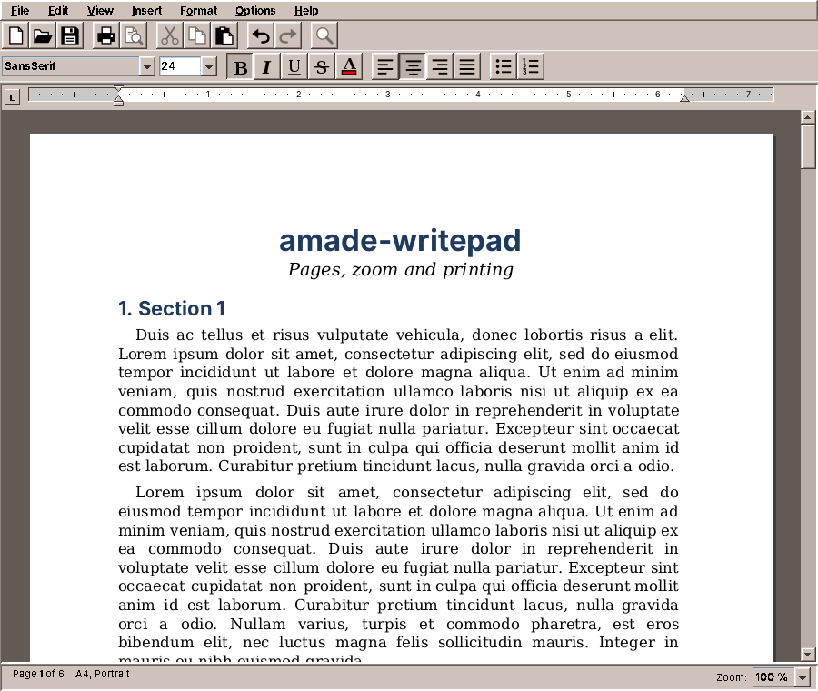
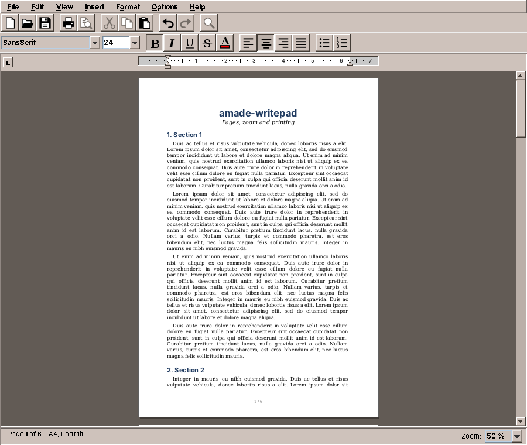

# 23. WritePad

Pad edits text. WritePad edits documents: fonts and sizes, bold and italic, indents and tab stops, lists, and above all *pages*. A letter has to fit on a sheet of A4 and look on paper the way it looked on the screen. And a document has to open in other people's word processors, so WritePad reads and writes their file formats.

amade-writepad is modelled on the small word processors that came with the desktops of the 1990s: a toolbar, a format bar, a ruler, and the pages on a dark desk. It is the biggest program so far, about 10,300 lines of Java and 4,000 lines of tests. This chapter shows the three parts that make it a word processor, the page view, the file formats and printing, and it moves printing into amade-commons, where Calendar has been waiting for it since chapter 21.

## What you build



- **Formatted text**: font, size, bold, italic, underline, strike-through, colour, alignment.
- **Real pages** in A5, A4, Letter or Legal, portrait or landscape, with margins; zoom from 50 % to 300 %.
- **A ruler** with indent markers and tab stops (left, centre, right, decimal) to drag.
- **Bullet and numbered lists** in several levels.
- **ODT, DOCX, RTF and plain text**, opened and saved; old DOC files through LibreOffice when it is installed.
- **Printing** that puts the lines and page breaks on paper exactly where they are on the screen.

## What you will learn

- How Swing's text components are built: document, elements, views and the editor kit.
- How to replace Swing's views to lay text out on pages.
- How to keep a layout in points and show it in pixels, at any zoom.
- How to read and write document formats with the JDK alone, and why that is possible.
- How to print through `java.awt.print`, and what moves into amade-commons for it.

## Swing's text model in five minutes

Pad used a `JTextArea`, which shows one font and has no idea of a page. WritePad uses a `JTextPane`, the styled text component of Swing. Like every Swing text component it has four parts, and a word processor has to know all of them:

| Part | Class | What it is |
|---|---|---|
| **Document** | `StyledDocument` (`DefaultStyledDocument`) | The text and its attributes. The model: no pixels, no fonts on screen. |
| **Elements** | `Element` | The structure of the document: a root, one element per paragraph, and inside each paragraph one element per run of equally formatted characters. Attributes (`AttributeSet`) hang on the elements. |
| **Views** | `View` (`BoxView`, `ParagraphView`, `LabelView`, ...) | The layout: one view per element, which knows its size, where its lines break, and how it paints. |
| **Editor kit** | `EditorKit` (`StyledEditorKit`) | The glue: it makes the document, and its *view factory* decides which view each element gets. |

The document is shared, the views are not. That is the opening: if you give a `JTextPane` an editor kit with a different view factory, the same document is laid out differently. Everything else (typing, the caret, selection, undo, copy and paste) keeps working, because it talks to the document and asks the views only where things are.

## Text on pages

Swing's `StyledEditorKit` lays out a document as one endless sheet: the section view stacks the paragraphs, and each paragraph view breaks its text into lines as wide as the component. WritePad's kit keeps most of the views and replaces two:

```java title="amade-writepad · service/layout/PagedEditorKit.java"
--8<-- "amade-writepad/src/main/java/eu/amadeos/apps/writepad/service/layout/PagedEditorKit.java:factory"
```

The section becomes a `PagedSectionView`, which stacks the paragraphs on pages, and every paragraph a `PagedParagraphView`, which never lets a line cross the bottom of a page. One small class knows where the pages are, `PageLayout`, and it answers one question for both: where does a line go?

```java title="amade-writepad · service/layout/PageLayout.java"
--8<-- "amade-writepad/src/main/java/eu/amadeos/apps/writepad/service/layout/PageLayout.java:place"
```

`place` is pure arithmetic over the page size and the margins, so it is tested without Swing:

```java title="amade-writepad · PageLayoutTest.java"
--8<-- "amade-writepad/src/test/java/eu/amadeos/apps/writepad/service/layout/PageLayoutTest.java:crossing"
```

Note the last rule in `place`: a line that starts at the top of a page stays there, even if it is taller than the page. Without that rule, a picture larger than a page would move to the next page, and the next, and the layout would never end. Every layout loop needs a case where it stops moving things.

A paragraph uses `place` for every line it has broken:

```java title="amade-writepad · service/layout/PagedParagraphView.java"
--8<-- "amade-writepad/src/main/java/eu/amadeos/apps/writepad/service/layout/PagedParagraphView.java:layout"
```

`layoutMajorAxis` is where a `BoxView` decides the vertical position of its children, here the lines. WritePad lets Swing break the lines as usual, then walks over them and moves each one that would cross a page boundary. The space a moved line leaves behind (`pushed`) is added to the paragraph's height, so the paragraphs below move down too. For that, a paragraph has to know where on the page it starts, and the section tells it before it lays it out:

```java title="amade-writepad · service/layout/PagedSectionView.java"
--8<-- "amade-writepad/src/main/java/eu/amadeos/apps/writepad/service/layout/PagedSectionView.java:stack"
```

When the number of pages changes, the section asks its parent for a new size. That is how the scroll bar grows while you type.



!!! warning "Pitfall: Swing's view classes are not an API"
    `ParagraphView`, `BoxView` and their protected methods are documented, but they were written for Swing's own use, and their behaviour is defined mostly by their source code. WritePad overrides a handful of them (`layoutMajorAxis`, `calculateMajorAxisRequirements`, `getFlowStart`, `nextTabStop`, `getViewAtPoint`), and each override has a comment that says what Swing does there and why it is not enough. When you extend a framework through its protected methods, write those comments: the next reader has to understand two pieces of code, not one.

## Points inside, pixels outside

A page of A4 is 595 × 842 points (1/72 inch). On a screen at 100 % it should be as big as the real sheet, which on a 96 dpi screen is 794 pixels wide; at 50 % half of that. Where should the zoom live?

If the views laid out in pixels, every zoom would break the lines differently: fonts do not scale exactly linearly in pixels, so a line that just fits at 100 % may not fit at 125 %. The page breaks would move with the zoom, and the printout would match none of them. So WritePad lays out in points, always, and only the section view translates:

```java title="amade-writepad · service/layout/PagedSectionView.java"
--8<-- "amade-writepad/src/main/java/eu/amadeos/apps/writepad/service/layout/PagedSectionView.java:paint"
```

`toScreen` is a scale (and the offset that centres the page in a wide window). Everything inside the paragraphs and lines is in points; everything outside, the component size, the caret, the mouse, in pixels. The same translation runs the other way in `modelToView` and `viewToModel`, so a click lands on the right character at every zoom.

Two rendering hints matter. *Fractional metrics* lets glyphs sit at fractions of a pixel; without it, every glyph of a scaled font snaps to whole pixels and the spaces in a line become uneven. *Text antialiasing* makes small text readable at 50 %.

### Tabs measured from the margin

Tab stops are a good example of how much a word processor depends on getting the coordinates right. A tab stop at 4 cm is 4 cm from the left margin, in RTF, ODT and DOCX alike. Swing measures tabs from a position it only learns while painting, so before the first paint, lines could break with different tab widths than after it. `PagedParagraphView` overrides `getFlowStart` and `nextTabStop` to measure from the margin, in the same coordinates in which it paints, and leaves the rules (which stop comes next, how a decimal tab aligns) to `TabStops`, a small class without Swing that is tested on its own.

The ruler follows the same idea. `RulerModel` knows the markers, the stops and what a drag does to them; `Ruler` is the component that draws the model and passes on the mouse. The model has its own tests, which never open a window.

## Lists that are drawn, not typed

A numbered list item in WritePad is a paragraph with three attributes: the id of its list, its level, and its format (`1.`, `a.`, `i.`, `•`). The number itself is not in the text. It is computed when the paragraph is painted:

```java title="amade-writepad · service/list/ListNumbering.java"
--8<-- "amade-writepad/src/main/java/eu/amadeos/apps/writepad/service/list/ListNumbering.java:compute"
```

One pass over the paragraphs counts, per list and level, and a higher level starts the deeper ones again. Paragraphs between two items of a list do not interrupt it, which is how word processors number a list with a note in the middle. The labels are kept in a cache until the document changes, so painting a page does not count the whole document again.

Why not type the numbers? Because then deleting item 2 would leave "1., 3., 4.", and every file format stores lists as structure, not as text. A label that the program draws is always right. `PagedParagraphView.paintLabel` draws it in front of the first line, at the first-line indent, in the font of the paragraph's first character.

## File formats

Every format is a `DocumentFormat`:

```java title="amade-writepad · service/format/DocumentFormat.java"
--8<-- "amade-writepad/src/main/java/eu/amadeos/apps/writepad/service/format/DocumentFormat.java"
```

Read the comments about threads: `read` builds a new document that nothing shows yet, so it may run in the background; `write` reads the document in the editor, so it runs on the EDT and only produces bytes. `finish` runs in the background again, for formats that hand the bytes to another program. Guice collects the formats with a *multibinder*, a set that every binding adds to:

```java title="amade-writepad · bootstrap/WritepadModule.java"
--8<-- "amade-writepad/src/main/java/eu/amadeos/apps/writepad/bootstrap/WritepadModule.java:formats"
```

A new format is one class and one line here. The registry decides which format opens a file, and it trusts the content more than the name:

```java title="amade-writepad · service/format/FormatRegistry.java"
--8<-- "amade-writepad/src/main/java/eu/amadeos/apps/writepad/service/format/FormatRegistry.java:for-opening"
```

### ZIP files with XML inside

ODT (OpenDocument) and DOCX (Office Open XML) look frightening and are not: both are ZIP files with a few XML files inside. WritePad reads and writes them with `java.util.zip` and StAX, the streaming XML reader and writer that are part of the JDK. An ODT file has one rule that is easy to miss:

```java title="amade-writepad · service/format/odt/OdtWriter.java"
--8<-- "amade-writepad/src/main/java/eu/amadeos/apps/writepad/service/format/odt/OdtWriter.java:zip"
```

The first entry must be `mimetype`, uncompressed. Then its name and its content stand at fixed offsets in the file, and a program can recognise an ODT file from its first hundred bytes, without unpacking anything. WritePad's own recognition does exactly that:

```java title="amade-writepad · service/format/odt/OdtFormat.java"
--8<-- "amade-writepad/src/main/java/eu/amadeos/apps/writepad/service/format/odt/OdtFormat.java:recognizes"
```

A DOCX file is a ZIP too, but without the `mimetype` entry, which is why the check reads the name and the type instead of stopping at `PK`. And the test checks the bytes, not only that reading works:

```java title="amade-writepad · OdtFormatTest.java"
--8<-- "amade-writepad/src/test/java/eu/amadeos/apps/writepad/service/format/odt/OdtFormatTest.java:package"
```

!!! note "Note: why no document library"
    Java libraries exist for these formats, and they are big: the usual one for DOCX brings about 19 MB of jars, four times the size of the whole WritePad package, and a DOM of the entire document in memory. WritePad needs three XML files of a DOCX and four of an ODT, and StAX reads them as a stream. The decision and its alternative are written down in the repository's `CONTRIBUTING.md`, with the size, the date and what would change it. Write such notes for every dependency you decide against: in a year someone will ask again.

RTF is different: a text format of nested groups in curly braces with control words such as `\b` and `\par`. WritePad reads it with its own small tokenizer. The old binary DOC format is the one case where WritePad does not write its own code: it runs LibreOffice (`soffice --headless --convert-to docx`) in the background, with a profile of its own, and reads the DOCX. Running another program well, with a timeout, its output and its exit code, is a part that moves into amade-commons in chapter 31.

The tests for every format do the same three things: write a document and read it back (a *round trip*), read files that other programs wrote, and check the bytes against the rules of the format. The round trip alone is not enough: a writer and a reader that share a mistake pass it.

## Saving, and a second Ctrl+S

Opening and saving follow Pad (chapter 10): read and parse in the background, write the bytes on the EDT from the document in the editor, put them on disk in the background, and remember which revision was saved:

```java title="amade-writepad · ui/main/MainPresenter.java"
--8<-- "amade-writepad/src/main/java/eu/amadeos/apps/writepad/ui/main/MainPresenter.java:save"
```

The first line of `save` was missing when this chapter was written. *Save As* and the "save your changes?" question checked `busy`, but plain *Save* of a document that already had a file did not. Press Ctrl+S twice quickly, and two writes of the same file ran on two virtual threads. They could finish in either order, and the older text could be the one left on disk: the same race as in Calendar's saving (chapter 21). Calendar had to save every change, so it chains its saves. A word processor saves when the user says so, and the user sees whether the document is saved: the title keeps its `*`. So WritePad simply starts no second save while one is running. The test drives both saves through an executor that only queues its tasks:

```java title="amade-writepad · MainPresenterTest.java"
--8<-- "amade-writepad/src/test/java/eu/amadeos/apps/writepad/ui/main/MainPresenterTest.java:second-save"
```

## Printing

Because the layout is in points, printing is the easy part. `java.awt.print` hands a program a `Graphics2D` per page, in points, with (0, 0) at the corner of the paper. WritePad paints each page with the same views as the screen, at zoom 1:

```java title="amade-writepad · service/layout/PagedSectionView.java"
--8<-- "amade-writepad/src/main/java/eu/amadeos/apps/writepad/service/layout/PagedSectionView.java:paint-page"
```

```java title="amade-writepad · service/print/DocumentPageable.java"
--8<-- "amade-writepad/src/main/java/eu/amadeos/apps/writepad/service/print/DocumentPageable.java:print"
```

The lines on paper break where they broke on the screen, because they are the same lines. This is the payoff of the decision in "Points inside, pixels outside".

### Printing moves into amade-commons

Calendar prints its reports (chapter 21), and WritePad prints documents. Their pages have nothing in common. Calendar paints grids of days, WritePad paints text views. But around the pages they had the same code twice:

- **Paper sizes**: Calendar's `paperFor(Locale)` with A4 and Letter in points, WritePad's `PaperSize` with A5, A4, Letter and Legal.
- **A page format** for a paper, portrait or landscape, with or without margins.
- **What the printer is told**: the paper and the job name, and *not* the orientation.
- **Where the pages go**: a PostScript file (Calendar), the system's print dialog (WritePad).

That is the part that moves, into the package `eu.amadeos.commons.print`. `PaperSize` comes from WritePad, with one addition from Calendar, the usual paper of the user's country:

```java title="amade-commons · print/PaperSize.java"
--8<-- "amade-commons/src/main/java/eu/amadeos/commons/print/PaperSize.java:for-locale"
```

`PrintJobs` has the rest, as static methods, because none of them keeps state:

```java title="amade-commons · print/PrintJobs.java"
--8<-- "amade-commons/src/main/java/eu/amadeos/commons/print/PrintJobs.java:page-format"
```

```java title="amade-commons · print/PrintJobs.java"
--8<-- "amade-commons/src/main/java/eu/amadeos/commons/print/PrintJobs.java:attributes"
```

The comment on `attributes` is a lesson WritePad learned the hard way: a `PageFormat` in landscape already turns the graphics, and some printer drivers turn the page again when they are also asked for landscape. A rule like that belongs in one place, next to a test.

### PostScript without a printer

Calendar wrote its PostScript files with a `PrinterJob` and a `Destination` attribute. Moving the code into amade-commons meant writing a test for it there, and the test failed on the build machine with "No print service found": a `PrinterJob` needs a printer, even when it only writes a file. Calendar's own tests had skipped on such machines all along, so nobody had noticed that *Print to File* only worked where CUPS was installed.

The JDK has a second way to print: *stream print services*, which write a format into any `OutputStream`. One of them writes PostScript and needs no printer at all:

```java title="amade-commons · print/PrintJobs.java"
--8<-- "amade-commons/src/main/java/eu/amadeos/commons/print/PrintJobs.java:post-script"
```

Now Calendar prints to a file on any computer, and its tests run everywhere instead of skipping. A test that is skipped is a test that does not exist; when you write `assumeTrue`, check now and then where it is false.

### Re-pinning the two programs

The move is the same as for `Texts` in chapter 22:

1. amade-commons gets `print/PaperSize.java`, `print/PrintJobs.java` and their tests.
2. WritePad deletes its `PaperSize` and imports the one from amade-commons (the format readers and writers, the page setup dialog and the menus use it). `DocumentPageable.pageFormat` and `PrintService` shrink to one line each.
3. Calendar deletes `paperFor`, `render` and `printerNames`, and asks `PaperSize.forLocale` and `PrintJobs`. Its test helper that probed for a print service is gone.
4. Both programs pin the new amade-commons commit, and all tests run.

What stays in the programs is what is really theirs: Calendar's report pages and its `lp` command with dtcm's options, WritePad's pages and its use of the system print dialog.

## What amade-commons gives WritePad

| Part | Since | WritePad uses it for |
|---|---|---|
| `AmadeApplication`, `CommonsModule`, `EdtExecutor` | chapter 10 | start-up, wiring, the two threads |
| `Messages`, `Mnemonics`, `LocaleSettings` | chapter 10 | five languages, menu letters, the language setting |
| `AmadeUI`, `DesktopTheme` | chapter 10 | the theme's colours for bars, ruler and icons |
| `AppDirectories`, `PropertiesFile` | chapter 20 | the preferences: which bars are shown |
| `PaperSize`, `PrintJobs` | **this chapter** | paper sizes in the formats and the page setup; printing |

### And what stays in WritePad

- **The toolbar icons** (`ToolIcon`, `ToolButtons`) are drawn in Java2D in the theme's colours, so WritePad needs no icon theme. Fractals draws its toolbar the same way, and they move into amade-commons with it in chapter 30.
- **`LibreOffice`**, the runner for `soffice`, moves with Imagescan's command runner in chapter 31.
- **`DocumentFiles`** writes files atomically and keeps their permissions, like Pad. That makes four atomic writes (Pad, `PropertiesFile`, Calendar, WritePad), and the first exercise of chapter 21 is still open.

## Exercises

1. **Keep together.** Headings should never be the last line of a page. Add a paragraph attribute "keep with next" and make `PagedSectionView` move a heading to the next page when the paragraph after it does not start on the same page. Where does the loop stop if every paragraph has the attribute?
2. **Page numbers in the footer.** The page view already paints a footer ("1 / 6"). Make it a setting of the document, saved in ODT as a footer with a page-number field. Which part of the code reads it, and which writes it?
3. **The paper where you live.** New documents always start on A4. Use `PaperSize.forLocale` for new documents. What should happen when a document from a Letter country is opened in an A4 country?
4. **A second Ctrl+S that counts.** Instead of ignoring a save while one is running, remember it and save again when the first one is done, with the newest text. Write the test first, with the queueing executor.
5. **Print preview for Calendar.** `ReportPages` paints into any `Graphics2D`. Show the pages in a window before printing. Could WritePad's page view show Calendar's pages? What would a `PreviewPanel` in amade-commons need to know about the pages?

## Summary

- A Swing text component is a document, its elements, the views and an editor kit. Replace the views through the kit's view factory, and typing, caret, selection and undo keep working.
- Lay out in one unit (points) and translate only at the edge; then zoom does not move line breaks, and printing is the same painting at scale 1.
- A layout that moves things needs a case in which it stops moving them.
- Labels of list items are computed from structure, not stored as text.
- ODT and DOCX are ZIP files with XML inside; the JDK's `java.util.zip` and StAX read and write them. Recognise files by content first, by name second.
- Two writes of the same file must not run at the same time: chain them, or start no second one.
- Paper sizes, page formats, printer attributes, the print dialog and PostScript files move into amade-commons as `PaperSize` and `PrintJobs`, their second user after Calendar. The JDK's stream print service writes PostScript without a printer.
