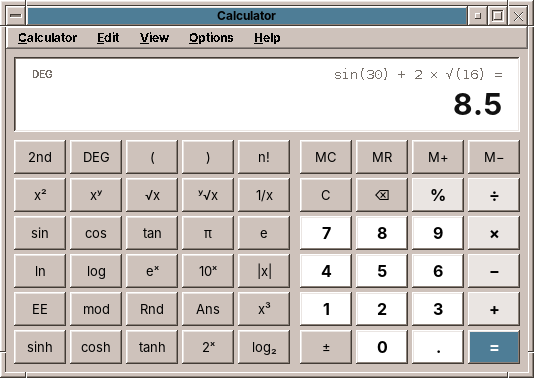

# 24. Calculator

Every desktop has a calculator, and nobody thinks about it until it is wrong. Type 0.1 + 0.2 into a calculator written with `double` and it answers 0.30000000000000004. Type 2 + 3 × 4 into one that computes as the keys come and it answers 20. amade-calculator gets both right, and it is the first program in this book whose most important part has nothing to do with Swing: a calculator that knows only keys, numbers and expressions, and a window that shows it.

The program is small next to WritePad or Mail, about 3,400 lines of Java and 1,100 lines of tests. Nothing moves into amade-commons with it. Its lessons are about modelling: exact numbers, an expression parser of thirty lines, one calculator that works with two kinds of numbers, and a keyboard that types into a window without a text field.

## What you build


- **Three modes** in one window, switched in the View menu with Ctrl+1 to Ctrl+3:
    - **Basic** with percent, memory and a **paper tape** of every calculation.
    - **Scientific** with brackets, powers, roots, logarithms and trigonometry in degrees or radians.
    - **Programmer** with HEX, DEC, OCT and BIN side by side, word sizes from 8 to 64 bits, bit operations and a field of bits to click.
- **Exact decimal arithmetic** with 34 digits, and **precedence**: 2 + 3 × 4 is 14.
- **The keyboard** works like the keys on the screen, and the key you type lights up.
- **Copy and paste** of numbers, in the forms people write them: `1,234.5`, `1.234,5`, `0xFF`.
- **Five languages**, with the digit grouping and the decimal separator of each.

## What you will learn

- Why money and calculators need `BigDecimal`, and where `double` is still the right tool.
- How to parse an expression with precedence and brackets by *precedence climbing*.
- How to keep a model free of Swing, so that most of a program is tested without a display.
- How one class can work with two kinds of numbers behind an interface.
- How to read the keyboard in a window that has no text field, and why menu shortcuts then stop working.
- A pitfall of Swing's button model that makes a key fire twice.

## The structure

The program has the usual packages ([chapter 2](02-structure.md)), but the weight is in `domain`:

| Package | Contents |
|---|---|
| `domain` | `Calculator` (the state of the calculator, one method per key), `Evaluator` (precedence), `NumberSystem` with `DecimalSystem` and `ProgrammerSystem`, `Token` and `Term` (the expression), `ExpressionText`, `Settings`, `PastedNumber` |
| `repository` | `CalculatorPreferences`: the mode and the options in `calculator.properties` |
| `ui.main` | `MainWindow`, `MainPresenter`, `MainMenuBar`, `Key` and `Keypads`, `Display`, `BitField`, `PaperTape` |

`Calculator` does not import a single `javax.swing` class. The presenter turns a key on the screen, a typed character or a menu choice into a call such as `calculator.digit('7')` or `calculator.function(MathFunction.SIN)`, then reads what to show. 60 of its 65 tests run without a window.

## Exact numbers

A `double` holds a binary fraction. 0.1 has no exact binary form, as 1/3 has no exact decimal one, so `0.1 + 0.2` is the binary number closest to 0.30000000000000004. For a scientist that error in the 17th digit does not matter. For a person who adds up a bill, it is a calculator that cannot add.

Java's answer is `java.math.BigDecimal`: a whole number of any size and a scale, the count of digits after the point. 0.1 is 1 with scale 1, exactly. Adding and multiplying are exact; dividing needs to be told where to stop, because 1 ÷ 3 never ends. That is what a `MathContext` is for:

```java title="amade-calculator · domain/DecimalSystem.java"
--8<-- "amade-calculator/src/main/java/eu/amadeos/apps/calculator/domain/DecimalSystem.java:precision"
```

34 digits are the precision of *decimal128*, the decimal format of the IEEE 754 standard. The display shows 16, rounded. That gap is deliberate: 1 ÷ 3 × 3 is 0.9999… with 34 nines inside, and 1 on the display. The test says what the user sees:

```java title="amade-calculator · test · domain/CalculatorTest.java"
--8<-- "amade-calculator/src/test/java/eu/amadeos/apps/calculator/domain/CalculatorTest.java:exact"
```

!!! warning "Pitfall: `new BigDecimal(0.1)` is not 0.1"
    The constructor that takes a `double` keeps every binary digit: `new BigDecimal(0.1)` is 0.1000000000000000055511151231257827… Build exact numbers from strings, `new BigDecimal("0.1")`, or with `BigDecimal.valueOf(0.1)`, which goes through the shortest decimal form of the `double`. And compare them with `compareTo`, not `equals`: for `equals`, 2.0 and 2.00 differ because their scales differ.

### Where double is still right

`BigDecimal` has `sqrt` but no sine, no logarithm and no fractional power. Computing them to 34 digits is possible, and slow, and nobody needs it: the sine of an angle someone typed is as exact as the angle. So these functions go through `double` and are rounded to 15 digits, the number of decimal digits a `double` always holds correctly:

```java title="amade-calculator · domain/DecimalSystem.java"
--8<-- "amade-calculator/src/main/java/eu/amadeos/apps/calculator/domain/DecimalSystem.java:from-double"
```

Rounding is what makes sin 30° exactly 0.5. `Math.sin(Math.toRadians(30))` is 0.49999999999999994, because π/6 is not exact in binary; rounded to 15 digits that is 0.500000000000000. Two cases need more than rounding, and degrees make them easy to recognise: the multiples of 90°.

```java title="amade-calculator · domain/DecimalSystem.java"
--8<-- "amade-calculator/src/main/java/eu/amadeos/apps/calculator/domain/DecimalSystem.java:trigonometric"
```

The angle is reduced with `remainder` while it is still a `BigDecimal`, so 7290° is exactly 90°. sin 180° in `double` is 1.2 × 10⁻¹⁶ and must be 0, and tan 90° in `double` is 1.6 × 10¹⁶ and must be an error. Results within 10⁻¹⁵ of zero are taken as zero for the same reason in radians, where sin π cannot be recognised exactly.

## The expression

The calculator keeps what the user entered as a list of tokens: numbers, operators and brackets. A number remembers how it came about, a `Term`, so that the line above the display can show `sin(30) + 2 × √(16)` rather than `0.5 + 2 × 4`.

### Precedence climbing

To compute 2 + 3 × 4 correctly, the × must be done before the +. The classic solutions are the *shunting-yard* algorithm with two stacks, or a grammar with one method per level. *Precedence climbing* needs one method and a number per operator:

```java title="amade-calculator · domain/Evaluator.java"
--8<-- "amade-calculator/src/main/java/eu/amadeos/apps/calculator/domain/Evaluator.java:expression"
```

`expression(minimum)` reads a number, then takes operators as long as they bind at least as tightly as `minimum`. For the right side of an operator it calls itself with a higher minimum, so that it returns as soon as a weaker operator comes. Read 2 + 3 × 4 with it: it reads 2, sees + (precedence 4) and calls itself with minimum 5 for the right side. That call reads 3, sees × (5, not below the minimum), reads 4, multiplies, and returns 12. Back at the top, 2 + 12. For 2 × 3 + 4 the inner call returns after 3, because + is below its minimum of 6, and the top level goes on with + 4.

Powers are right-associative: 2 ^ 3 ^ 2 is 2 ^ 9, not 8 ^ 2. For them the right side gets the same minimum instead of one more, so the inner call takes the next ^ itself. A bracket is a number to `primary()`: it reads a whole expression with minimum 0 inside. An open bracket at the end counts as closed, which is what the user means when they press = after `2 × (3 + 4`.

The operators carry their own precedence, from 8 for EE down to 0 for OR, so the Programmer mode's bit operators come in the order C has them: shifts before AND before XOR before OR.

### What the display shows meanwhile

A desk calculator shows a result after every operator. With precedence that is not always possible: after 2 + 3 × the multiplication still waits for its right side. The display then shows what is certain, the 3; after 2 + 3 × 4 + it shows 14. `preview()` walks back from the end over the part that the pending operator cannot change any more:

```java title="amade-calculator · domain/Calculator.java"
--8<-- "amade-calculator/src/main/java/eu/amadeos/apps/calculator/domain/Calculator.java:preview"
```

## The habits of a desk calculator

People do not type formulas into a calculator. They type a number, press √, and expect the root at once. So functions apply immediately to the number in the display, operators wait for =:

```java title="amade-calculator · domain/Calculator.java"
--8<-- "amade-calculator/src/main/java/eu/amadeos/apps/calculator/domain/Calculator.java:function"
```

"The number in the display" is found by `takeOperand()`: the number being typed, the last result, the last number of the expression, or a whole bracket just closed, in which case the function's term keeps the bracket and the line shows `(1 + 2)²`.

The percent key is the oddest key on any calculator, and users expect its odd behaviour: 200 + 10 % is 220, a price plus ten percent; 100 × 19 % is 19, the tax on 100. After + and −, percent means a share of what came before:

```java title="amade-calculator · domain/Calculator.java"
--8<-- "amade-calculator/src/main/java/eu/amadeos/apps/calculator/domain/Calculator.java:percent"
```

```java title="amade-calculator · test · domain/CalculatorTest.java"
--8<-- "amade-calculator/src/test/java/eu/amadeos/apps/calculator/domain/CalculatorTest.java:percent"
```

The last habit: pressing = again repeats the last operation. 2 + 3 = = = counts 5, 8, 11. `equals()` remembers the last operator and its right side, and each finished calculation becomes a `TapeEntry` for the paper tape:

```java title="amade-calculator · domain/Calculator.java"
--8<-- "amade-calculator/src/main/java/eu/amadeos/apps/calculator/domain/Calculator.java:equals"
```

An error, a division by zero or the logarithm of a negative number, is a `CalculationException` with the key of its text. The calculator keeps the key; the presenter translates it, so the domain needs no `Messages`.

## Two kinds of numbers


The Programmer mode computes with whole numbers of 8 to 64 bits that wrap around, writes them in four bases, and has no decimal point. Everything else, the expression, precedence, brackets, memory, = again, is the same as in Basic. So the expression stays in `Calculator`, and what numbers are moves behind an interface:

```java title="amade-calculator · domain/NumberSystem.java"
--8<-- "amade-calculator/src/main/java/eu/amadeos/apps/calculator/domain/NumberSystem.java"
```

`DecimalSystem` and `ProgrammerSystem` both use `BigDecimal` for their values, so the calculator does not need to be generic; a programmer value is a `BigDecimal` without a fraction. The interesting part of `ProgrammerSystem` is the step between a value and its bits. A value is what DEC shows, −1 in a signed byte. Its bit pattern is what HEX and BIN show, 1111 1111. `BigInteger` computes in two's complement with endless bits, so the pattern is the value with a mask, and the way back subtracts 2⁸ if the top bit is set:

```java title="amade-calculator · domain/ProgrammerSystem.java"
--8<-- "amade-calculator/src/main/java/eu/amadeos/apps/calculator/domain/ProgrammerSystem.java:pattern"
```

With these two methods every operation is one line. Arithmetic works on values and wraps through `fromPattern`, so 127 + 1 in a signed byte is −128 as in a CPU register. AND, OR and XOR work on patterns. A shift to the right keeps the sign of a signed number and fills with zeros in an unsigned one, as C's `>>` on `int` and Java's `>>>` do.

Switching the base only changes how numbers are written, so the expression stays (`changeNotation`). Switching the word size or between Basic and Programmer changes what the numbers are, so only the number in the display survives, converted (`changeSystem`). The presenter test walks through all of it:

```java title="amade-calculator · test · ui/main/MainPresenterTest.java"
--8<-- "amade-calculator/src/test/java/eu/amadeos/apps/calculator/ui/main/MainPresenterTest.java:programmer"
```

## The window



### Keypads as data

Each mode is a few blocks of keys. A key is an enum constant with its label and its kind; a block is a number of columns and a list of keys:

```java title="amade-calculator · ui/main/Keypads.java"
--8<-- "amade-calculator/src/main/java/eu/amadeos/apps/calculator/ui/main/Keypads.java:basic"
```

The window builds a `GridLayout` per block and a button per key, and the presenter's `press(Key)` is one `switch` over all keys, which the compiler checks for completeness. A key that appears in two blocks, as the digits do in Scientific, is simply a second button for the same constant.

The kind of a key decides its colour: digits light, operators a little darker, = in the selection colour of the theme. Since the colours come from the theme, they are set in a styler, which runs again when the user picks another palette in Settings ([chapter 42](42-look.md#colours-of-your-own-style)):

```java title="amade-calculator · ui/main/MainWindow.java"
--8<-- "amade-calculator/src/main/java/eu/amadeos/apps/calculator/ui/main/MainWindow.java:key-colours"
```

### A display that fits

The number in the display can be one digit or a 64-bit number in BIN. The display paints it itself and makes the font smaller until it fits, instead of cutting it off:

```java title="amade-calculator · ui/main/Display.java"
--8<-- "amade-calculator/src/main/java/eu/amadeos/apps/calculator/ui/main/Display.java:fit"
```

The component extends `JLabel` although it paints the text itself: a `JLabel` has an accessible context, so a screen reader reads the number. A plain `JComponent` returns `null` from `getAccessibleContext()`, and the first version of the display failed on exactly that line. The bit field draws its 64 digits the same way and takes its colours from `AmadeUI.theme()` while painting, so it needs no styler.

## The keyboard

A calculator has no text field, and it should not have one: typing `7*6` and Enter should press the keys, not edit text. The keys on the screen are not focusable, so a click does not take the focus away. The keyboard is read by a `KeyEventDispatcher`, which sees every key event of the application before any component does:

```java title="amade-calculator · ui/main/MainWindow.java"
--8<-- "amade-calculator/src/main/java/eu/amadeos/apps/calculator/ui/main/MainWindow.java:keyboard"
```

Characters come as `KEY_TYPED` events, already translated by the keyboard layout, so `*` and `%` work on every keyboard without knowing where they are. Enter, Backspace and Delete have no character and come as `KEY_PRESSED`. Events with Ctrl or Alt are left alone for the menus, and so is everything while a dialog or the word size list has the focus.

!!! warning "Pitfall: no focused component, no menu shortcuts"
    The first version handled typing perfectly, and Ctrl+T, Ctrl+1 and Ctrl+C did nothing. Menu accelerators are key bindings of the `JMenuBar` in the condition `WHEN_IN_FOCUSED_WINDOW`, and Swing processes them only for a key event that reaches a `JComponent` of the window. With every key unfocusable, the focus owner was the frame itself, which is not a `JComponent`. The display now takes the focus whenever the window gets it:

    ```java title="amade-calculator · ui/main/MainWindow.java"
    --8<-- "amade-calculator/src/main/java/eu/amadeos/apps/calculator/ui/main/MainWindow.java:focus"
    ```

### A key that fired twice

A typed key should light up on the screen as if it were pressed. The button model has the states for that, *armed* and *pressed*, and a timer releases them after 90 milliseconds. In the first version every Enter computed twice: 2 + 3 Enter gave 5 and then 8.

`DefaultButtonModel` fires the button's action when it goes from pressed to not pressed *while armed*. That is how a mouse click works: press, release over the button. Releasing in the order pressed, then armed, was a click. Disarming first makes it only a picture:

```java title="amade-calculator · ui/main/MainWindow.java"
--8<-- "amade-calculator/src/main/java/eu/amadeos/apps/calculator/ui/main/MainWindow.java:flash"
```

!!! tip "Tip: when you find a bug by hand, write the test that would have found it"
    The window tests sent key events through the dispatcher and passed, because the window was not showing, so no key lit up, and the checks ran before the timer. The test for this bug shows the window, types, and waits for the timer:

    ```java title="amade-calculator · test · ui/main/MainWindowTest.java"
    --8<-- "amade-calculator/src/test/java/eu/amadeos/apps/calculator/ui/main/MainWindowTest.java:enter-once"
    ```

    With the two lines of the release swapped back, it fails.

## Settings and the paper tape

The mode, the paper tape, grouping, the angle unit, the base, the word size and the sign are one `Settings` record with a `with…` method for each, saved by `CalculatorPreferences` in `~/.config/amadeos/calculator/calculator.properties` ([chapter 44](44-settings.md)). Each change is written at once, so the calculator opens the way it was closed. Values that cannot be read fall back to the defaults, one by one.

The paper tape is kept in the presenter as a list of `TapeEntry`, shown in a `JTextPane` with right-aligned paragraphs, and copied as plain text. It lives as long as the window; keeping it is an exercise.

## What amade-commons gives Calculator

| Part | Since | Calculator uses it for |
|---|---|---|
| `AmadeApplication`, `AppInfo`, `CommonsModule`, `EdtExecutor` | chapter 10 | start-up and wiring |
| `Messages`, `Mnemonics`, `LocaleSettings`, `TranslationCheck` | chapter 10 | five languages, the menu letters, the language menu, the translation test; the `Locale` also gives the decimal separator and grouping |
| `AmadeUI`, `DesktopTheme` | chapter 10 | the Motif look, the key colours by kind, the display and the bit field in the theme's field colours, font sizes that follow Settings |
| `AppDirectories`, `PropertiesFile` | chapter 20 | `calculator.properties` |

### And what stays in Calculator

- **The whole domain.** No other program needs an expression parser or a number system. If a spreadsheet comes, its formulas are a reason to look at `Evaluator` again.
- **`PastedNumber`.** Reading numbers as people write them is useful elsewhere, in a spreadsheet or a converter. It moves when the second program needs it.
- **The keyboard dispatcher.** A game reads the keyboard differently, and a text program through its text component.

## Exercises

1. **Convert.** Add a fourth mode *Convert* for units: length, weight, temperature. Which part of the design takes it, a `NumberSystem`, a new `Mode`, or a panel of its own? Why is temperature different from the others?
2. **Keep the tape.** Save the paper tape in the cache directory (`AppDirectories.cache()`) when the window closes and load it at the start. What should happen when the file is a year old?
3. **Print the tape** with `PrintJobs` ([chapter 46](46-toolbars-and-printing.md)), in a monospaced font, right-aligned like on the screen.
4. **More digits.** Compute sine and logarithm to 34 digits with Taylor series in `BigDecimal`. How many terms does sin need for an angle below π/4? Measure how much slower it is than `Math.sin`.
5. **Undo.** Ctrl+Z should take back the last key. `Calculator` has a few fields; what would a snapshot of its state contain, and which field makes that harder than it looks?

## Summary

- Use `BigDecimal` for numbers people type and read, with a `MathContext` for division. Build it from strings, compare it with `compareTo`.
- Keep `double` for functions where 15 correct digits are plenty, and round their results to 15 digits. Recognise exact cases, such as multiples of 90°, before computing.
- Precedence climbing parses expressions with precedence, right-associative powers and brackets in about thirty lines.
- Put the logic in a model without Swing: one method per key, readable state, translated texts only in the presenter.
- An interface for "what numbers are" lets one calculator work with decimal fractions and with programmer integers; a mask and one subtraction convert between a value and its bits.
- Read the keyboard of a window without text fields with a `KeyEventDispatcher`, and keep a focused component in the window, or the menu shortcuts stop working.
- When you press a button model by hand, release it disarmed, or you have clicked it.
