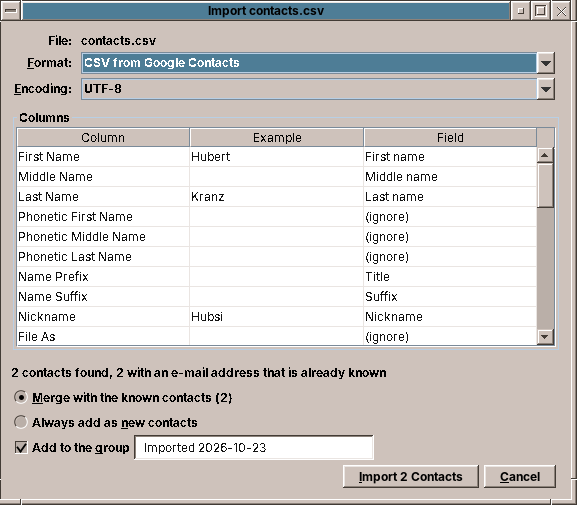
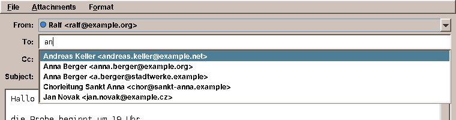
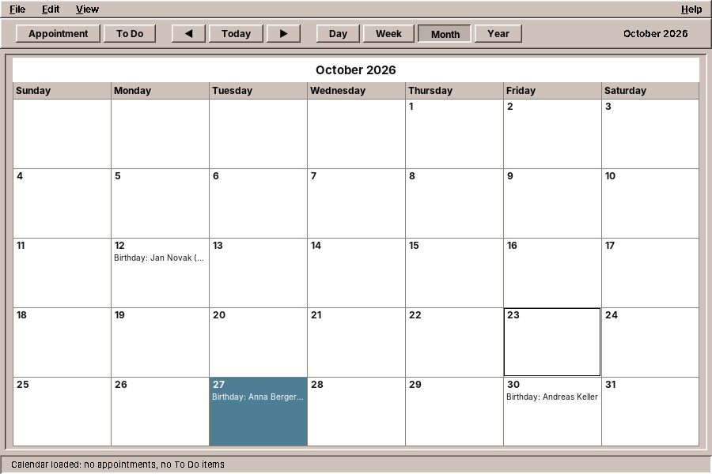

# 25. Contacts

An address book looks like the simplest program in this part: a list of names and a form. The difficult part is not on the screen. The addresses a user brings come from a phone, from Google, from Outlook and from Thunderbird, each in its own format and encoding, and the addresses the program writes should be readable by the next program the user tries, and by a phone that synchronises them. amade-contacts is a chapter about data that belongs to the user: open formats, files that other programs may change at any time, and the duty to keep what you do not understand.

The program has about 5,200 lines of Java and 1,800 lines of tests. Its toolbar made the shared glyphs grow: five programs had drawn their own *Export*, *Turn* and *Full Screen*, and they now share them in `StandardGlyph` ([chapter 46](46-toolbars-and-printing.md#the-shared-symbols-standardglyph)). And its address books go into amade-commons as a read-only `ContactDirectory`, from which the Mailer completes addresses and the Calendar shows birthdays ([below](#contacts-in-other-programs)).

## What you build


- **Three columns**: all contacts, the groups and the coming birthdays on the left; the list with photos or initials in the middle; the card of one contact on the right, with *Call*, *Write*, *Map* and *Open* next to the numbers and addresses.
- **A search** over everything on the card, that finds `+49 170 555 0123` when you type `5550123` and *Weiß* when you type `weiss`.
- **An editor** with as many phone numbers, e-mail and postal addresses and websites as a person has, birthdays with or without the year, groups and a photo.
- **Import** of vCard 2.1, 3.0 and 4.0, CSV from Google and Outlook and other tables, and LDIF from Thunderbird; contacts that are already known are merged.
- **Export** in the same formats, and the contacts on the clipboard as text for a mail or as vCards for another program.

## What you will learn

- Why one file per record in an open format beats a database for personal data, and how to write such files safely.
- How to read and write vCards with a library, and how to keep the properties your program does not know.
- How to guess the encoding of a file and the meaning of the columns of a table that another program exported.
- How to merge imported records with known ones without overwriting anything.
- How a program hands a mail, a phone call or a map to other programs with a URI.
- A pitfall of Swing tables that only shows when the dialog is built in a test.

## The structure

| Package | Contents |
|---|---|
| `domain` | `Contact`, `Name`, `Entry` and `Kind` (a phone number or e-mail address and whether it is mobile, home, work, fax or other), `PostalAddress`, `Birthday`, `Photo`, `Source` (what the left column lists), `StoredContact`, `Settings` |
| `io` | `VCards` (vCard to `Contact` and back), `CsvTable`, `ColumnMapping`, `CsvContacts`, `Ldif`, `TextFiles`, `FileFormat`, `ImportFile`, `Exports` |
| `repository` | `AddressBooks` (the folders and files), `ContactsPreferences` |
| `service` | `ContactImport` (adding and merging) |
| `ui.main` | `MainWindow`, `MainPresenter`, `MainMenuBar`, `ContactCard`, `Avatar`, `ContactsGlyph` |
| `ui.editor` | `ContactEditor` and its rows, `Photos` |
| `ui.transfer` | `ImportDialog`, `ExportDialog` |

`Contact` is a record of plain values. It knows nothing about vCards: `io` converts in both directions, so the domain and the presenter tests never see a file format.

## One file per contact

Where do the contacts go? A database such as SQLite would be fast and easy to query. But the user cannot read it, no other program understands it, a synchronisation tool cannot work with it, and one broken write can damage all records at once. An address book has a few hundred records, small enough to read completely at the start.

So amade-contacts uses the layout that the synchronisation tool [vdirsyncer](https://vdirsyncer.pimutils.org/) and the address book khard use, a *vdir*: a folder per address book, one vCard file per contact, and a file `displayname` with the name of the book.

```
~/.local/share/amadeos/contacts/
└── personal/
    ├── displayname
    ├── 4f1c0a2e-….vcf
    └── …
```

The folder is in the XDG data directory, not in the configuration directory, because contacts are data that the user would back up and take along:

```java title="amade-contacts · bootstrap/ContactsModule.java"
--8<-- "amade-contacts/src/main/java/eu/amadeos/apps/contacts/bootstrap/ContactsModule.java:books"
```

With this layout, vdirsyncer can already keep the folder in step with a CardDAV server today, without a line of network code in the program. And other programs may change the files while the address book runs. `AddressBooks.reload()` therefore reads the folders again whenever the window becomes active, and parses only the files whose modification time changed:

```java title="amade-contacts · repository/AddressBooks.java"
--8<-- "amade-contacts/src/main/java/eu/amadeos/apps/contacts/repository/AddressBooks.java:reload"
```

### Writing a file safely

`Files.writeString` truncates the file and then writes. A crash, a full disk or a power cut in between leaves an empty or half contact. The safe way is to write a temporary file in the same folder and then rename it over the old one. A rename within one file system is atomic: whoever reads the file sees the old or the new version, never a mix.

```java title="amade-contacts · repository/AddressBooks.java"
--8<-- "amade-contacts/src/main/java/eu/amadeos/apps/contacts/repository/AddressBooks.java:atomic"
```

The temporary file starts with a dot and ends with `.tmp`, so it does not match `*.vcf`, and a reload in that moment does not take it for a contact. It must be in the same folder: a temporary file in `/tmp` may be on another file system, and a "move" from there is a copy and a delete, which is exactly the half-written state we wanted to avoid. If the file system cannot rename atomically, which some network shares cannot, the fallback still replaces the file in one step.

## vCard

vCard is the format every address program speaks. It exists in three versions that are all in use: 2.1 from old phones and Outlook, with quoted-printable text; 3.0 from Apple and most programs of the 2000s; and 4.0 (RFC 6350), the current standard. They differ in details that matter: how a type is written (`TEL;CELL`, `TEL;TYPE=CELL`, `TEL;TYPE=cell`), how a birthday without a year looks (`--1114` in 4.0; Apple writes the year 1604), how a photo is embedded.

Writing a parser for this is a project of its own. amade-contacts uses [ez-vcard](https://github.com/mangstadt/ez-vcard) (BSD licence), which reads all three versions and writes each. It also brings support for HTML and JSON vCards, which the program does not need, so the build leaves those libraries out:

```groovy title="amade-contacts · build.gradle"
implementation('com.googlecode.ez-vcard:ez-vcard:0.12.2') {
    exclude group: 'org.jsoup'                      // hCard in HTML
    exclude group: 'com.fasterxml.jackson.core'     // jCard in JSON
}
```

!!! warning "Pitfall: a dependency you excluded can still be needed"
    The first build also left out FreeMarker, the template library ez-vcard uses for hCard output. Everything compiled, and reading the first vCard failed with `NoClassDefFoundError: freemarker/template/TemplateException`: the reader class mentions that exception type, and the JVM needs the class when it loads the reader. Exclude a transitive dependency only when a test reads and writes through the library with the jar as it will be shipped.

amade-contacts writes vCard 4.0 and reads everything. *Export* also offers 3.0, for older phones.

### Keeping what you do not understand

A vCard from an iPhone has properties amade-contacts does not show: instant-messaging addresses (`IMPP`), phonetic names, Apple's own `X-ABLabel` lines. If the program wrote a fresh vCard from its `Contact` record on every save, editing the phone number on the computer would delete them, and the user would only notice on the phone, weeks later.

So `AddressBooks` keeps the parsed `VCard` of every file next to the `Contact`, and saving changes only what the user changed:

```java title="amade-contacts · io/VCards.java"
--8<-- "amade-contacts/src/main/java/eu/amadeos/apps/contacts/io/VCards.java:update"
```

`update` turns the stored card into a `Contact` first, the state before the edit, and compares field by field. A name that did not change keeps its property as it was, with all its parameters; the phone numbers are replaced only if the list differs. Every other property of the file is not touched at all. The test writes a card like a phone would, edits it, and looks into the file:

```java title="amade-contacts · test · repository/AddressBooksTest.java"
--8<-- "amade-contacts/src/test/java/eu/amadeos/apps/contacts/repository/AddressBooksTest.java:foreign"
```

The same idea decides the formatted name `FN`, which vCard 4.0 requires. Most cards have `FN:Anna Berger` and `N:Berger;Anna;;;`. If `toContact` took `FN` as the display name, the editor would show "Anna Berger" in the display-name field, and changing the first name to *Anne* would leave the display name at *Anna*. So an `FN` that only repeats the name stays out of `displayName`, and the editor keeps it following the name.

The `save` method itself puts the parts together: the stored card or the imported one as the start, `update`, and the atomic write:

```java title="amade-contacts · repository/AddressBooks.java"
--8<-- "amade-contacts/src/main/java/eu/amadeos/apps/contacts/repository/AddressBooks.java:save"
```

## Reading what other programs export



### The encoding

A vCard from a phone is UTF-8. A CSV file from a German Outlook is Windows-1252, and `Jürgen` read as UTF-8 becomes `J�rgen`. A file does not say its encoding, but the bytes give it away: a byte order mark is certain, and a text in another encoding is almost never valid UTF-8, because UTF-8 requires every byte above 127 to be part of a strict pattern.

```java title="amade-contacts · io/TextFiles.java"
--8<-- "amade-contacts/src/main/java/eu/amadeos/apps/contacts/io/TextFiles.java:detect"
```

Windows-1252 is the right guess for the users of the five languages amadeOS speaks. The import dialog shows the guess and offers the others, and the preview is read again when the user picks one.

!!! tip "Tip: make test files the way the other program makes them"
    The test file for the German Outlook export was first written by a script that wrote the header in UTF-8 and the rows in Windows-1252. The detection rightly answered Windows-1252, the header became `Telefon geschäftlich`, and the column was not recognised as a work phone. The bug was in the test file, and only `file` and a hex dump showed it. Write test files with the bytes of the real program, and check them before you trust a failing test.

### The columns

Google, Outlook and every spreadsheet name their columns differently, in the language of the user: `Business Phone`, `Telefon geschäftlich`, `Téléphone bureau`, or in Google's export `Phone 1 - Label` and `Phone 1 - Value` with the kind in a cell of its own. `ColumnMapping.guess` reads each title as a list of folded words (lower case, without accents) and decides first the field and then the kind:

```java title="amade-contacts · io/ColumnMapping.java"
--8<-- "amade-contacts/src/main/java/eu/amadeos/apps/contacts/io/ColumnMapping.java:kind"
```

The guess is a suggestion, not a decision. The import dialog shows every column with an example value from the file and the field it will fill, and the user can change it. The guess only has to be good enough that for the exports of the big programs nobody has to.

### Merging

A user who imports their phone's contacts after the Google export has most people twice. `ContactImport` looks for a known contact with one of the imported e-mail addresses and merges the two:

```java title="amade-contacts · service/ContactImport.java"
--8<-- "amade-contacts/src/main/java/eu/amadeos/apps/contacts/service/ContactImport.java:apply"
```

`Contact.mergedWith` adds what the known contact lacks: further phone numbers (compared by their digits, so `089 555-0123` and `089 5550123` count as one), addresses, websites and groups, and the name, birthday or photo if the known one has none. It never replaces a value. An imported vCard that is not merged keeps all its properties, because `save` starts from it.

!!! warning "Pitfall: \"if empty\" is not the same as \"unknown\""
    The first version took the imported display name when the known contact had none. A table with the column *Name* and the line `Anna B.` then turned the known *Anna Berger* into *Anna B.*, because she had a name but no separate display name. The presenter test that imports a table into the fixture's address book caught it. A display name is only taken when the known contact has no name at all.

## Search

The search runs through everything on the card on every keystroke. For a few hundred contacts that is fast enough without an index, and it keeps the code simple:

```java title="amade-contacts · domain/Contact.java"
--8<-- "amade-contacts/src/main/java/eu/amadeos/apps/contacts/domain/Contact.java:matches"
```

Two rules make it find what people type. Text is folded, lower case and without accents, with ß as ss, so `weiss` finds *Weiß* and `muller` finds *Müller*. A word that is mostly digits is also compared with the digits of the phone numbers, because nobody remembers whether the number was saved as `0170/555 0123` or `+49 170 5550123`. Several words must all match, in any order.

## Handing over to other programs

An address book is the start of something else: a mail, a call, a visit. amade-contacts does none of these itself. It builds a URI and gives it to `DesktopLauncher` ([chapter 11](11-web.md)), which asks the desktop which program handles it:

- `mailto:` opens the Mailer with the recipients filled in.
- `tel:` goes to a program for calls if one is installed. If none is, `browse` throws, and the presenter copies the number instead and says so.
- An `https://www.openstreetmap.org/search?query=…` link shows the address on a map in the browser.

A mailto URI with several recipients needs care: the names may contain commas, quotes and umlauts. Each recipient is written as an RFC 5322 mailbox, `Anna Berger <anna@example.org>`, with quotes where the name needs them, and then percent-encoded:

```java title="amade-contacts · ui/main/MainPresenter.java"
--8<-- "amade-contacts/src/main/java/eu/amadeos/apps/contacts/ui/main/MainPresenter.java:mailbox"
```

The way back works through the desktop entry. Its `MimeType=text/vcard;text/x-vcard;text/directory;` line makes the File Manager open `.vcf` files in Contacts, and `Exec=/usr/bin/amade-contacts %F` hands them over as arguments, which the program imports. `Categories=Office;ContactManagement;` puts it into two drawers of the Front Panel, *Text & Office* and *Mail & Internet*, because a drawer takes every program with one of its categories.

## The window

The window is three lists and a card, built as in the earlier chapters: a presenter behind a `MainView` interface, a menu bar and a toolbar that share their actions. The toolbar takes *Edit*, *Delete*, *Mail*, *Import* and *Export* from `StandardGlyph`; only *New Contact* (a person with a plus) and *Call* (a handset) are its own:

```java title="amade-contacts · ui/main/ContactsGlyph.java"
--8<-- "amade-contacts/src/main/java/eu/amadeos/apps/contacts/ui/main/ContactsGlyph.java:paint"
```

A contact without a photo gets its initials in a circle. The colour comes from the hash of the UID, so it stays the same when the contact is renamed, and from a small palette of muted colours that work with every theme.

!!! warning "Pitfall: a JTable asks its model at once"
    The import dialog has a table of columns whose model translates its column titles with the dialog's `Messages`. The table was a field: `private final JTable table = new JTable(columns);`. Field initialisers run before the constructor's body, so the `JTable` constructor asked the model for its column names while `msg` was still `null`. The program never showed the dialog with a CSV file during development, and the first test that built the dialog failed with a `NullPointerException`. Create Swing components that call back into your object in the constructor, after the fields they need.

## Contacts in other programs

An address book earns its keep when the other programs use it. The Mailer completes addresses from it while you type, and the Calendar shows the birthdays. Both read the same folder Contacts writes, through a small `ContactDirectory` in amade-commons:



### Reading without the library

The Mailer and the Calendar need three things from a card: the name, the e-mail addresses and the birthday, plus the groups to put a whole group into *To*. ez-vcard would bring them all, at the price of a library in two more programs. `ContactDirectory` reads them with under 300 lines of its own instead: it unfolds the lines, drops group prefixes such as `item1.EMAIL`, unescapes `\,` and `\n`, decodes vCard 2.1's `QUOTED-PRINTABLE` and skips every property it does not know. It never writes. Contacts stays the only program that changes a contact, so there is one place that has to get the full format right.

The directory is asked on every key press, so it must be cheap. It looks at the folder again at most every two seconds and reads only the files whose modification time changed, the same rule `AddressBooks.reload` follows ([above](#one-file-per-contact)):

```java title="amade-commons · contacts/ContactDirectory.java"
--8<-- "amade-commons/src/main/java/eu/amadeos/commons/contacts/ContactDirectory.java:rescan"
```

### Completing an address

What the user typed is matched against the start of every word of the name, the nickname and the address, folded as in the search of Contacts, so `mull` finds *Müller* and `firma` finds `a.berger@firma.example`. Whole-name matches come first, then word matches, then addresses, and groups after the people. A group becomes one suggestion that puts in the preferred address of every member:

```java title="amade-commons · contacts/ContactDirectory.java"
--8<-- "amade-commons/src/main/java/eu/amadeos/commons/contacts/ContactDirectory.java:complete"
```

`AddressCompletion` is the Swing half. It listens to the field, finds the address under the caret between the commas, asks for suggestions and shows them in a popup under that address. Up and Down choose, Enter or Tab takes one, Escape closes the list. The popup is not focusable, so the caret stays in the field and the user simply goes on typing. A comma inside a quoted name is not a separator:

```java title="amade-commons · contacts/AddressCompletion.java"
--8<-- "amade-commons/src/main/java/eu/amadeos/commons/contacts/AddressCompletion.java:token"
```

`CommonsModule` binds a `ContactDirectory` for every program ([chapter 41](41-start-up.md#what-every-program-gets-commonsmodule)), so the Mailer only has to ask for it and install the completion on its three address fields:

```java title="amade-mail · ui/compose/ComposeWindow.java"
--8<-- "amade-mail/src/main/java/eu/amadeos/apps/mail/ui/compose/ComposeWindow.java:completion"
```

The completion leaves `Anna Berger <anna@example.org>, ` in the field, with a comma for the next address. Jakarta Mail's `InternetAddress.parse` skips the empty address after the last comma, and a test in the Mailer makes sure it stays that way.

??? example "Test: names, words, addresses and groups"
    ```java title="amade-commons · test/contacts/ContactDirectoryTest.java"
    --8<-- "amade-commons/src/test/java/eu/amadeos/commons/contacts/ContactDirectoryTest.java:complete-test"
    ```

### Birthdays in the calendar

`ContactDirectory.birthdays(from, to)` lists the birthdays in a range of days, with the age when the year is known. A birthday on 29 February is on 28 February in other years, and nobody has a birthday before they were born:

```java title="amade-commons · contacts/ContactDirectory.java"
--8<-- "amade-commons/src/main/java/eu/amadeos/commons/contacts/ContactDirectory.java:birthdays"
```

The Calendar turns them into day notes, appointments without a time. They must look like appointments to the views, the lists, Find and printing, and must not become part of the calendar file. So `CalendarService` keeps them out of its map and adds them only when it answers `occurrencesBetween` ([chapter 21](21-calendar.md#all-occurrences-of-a-period)). Their UIDs start with a prefix no iCalendar program uses, which is how the presenter recognises them:

```java title="amade-calendar · service/CalendarService.java"
--8<-- "amade-calendar/src/main/java/eu/amadeos/apps/calendar/service/CalendarService.java:birthdays"
```

```java title="amade-calendar · ui/main/MainPresenter.java"
--8<-- "amade-calendar/src/main/java/eu/amadeos/apps/calendar/ui/main/MainPresenter.java:birthdays"
```



A birthday cannot be edited in the Calendar. A double-click says where it comes from and offers to open Contacts; the Appointment Editor leaves birthdays out of its list of the day, and the presenter ignores a change or a delete of one. *Display Settings* can hide them.

??? example "Test: birthdays are day notes that cannot be edited"
    ```java title="amade-calendar · test/ui/main/MainPresenterTest.java"
    --8<-- "amade-calendar/src/test/java/eu/amadeos/apps/calendar/ui/main/MainPresenterTest.java:birthday-test"
    ```

!!! tip "Tip: `user.home` is not `$HOME`"
    `XdgDirectories.system()` takes the home folder from the Java property `user.home`, which the JVM reads from the user database, not from the `HOME` variable. A screenshot or test that sets `HOME=/tmp/demo` still sees the real address books. Pass `-Duser.home=/tmp/demo` too, or build an `XdgDirectories` with the folder you want.

## What amade-commons gives Contacts

| Part | Since | Contacts uses it for |
|---|---|---|
| `AmadeApplication`, `AppInfo`, `CommonsModule`, `EdtExecutor` | chapter 10 | start-up and wiring |
| `Messages`, `Mnemonics`, `LocaleSettings`, `TranslationCheck` | chapter 10 | five languages, the menu letters, the language menu, the translation test |
| `AmadeUI`, `DesktopTheme` | chapter 10 | the Motif look, the colours of the card and the avatars |
| `DesktopLauncher` | chapter 11 | `mailto:`, `tel:`, the map and websites |
| `XdgDirectories`, `AppDirectories`, `PropertiesFile` | chapter 20 | the contacts folder, `contacts.properties` |
| `DateChooser` | chapter 21 | the birthday in the editor |
| `ToolIcon`, `StandardGlyph`, `ToolButtons` | chapter 30 | the toolbar; *Edit*, *Delete*, *Import*, *Export* and *Mail* are new in `StandardGlyph` |
| `ContactDirectory`, `AddressCompletion`, `Recipient` | **this chapter** | not used by Contacts itself: they give its address books to the Mailer and the Calendar |

### And what stays in Contacts

- **vCard reading and writing.** ez-vcard is a dependency of this program only. The Mailer and the Calendar need much less, read only, and get it from `ContactDirectory` with its own small reader ([above](#reading-without-the-library)).
- **CSV and LDIF import.** No other program imports address tables.
- **Merging.** It depends on what a contact is.

## Exercises

1. **Add a contact from the Mailer.** Start `amade-contacts --add "Anna Berger <anna@example.org>"` and open the editor with that name and address filled in, or the existing contact if the address is known. Where in the start-up does the argument go, and what should happen if Contacts is already running?
2. **Duplicates without an import.** Add *Contacts → Find Duplicates…* that lists pairs with the same e-mail address or the same phone digits and merges a pair on request. Which contact keeps its UID and file, and what happens to the other file?
3. **Address labels.** Print the selected contacts' postal addresses on a sheet of labels, 3 × 8 on A4, with `PrintJobs` ([chapter 46](46-toolbars-and-printing.md)). How do you print the address in the order the country uses?
4. **A second address book.** The repository already reads every folder as an address book. Add *Contacts → New Address Book…* and a way to move contacts between books. Why must moving be a write of the new file followed by a delete of the old one, and not the other way round?
5. **Recently used addresses.** The Mailer could also suggest addresses it sent to that are not in the address book. Where would you keep them, how would you rank them against contacts, and how does the user turn such an address into a contact?
6. **Watch the folder.** Replace the reload on window activation with a `WatchService` on the folders. What happens when vdirsyncer writes fifty files in one second?

## Summary

- Keep personal data in open formats, one file per record, in the XDG data directory. Other programs, backups and synchronisation tools then work with it for free.
- Write files through a temporary file in the same folder and an atomic rename.
- Reload what other programs changed, by modification time, when the window becomes active.
- When you edit a record that another program wrote, change only what the user changed and keep every property you do not understand.
- Guess the encoding from the bytes: a byte order mark, valid UTF-8, else the Windows code page; and let the user override it.
- Guess the meaning of columns from their folded words, and show the guess so the user can correct it.
- Merge imported records by a strong key such as the e-mail address, add what is missing, and never overwrite.
- Hand mails, calls and maps to other programs with URIs, and have a fallback when no program takes them.
- Let other programs read your data through a small read-only view in the shared library, and keep the writing in one program.
- Show data that belongs to another program, such as birthdays, next to your own without saving it, and say where to change it.
