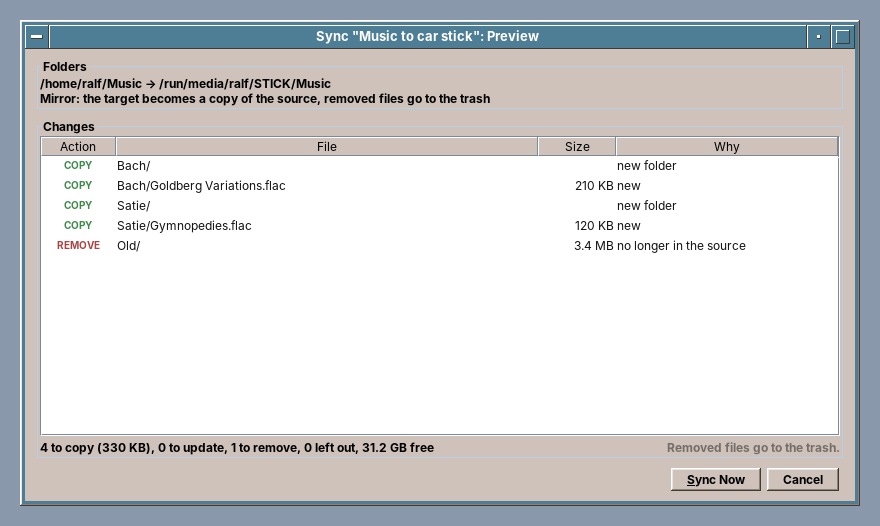

# 26. Backup & Sync

Every other program in this book works on the user's files. This one is there for the day they are gone: a broken disk, a stolen laptop, a letter overwritten by mistake. A backup program has to be the most careful program on the computer. When it fails, nobody notices until the day it is needed, and when it is wrong, it takes the user's trust with it. So most of this chapter is about care: an engine that is not ours behind an interface of our own, a disk that is found again wherever it is mounted, restoring that never overwrites a file without asking, and a sync that shows what it will do before it does it.

amade-backup has about 7,800 lines of Java and 2,600 lines of tests. Some of the tests run the real restic program. Nothing moves into amade-commons with it. It is the third program that writes the freedesktop.org trash, after Files and Image Viewer, which makes the trash the next candidate.

## What you build


- **Jobs** of two kinds. A *backup* keeps versions of folders on another disk, encrypted and compressed. A *sync* makes one folder like another, as an update or as a mirror. Every job has its state as a coloured dot, its settings, and a **history** of its runs with their logs.
- **The home folder backup**: an assistant in five steps (where, what, when, password, start). It sorts the home folder into areas with their sizes and always leaves out caches and the trash.
- **A keep rule** that reads as a sentence: *all of the last 2 days, then 7 daily, 8 weekly, 12 monthly, 100 yearly*.
- **The password in the keyring**, a password made up for the user on request, and a **recovery sheet** to print.
- **Restoring** from a timeline of the backups, with a folder tree, the state of each file now, its versions, and a search over all backups.
- **The sync preview**: every copy, update, removal and left-out file with its reason, before anything happens.
- **Five languages**, following the desktop.

The pictures in this chapter are taken from the program's real windows, on a test scene with real restic backups ([below](#pictures-from-the-real-windows)).

## What you will learn

- How to put a command line program behind an interface of your own, talk to it in JSON, and hand it a password safely.
- How to find a USB disk again by its UUID, wherever it is mounted next time.
- How to describe a home folder in areas the user understands, and turn them into exclude lists.
- How to restore files without ever overwriting one silently, through a staging folder on the same disk.
- How to plan a sync first and run it second, and why FAT sticks need two seconds of tolerance.
- How to write into the trash of any disk, not only the home trash.
- How to test against the real tool, and take the README's pictures from the real windows.

## The structure

| Package | Contents |
|---|---|
| `domain` | `Job`, `Target`, `Schedule`, `KeepPolicy`, `HomeArea`, `HomeLayout`, `Snapshot`, `SnapshotEntry`, `Timeline`, `Comparison`, `RunRecord`, `RunResult` |
| `engine` | `BackupEngine`, `Repository`, `BackupRequest`, `EngineException`, `Cancellation` |
| `engine.restic` | `ResticEngine`, `ResticCall` |
| `disk` | `Disks`, `Disk` |
| `run` | `BackupRunner`, `Restorer`, `SyncRunner`, `Places`, `Passwords`, `Readme`, `JobLock` |
| `sync` | `SyncPlanner`, `SyncPlan`, `SyncAction`, `SyncExecutor`, `Patterns`, `Trash`, `FileSystemInfo` |
| `repository` | `JobStore` (`jobs.json`), `HistoryStore` (the runs and logs of each job) |
| `ui` | `main`, `assistant`, `restore`, `sync`, `edit`, `common` |

The windows never see restic, and the runners never see Swing. `BackupRunner` and `SyncRunner` take a job and return a `RunRecord`, whoever starts them. Today that is the window. Later it will be the helper that starts with the session and runs the scheduled jobs.

## An engine behind an interface

Writing a backup program means writing two things: the program people use, and the engine that stores versions of files, deduplicated, compressed and encrypted, so that a bit flipped on the disk is noticed and a lost disk gives nothing away. The engine is years of work, and [restic](https://restic.net) has done that work: it is free software (BSD-2-Clause), it is in Debian, and its repositories are documented. So amade-backup uses restic, but only through an interface of its own:

```java title="amade-backup · engine/BackupEngine.java"
--8<-- "amade-backup/src/main/java/eu/amadeos/apps/backup/engine/BackupEngine.java:engine"
```

The interface talks in the program's own words: a `Snapshot`, a `SnapshotEntry`, a `KeepPolicy`, a `BackupProgress`. Nothing in it says restic. An engine of our own, in Java, could replace `ResticEngine` later without changing a window, a job or the history. The decision for restic was made the way the book makes such decisions: use the proven tool now, and keep the door open.

There is a second reason for restic. A backup must be readable when amadeOS is not there: on a new computer, on another system, in ten years. A restic repository can be read by restic on Linux, macOS and Windows. The program writes a `README-amadeOS-backup.txt` next to the repositories that says how.

### The password on standard input

restic needs the repository's password on every call. The obvious ways to hand it over are both wrong. On the command line, every user of the computer can read it in the process list. In an environment variable, it is inherited by every program restic starts and can be read from `/proc` by the same user. restic reads the password from standard input when that is not a terminal, so `ResticCall` writes it there and closes the stream:

```java title="amade-backup · engine/restic/ResticCall.java"
--8<-- "amade-backup/src/main/java/eu/amadeos/apps/backup/engine/restic/ResticCall.java:password"
```

`ResticCall` runs restic through amade-commons' `CommandRunner` ([chapter 47](47-programs-json-network.md#running-a-program-commandrunner)), reads standard error on a virtual thread of its own so that neither stream can block the other, and connects the `Cancellation` to `Process.destroy`.

### JSON lines

With `--json`, restic writes one JSON object per line while a backup runs: `status` lines with the progress, `error` lines for files it could not read, and a `summary` at the end. The engine turns them into the program's records with amade-commons' `Json` ([chapter 47](47-programs-json-network.md#json)):

```java title="amade-backup · engine/restic/ResticEngine.java"
--8<-- "amade-backup/src/main/java/eu/amadeos/apps/backup/engine/restic/ResticEngine.java:backup"
```

Exit code 3 (`INCOMPLETE`) is accepted: restic ends with it when it saved a backup but could not read some files, for example a socket or a file the user may not read. That is not a failure. The run becomes *incomplete*, a yellow dot, and the log names the files.

Not every command is that tidy. Some print plain text between their JSON, and one prints into its data. `restic dump` writes a file of a backup to standard output, and without `--quiet` it also writes *reading repository password from stdin* there, which would end up at the start of the restored file:

```java title="amade-backup · engine/restic/ResticEngine.java"
--8<-- "amade-backup/src/main/java/eu/amadeos/apps/backup/engine/restic/ResticEngine.java:dump"
```

### Failures by kind

The window must say different things for a wrong password, a missing repository and a repository that another run holds locked. restic 0.17 and later use separate exit codes for these. Older versions, such as Debian's, only say it in the message, so `failure` looks at both:

```java title="amade-backup · engine/restic/ResticCall.java"
--8<-- "amade-backup/src/main/java/eu/amadeos/apps/backup/engine/restic/ResticCall.java:failure"
```

A missing restic is its own kind too, `PROGRAM_MISSING`, from `ProgramMissingException`. The window then says that the package `restic` is needed, instead of showing a stack trace.

### Tests with a fake restic

Most of the engine's tests never start restic. A `CommandRunner` that answers with canned output (amade-commons' `FinishedProcess`) is enough to check what the engine asks for and what it makes of the answer:

```java title="amade-backup · engine/restic/ResticEngineTest.java"
--8<-- "amade-backup/src/test/java/eu/amadeos/apps/backup/engine/restic/ResticEngineTest.java:fake"
```

```java title="amade-backup · engine/restic/ResticEngineTest.java"
--8<-- "amade-backup/src/test/java/eu/amadeos/apps/backup/engine/restic/ResticEngineTest.java:progress"
```

Canned output only tests what we believe restic says. `ResticIntegrationTest` checks the belief: it backs up a small home folder with the real restic, changes it, backs up again, and then lists, finds, compares, restores and thins out. CI installs restic for it:

```yaml title="amade-backup · .github/workflows/build.yml"
--8<-- "amade-backup/.github/workflows/build.yml:restic"
```

## Finding the disk again

A USB disk is mounted under `/media/ralf/BACKUP` today, `/media/ralf/BACKUP1` tomorrow when a second stick with the same label is plugged in, and `/run/media/ralf/BACKUP` on another distribution. A job that remembered the path would back up into an empty folder on the system disk, or fail. So a job remembers the disk by its **file system UUID**, and the path *on* the disk relative to its root. `Disks` reads what is mounted from `/proc/self/mounts`, keeps the mount points below `/media`, `/run/media` and `/mnt`, and looks up each device in the links of `/dev/disk/by-uuid` and `/dev/disk/by-label`:

```java title="amade-backup · disk/Disks.java"
--8<-- "amade-backup/src/main/java/eu/amadeos/apps/backup/disk/Disks.java:mounted"
```

`/proc/self/mounts` writes a space in a path as `\040`, and udev writes it as `\x20` in the link names, so both are unescaped. Finding the disk of a job is then one filter:

```java title="amade-backup · disk/Disks.java"
--8<-- "amade-backup/src/main/java/eu/amadeos/apps/backup/disk/Disks.java:by-uuid"
```

`Places` answers the question every run starts with: where is the target right now? A target on a disk is there when its disk is. A target folder is there when the folder or its parent exists. A folder on a network share that is not mounted is *not* there, even though `Files.createDirectories` would happily create it on the system disk under the empty mount point:

```java title="amade-backup · run/Places.java"
--8<-- "amade-backup/src/main/java/eu/amadeos/apps/backup/run/Places.java:resolve"
```

A run whose target is not there does not fail. It ends as `TARGET_MISSING`, the dot turns yellow, and the window says *Connect BACKUP to back up or restore*.

`Disks` takes the three paths in its constructor, so the tests write a `mounts` file and a folder of links of their own, and need neither root rights nor a real stick.

## The home folder in areas

"Back up the home folder" sounds simple, until the first backup takes four hours for a 200 GB folder of videos and browser caches. The assistant shows the home folder as the user thinks of it: Documents, Pictures, Music, Videos, Downloads, the desktop folders, the data of the amade programs, the settings, and everything else. `HomeLayout` decides which area a path belongs to. The names of the user folders come from `~/.config/user-dirs.dirs`, so a German *Bilder* is Pictures:

```java title="amade-backup · domain/HomeLayout.java"
--8<-- "amade-backup/src/main/java/eu/amadeos/apps/backup/domain/HomeLayout.java:area"
```

A job stores the chosen areas, not a list of folders. At every run, `HomeLayout.excludes` turns the areas that are switched off into exclude paths for restic. A folder the user creates next month falls into *Other folders* and is backed up without anyone touching the job. `.local/share` mixes areas (the amade programs' data next to other programs' caches), so it is split one level deeper. Caches and the trash are never areas: they are always left out.

A home backup also saves `apt-mark showmanual` into a file of the home folder first. After a new installation, the backup then holds the list of programs the user had installed.

## Keeping what matters

Backups would fill any disk if all of them stayed. restic's `forget` thins them out by a rule, and `prune` frees the space. `KeepPolicy` is the rule in the program's terms, and translates itself into restic's options:

```java title="amade-backup · domain/KeepPolicy.java"
--8<-- "amade-backup/src/main/java/eu/amadeos/apps/backup/domain/KeepPolicy.java:restic"
```

`--keep-last 1` is always there. A rule of zeros must never leave a repository without its newest backup. `forget` groups by paths, so backups of different folders in one repository never thin each other out, and `prune` runs only when something went:

```java title="amade-backup · engine/restic/ResticEngine.java"
--8<-- "amade-backup/src/main/java/eu/amadeos/apps/backup/engine/restic/ResticEngine.java:forget"
```

### The password

The repository password is the only key. `Passwords` keeps it in the keyring through amade-commons' `PasswordStore` ([chapter 45](45-desktop.md#passwords-passwordstore)), under the job's id, so scheduled backups never ask. A password made up by the program avoids the letters and digits that look alike on paper, because the user will one day type it in from the printed recovery sheet:

```java title="amade-backup · run/Passwords.java"
--8<-- "amade-backup/src/main/java/eu/amadeos/apps/backup/run/Passwords.java:generate"
```

The assistant does not go on until the user ticks *I have written down or printed the password*. A program cannot make anyone keep a sheet of paper, but it can make them think about it once.

## One run

`BackupRunner.run` is a job from start to end. It never throws: every ending, even a missing disk or a cancelled run, becomes a `RunRecord` in the history, with a log:

```java title="amade-backup · run/BackupRunner.java"
--8<-- "amade-backup/src/main/java/eu/amadeos/apps/backup/run/BackupRunner.java:run"
```

`JobLock` is a lock file in the job's history folder. When the helper of step 2 starts a scheduled backup while the user clicks *Back Up Now* in the window, one of the two gets the lock and the other ends at once. The numbers of removed files come from `restic diff` against the previous backup, since restic's summary only counts new and changed ones.

## Restoring


The restore window sorts the backups into a timeline of the kind a person remembers: today, yesterday, this week, then by month, then by year. The headings are computed, not stored, so they are right on every day the window opens. The week starts on the day of the user's locale:

```java title="amade-backup · domain/Timeline.java"
--8<-- "amade-backup/src/main/java/eu/amadeos/apps/backup/domain/Timeline.java:of"
```

### Never overwrite silently

`restic restore` writes the files under their full original path below a target folder and overwrites whatever is there. Pointed at `/`, it would replace the user's current files without a question. `Restorer` therefore lets restic write into a hidden **staging folder**, and moves each file from there to its place itself:

```java title="amade-backup · run/Restorer.java"
--8<-- "amade-backup/src/main/java/eu/amadeos/apps/backup/run/Restorer.java:restore"
```

The staging folder lies on the same disk as the destination, next to it, so the final step is a rename and not a second copy of gigabytes. When a file is already there, the user's choice decides. *Replace* puts the current file into the trash first, so even that can be undone:

```java title="amade-backup · run/Restorer.java"
--8<-- "amade-backup/src/main/java/eu/amadeos/apps/backup/run/Restorer.java:conflict"
```

Folders are merged, file by file, so restoring a folder over itself only meets the files that exist in both. *Keep Both* names the restored file `report (restored).odt`.

## Syncing with a preview



The sync is the oldest part of the program: it is the engine of EuroSync, an earlier experiment in the spirit of grsync, ported and given one rule. **Nothing happens without a preview.** `SyncPlanner` walks both trees and produces a `SyncPlan`, a list of actions with their reasons. The window shows the plan, and only *Sync Now* hands the same plan to `SyncExecutor`. A dry run is not an option the user has to know about: it is the first step, every time.

A file is copied when the target lacks it, and updated when size or time differ:

```java title="amade-backup · sync/SyncPlanner.java"
--8<-- "amade-backup/src/main/java/eu/amadeos/apps/backup/sync/SyncPlanner.java:file"
```

FAT and exFAT, the file systems of most sticks and of every car radio, store modification times only to two seconds. A file copied there at 12:00:01 reads back as 12:00:00, and a naive sync would copy every file again every time. So the planner asks for the target's file system type first:

```java title="amade-backup · sync/SyncPlanner.java"
--8<-- "amade-backup/src/main/java/eu/amadeos/apps/backup/sync/SyncPlanner.java:tolerance"
```

The executor writes each copy under a hidden name ending in `.amade-part` and renames it when it is complete, like Files ([chapter 20](20-files.md#a-copy-that-is-never-half-a-file)). The planner skips such names, so a cancelled sync leaves no half file that looks real.

## The trash of any disk

A mirror removes files from the target, and a sync must never delete for good. Files ([chapter 20](20-files.md#the-trash)) and Image Viewer write into the home trash. A sync's target is usually another disk, though, and moving a file from a stick into the home trash would copy it onto the system disk. The freedesktop.org specification has an answer: every disk has its own trash, `.Trash-<uid>` at its top folder. `Trash` picks the right one:

```java title="amade-backup · sync/Trash.java"
--8<-- "amade-backup/src/main/java/eu/amadeos/apps/backup/sync/Trash.java:trash-for"
```

In the trash of another disk, the `Path=` of the `.trashinfo` file is relative to that disk's top folder, so the entry is still right when the stick is mounted somewhere else. Creating the info file first with `CREATE_NEW` reserves the name, as in Image Viewer:

```java title="amade-backup · sync/Trash.java"
--8<-- "amade-backup/src/main/java/eu/amadeos/apps/backup/sync/Trash.java:info"
```

The planner leaves the trash folder of the target alone, so a mirror does not remove its own trash at the next run.

## Pictures from the real windows

The README, the AppStream metadata and this chapter need pictures with a believable home folder, five backups over six weeks, a changed report and a deleted letter. Drawing them by hand would show a program that does not exist. Making them on a real machine is slow, and they would show the author's own files. The tests already have what the pictures need: `Scene` builds a home folder, a fake mounted disk and real restic backups with times in the past. restic sets a backup's time with `--time`:

```java title="amade-backup · Scene.java"
--8<-- "amade-backup/src/test/java/eu/amadeos/apps/backup/Scene.java:snapshot"
```

`Screenshots`, a `main` in the test sources, opens the real windows on that scene with a fixed clock, waits for each to fill, and paints it into an image with the frame of the amadeOS window manager. A Gradle task runs it:

```groovy title="amade-backup · build.gradle"
--8<-- "amade-backup/build.gradle:screenshots"
```

`xvfb-run ./gradlew screenshots` renews all pictures after a change to a window. The program in the pictures is always the program as it is.

## What amade-commons gives Backup & Sync

| Part | Since | Backup & Sync uses it for |
|---|---|---|
| `AmadeApplication`, `AppInfo`, `CommonsModule`, `EdtExecutor` | chapter 10 | start-up and wiring, the background executor, results to the event dispatch thread |
| `Messages`, `Mnemonics`, `TranslationCheck` | chapters 10 and 22 | five languages, the menu letters, the test that all of them have every text |
| `AmadeUI`, `DesktopTheme` | chapter 10 | the Motif look, the bevels, the colours of the dots |
| `XdgDirectories` | chapter 10 | the home, data and cache folders |
| `DesktopLauncher` | chapter 11 | *Open* in the restore window, which opens a version in its program |
| `PasswordStore` | chapter 22 | the repository passwords in the keyring |
| `PrintJobs` | chapter 23 | the recovery sheet |
| `CommandRunner`, `FinishedProcess`, `ProgramMissingException` | chapter 31 | restic and `apt-mark`, and tests with a fake restic |
| `Json` | chapter 33 | restic's answers, `jobs.json` and the history |

### What stays in Backup & Sync

- **The engine and its interface.** No other program keeps versions of files.
- **`Disks`.** Files lists the mounted sticks too, but for showing them, not for finding one again by its UUID. When a third program needs mounted disks, the reading of `/proc/self/mounts` and its escapes is the part to share.
- **`Trash`.** Backup & Sync is the third program that writes the freedesktop.org trash, after Files and Image Viewer, and the first that writes the trash of other disks. The writing half of the trash (`moveToTrash` with the right trash folder) is the next candidate for amade-commons. The reading half, listing and restoring, belongs to Files. See the exercises.

## Exercises

1. **The trash in amade-commons.** Compare `Trash` here with Files' `TrashService` and Image Viewer's `Trash`. Write `eu.amadeos.commons.files.Trash` with `moveToTrash` for the home trash and the trash of other disks, and tests with a temporary folder as home. Which of the three programs needs which part, and what stays in Files?
2. **Backup when the disk comes.** Watch `/proc/self/mounts` (it signals changes through `poll` with `POLLPRI`, or simply read it every few seconds) and start the jobs whose disk has just appeared and whose schedule says *also when the disk is connected*. Where does the code belong, so that the helper of step 2 can use it without a window?
3. **Check now and then.** `restic check --read-data-subset=5%` reads a twentieth of the data. Run it after every tenth backup, and show the result in the history. How long does it take on a stick, and is that acceptable after a backup?
4. **Restore a deleted folder.** *Show → Deleted* lists deleted files. Make it list a deleted folder as one entry, with the number of files in it, and restore it with one click.
5. **A second password.** restic repositories can have several keys (`restic key add`). Offer a second password for the recovery sheet, so the one in the keyring can be changed without printing a new sheet. What happens to the old sheet?

## Summary

- Use a proven engine through an interface of your own. The interface speaks in the program's words; the engine can be replaced. Choose an engine whose data can be read without your program.
- Hand passwords to other programs on standard input, never on the command line or in the environment.
- Read JSON lines as they come. Expect plain text between them, and keep a program's messages out of its data (`--quiet`).
- Remember a disk by its UUID and the path on it, and treat a target that is not there as *not connected*, never as a folder to create.
- Describe the home folder in areas the user understands, and compute the excludes at every run.
- Restore through a staging folder on the same disk, never overwrite silently, and put replaced files into the trash.
- Plan a sync first and show the plan; on FAT and exFAT, times within two seconds are equal. Removed files go into the trash of their own disk.
- Test with canned output for what the program makes of an answer, and with the real tool for what the tool really says. Take the pictures from the real windows.
