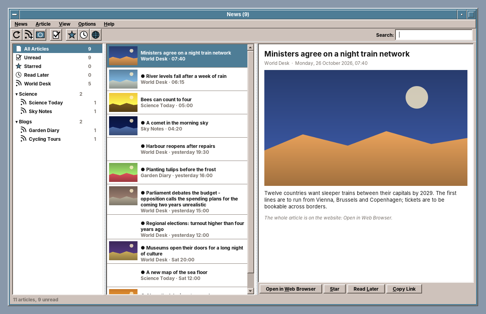
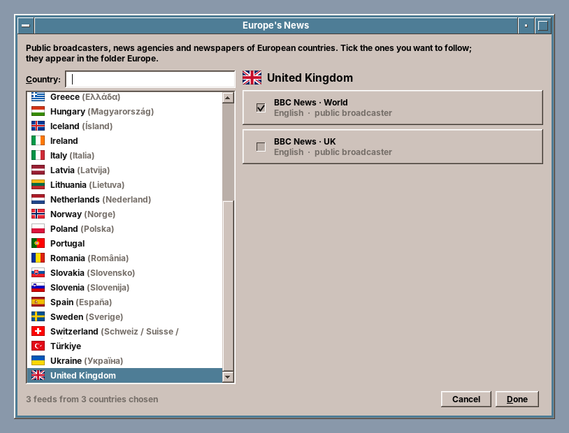

# 27. News

Every program so far has worked with files that are on the computer, or with one server the user chose. News reads what thousands of strangers publish: the feeds of websites, blogs and podcasts, written by every kind of software, some of it twenty years old, some of it broken. A feed reader has to read what it gets, without trusting any of it, and it has to be a polite guest, because it asks the same servers the same question every half hour.

amade-news has about 5,200 lines of Java and 2,000 lines of tests. It needs no library besides amade-commons: the feeds are read with the JDK's StAX parser and fetched with `java.net.http.HttpClient`.

## What you build



- **Three columns**: on the left *All Articles*, *Unread*, *Starred*, *Read Later*, the feeds and their folders with unread counts; in the middle the articles, newest first, with a small picture; on the right the article.
- **Europe's News**: the public broadcasters, news agencies and newspapers of European countries, chosen by country and flag.
- **Add Feed** from the address of a feed or just of a website, whose page names its feeds.
- **Updating** in the background, four feeds at a time, asking each server whether anything changed.
- **Star**, **Read Later**, search, folders, and **OPML** import and export to move between feed readers.
- **Five languages**, following the desktop. The articles stay in the language they were written in.

## What you will learn

- How to read XML from the internet safely, and how to repair what other programs got wrong.
- How to find the feeds of a website from its HTML.
- How to ask a server *has anything changed?* instead of fetching everything again, and how to wait when it asks you to.
- How to merge fresh data into what the user already did with the old data, without losing either.
- How to run many network requests at once, but only a few at a time, and report to the window as they finish.
- How to wrap HTML in a list cell to the width the list really has.
- How to test a network program with a network made of a map.

## The structure

| Package | Contents |
|---|---|
| `domain` | `Feed`, `Article`, `Source` (all, unread, starred, later, folder, one feed), `Settings` |
| `feed` | `FeedParser` (RSS, RDF, Atom), `ParsedFeed`, `FeedDiscovery`, `HtmlText`, `Dates` |
| `net` | `Http`, `JdkHttp` |
| `update` | `FeedUpdater`, `FeedFinder` |
| `store` | `Subscriptions` (`subscriptions.opml`), `Opml`, `ArticleStore` (a JSON file per feed), `FeedState`, `NewsPreferences` |
| `catalog` | `Catalog` (Europe's News) |
| `images` | `ImageCache` |
| `ui` | `main` (window, presenter, `ReadingPane`), `dialogs` (Add Feed, Europe's News, Preferences), `common` |

The presenter knows the window only through `MainView`, and the updater knows the network only through `Http`, an interface with one method. The tests replace both.

## Reading what the internet sends

A feed is XML, and XML can do more than a feed needs. A document type definition can declare an entity that the parser reads from a file (`file:///etc/passwd`) or a server inside the user's network, and an entity that expands into another, a billion times. A program that reads documents from strangers switches all of that off. Feeds never need it:

```java title="amade-news · feed/FeedParser.java"
--8<-- "amade-news/src/main/java/eu/amadeos/apps/news/feed/FeedParser.java:factory"
```

Then comes the other half of reading the internet: much of it is not quite XML. A raw `&` in a title, `&nbsp;` copied from HTML, a control character from a database, or a page that says `ISO-8859-1` in its header but sends UTF-8. A strict parser stops at the first of them, and the reader would show nothing. So `parse` tries strictly first, and only when that fails reads the text again after a repair:

```java title="amade-news · feed/FeedParser.java"
--8<-- "amade-news/src/main/java/eu/amadeos/apps/news/feed/FeedParser.java:parse"
```

```java title="amade-news · feed/FeedParser.java"
--8<-- "amade-news/src/main/java/eu/amadeos/apps/news/feed/FeedParser.java:repair"
```

The first lines catch a common mistake of users rather than of servers: the address of a web page instead of its feed. That becomes its own error, *web-page*, which the window turns into *The address is a web page, not a feed*, and which Add Feed answers by looking into the page.

!!! tip "One tree for three formats"
    RSS 2.0, RSS 1.0 (RDF) and Atom name the same things differently: `item` or `entry`, `pubDate`, `dc:date` or `updated`, `guid` or `id`. `FeedParser` first reads the document into a small tree of its own, then `rss()` and `atom()` look for what they need in it. Media RSS, `content:encoded` and the iTunes fields of podcasts are just more names to look for. An article without an id gets one from its link, or a hash of its title and date, so it is recognised at the next update.

The dates are their own small world. RFC 822 dates are written by hand in some feeds, with German month names, missing seconds or a time zone such as `CEST`. `Dates` is lenient with all of them. An article without a date, or with one in the future, is dated *now*, so it neither disappears at the bottom nor sticks to the top.

## Finding the feeds of a website

Most people know a website's address, not its feed's. A website names its feeds in its HTML head:

```html
<link rel="alternate" type="application/rss+xml" title="Nachrichten" href="/feeds/news.xml">
```

`FeedDiscovery` reads these lines with a regular expression. It does not build a DOM, because only the head matters and broken HTML must not stop it:

```java title="amade-news · feed/FeedDiscovery.java"
--8<-- "amade-news/src/main/java/eu/amadeos/apps/news/feed/FeedDiscovery.java:find"
```

`FeedFinder` puts it together for the Add Feed dialog. It adds `https://` when the user typed only a name, fetches the address, and if it is a feed, offers it. If it is a page, it fetches the feeds the page names, at most six, and offers the ones that parse, with their number of articles and the date of the newest. The dialog calls it through a `CompletableFuture` that the presenter completes on the EDT, so the window stays alive while a slow server answers.

## Asking politely

A reader with 40 feeds that updates every 30 minutes asks 1,920 questions a day. Most answers are *nothing new*. HTTP has a way to say that in a few bytes: the client sends the `ETag` and `Last-Modified` of the last answer back, and the server answers `304 Not Modified` without a body when nothing changed:

```java title="amade-news · update/FeedUpdater.java"
--8<-- "amade-news/src/main/java/eu/amadeos/apps/news/update/FeedUpdater.java:update"
```

`FeedState` keeps the two values per feed, with the time of the last check and the last error. A `304` only touches the state. Nothing else changes, and nothing is pruned, because the reader does not know which articles are still in the feed.

When a server is too busy, it says so: `429 Too Many Requests` or `503 Service Unavailable`, often with `Retry-After`, in seconds or as a date. The updater then leaves that feed alone until that time, even when the user presses F5 again. A server that names no time gets an hour, and no server gets more than a day:

```java title="amade-news · update/FeedUpdater.java"
--8<-- "amade-news/src/main/java/eu/amadeos/apps/news/update/FeedUpdater.java:retry-after"
```

Every request also says who is asking: `amade-news/1.0.0 (amadeOS; +https://amadeos.eu)`. A server operator who sees many requests from News can find out what it is.

## Merging without losing what the user did

A feed is a window on the newest articles, often the last 20. The user's state, *read*, *starred* and *Read Later*, belongs to the reader. Every update merges the two. A new entry is added unread. A known one takes the feed's new text, since titles get corrected, but keeps what the user did with it:

```java title="amade-news · domain/Article.java"
--8<-- "amade-news/src/main/java/eu/amadeos/apps/news/domain/Article.java:updated-from"
```

```java title="amade-news · store/ArticleStore.java"
--8<-- "amade-news/src/main/java/eu/amadeos/apps/news/store/ArticleStore.java:merge"
```

The pruning rule has one condition that is easy to miss: an old article is only removed when it is *no longer in the feed*. A feed that still carries a 40-day-old article would otherwise bring it back as unread at every update, after it was pruned at 30 days.

Each feed's articles are one JSON file, written with `Json` from amade-commons ([chapter 47](47-programs-json-network.md#json)) into a temporary file and moved into place. A crash during an update never loses a feed's history, and a broken file costs one feed, not all of them.

## Four at a time

Forty feeds one after another take as long as the slowest forty servers together. Forty at once would open forty connections from one computer, which looks like an attack to some servers. The presenter starts one virtual thread per feed and lets four of them talk to the network at the same time, with a `Semaphore`:

```java title="amade-news · ui/main/MainPresenter.java"
--8<-- "amade-news/src/main/java/eu/amadeos/apps/news/ui/main/MainPresenter.java:parallel"
```

Each result goes back to the EDT through the `@Ui` executor. The status line counts *Updating feeds: 12 of 40*, a feed that failed gets its error at once, and when the last result is in, the lists are shown again with the new articles and the status line says how many are new. The counting happens on the EDT, so the last result knows it is the last.

## Europe's News



The catalog is a JSON file in the program's resources. Each country has its code, its own name and its feeds, and each feed has a title, an address, a language and a kind:

```json title="amade-news · catalog/europe.json"
{
  "code": "at",
  "name": "Österreich",
  "feeds": [
    { "title": "ORF · news", "url": "https://rss.orf.at/news.xml", "language": "de", "kind": "broadcaster" }
  ]
}
```

The dialog shows each country in the user's language and in its own (*Hungary (Magyarország)*), sorted with a `Collator`, so *Österreich* is among the O's in German. A country can be found by either name. Feeds in the user's language and in English come first. The flags are PNG files rendered from the free [flag-icons](https://github.com/lipis/flag-icons) (MIT licence), whose licence goes into the package with them.

A ticked feed becomes an ordinary subscription in the folder *Europe*, with the country code kept in the OPML file, so the source list can show its flag. Unticking it unsubscribes. The catalog keeps no state of its own: what is ticked is what is subscribed.

!!! warning "Names that are not ours"
    The program's name, *News*, and its catalog's name, *Europe's News*, are plain words. A feed reader modelled on a broadcaster's app must not carry the broadcaster's name, and the catalog shows the broadcasters' feeds under their own titles, as anyone may link to them.

## A list whose rows wrap

The article list shows each title in full, over as many lines as it needs. The first version gave the HTML of each row a CSS width: `<div style='width:300px'>`. Swing's HTML renderer does not keep to that width exactly, and depending on the font and the scale, long titles ran under the vertical scroll bar. A user saw it on the first day.

The reliable way is to ask the HTML view itself. `BasicHTML` keeps the view of a label's HTML as a client property. Give it the width that is really there, ask it how tall it then is, and make that the row's height:

```java title="amade-news · ui/main/MainWindow.java"
--8<-- "amade-news/src/main/java/eu/amadeos/apps/news/ui/main/MainWindow.java:row-height"
```

The list must also follow the width of its viewport instead of asking for a horizontal scroll bar. An anonymous subclass returns `true` from `getScrollableTracksViewportWidth`. Because the heights change with the width, the list measures again whenever the viewport is resized: setting a fixed cell height and taking it back away clears `JList`'s cached heights.

## The network of the desktop

News fetches through amade-commons' `Network` ([chapter 47](47-programs-json-network.md#the-proxy-of-the-desktop-network)), so the proxy of Settings > Network and its password apply, and a change of them reaches the running program:

```java title="amade-news · net/JdkHttp.java"
--8<-- "amade-news/src/main/java/eu/amadeos/apps/news/net/JdkHttp.java:client"
```

The rest of `JdkHttp` asks for gzip, unpacks it, and stops reading after 20 MB, because a feed that large is a mistake or an attack.

## Tests with a network made of a map

`Http` has one method, so a fake is a map from addresses to answers. Unknown addresses fail the way an unreachable server does:

```java title="amade-news · test/FakeHttp.java"
--8<-- "amade-news/src/test/java/eu/amadeos/apps/news/FakeHttp.java:fake"
```

A `Scene` serves two feeds and a web page from it, with a clock that stands still until the test moves it on. The presenter tests run every executor straight away (`Runnable::run`), so an update is finished when `start` returns, and a `FakeView` records what the window would show:

```java title="amade-news · ui/main/MainPresenterTest.java"
--8<-- "amade-news/src/test/java/eu/amadeos/apps/news/ui/main/MainPresenterTest.java:presenter-test"
```

The same scene drives the real window under Xvfb, and `xvfb-run ./gradlew screenshots` takes the pictures of this chapter and of the README from it. They show made-up feeds with drawn pictures, so no broadcaster's content ends up in the repository.

## What amade-commons gives News

| Part | Introduced in | Used for |
|---|---|---|
| `AmadeApplication`, `AppInfo`, `@Ui` | chapter 10, chapter 30 | start-up, theme, language, the EDT executor |
| `Messages`, `Mnemonics`, `LocaleSettings` | chapter 10 | the texts in five languages and their mnemonics |
| `AppDirectories`, `XdgDirectories`, `PropertiesFile` | chapter 20 | `subscriptions.opml`, `news.properties`, the articles and the picture cache |
| `DesktopLauncher` | chapter 11 | opening articles and websites in the browser |
| `ToolIcon`, `StandardGlyph`, `ToolButtons` | chapter 30 | the toolbar |
| `Json` | chapter 33 | the articles of each feed and the catalog |
| `Network` | chapters 33 and 47 | the proxy of the desktop |

### What stays in News

- **The feed parser and the repair.** No other program reads feeds yet. A podcast section in Audio would be the second user, and then `feed` moves into amade-commons.
- **`ImageCache`.** Pictures from the network, scaled and kept on disk, are what Audio's covers, TV's logos and Image Viewer's map tiles do too, each in its own way. Three users make it a candidate. See the exercises.
- **The catalog.** It is News' content, not a library.

## Exercises

1. **Read the whole article.** Most feeds carry only the start of an article. Fetch the article's page and find its main text: the largest block of paragraphs, without navigation, comments and advertising. Which parts of the page can you recognise by their tags alone, and which only by how much text they hold?
2. **Podcasts to Audio.** Articles with an `audio` enclosure are podcast episodes. Add *Listen* to the reading pane, which hands the address to the Audio Station. What does Audio need to accept: a command line argument, or a message to a running instance?
3. **One image cache.** Compare `ImageCache` with the caches of Audio and Image Viewer. Design `eu.amadeos.commons.net.ImageCache` for all three: what is the key, where do the files go, how big may the cache get, and who removes old files?
4. **A catalog from amadeos.eu.** Broadcasters move their feeds. Fetch a newer `europe.json` from amadeos.eu once a week and use it when its `version` is the same and its `updated` is newer. How do you make sure a broken file on the server never empties the catalog?
5. **Check the catalog.** Write a Gradle task that fetches every address of `europe.json` and reports the ones that fail or are not feeds. Why should it not run in the normal build?

## Summary

- Read XML from the internet with DTDs and external entities switched off. Try strictly first, and repair only when that fails: raw ampersands, HTML entities, forbidden characters, a wrong charset.
- Read three feed formats into one small tree of your own, and give every article an id it keeps.
- Find feeds in a page's `<link rel="alternate">` lines, without parsing the whole page.
- Send `ETag` and `Last-Modified` back, take `304` as *nothing new*, honour `Retry-After` within limits, and say who you are in the `User-Agent`.
- Merge fresh data into the user's state: new text, old flags. Prune only what is old *and* no longer in the feed.
- Run requests on virtual threads, a few at a time with a `Semaphore`, and report each on the EDT as it finishes.
- Wrap HTML in a list cell by asking its view how tall it is at the real width, not with a CSS width.
- Test the network with a map of answers and a clock the test moves; take the pictures from the real window with made-up content.
