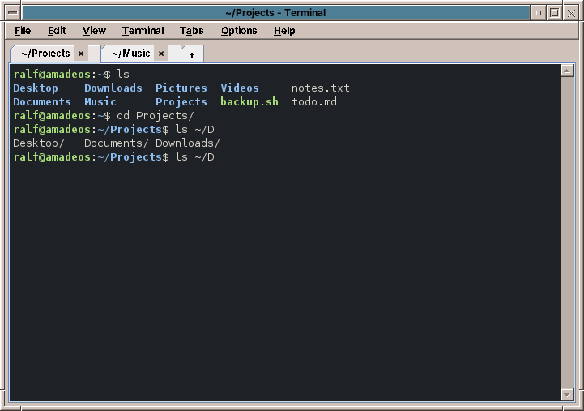
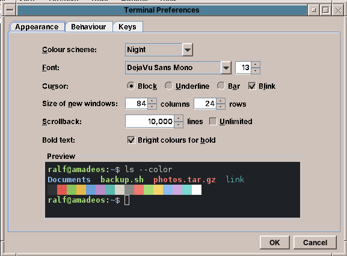

# 29. Terminal

A terminal looks like the simplest program on the desktop: a black window with text. Underneath it is two programs in one. The first is a piece of the operating system's plumbing: a *pseudo terminal*, the kernel device that makes a shell believe it talks to a real terminal, with job control, Ctrl+C and a window size. The second is an emulator of a 1980s video terminal, the DEC VT100 and its successors, because that is the language programs such as `vim`, `top` or `less` still speak to the screen.

amade-terminal has about 6,500 lines of Java and 2,000 lines of tests. It uses no terminal library and no native code of its own: the pseudo terminal comes from the C library through Java's Foreign Function and Memory API, and the emulator is plain Java that can be tested without a window. Nothing moves into amade-commons with it.

## What you build



- **The shell** of the user (normally bash) on a real pseudo terminal, so Tab completion, the history, Ctrl+C, Ctrl+Z and job control work as in any terminal. Tab completion is not the terminal's job at all: bash's readline does it, and the terminal only has to pass on the key.
- **An xterm compatible emulator**: `TERM=xterm-256color` with 16, 256 and true colours, bold, italic, underline, the alternate screen of full-screen programs, mouse reporting, bracketed paste, cursor shapes, titles, line drawing, wide characters and combining marks.
- **Copy and paste** the X11 way (selecting copies, the middle button pastes) and the desktop way (Ctrl+Shift+C and Ctrl+Shift+V), and a warning before several lines are pasted into a program that would run them at once.
- **Tabs and windows**, a scrollback of 10,000 lines that is rewrapped when the window changes its width, find in the scrollback, links that open with Ctrl+click.
- **Preferences** with a live preview, five colour schemes, five languages, and the `x-terminal-emulator` alternative of Debian.



## What you will learn

- How a pseudo terminal works, and how to open one from Java with the Foreign Function and Memory API, `errno` included.
- How to start a program on it so that it gets its own session and controlling terminal, without native code.
- How to split a byte stream into characters and control sequences with the DEC/ANSI parser state machine.
- How to keep a screen, a scrollback and the rewrap of long lines in a model that knows nothing about Swing.
- How to turn keys and mouse clicks back into the bytes a terminal program expects.
- How to paint 60 times a second from a reader thread without a queue and without holding up the program.
- How to make paste safe.

## The structure

| Package | Contents |
|---|---|
| `pty` | `Libc` (the C calls), `UnixPty` (open, read, write, resize), `PtySession` (starts the program, reads its output, hangs up) |
| `emulator` | `Parser`, `ParserHandler`, `Params`, `Utf8Decoder`, `TerminalEmulator`, `Line`, `Attr`, `Scrollback`, `CharWidth`, `KeyEncoder`, `MouseEncoder`, `TextModel` (the text of a selection, words, links, find) |
| `domain` | `TerminalSettings`, `ColorScheme`, `Palette`, `CursorShape`, `LaunchOptions` (the command line), `ShellCommand`, `TabTitles`, `PasteText` |
| `repository` | `TerminalPreferences` (`terminal.properties`) |
| `ui` | `TerminalApp`, `MainWindow`, `TerminalTab`, `TerminalView`, `BoxDrawing`, `FindBar`, `PasteWarning`, `PreferencesDialog` |

The dependencies go one way: `emulator` knows nothing of `pty` or Swing, `pty` knows nothing of the emulator. `TerminalTab` connects them: the session's output goes into the emulator, the view's keys go into the session.

## The pseudo terminal

A pseudo terminal is a pair of devices. The program side, `/dev/pts/3` for example, behaves like a serial terminal: the kernel's line discipline turns Ctrl+C into SIGINT for the foreground process group, echoes typed characters, and knows the window size. The other side, the *master*, is a file descriptor in the terminal program: what the shell writes comes out there, and what the terminal writes there arrives as typed keys.

Java has no API for it, and before Java 22 a terminal needed JNA or a small C library per platform. With the Foreign Function and Memory API (`java.lang.foreign`), the C library's functions become method handles:

```java title="amade-terminal · pty/Libc.java"
--8<-- "amade-terminal/src/main/java/eu/amadeos/apps/terminal/pty/Libc.java:handles"
```

Two of them need more than a descriptor. `ioctl` is a variadic C function, and on x86-64 a variadic call passes its arguments differently than a normal one, so the linker has to be told where the variable part starts: `firstVariadicArg(2)`. And `read` and `write` report errors through `errno`, a thread-local variable of the C library that the JVM may overwrite before Java code gets to it. `captureCallState("errno")` makes the linker copy it into a segment right after the call:

```java title="amade-terminal · pty/Libc.java"
--8<-- "amade-terminal/src/main/java/eu/amadeos/apps/terminal/pty/Libc.java:errno"
```

Opening the terminal is the classic sequence of four calls. `O_NOCTTY` keeps the terminal program itself from getting the new terminal as its controlling terminal, and `O_CLOEXEC` keeps the master out of the programs it starts:

```java title="amade-terminal · pty/UnixPty.java"
--8<-- "amade-terminal/src/main/java/eu/amadeos/apps/terminal/pty/UnixPty.java:open"
```

The window size lives in the kernel too. `TIOCSWINSZ` sets it, and the kernel sends `SIGWINCH` to the foreground program, which asks for the new size and redraws:

```java title="amade-terminal · pty/UnixPty.java"
--8<-- "amade-terminal/src/main/java/eu/amadeos/apps/terminal/pty/UnixPty.java:resize"
```

The manifest says `Enable-Native-Access: ALL-UNNAMED`, and the launcher and the tests pass `--enable-native-access=ALL-UNNAMED`. Without it Java 25 still runs the calls but warns on standard error, and a later release will refuse them.

### Starting the shell on it

A C terminal would now `fork()`, call `setsid()` in the child, open the program side so it becomes the controlling terminal, and `exec` the shell. `fork` cannot be called from a JVM, and `ProcessBuilder` cannot do the rest. But util-linux has a small program that does exactly the missing part, `setsid --ctty`, so the work is left to `/bin/sh`:

```java title="amade-terminal · pty/PtySession.java"
--8<-- "amade-terminal/src/main/java/eu/amadeos/apps/terminal/pty/PtySession.java:script"
```

The shell opens the terminal device as standard input, output and error (`<>` opens for reading and writing), and `setsid --ctty` makes a new session in which that terminal is the controlling one. `exec` everywhere means no extra process stays behind: the `Process` that Java sees is the shell itself, so its pid is the shell's pid, which the tab needs for the shell's folder (`/proc/<pid>/cwd`) and for closing:

```java title="amade-terminal · pty/PtySession.java"
--8<-- "amade-terminal/src/main/java/eu/amadeos/apps/terminal/pty/PtySession.java:start"
```

The device name travels in an environment variable, not in the script, so no quoting can go wrong, and the command's own arguments are passed as `"$@"`.

### Reading, and the end

One platform thread per tab reads the master. It waits with `poll` for a quarter of a second at a time instead of blocking in `read`, so it can notice when the tab is closed:

```java title="amade-terminal · pty/UnixPty.java"
--8<-- "amade-terminal/src/main/java/eu/amadeos/apps/terminal/pty/UnixPty.java:read"
```

When every program on the terminal has closed it, `read` on Linux fails with `EIO`, the normal end. There is one case where that never comes: the shell has ended but left a program in the background that still holds the terminal. A tab would then stay open forever. So the reader also gives up when the shell has been gone for a second:

```java title="amade-terminal · pty/PtySession.java"
--8<-- "amade-terminal/src/main/java/eu/amadeos/apps/terminal/pty/PtySession.java:reader"
```

Closing a tab does what closing a real terminal does, a hang-up:

```java title="amade-terminal · pty/PtySession.java"
--8<-- "amade-terminal/src/main/java/eu/amadeos/apps/terminal/pty/PtySession.java:hangup"
```

`TIOCGPGRP` also answers a question the window asks before closing: is a program running in the foreground that is not the shell? If the foreground process group is not the shell's pid, `/proc/<pgrp>/comm` names it, and the window asks *Close the tab? htop is still running.*

## The parser

Everything a program writes is one byte stream: text, and control sequences mixed into it. `ESC [ 1 ; 3 1 m` switches to bold red, `ESC [ 2 J` clears the screen, `ESC ] 0 ; title BEL` sets the window title. Writing a parser for these with regular expressions or `indexOf` breaks on the first sequence that arrives split across two reads. The reliable way is the state machine that DEC's VT500 terminals used and that Paul Williams documented at vt100.net; xterm, VTE and most other terminals follow it.

The bytes are decoded as UTF-8 first, by `Utf8Decoder`, which keeps the half of a character that the last read cut off. The parser then gets one code point at a time and calls a `ParserHandler` with what it found: `print` for a character, `execute` for a control character such as a line feed, `csiDispatch`, `escDispatch` and `oscDispatch` for the sequences:

```java title="amade-terminal · emulator/Parser.java"
--8<-- "amade-terminal/src/main/java/eu/amadeos/apps/terminal/emulator/Parser.java:accept"
```

The excerpt shows the start of the machine. ESC always starts a new sequence, wherever the parser is, and CAN and SUB cancel one: that is how a terminal recovers from garbage. Characters that do not fit a state are ignored instead of printed, so a broken sequence never shows up as junk on the screen. Parameters (`Params`) keep the colon sub-parameters apart from semicolons, because `ESC[38:2::255:0:0m` and `ESC[38;2;255;0;0m` are two spellings of the same true colour.

## The screen model

`TerminalEmulator` implements `ParserHandler`. It holds two screens, the main screen and the alternate screen that full-screen programs switch to, the cursor, the current style, the scroll region, about thirty modes, and a `Scrollback` of the lines that scrolled off the top. A `Line` is a set of parallel arrays, one entry per cell: the code point, foreground, background, attributes and a link id. An object per cell would make 10,000 lines of 120 columns 1.2 million objects; arrays make it a few thousand.

Printing a character is where most of the rules are:

```java title="amade-terminal · emulator/TerminalEmulator.java"
--8<-- "amade-terminal/src/main/java/eu/amadeos/apps/terminal/emulator/TerminalEmulator.java:print"
```

Three of them surprise everyone who writes a terminal for the first time.

- **The pending wrap.** Writing into the last column does not move the cursor to the next line. It stays in the last column with a flag set, and only the *next* character wraps. Without that, every program that draws a full-width line (a status bar in `top`, a frame in `mc`) would scroll the screen by one line.
- **Wide characters.** A Chinese character or an emoji takes two cells. `CharWidth` knows which ones, the second cell holds a marker, and a wide character that does not fit in the last column wraps early.
- **Combining marks.** A combining accent has width 0 and belongs to the character before it. The line keeps it as an extra string on that cell.

The scrollback is a ring. Once it is full, the oldest line goes, and the emulator counts how many went, so a selection or a search hit that is kept as an absolute line number still points at the same text:

```java title="amade-terminal · emulator/Scrollback.java"
--8<-- "amade-terminal/src/main/java/eu/amadeos/apps/terminal/emulator/Scrollback.java:add"
```

### Rewrapping

When a window becomes narrower, xterm cuts the lines off; modern terminals rewrap them. For that a line has to remember whether it ended because the text went on (`wrapped`) or because of a line feed. On resize the emulator joins the rows of each logical line, lays the cells out again in the new width, and puts back the scrollback and the screen:

```java title="amade-terminal · emulator/TerminalEmulator.java"
--8<-- "amade-terminal/src/main/java/eu/amadeos/apps/terminal/emulator/TerminalEmulator.java:reflow"
```

The cursor travels with its character, so the shell's prompt stays where the user was typing. The alternate screen is not rewrapped: the full-screen program gets `SIGWINCH` and redraws it itself.

## Keys and mouse

The way back is smaller. `KeyEncoder` turns a key into the bytes of an xterm. Cursor keys depend on a mode the program sets (`ESC [ A` or `ESC O A`), and modifiers are encoded as a number in the sequence, `ESC [ 1 ; 5 A` for Ctrl+Up:

```java title="amade-terminal · emulator/KeyEncoder.java"
--8<-- "amade-terminal/src/main/java/eu/amadeos/apps/terminal/emulator/KeyEncoder.java:keys"
```

Everything in `KeyEncoder` and `MouseEncoder` is a static function from a key or a click to a string, so the tests check the bytes without a keyboard.

Swing makes the keyboard harder than it should be. Ctrl+letter may or may not come with a `KEY_TYPED` event carrying the control character, AltGr has to be told apart from Ctrl+Alt, and the menu accelerators would take Ctrl+W away from the shell. `TerminalView` therefore handles `KEY_PRESSED` itself for everything that is not plain text, keeps a set of the window's accelerators (all with Ctrl+Shift, so none of them collides with a key a program needs), and lets every other key through to the program.

## Painting

The reader thread feeds the emulator under its lock. The view does not repaint for every read: `ls -R /` delivers thousands of reads a second, and a repaint per read would spend all the time in Swing. Instead a Swing `Timer` looks every 16 milliseconds whether the emulator's change counter moved:

```java title="amade-terminal · ui/TerminalView.java"
--8<-- "amade-terminal/src/main/java/eu/amadeos/apps/terminal/ui/TerminalView.java:poll"
```

This is the frame-slot idea of [Webcam](28-webcam.md#from-the-reader-to-the-screen) again: the screen may skip states, but it never runs behind the program. Painting goes cell run by cell run: neighbouring cells with the same style are drawn with one `drawString`, and box drawing characters (`BoxDrawing`) are drawn as lines and blocks so they join without gaps whatever the font.

## Copy and paste

Copying is a matter of the right text. `TextModel` turns a selection into text: a wrapped line becomes one line again, trailing blanks go, and wide characters count once. Double click selects a word with the characters of paths and URLs in it, so `/usr/share/doc` or a link is one word. The selection goes to X11's PRIMARY selection (`Toolkit.getSystemSelection()`) at once, the clipboard only on Ctrl+Shift+C.

Pasting is a matter of safety. A shell runs each line of pasted text as soon as the line feed arrives, so a command copied from a web page with a hidden line feed runs before the user sees it. Programs that understand *bracketed paste* (bash, zsh, vim) ask for it with mode 2004, and the terminal then wraps the text in `ESC [ 200 ~` and `ESC [ 201 ~`, so the program knows it was pasted and does not run it. The end marker is removed from the text first, otherwise the text could end the bracket itself and run what follows:

```java title="amade-terminal · emulator/KeyEncoder.java"
--8<-- "amade-terminal/src/main/java/eu/amadeos/apps/terminal/emulator/KeyEncoder.java:paste"
```

For programs without bracketed paste, the window asks first:

```java title="amade-terminal · ui/MainWindow.java"
--8<-- "amade-terminal/src/main/java/eu/amadeos/apps/terminal/ui/MainWindow.java:paste"
```

The same care applies to the other direction. OSC 52 lets a program put text on the clipboard, which is useful in `tmux` over ssh and dangerous with `cat` of an unknown file. It is off by default and has a switch in the preferences.

## Tests

The emulator is tested like a pure function: feed it bytes, look at the screen. About a hundred tests cover the parser (split sequences, cancelled sequences, colon parameters), cursor movement, scroll regions, the pending wrap, wide characters, the alternate screen, SGR colours, the modes, OSC titles and links, the answers to queries (`ESC [ 6 n`, device attributes), and the rewrap.

`PtySessionTest` starts real `sh` and `bash` processes on a real pseudo terminal: the program sees a terminal, input and output arrive (with the line ends a terminal makes), the window size reaches the program and changes on resize, Ctrl+C interrupts the foreground program, the exit code, the working directory and the foreground program are reported, a hang-up ends the shell, and a background job left behind does not keep the tab open.

`MainWindowTest` opens the real window with a real shell and drives it through its menus: typing a command and finding its output on the screen, tabs, copy to the clipboard, paste from it, find, zoom, the title set by `printf '\033]0;...'`, and `exit` closing the program. The CI workflow runs all of them under Xvfb and fails if a test is skipped.

## What amade-commons gives Terminal

| Part | Since | Terminal uses it for |
|---|---|---|
| `AmadeApplication`, `AppInfo`, `CommonsModule` | chapter 10 | start-up and wiring, `--version` |
| `Messages`, `Mnemonics`, `LocaleSettings`, `TranslationCheck` | chapter 10 | five languages, menu letters, the language menu, the translation test |
| `AmadeUI`, `DesktopTheme`, `ThemeStore` | chapter 10 | the Motif look, and the *Desktop theme* colour scheme that follows Settings while the program runs |
| `DesktopLauncher` | chapter 11 | Ctrl+click on links and paths, *Open Folder in Files*, the handbook |
| `AppDirectories`, `PropertiesFile` | chapter 20 | `terminal.properties` |
| `Notification`, `Notifications` | chapter 67 | a bell in a tab that is not in front |

### And what stays in Terminal

- **The pseudo terminal.** `Libc`, `UnixPty` and `PtySession` are the first FFM code of the amade programs. If a second program needs a terminal (a build view in an IDE, a console in Backup & Sync), the `pty` package moves to amade-commons as it is, since it knows nothing about Terminal.
- **The emulator.** It is a large piece with one user. An embedded terminal elsewhere would take `emulator`, `pty` and `TerminalView` together.

## Exercises

1. **Split view.** Show two sessions side by side in one tab. Which of `TerminalTab`'s jobs belong to the tab and which to each session, and how does focus decide where keys go?
2. **Sixel pictures.** Implement the DCS sequence that carries sixel graphics. Where do pictures live in a model of cells, and what happens to them when they scroll into the scrollback or the window is rewrapped?
3. **Saved profiles.** Let the user keep profiles, a command with a colour scheme (`ssh server` in red, for instance), and open a tab with one. What changes in `TerminalSettings` and in the preferences file?
4. **Shell integration.** bash can mark the start and end of each prompt and command with OSC 133. Use it to jump from prompt to prompt with Ctrl+Shift+Up, and to select the output of the last command.
5. **Reading without polling.** Replace the 250 ms `poll` in `UnixPty.read` with a self-pipe: `close` writes a byte into a pipe that `poll` watches too. What do you gain, and what does the test for closing look like?

## Summary

- A terminal is a pseudo terminal plus an emulator; Tab completion and line editing belong to the shell, not to either of them.
- The C library's `posix_openpt`, `grantpt`, `unlockpt` and `ptsname_r` give a pseudo terminal; FFM calls them without native code, with `firstVariadicArg` for `ioctl` and `captureCallState` for `errno`.
- Without `fork`, let `/bin/sh` open the terminal and `setsid --ctty` make it the controlling terminal; `exec` keeps the shell's pid the process's pid.
- Read with `poll` so the reader can stop, treat `EIO` as the end, and do not wait for leftovers once the shell is gone.
- Parse with the DEC/ANSI state machine on decoded code points; ignore what does not fit instead of printing it.
- Keep the screen in arrays per line, remember the pending wrap and which lines wrapped, and count the lines that left the scrollback.
- Paint from a change counter on a timer, never per read.
- Copy whole logical lines; paste bracketed, strip the end marker, and ask before several lines go to a program that would run them.
