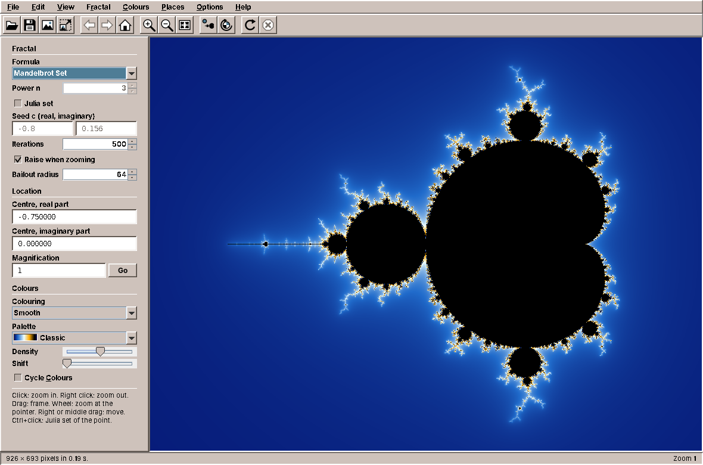
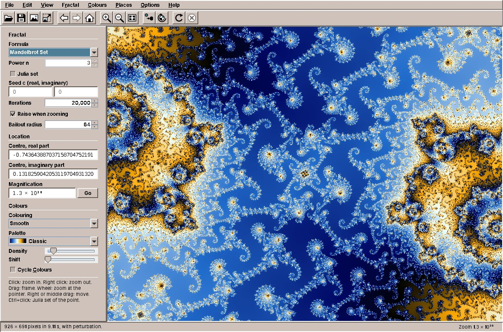
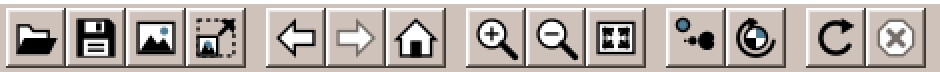

# 30. Fractals

Every program so far has shown things that Swing knows how to draw: text, lists, tables, a page of a document. Fractals draws every pixel itself. A picture of the Mandelbrot set is a million small calculations, some of them thousands of steps long, and the user wants to click into it and see the next picture at once. So this chapter is about pictures and about speed: Java2D, all the processor cores, a calculation that can be thrown away halfway, and numbers more exact than `double` for the deep zooms.

amade-fractals is a fractal explorer: nine formulas, Julia sets from any point, smooth colouring with palettes that follow the desktop theme, zoom by click, frame or mouse wheel, and exports as large as a poster. It is about 4,800 lines of Java and 1,900 lines of tests. This chapter opens Part III, and it moves the toolbar into amade-commons: WritePad drew its toolbar icons in Java2D, Fractals does the same, and it is the second user.

## What you build



- **Nine formulas**: the Mandelbrot set and its powers, Burning Ship, Tricorn, Celtic, Buffalo, Phoenix, Magnet and Newton's method, each escape-time formula also as a Julia set.
- **Navigation**: click to zoom in, right click to zoom out, drag a frame, the mouse wheel at the pointer, drag to move; *Back*, *Forward* and *Home*.
- **An answer at once**: the old picture moves and scales with the gesture while the new one is calculated, and a coarse preview comes first.
- **Deep zoom** into the Mandelbrot set down to about 10⁻²⁹⁰, far below the precision of `double`.
- **Colours** that never calculate again: four colouring methods, eight palettes (one from the desktop theme), colour cycling.
- **Exports** up to 64 megapixels, calculated strip by strip.
- **Parameter files** (`.fractal`) that keep a place with all its digits.

## What you will learn

- How to keep a calculation's results apart from its colours, so that colours are cheap.
- How to keep a position exact with `BigDecimal` and calculate the pixels in `double`.
- How to spread work over all cores when the pieces cost very different amounts.
- How to run a calculation in the background, cancel it, and report on the event dispatch thread, testably.
- How to make a gesture answer before its result is there.
- How perturbation lets `double` calculate where `double` is not precise enough.
- What moves into amade-commons: toolbar icons drawn in Java2D, the toolbar buttons and the `@Ui` executor.

## Values first, colours afterwards

The obvious design calculates a colour for each pixel. Fractals calculates *values* for each pixel and colours them in a second step:

```java title="amade-fractals · service/render/FractalData.java"
--8<-- "amade-fractals/src/main/java/eu/amadeos/apps/fractals/service/render/FractalData.java:set"
```

For every pixel, `FractalData` keeps how the orbit ended (inside, escaped, or converged to a root), after how many steps, where it was at the end, and how close it came to 0. That is 21 bytes per pixel, in five plain arrays rather than a million small objects. Everything the user can change about colours works from these values alone:

```java title="amade-fractals · service/color/Colorizer.java"
--8<-- "amade-fractals/src/main/java/eu/amadeos/apps/fractals/service/color/Colorizer.java:colorize"
```

`colorize` writes straight into the `int[]` behind a `TYPE_INT_RGB` picture, one palette lookup per pixel: no `setRGB` calls, no colour objects. That is fast enough to run 25 times a second, which is what colour cycling does. A palette is a table of 1,024 colours, and moving through it is moving an offset.

The smooth colouring is where the stored last value pays off. The plain count of steps jumps from one band to the next; the *continuous* count interpolates between them from how far beyond the bailout the orbit got:

```java title="amade-fractals · service/color/Colorizer.java"
--8<-- "amade-fractals/src/main/java/eu/amadeos/apps/fractals/service/color/Colorizer.java:smooth"
```

!!! tip "Tip: keep the expensive part and the cheap part apart"
    Whenever a program calculates something expensive and then shows it, ask what the user will change afterwards. If it only changes the showing, store the result of the calculation, not the picture. The same idea is in Calendar, which keeps the events and lays out the month again, and in WritePad, which keeps the document and lays out the pages again.

## A position that stays exact

A `double` has about 16 significant digits. That is enough for a picture of the whole Mandelbrot set, and not enough for a picture a billion billion times smaller, where two neighbouring pixels differ in the twentieth digit. The region in view therefore keeps its centre as `BigDecimal`:

```java title="amade-fractals · domain/Region.java"
--8<-- "amade-fractals/src/main/java/eu/amadeos/apps/fractals/domain/Region.java:zoom-at"
```

Every gesture becomes an operation on the region: `zoomAt` keeps the point under the pointer where it is, `frame` fills the window with a rectangle, `pan` moves by pixels. The offsets are small, so they are calculated in `double` and added to the exact centre. Then the centre is rounded to the digits that the zoom needs, so that it does not collect the noise of binary fractions with every step:

```java title="amade-fractals · domain/Region.java"
--8<-- "amade-fractals/src/main/java/eu/amadeos/apps/fractals/domain/Region.java:round"
```

The region has a height but no width. The width follows from the window, so the same region fits a small window, a full screen and a poster export. Parameter files store the centre with all its digits as text, so a place survives a round trip through a file or the clipboard exactly.

## Rows to whichever core is free

Calculating the pixels is the easy part to parallelise: every pixel is independent. The hard part is that they cost very different amounts. A pixel far outside the set escapes after three steps; a pixel inside never escapes and runs to the maximum, 20,000 steps in a deep zoom. Cut the picture into four quarters for four cores, and the core that got the quarter with the set in it works while the others wait.

So the renderer does not divide the picture. It starts one task per core, and each task takes the next row that nobody has taken yet:

```java title="amade-fractals · service/render/Renderer.java"
--8<-- "amade-fractals/src/main/java/eu/amadeos/apps/fractals/service/render/Renderer.java:run"
```

An `AtomicInteger` is the whole scheduler: `getAndIncrement` hands out every row exactly once, however the tasks interleave. A row is small enough that the last ones finish at about the same time, and large enough that taking one costs nothing. The first failure is kept and thrown in the caller's thread, and the cancel check runs after every row and every pixel.

The workers are platform threads, one per core, a little below normal priority:

```java title="amade-fractals · bootstrap/FractalsModule.java"
--8<-- "amade-fractals/src/main/java/eu/amadeos/apps/fractals/bootstrap/FractalsModule.java:renderer"
```

!!! note "Note: virtual threads are for waiting, not for calculating"
    amade-commons gives every program an executor on virtual threads (chapter 10), and Fractals uses it to run the render job. But the rows themselves go to platform threads. Virtual threads are cheap to have by the thousand because they give their carrier thread back while they *wait* for files or the network. A calculation never waits, so a virtual thread would hold its carrier anyway, and the lower priority, which keeps the window responsive while all cores are busy, is only available for platform threads.

## In the background, on the EDT, and cancellable

`RenderService` connects the renderer to the window. It runs a calculation on the background executor, sends a coarse preview first when the picture is large, reports progress, and delivers the result on the event dispatch thread:

```java title="amade-fractals · service/render/RenderService.java"
--8<-- "amade-fractals/src/main/java/eu/amadeos/apps/fractals/service/render/RenderService.java:run"
```

A calculation that is no longer wanted is cancelled: the user zoomed again before it was done. The renderer notices the flag at the next row and throws, but results that were already on their way to the event dispatch thread could still arrive and show an old picture over a new one. So every report checks the flag again where it arrives:

```java title="amade-fractals · service/render/RenderService.java"
--8<-- "amade-fractals/src/main/java/eu/amadeos/apps/fractals/service/render/RenderService.java:post"
```

The check runs on the event dispatch thread, the same thread on which the presenter cancels. Between the check and the call nothing else can run there, so a cancelled task can never report.

Both executors are injected. The background executor is the one from `CommonsModule`; the other one is marked `@Ui` and runs on the event dispatch thread. In the tests both are a `QueueExecutor`, which runs nothing until asked, so a test can cancel a task exactly between its calculation and its report:

```java title="amade-fractals · RendererTest.java"
--8<-- "amade-fractals/src/test/java/eu/amadeos/apps/fractals/service/render/RendererTest.java:cancelled"
```

## Every gesture answers at once

A deep zoom takes seconds. If a click showed nothing until then, the program would feel broken. Fractals answers every gesture at once with the picture it has: the canvas moves and scales the old picture the way the gesture moves the view, while the presenter calculates the new one.

```java title="amade-fractals · ui/view/FractalCanvas.java"
--8<-- "amade-fractals/src/main/java/eu/amadeos/apps/fractals/ui/view/FractalCanvas.java:scale-about"
```

A click zooms in two times around the point, so the canvas scales the old picture by 2 around that point. The transforms of several quick gestures are combined, so three fast clicks show the old picture eight times larger:

```java title="amade-fractals · ui/view/FractalCanvas.java"
--8<-- "amade-fractals/src/main/java/eu/amadeos/apps/fractals/ui/view/FractalCanvas.java:transform"
```

The canvas only does this when the presenter accepted the gesture: `listener.centerAt(...)` returns false at the deepest zoom, and then nothing moves. When the new picture arrives, the transform ends:

```java title="amade-fractals · ui/view/FractalCanvas.java"
--8<-- "amade-fractals/src/main/java/eu/amadeos/apps/fractals/ui/view/FractalCanvas.java:set-picture"
```

The coarse preview, a quarter of the size in each direction, costs a sixteenth of the full picture. The canvas stretches it over the window with bilinear interpolation, so it looks blurred rather than blocky, and the details follow.

## A bug that only slow calculations found

While the screenshots for this chapter were taken, the deep zoom place never finished. The progress bar ran to 99 %, the picture appeared, and the calculation started again from 0 %, for ever. The cause was two pixels:

1. While a calculation runs, the status bar shows a progress bar. The progress bar was 2 pixels taller than the text in the status bar, so the status bar grew and the canvas above it shrank by 2 pixels.
2. A canvas of a new size needs a new picture, so after a short delay the window asks the presenter to calculate again.
3. When the calculation ended, the progress bar was hidden, the canvas grew back, and step 2 started the next calculation, which showed the progress bar again.

A picture that took less than the resize delay never showed the loop: the canvas shrank and grew back before the delay ran out, and the presenter saw no change. Only calculations that took longer than the delay, a fifth of a second, ran into it, and every deep zoom does. The fix keeps the height in the status bar whether the progress bar is shown or not, with a strut, and a test makes sure it stays that way:

```java title="amade-fractals · MainWindowTest.java"
--8<-- "amade-fractals/src/test/java/eu/amadeos/apps/fractals/ui/main/MainWindowTest.java:status-height"
```

!!! warning "Pitfall: layouts that react to what they show"
    Whenever the size of a component starts work, and the work changes something that is laid out, check that the second does not change the first. Progress bars, status texts that get longer, scroll bars that appear: each of them can change the space the rest of the window gets. A loop like this one does not show in a test with a fast machine and a small picture; write the test for the sizes, not for the loop.

## Deep zoom by perturbation

Below a pixel size of about 10⁻¹⁵, neighbouring pixels have the same `double` coordinates, and the picture turns into large flat blocks. The obvious cure is to calculate every pixel in `BigDecimal`, which is correct and a thousand times too slow.

*Perturbation* calculates only one orbit in `BigDecimal`, the *reference* at the centre of the picture: Z₀, Z₁, Z₂, ... Every pixel lies a tiny distance dc from the centre, and its orbit stays a tiny distance dz from the reference orbit. That distance follows from the formula z² + c:

```
z + dz → (Z + dz)² + C + dc  =  Z² + C  +  (2Z + dz)·dz + dc
```

The first part is the next value of the reference. The second part, (2Z + dz)·dz + dc, is the next distance, and it can be calculated in `double`, because a `double` with a tiny value is as precise as one with a large value: the exponent moves, the 16 digits stay.

```java title="amade-fractals · service/render/Perturbation.java"
--8<-- "amade-fractals/src/main/java/eu/amadeos/apps/fractals/service/render/Perturbation.java:compute"
```

The last condition is the clever part, known as *rebasing*. When a pixel's orbit comes closer to 0 than to the reference (|Z + dz| < |dz|), the distance would grow large and lose its precision. Instead, the pixel jumps back to the start of the reference, because near 0 the reference's start is the better neighbour. Older programs needed a list of special cases and several references for this; with rebasing, one reference is enough.

A method like this is worth nothing without proof that it calculates the right thing. The test calculates a few pixels of the 10²⁰ zoom both ways, by perturbation and by plain iteration in `BigDecimal`, and compares the step counts:

```java title="amade-fractals · CalculationTest.java"
--8<-- "amade-fractals/src/test/java/eu/amadeos/apps/fractals/service/render/CalculationTest.java:perturbation"
```



Perturbation ends where the exponent of `double` ends, at about 10⁻²⁹⁰. The other formulas have no perturbation, and they stop at the limit of `double` with a message, rather than showing blocks.

## Exports in strips

An export of 8K is 33 million pixels. As `FractalData` that would be 700 MB, as an RGB picture 130 MB. Fractals calculates and colours 128 rows at a time, so it holds the finished picture and one strip of values:

```java title="amade-fractals · service/render/RenderService.java"
--8<-- "amade-fractals/src/main/java/eu/amadeos/apps/fractals/service/render/RenderService.java:strips"
```

Each strip gets a region of its own, with the same pixel size and its own centre, so the renderer does not need to know about strips at all. Then `ImageFiles` writes the picture with ImageIO into a temporary file and moves it over the target in one step. That makes five atomic writes in the applications, and the exercise from chapter 21 is still open.

## The toolbar moves into amade-commons

Fractals has a toolbar of raised Motif buttons with icons drawn in Java2D, so that it needs no icon theme and every icon takes the colours of the desktop theme. WritePad has the same. When Fractals was written, its `ToolIcon`, `ToolButtons` and `@Ui` were copies of WritePad's, with other glyphs. Imagescan has a third copy.



What is the same in all three copies, and what is not?

| The same | Different |
|---|---|
| The icon: size 22, the 16-unit grid, antialiasing, the colours from the theme and the button | The glyphs: WritePad has bold, italic and alignment; Fractals has the Julia set and colour cycling; Imagescan has the scanner and cropping |
| The shapes several glyphs share: a sheet with a folded corner, a magnifier | |
| A dozen common glyphs: open, save, print, copy, undo, zoom, refresh | |
| The buttons: icon only, no focus, the Motif bevel | |
| `@Ui`, a Guice binding annotation, and its binding to the `EdtExecutor` | |

The common part moves; the glyphs that only one program needs stay in that program. To make that possible, the glyphs become an interface instead of an enum:

```java title="amade-commons · swing/ToolIcon.java"
--8<-- "amade-commons/src/main/java/eu/amadeos/commons/swing/ToolIcon.java:glyph"
```

`ToolIcon` does what all copies did: it works out the colours, scales the graphics to the grid and hands them to the glyph, together with the colours, as a `Pen`:

```java title="amade-commons · swing/ToolIcon.java"
--8<-- "amade-commons/src/main/java/eu/amadeos/commons/swing/ToolIcon.java:paint"
```

The `Pen` is a record of the graphics and the four things a glyph needs to know: `ink` for lines (the button's text colour, grey when disabled), `paper` for light areas, `light` for highlights (the selection colour) and whether the button is enabled. Its methods are the shapes that were in more than one copy: `page`, `magnifier`, `line`, `triangle`, `fillAndDraw`, `bold` and `thin` for the stroke, and `mirror`, which turns *undo* into *redo* and *back* into *forward*.

The common glyphs are an enum in amade-commons:

```java title="amade-commons · swing/StandardGlyph.java"
--8<-- "amade-commons/src/main/java/eu/amadeos/commons/swing/StandardGlyph.java:paint"
```

```java title="amade-commons · swing/StandardGlyph.java"
--8<-- "amade-commons/src/main/java/eu/amadeos/commons/swing/StandardGlyph.java:open"
```

A program's own glyphs are an enum of its own that implements `ToolIcon.Glyph`. Here is Fractals' Julia set, the Mandelbrot silhouette with a seed point in the selection colour:

```java title="amade-fractals · ui/icons/FractalGlyph.java"
--8<-- "amade-fractals/src/main/java/eu/amadeos/apps/fractals/ui/icons/FractalGlyph.java:julia"
```

The actions mix both kinds freely, because both are a `Glyph`:

```java title="amade-fractals · ui/main/FractalActions.java"
--8<-- "amade-fractals/src/main/java/eu/amadeos/apps/fractals/ui/main/FractalActions.java:actions"
```

```java title="amade-fractals · ui/main/FractalActions.java"
--8<-- "amade-fractals/src/main/java/eu/amadeos/apps/fractals/ui/main/FractalActions.java:icons"
```

An interface also allows a glyph with state, which an enum constant cannot have. WritePad's text colour button shows the colour it will apply next, so its glyph is a record with a supplier:

```java title="amade-writepad · ui/icons/TextColorGlyph.java"
--8<-- "amade-writepad/src/main/java/eu/amadeos/apps/writepad/ui/icons/TextColorGlyph.java:text-color"
```

In WritePad's copy this colour was a third constructor argument of `ToolIcon` that every other glyph ignored. Moving code into a library is a chance to find such special cases and give them a place of their own.

The buttons move unchanged:

```java title="amade-commons · swing/ToolButtons.java"
--8<-- "amade-commons/src/main/java/eu/amadeos/commons/swing/ToolButtons.java:configure"
```

### The `@Ui` executor

Every program that continues on the event dispatch thread after background work had the same annotation and the same three lines in its Guice module. The annotation moves into `eu.amadeos.commons.app`, and `CommonsModule` binds it:

```java title="amade-commons · app/CommonsModule.java"
--8<-- "amade-commons/src/main/java/eu/amadeos/commons/app/CommonsModule.java:configure"
```

Presenters still take a plain `Executor` with `@Ui` in front, so the tests can keep passing a queueing or a direct executor. A new test in amade-commons checks that the binding really runs its tasks on the event dispatch thread.

### Re-pinning the programs

1. amade-commons gets `ToolIcon` with `Glyph` and `Pen`, `StandardGlyph`, `ToolButtons`, `app/Ui`, the binding in `CommonsModule`, and tests for all of them.
2. WritePad deletes its `ToolIcon`, `ToolButtons` and `Ui`. Its own glyphs (preview, bold, italic, underline, strike-through, the four alignments, bullets, numbering) become `WritepadGlyph`, the colour button `TextColorGlyph`. The provider method for `@Ui` leaves `WritepadModule`.
3. Fractals does the same: its own glyphs become `FractalGlyph`.
4. Both pin the new amade-commons commit, and all tests run, with the glyph tests now in the program that owns the glyphs.
5. Imagescan keeps its copy until chapter 31, where it switches to the library like the other two.

## What amade-commons gives Fractals

| Part | Since | Fractals uses it for |
|---|---|---|
| `AmadeApplication`, `CommonsModule`, `EdtExecutor` | chapter 10 | start-up, wiring, the background executor, the event dispatch thread |
| `Messages`, `Mnemonics`, `LocaleSettings`, `TranslationCheck` | chapter 10 | five languages, menu letters, the language setting |
| `AmadeUI`, `DesktopTheme` | chapter 10 | the theme's colours, and the *Desktop Colours* palette that follows the Style Manager |
| `AppDirectories`, `PropertiesFile` | chapter 20 | the preferences: bars, automatic iterations, export size |
| `ToolIcon`, `StandardGlyph`, `ToolButtons`, `@Ui` | **this chapter** | the toolbar and the menus' icons; continuing on the event dispatch thread |

### And what stays in Fractals

- **Everything about fractals**: formulas, regions, perturbation, colouring, palettes, places.
- **The renderer and its worker pool.** It is the only program that calculates on all cores. If a second one does, `Renderer.run` with its atomic row counter is a candidate for amade-commons.
- **`ImageFiles`**, which writes pictures atomically. Imagescan writes pictures too, so it is a candidate in chapter 31.

## Exercises

1. **Blocks instead of rows.** Change `Renderer.run` to hand out blocks of 16 rows instead of one. Measure with the Deep Zoom place: when is it faster, and when slower? What would happen with blocks of a quarter of the picture?
2. **A glyph of your own.** Add a *Places* button to the toolbar with a glyph of a map pin. Use only the `Pen`'s methods and its colours, and check it in a dark theme. Where does the test for it go?
3. **Distance estimation.** Store a fourth value per pixel, the derivative of the orbit, and add a colouring method that draws the boundary of the set as thin lines. Which classes change? Which do not, and why?
4. **Progress you can trust.** The progress bar counts rows, but rows cost very different amounts. Count iterations instead. Is the result worth the cost of counting?
5. **Zoom video.** Export a sequence of pictures from the whole set down to a place, each 1.05 times deeper than the last. How do you keep memory and time in check, and how can the previous frame make the next one cheaper?

## Summary

- Store what a calculation found, not what it looks like; then everything about colours is cheap, and colour cycling is a moving offset in a table.
- Keep exact values where they must be exact (the centre, in `BigDecimal`) and fast values where they can be fast (the pixels, in `double`).
- Spread uneven work by handing out small pieces from an `AtomicInteger`, not by dividing it up front. Calculate on platform threads; virtual threads are for waiting.
- A cancelled task must not report: check the flag where the report arrives, on the event dispatch thread. Inject the executors, and a queueing executor makes the order testable.
- Answer a gesture at once with the picture you have, transformed, and replace it when the new one is there.
- Perturbation calculates one orbit exactly and every pixel as a small distance from it, in `double`; rebasing keeps one reference enough.
- When the size of a component starts work, make sure the work cannot change the size.
- Toolbar icons drawn in Java2D (`ToolIcon` with its `Glyph` interface and `Pen`, `StandardGlyph`), the toolbar buttons and the `@Ui` executor move into amade-commons, their second user after WritePad.
