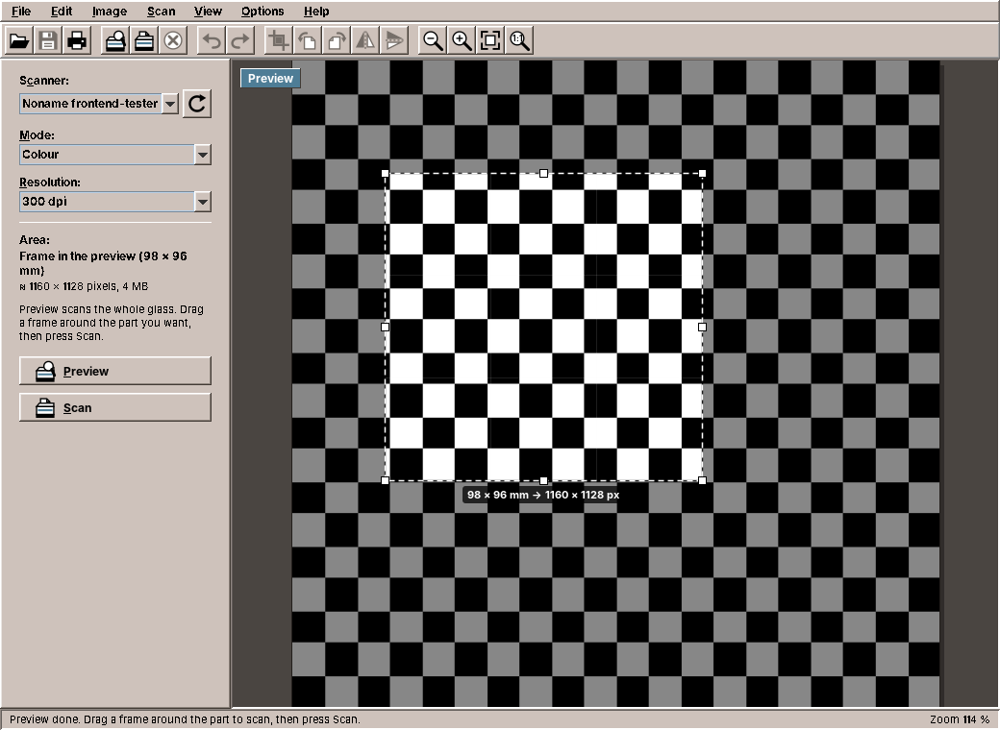
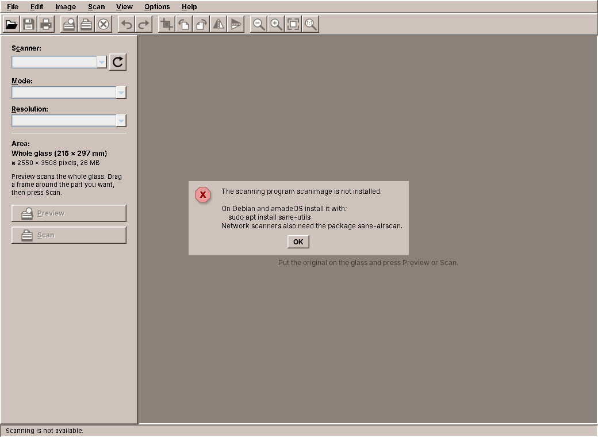
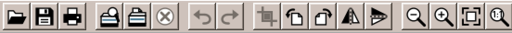

# 31. Imagescan

The programs so far have worked with files, the network and the screen. Imagescan works with a machine on the desk. It cannot talk to the scanner itself: on Linux it runs SANE's command line program `scanimage` and reads the picture from its output, on Windows it calls Windows Image Acquisition inside the process. So this chapter is about other programs: how to start one, read what it prints while it prints it, stop it when the user cancels, and never wait for it for ever.

amade-imagescan is a scanning program in the spirit of the classic preview-and-frame dialogs: a quick preview of the whole glass, a frame around the part you want, a scan of just that part at the chosen resolution. Then crop, turn, mirror, undo, save with the resolution in the file, and print at true size. It is about 5,000 lines of Java and 2,200 lines of tests. Imagescan is the third program that runs other programs, after WritePad (LibreOffice, chapter 23) and Audio (the sound server's tools; its chapter, 33, comes later), and the third with a toolbar drawn in Java2D. The command runner moves into amade-commons, and Imagescan's toolbar copy gives way to the one from chapter 30.

## What you build



- **Preview, frame, scan**: *Preview* scans the whole glass at 75 dpi, you drag a frame with eight handles, and *Scan* scans only that part. The label at the frame says how large the result will be.
- **Scanner, mode and resolution** as the scanner offers them, with the area and the size of the result in the panel. Scans that would need more than 512 MB of memory are confirmed first.
- **Progress and cancel**: the status bar shows how far the scan is, and *Cancel Scan* stops the scanner.
- **Editing that keeps every pixel**: crop, quarter turns and mirroring, with undo and redo. Line art stays one bit per pixel, grey stays grey.
- **Save** as PNG, JPEG or TIFF with the resolution in the file; **print** at true size; **copy** to the clipboard.
- **Two backends**: SANE through `scanimage` on Linux and amadeOS, Windows Image Acquisition over COM on Windows.

## What you will learn

- How to put hardware behind an interface, so that the rest of the program does not know the platform.
- How to read a picture from another program's output while it arrives, and its progress from the error output at the same time.
- How to cancel work that runs in another process.
- How to work in two units, pixels on the screen and millimetres on the glass.
- How to edit images without changing their kind, and keep undo affordable when every step is a whole image.
- Why a time limit that comes after reading the output is no time limit, and how the shared `CommandRunner` gets it right.
- What moves into amade-commons: `CommandRunner`, `ProgramResult`, `ProgramMissingException` and `FinishedProcess`, and the toolbar for its third user.

## Developing without a scanner

You do not need a scanner for this chapter. SANE comes with a *test backend*, a virtual scanner that delivers test pictures. It is switched off by default; switch it on in SANE's list of backends and choose a picture:

```sh
sudo apt install sane-utils
sudo sed -i 's/^#test$/test/' /etc/sane.d/dll.conf     # enable the test backend
sudo sed -i 's/^test-picture .*/test-picture "Grid"/; s/^mode Gray/mode Color/' /etc/sane.d/test.conf
scanimage -L                                           # device `test:0' is a Noname frontend-tester ...
```

The scanner is then *Noname frontend-tester* in Imagescan's list. The grid has squares of 10 mm, which makes it easy to check that a frame on the screen becomes the right millimetres on the glass. All screenshots in this chapter were taken with it. Tests do not even need SANE: they give the backend a fake process, as shown below.

## One interface, two worlds

Everything the program needs from a scanner fits in three questions: which scanners are there, what can this one do, and scan, please.

```java title="amade-imagescan · service/scan/ScannerBackend.java"
--8<-- "amade-imagescan/src/main/java/eu/amadeos/apps/imagescan/service/scan/ScannerBackend.java:backend"
```

All three block, and all three can take seconds: a network scanner may take a while to answer, and a scan of an A4 page at 600 dpi takes a minute. `ScanService` runs them on the background executor and hands out `CompletableFuture`s, and the presenter continues on the event dispatch thread with `whenCompleteAsync(..., ui)`, the pattern of the earlier chapters.

The two implementations could hardly be more different:

- **`SaneBackend`** runs `scanimage`, SANE's command line program. That needs no native library and no JNA, and every SANE driver works with it, including network scanners through `sane-airscan`. The price is that the program speaks to the scanner through text and a pipe.
- **`WiaBackend`** uses Windows Image Acquisition, which ships with every Windows and bridges older TWAIN drivers itself. It calls the same automation objects a VBScript would use, but over COM inside the Java process, with JNA. A script started from Java would be simpler to write, and it is exactly what malware does, so Windows Defender stops it.

COM has one rule that matters for Java: it is set up per thread, and the objects it hands out belong to the thread that created them. A virtual thread can change its carrier thread at every blocking call, so `ComWiaApi` runs every COM call on one platform thread of its own:

```java title="amade-imagescan · service/scan/wia/ComWiaApi.java"
--8<-- "amade-imagescan/src/main/java/eu/amadeos/apps/imagescan/service/scan/wia/ComWiaApi.java:com-thread"
```

`WiaApi` is the interface between the backend and COM, so the tests of `WiaBackend` run on Linux with a fake. When the JNA classes for Windows are missing, every call ends with `BackendMissingException`, and the presenter shows the same kind of message as for a missing `scanimage`.

## Asking scanimage

`scanimage` answers the first two questions on its standard output. The scanner list comes in a format the program chooses, with a tab between the fields, so names with spaces are no problem:

```java title="amade-imagescan · service/scan/sane/SaneBackend.java"
--8<-- "amade-imagescan/src/main/java/eu/amadeos/apps/imagescan/service/scan/sane/SaneBackend.java:list"
```

`runner.run(command, timeout)` starts the program, collects both outputs and its exit code, and gives up after the time limit. It comes from amade-commons, and the section about it below explains why it is harder than it looks. Network scanners are found by asking the network, so the list may take many seconds; the limit is a minute.

`scanimage -d <device> -A` prints the options of one scanner as help text: the modes with the scanner's own names (`Color`, `24bit Color`, `Gray`, `Lineart`), the resolutions as a list or a range, and the size of the glass. `SaneOptionParser` reads them into `ScannerOptions`. The scan command then uses the scanner's own words:

```java title="amade-imagescan · service/scan/sane/SaneBackend.java"
--8<-- "amade-imagescan/src/main/java/eu/amadeos/apps/imagescan/service/scan/sane/SaneBackend.java:scan-command"
```

The area is given in millimetres, with `Locale.ROOT`, so that a German desktop does not write `20,3mm`. Scanners whose options have no millimetre geometry scan the whole glass, and Imagescan cuts the frame out afterwards.

## A picture through a pipe

The scan itself is different from the two questions. Its output is not text but a picture, many megabytes of it, and it arrives slowly, as fast as the scanner's light moves. `scanimage --format=pnm` writes it to standard output, and `--progress` writes lines such as `Progress: 12.5%` to standard error. Both have to be read at the same time: if nobody reads standard error, its pipe fills up after 64 KB, `scanimage` blocks writing to it, and the picture on standard output stops too.

So `scan` starts the process itself with `runner.start(command)` and reads the two streams on two threads:

```java title="amade-imagescan · service/scan/sane/SaneBackend.java"
--8<-- "amade-imagescan/src/main/java/eu/amadeos/apps/imagescan/service/scan/sane/SaneBackend.java:scan"
```

The picture is decoded while it arrives, from a buffered stream, so no temporary file is needed and the memory holds the picture once. The error output goes to a virtual thread that splits it into lines. `scanimage` ends its progress lines with a carriage return, so that a terminal shows them in one place, which is why the reader splits at `\r` as well as at `\n`:

```java title="amade-imagescan · service/scan/sane/SaneBackend.java"
--8<-- "amade-imagescan/src/main/java/eu/amadeos/apps/imagescan/service/scan/sane/SaneBackend.java:progress"
```

Everything that is not progress is kept. When the scan fails, it is the message: "scanimage: open of device epson2:libusb:001:004 failed: Device busy" says more than any exit code.

The Java runtime cannot read PNM (the Netpbm formats PBM, PGM and PPM), so `PnmReader` does, in 170 lines. It creates the picture in the kind that fits: one bit per pixel for line art, one byte for grey, three for colour. The fast path for line art copies the bytes straight into the raster, with one surprise:

```java title="amade-imagescan · service/scan/sane/PnmReader.java"
--8<-- "amade-imagescan/src/main/java/eu/amadeos/apps/imagescan/service/scan/sane/PnmReader.java:bitmap"
```

In PBM a 1 bit is black; in Java's `TYPE_BYTE_BINARY` the colour at index 1 is white. The packing is the same, so one pass that inverts every byte turns the one into the other. The tests check colour, grey, 16-bit samples, line art and the plain text variants with small pictures of known pixels.

## Cancelling a program

A scan can take minutes, and the user must be able to stop it. Stopping a thread from outside is not possible in Java, but here the work is done by another process, and a process can be stopped. `ScanMonitor` connects the two: the backend registers what cancelling means, and the button calls `cancel`:

```java title="amade-imagescan · service/scan/ScanMonitor.java"
--8<-- "amade-imagescan/src/main/java/eu/amadeos/apps/imagescan/service/scan/ScanMonitor.java:cancel"
```

The race is the interesting part. The user may press *Cancel Scan* before the backend has started `scanimage` and registered its action. `onCancel` therefore runs the action at once when the scan was already cancelled. The lock covers only the flag and the list; the actions run outside it, so that a slow `destroy` cannot block the event dispatch thread on the lock.

When the process is destroyed, its standard output ends, `PnmReader` fails with an `IOException`, and `scan` turns that into a `CancellationException` because the monitor says it was cancelled. The presenter shows "Scan cancelled." and keeps the image it had. The test uses a fake process that delivers the start of a picture and then hangs until it is destroyed, exactly what a scanner in the middle of a page does:

```java title="amade-imagescan · SaneBackendTest.java"
--8<-- "amade-imagescan/src/test/java/eu/amadeos/apps/imagescan/service/scan/sane/SaneBackendTest.java:cancel"
```

## Pixels and millimetres

The preview is a picture of the whole glass at 75 dpi. The user draws the frame on it in screen pixels, `CropSelection` keeps it in pixels of the picture, and the scanner wants millimetres. The resolution of the preview connects the two:

```java title="amade-imagescan · domain/ScanArea.java"
--8<-- "amade-imagescan/src/main/java/eu/amadeos/apps/imagescan/domain/ScanArea.java:from-pixels"
```

```java title="amade-imagescan · ui/main/MainPresenter.java"
--8<-- "amade-imagescan/src/main/java/eu/amadeos/apps/imagescan/ui/main/MainPresenter.java:scan-area"
```

Millimetres are the unit that does not change: the frame is the same part of the glass at 75 dpi in the preview and at 600 dpi in the scan. So the domain keeps areas in millimetres, as SANE does, and converts to pixels only where pixels are needed: for the frame on the screen, and for the estimate "≈ 1160 × 1128 pixels, 4 MB" in the panel. The estimate is also what decides whether a scan needs a confirmation. A whole glass at 1200 dpi in colour is about 400 MB, and the user should know before the program asks the Java heap for it.

`Viewport` does the same for zoom and scrolling: it knows where the picture sits in the panel and converts in both directions, and like `CropSelection` it has no Swing code, so its tests need no display.

## Edits that keep every pixel

A scanned letter in line art is one bit per pixel: an A4 page at 300 dpi is 1 MB. Turn it with `Graphics2D.rotate` into a new RGB picture, and it is 26 MB, with grey edges where there were none. Imagescan's edits work on the raster instead and create the new picture with the same colour model:

```java title="amade-imagescan · service/image/ImageOperations.java"
--8<-- "amade-imagescan/src/main/java/eu/amadeos/apps/imagescan/service/image/ImageOperations.java:crop"
```

Cropping copies a child raster, a window onto the original, into a picture of the same kind. Turning and mirroring are one loop that moves every pixel to its new place, with two small functions for the new coordinates:

```java title="amade-imagescan · service/image/ImageOperations.java"
--8<-- "amade-imagescan/src/main/java/eu/amadeos/apps/imagescan/service/image/ImageOperations.java:rotate"
```

```java title="amade-imagescan · service/image/ImageOperations.java"
--8<-- "amade-imagescan/src/main/java/eu/amadeos/apps/imagescan/service/image/ImageOperations.java:transform"
```

`getDataElements` and `setDataElements` copy a pixel in whatever form the raster keeps it: a bit, a byte, three bytes. The loop does not need to know which, and a 1-bit picture comes out as a 1-bit picture. The source is never changed, which is what makes undo simple.

## Undo with whole pictures

WritePad's undo (chapter 23) comes with Swing's text components and records each small edit. An image edit changes every pixel, so Imagescan keeps whole pictures:

```java title="amade-imagescan · service/image/ImageHistory.java"
--8<-- "amade-imagescan/src/main/java/eu/amadeos/apps/imagescan/service/image/ImageHistory.java:push"
```

This is only affordable because the edits never change the pictures they get: a step in the history is a reference, not a copy. And it needs a limit: an A4 page at 600 dpi in colour is 100 MB, so only the last eight steps are kept, and the oldest falls off the end. A new scan or an opened file starts a new history.

The edits themselves run in the background, because turning 100 MB takes a noticeable moment, and the result becomes a step of the history on the event dispatch thread:

```java title="amade-imagescan · ui/main/MainPresenter.java"
--8<-- "amade-imagescan/src/main/java/eu/amadeos/apps/imagescan/ui/main/MainPresenter.java:edit"
```

## True size on paper

A scan knows its resolution, so it knows its size: 1160 pixels at 300 dpi are 98 mm. `ScannedImage` carries the resolution with the picture, `ImageCodec` writes it into the file (PNG `pHYs`, the JFIF density of JPEG, the resolution tags of TIFF), and printing uses it:

```java title="amade-imagescan · service/print/ImagePrintable.java"
--8<-- "amade-imagescan/src/main/java/eu/amadeos/apps/imagescan/service/print/ImagePrintable.java:placement"
```

A scanned A5 page prints as A5, centred; only a picture larger than the paper, or one without a resolution, is shrunk to fit. Imagescan does not use the printing of amade-commons (chapter 23): `PrintJobs` lays out documents of many pages on a paper the program chooses, while Imagescan prints one picture and lets the print dialog choose the paper. That is a `Printable` of 60 lines, and it stays in Imagescan.

## The command runner moves into amade-commons

Three programs of the book run other programs, and each had its own code for it:

| Program | Runs | Its own code |
|---|---|---|
| WritePad (chapter 23) | `soffice --convert-to` | `ProcessBuilder` with the output in a log file, `waitFor` with 120 s |
| Audio (chapter 33) | `wpctl`, `pactl`, `eject` | A `CommandRunner` with `String run(List<String>)` and 3 s; `eject` with no limit at all |
| Imagescan | `scanimage` | A `CommandRunner` with `start`, and `ProcessOutput.run` for short commands |

Two of them had the same bug. Here is the heart of Imagescan's `ProcessOutput.run`, and Audio's runner did the same:

```java
byte[] out = process.getInputStream().readAllBytes();          // (1)
if (!process.waitFor(timeoutSeconds, TimeUnit.SECONDS)) {      // (2)
    process.destroyForcibly();
    throw new IOException(command.getFirst() + " did not finish within " + timeoutSeconds + " s");
}
```

It looks right: read the output, wait with a limit, stop the program if it takes too long. But `readAllBytes` (1) returns only when the output ends, and the output ends when the program ends. A program that hangs without printing, a network scanner that never answers, a sound server that is stuck, holds the caller at (1) for ever. The limit at (2) is checked after the program has already finished; it can never apply. In Audio, a stuck sound server would freeze the mixer's volume control; in Imagescan, a network scanner that never answers would leave the status line at "Looking for scanners..." for good.

The tests never showed it, because the fake processes of the tests finish at once. A test that shows it needs a real program that hangs, and `sleep` is one:

```java title="amade-commons · CommandRunnerTest.java"
--8<-- "amade-commons/src/test/java/eu/amadeos/commons/process/CommandRunnerTest.java:hang"
```

With the old code, the call returns after 30 seconds without an exception, because `sleep` ended by itself, and the test fails. With the new one it passes after 300 milliseconds.

!!! warning "Pitfall: a time limit after a blocking read is no time limit"
    When you put a limit on something, check that nothing before the limit can block. `readAllBytes`, `readLine` and `read` on a process's stream all block until the program prints or ends. Read on other threads, and let the thread that holds the limit only wait.

### `CommandRunner` in amade-commons

The new package `eu.amadeos.commons.process` keeps Imagescan's idea, a functional interface with one method, `start`, that tests can replace, and gives it the parts that are easy to get wrong:

```java title="amade-commons · process/CommandRunner.java"
--8<-- "amade-commons/src/main/java/eu/amadeos/commons/process/CommandRunner.java:run"
```

- Standard input is closed at once, so a program that reads it sees its end instead of waiting.
- Both outputs are read on virtual threads, at the same time, so neither pipe fills up. Reading is waiting, which is what virtual threads are for (chapter 30).
- The calling thread only waits, with the limit. When it runs out, the program is stopped, its pipes close, and the readers end.
- The readers get five more seconds, not for ever: a child of the program may have inherited the pipes and keep them open.
- When the calling thread is interrupted, the program is stopped too, instead of running on without anyone waiting for it.

The result is a `ProgramResult` with the exit code and both outputs as bytes, because standard output may be a picture or text in any encoding. `stdoutText()` and `stderrText()` decode it as UTF-8 or in a given charset, and `failure(program)` makes the message "wpctl failed (exit code 1): Connection refused" from whatever the program said. For the common case, a short command whose output is text and whose failure is an error, `output(command, timeout)` does all of that and returns the text.

`start` stays for programs whose output is a stream, like the scan: `runner.start(command)` hands out the `Process`, and the caller reads it as it arrives.

### A missing program is a message, not an error

The most common failure is that the program is not installed. Java reports it as an `IOException` with a message from the operating system, "Cannot run program "scanimage": error=2, No such file or directory", which no user should see. `CommandRunner.system()` turns it into a `ProgramMissingException` that knows which program is missing:

```java title="amade-commons · process/ProgramMissingException.java"
--8<-- "amade-commons/src/main/java/eu/amadeos/commons/process/ProgramMissingException.java:check"
```

Other errors (no permission to run the program, no memory for a new process) stay as they are. Imagescan's presenter checks for a `ProgramMissingException` and says what to install:



Imagescan's own `BackendMissingException` now extends `ProgramMissingException`, for the case where what is missing is not a program but a part of Windows. The test gives the backend what `system()` would throw:

```java title="amade-imagescan · SaneBackendTest.java"
--8<-- "amade-imagescan/src/test/java/eu/amadeos/apps/imagescan/service/scan/sane/SaneBackendTest.java:missing"
```

### Fakes for the tests

Because `CommandRunner` has one abstract method, a test answers with a lambda that returns a process. `FinishedProcess` is a process that has already ended with a given output, so the lambda is one line. Audio's sound server falls back from PipeWire's `wpctl` to PulseAudio's `pactl` when `wpctl` fails, and the test shows it with a `wpctl` that ends with an error:

```java title="amade-audio · SoundServerTest.java"
--8<-- "amade-audio/src/test/java/eu/amadeos/apps/audio/service/mixer/SoundServerTest.java:fallback"
```

In the sound server itself, every command is now one call:

```java title="amade-audio · service/mixer/SoundServer.java"
--8<-- "amade-audio/src/main/java/eu/amadeos/apps/audio/service/mixer/SoundServer.java:run"
```

`eject` goes through the same runner with a limit of 30 seconds. WritePad's `LibreOffice` keeps its temporary folder and its profile of its own, and replaces the `ProcessBuilder`, the log file and the `waitFor` with one call. LibreOffice reports on either stream, so both go into the message when the conversion fails:

```java title="amade-writepad · service/format/LibreOffice.java"
--8<-- "amade-writepad/src/main/java/eu/amadeos/apps/writepad/service/format/LibreOffice.java:run"
```

That made the conversion testable without LibreOffice for the first time. The fake writes the file the real `soffice` would write, into the folder the command names:

```java title="amade-writepad · LibreOfficeTest.java"
--8<-- "amade-writepad/src/test/java/eu/amadeos/apps/writepad/service/format/LibreOfficeTest.java:fake"
```

## The toolbar's third user

Chapter 30 moved the toolbar into amade-commons from WritePad and Fractals and left Imagescan's copy for this chapter. Imagescan now draws its toolbar like the other two:



Open, save, print, undo, redo and the two magnifiers are `StandardGlyph`s. The rest is `ImagescanGlyph`, an enum of eleven glyphs that implements `ToolIcon.Glyph`. The scanner appears in three of them, so it is a method that draws it at a given place:

```java title="amade-imagescan · ui/icons/ImagescanGlyph.java"
--8<-- "amade-imagescan/src/main/java/eu/amadeos/apps/imagescan/ui/icons/ImagescanGlyph.java:scanner"
```

*Turn right* is *turn left* with `pen.mirror()`, as *redo* is *undo*. The actions mix both kinds of glyph:

```java title="amade-imagescan · ui/main/ScanActions.java"
--8<-- "amade-imagescan/src/main/java/eu/amadeos/apps/imagescan/ui/main/ScanActions.java:actions"
```

Imagescan's `ToolIcon`, `ToolButtons` and `Ui` are deleted, and the provider method for `@Ui` leaves `ImagescanModule`, since `CommonsModule` binds it. The test that painted every glyph now loops over `ImagescanGlyph.values()`; the standard glyphs are tested in amade-commons.

### Re-pinning the programs

1. amade-commons gets the package `process` (`CommandRunner`, `ProgramResult`, `ProgramMissingException`, `FinishedProcess`) and its tests, among them the one with `sleep`.
2. Imagescan deletes its `CommandRunner` and `ProcessOutput`, and with them its copies of `ToolIcon`, `ToolButtons` and `Ui`. `SaneBackend` uses `run` for the list and the options, and `start` for the scan. Its own `FakeProcess` stays for the scan tests, because it can hang until it is destroyed; `FinishedProcess` cannot.
3. Audio deletes its `CommandRunner`; `SoundServer` and `eject` use the one from amade-commons, and the tests answer with `FinishedProcess`.
4. WritePad's `LibreOffice` uses the runner and gets a test of its own.
5. All three pin the new amade-commons commit, and all their tests run.

## What amade-commons gives Imagescan

| Part | Since | Imagescan uses it for |
|---|---|---|
| `AmadeApplication`, `AppInfo`, `CommonsModule`, `EdtExecutor` | chapter 10 | start-up, wiring, the background executor, the event dispatch thread |
| `Messages`, `Mnemonics`, `LocaleSettings`, `Language`, `TranslationCheck` | chapter 10 | five languages, menu letters, the language setting |
| `AmadeUI`, `DesktopTheme` | chapter 10 | the theme's colours, the label at the frame in the selection colour |
| `AppDirectories`, `PropertiesFile` | chapter 20 | the preferences: scanner, mode, resolution, bars |
| `ToolIcon`, `StandardGlyph`, `ToolButtons`, `@Ui` | chapter 30 | the toolbar and the menus' icons; continuing on the event dispatch thread |
| `CommandRunner`, `ProgramResult`, `ProgramMissingException`, `FinishedProcess` | **this chapter** | running `scanimage`; the message when it is missing; the tests |

### And what stays in Imagescan

- **Everything about scanners**: the backends, `SaneOptionParser`, `PnmReader`, `ScanMonitor`, and COM for WIA.
- **The image edits and their history.** No other program edits pictures. `ImageHistory` is generic in all but its type; if a second program needs undo of whole states, it is a candidate.
- **The image view**, `Viewport` and `CropSelection`. Fractals' canvas zooms too, but into a calculation, not into a fixed picture, and shares no code with it.
- **Printing one picture at true size**, as explained above.
- **`ImageFiles`**, which writes pictures atomically and keeps the permissions of the file it replaces. That makes six atomic writes in the applications, and the first exercise of chapter 21 is still open.

## Exercises

1. **Several pages into one PDF.** Letters have more than one page. Add a *Scan Next Page* command that collects scans, and save them as one PDF. Which part of the program knows about pages: the presenter, a new service, the history?
2. **Find the hang yourself.** Write a test for Audio's old runner (it is in the history of amade-audio) with a fake process whose standard output never ends. How long does the test take? Then write the same test for `CommandRunner.run` with `FinishedProcess`. Why can `FinishedProcess` not show the bug, and what fake can?
3. **Brightness and contrast.** Add a dialog with two sliders and a preview. Where does the calculation go, and how do you keep a 1-bit picture 1-bit? (Hint: for line art, brightness is a threshold, and needs the grey scan.)
4. **A third backend.** Write a backend for eSCL, the protocol of network scanners, over HTTP with `java.net.http`, without `scanimage`. What changes outside the new class?
5. **Cancel the scanner list.** Searching for network scanners can take a minute. Give the list a *Stop* button. What would `runner.run` need for that, and is it better to change `CommandRunner` or to use `start`?

## Summary

- Put the hardware behind an interface of a few blocking calls, run them in the background, and the rest of the program does not know the platform. COM wants all its calls on one platform thread.
- Read a program's standard output and standard error at the same time, or one pipe fills up and stops both. A picture can be decoded while it arrives.
- Cancelling another program means stopping its process. Register the stop action with a monitor that also runs it when the cancel came first.
- Keep areas in the unit that does not change (millimetres on the glass) and convert to pixels where pixels are needed.
- Edit pictures on the raster with the same colour model, never change the source, and undo is a list of references with a limit.
- A time limit after a blocking read is no time limit. `CommandRunner.run` in amade-commons reads on virtual threads, waits with the limit, stops the program when it runs out, and reports a missing program as `ProgramMissingException`.
- `CommandRunner` moves into amade-commons from three programs (Imagescan, Audio, WritePad), and Imagescan becomes the third user of the toolbar from chapter 30.
