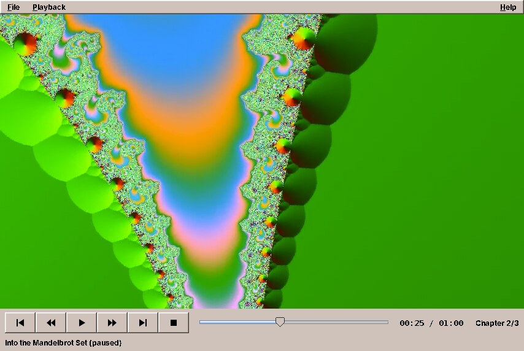

# 32. Video

Imagescan (chapter 31) ran another program to do the work it could not do itself. Video goes one step further: it loads another program's library into its own process and calls its C functions directly. Playing video is a job for decades of specialised code (FFmpeg's decoders, DVD navigation, synchronising sound and picture, scaling on the graphics card). amade-video leaves all of that to libmpv, the library behind the mpv player, and does what a Java program is good at: the window, the controls and the state.

amade-video plays video files, internet streams and DVDs. It is the smallest program of the book so far, about 1,250 lines of Java and 350 lines of tests, and still a skeleton: playing works, while track selection, subtitles, fullscreen and volume come later. That makes it a clear example of one technique: a native library through JNA, with its picture inside a Swing window. Nothing moves into amade-commons in this chapter. The transport symbols (play, pause, stop) have their first user here, and Audio, their second user, moves them in chapter 33.

## What you build



- **Files, streams and DVDs**: everything FFmpeg decodes; HTTP, HLS and DASH streams; DVDs from a drive, an ISO image or a `VIDEO_TS` folder, with titles and chapters.
- **Transport**: play and pause, stop, back and forward ten seconds, previous and next chapter, a position slider, the time and the chapter.
- **Keyboard**: Space, S, the arrow keys, Page Up and Page Down.
- **Five languages**, following the desktop.

The picture in the screenshot is a video FFmpeg made by itself, with a test source that draws a zoom into the Mandelbrot set. The commands are at the end of this chapter, so you can make one too.

## What you will learn

- How to map the functions of a C library to a Java interface with JNA, and read C structs without mapping them.
- How to let a native library draw into a Swing window, and what that costs.
- Why the thread that waits in native code is a platform thread, and how to shut it down without crashing the JVM.
- How to turn a stream of events from a library into one immutable state for the user interface.
- How to start when the machine has no GPU, or an older version of the library.

## A C library as a Java interface

JNA (Java Native Access) calls functions in shared libraries without a line of C. You describe the functions as a Java interface, JNA loads the library and implements the interface at run time. The part of libmpv's client API (`mpv/client.h`) that Video needs is a dozen functions:

```java title="amade-video · service/mpv/LibMpv.java"
--8<-- "amade-video/src/main/java/eu/amadeos/apps/video/service/mpv/LibMpv.java:functions"
```

The C types map in the obvious way: `int` to `int`, `int64_t` to `long`, `const char *` to `String`, and the opaque `mpv_handle *` to JNA's `Pointer`. A `String[]` is passed as a C array of strings with a null at the end, which is exactly what `mpv_command` expects. The one thing JNA cannot know is who owns memory: a string that `mpv_get_property_string` returns belongs to the caller and must be given back with `mpv_free`, while the strings inside an event belong to mpv and are valid only until the next `mpv_wait_event`.

The library has different names on different systems, so the player tries them in turn and remembers why each failed:

```java title="amade-video · service/mpv/MpvPlayer.java"
--8<-- "amade-video/src/main/java/eu/amadeos/apps/video/service/mpv/MpvPlayer.java:load"
```

Without libmpv, the program still starts. The window shows the reason and the package to install, instead of a stack trace on the console. That is the native-library version of chapter 31's `ProgramMissingException`.

### Structs without `Structure`

mpv reports what happens as events, and an event is a C struct: `mpv_event` with an id, an error code, a number the program chose and a pointer to more data, which is a struct of its own for each kind of event. JNA can map structs to Java classes (`Structure`), with field order, alignment and nested pointers. For four small structs that read a few fields each, Video reads the memory directly instead, at the offsets from the header file:

```java title="amade-video · service/mpv/LibMpv.java"
--8<-- "amade-video/src/main/java/eu/amadeos/apps/video/service/mpv/LibMpv.java:offsets"
```

The offsets are those of a 64-bit system, where a pointer and a `uint64_t` take 8 bytes and are aligned to 8. That is every system amadeOS and the Windows build run on; a 32-bit port would need other numbers. `MpvEvent.read` copies an event out of native memory into Java records, so it can be used after mpv has reused the memory:

```java title="amade-video · service/mpv/MpvEvent.java"
--8<-- "amade-video/src/main/java/eu/amadeos/apps/video/service/mpv/MpvEvent.java:read"
```

`MpvEvent` is a sealed interface, so the `switch` that handles events can list all its cases, and the compiler says when one is missing. Reading native memory at fixed offsets sounds like something only a running mpv can test. It is not: JNA's `Memory` is a piece of native memory that a test can fill with the same layout:

```java title="amade-video · MpvEventTest.java"
--8<-- "amade-video/src/test/java/eu/amadeos/apps/video/service/mpv/MpvEventTest.java:native-memory"
```

!!! warning "Pitfall: native code does not throw, it crashes"
    A wrong offset, a pointer used after it was freed, or a call with a destroyed handle does not end in an exception you can catch. It ends the JVM, with a crash log in the working directory. Keep the native part small, copy data out at once, and test the reading code against memory you built yourself.

## A native window in a Swing window

mpv can draw into a window that someone else created: its `wid` option takes the id of a native window (an X11 window id, a Windows `HWND`). Swing components have no native window of their own; the whole Swing window is one native window that Swing paints into. An AWT `Canvas` is different. It is a *heavyweight* component, with a native window of its own, and that is what mpv gets:

```java title="amade-video · ui/main/VideoCanvas.java"
--8<-- "amade-video/src/main/java/eu/amadeos/apps/video/ui/main/VideoCanvas.java:canvas"
```

The native window exists only once the canvas is *displayable*, after the frame was made visible. Then JNA's `Native.getComponentID` returns its id, and the player attaches:

```java title="amade-video · ui/main/MainPresenter.java"
--8<-- "amade-video/src/main/java/eu/amadeos/apps/video/ui/main/MainPresenter.java:start"
```

`attach` runs on the background executor, because `mpv_initialize` looks for the graphics card and takes a noticeable moment. A failure there comes back to the event dispatch thread as a message.

What it costs: mpv owns the pixels of the canvas, so Swing cannot paint over the picture. There are no controls that fade in over the video, and no Swing subtitles; the controls sit below the picture, and on-screen messages come from mpv itself. Menus are not affected. AWT knows which of its components are native and makes Swing's pop-up menus that overlap one visible on top of it, so the *Playback* menu opens over the running picture.

### libmpv's own conditions

`attach` sets the options before `mpv_initialize`, and one of them comes before everything:

```java title="amade-video · service/mpv/MpvPlayer.java"
--8<-- "amade-video/src/main/java/eu/amadeos/apps/video/service/mpv/MpvPlayer.java:attach"
```

libmpv refuses to start unless the C library's `LC_NUMERIC` locale is `C`, because it parses and prints decimal numbers in its options and must not get "0,5" for "0.5". The JVM sets the C locale to the user's, so on a German desktop libmpv would not start. One call to `setlocale` in libc, also through JNA, sets the numbers back to `C`. Java's own formatting is not affected, because Java does not use the C locale.

The other options make mpv a component rather than a player. `idle` keeps it running without a file, `keep-open` keeps the last picture at the end, and `input-default-bindings=no` with `input-vo-keyboard=no` leave the keyboard to the Swing window. `ytdl` lets it play video pages through `yt-dlp` when that program is installed.

## The event thread

mpv runs its own threads for decoding and output. The program sees them through one call, `mpv_wait_event`, which blocks until something happens or the time-out passes. One thread waits there for the whole life of the player:

```java title="amade-video · service/mpv/MpvPlayer.java"
--8<-- "amade-video/src/main/java/eu/amadeos/apps/video/service/mpv/MpvPlayer.java:event-loop"
```

It is a platform thread, not a virtual one. Chapter 30 said virtual threads are for waiting, and this thread does nothing but wait. But it waits *inside a native function*, and a virtual thread that calls native code cannot give its carrier thread back until the call returns. A virtual thread here would hold one of the carriers for as long as the program runs, and the rest of the program would have one carrier less. Virtual threads are for waiting in Java: on sockets, files, locks and queues.

Shutting down is where native code punishes mistakes. The handle must not be destroyed while the event thread is still inside `mpv_wait_event` with it, or the JVM crashes. So `close` wakes the thread, waits for it to leave, and only then destroys the handle:

```java title="amade-video · service/mpv/MpvPlayer.java"
--8<-- "amade-video/src/main/java/eu/amadeos/apps/video/service/mpv/MpvPlayer.java:close"
```

Commands such as `seek` or `cycle pause` can be sent from any thread; libmpv's client API is thread-safe. The presenter sends them from the event dispatch thread, and they return at once.

## From events to one state

mpv reports changes property by property: the position, the duration, the pause flag, the chapter, the title. The program asked for them once with `mpv_observe_property`, giving each a number, and every change arrives as an event with that number. The user interface does not want twelve kinds of events; it wants to know what to show. So the player keeps one immutable record:

```java title="amade-video · domain/PlayerState.java"
--8<-- "amade-video/src/main/java/eu/amadeos/apps/video/domain/PlayerState.java:state"
```

Every event becomes a function from the old state to the new one:

```java title="amade-video · service/mpv/MpvPlayer.java"
--8<-- "amade-video/src/main/java/eu/amadeos/apps/video/service/mpv/MpvPlayer.java:handle"
```

`propertyChanged` is a static method of state and event, so its tests need no mpv at all. One of them covers the end of a film. With `keep-open`, mpv does not end the file; it pauses on the last picture and sets `eof-reached`. The state calls that *ended*, and seeking back makes it *playing* again:

```java title="amade-video · MpvPlayerTest.java"
--8<-- "amade-video/src/test/java/eu/amadeos/apps/video/service/mpv/MpvPlayerTest.java:eof"
```

`update` applies the change, and only a real change goes to the listeners:

```java title="amade-video · service/mpv/MpvPlayer.java"
--8<-- "amade-video/src/main/java/eu/amadeos/apps/video/service/mpv/MpvPlayer.java:update"
```

The listeners run on the event thread. The presenter's listener only hands the state to the event dispatch thread (`edt.execute(() -> show(state))`), where `ControlBar.show` sets the buttons, the slider, the time and the status line from it. A record that cannot change can cross threads without a lock: the event thread never touches it again after publishing it.

The slider shows the position and also sets it, and the two must not mix. When the player moves the slider, that is not the user seeking; and while the user drags, the player must not pull the knob back:

```java title="amade-video · ui/main/ControlBar.java"
--8<-- "amade-video/src/main/java/eu/amadeos/apps/video/ui/main/ControlBar.java:seek"
```

`show` sets `following` while it moves the slider, and does not move it at all while the user holds the knob (`getValueIsAdjusting`). The seek goes to mpv once, when the knob is let go.

## Machines without a GPU, and older libraries

mpv's best video output renders with OpenGL or Vulkan on the graphics card. A virtual machine or a test display (Xvfb) has no graphics card, only software OpenGL, and there two things go wrong. mpv tries other ways to reach a screen, the Linux console among them, and its high-quality scalers do not compile in software, which leaves the picture black when a large video is shown smaller. `VideoOutput` chooses the options for the machine:

```java title="amade-video · service/mpv/VideoOutput.java"
--8<-- "amade-video/src/main/java/eu/amadeos/apps/video/service/mpv/VideoOutput.java:options"
```

Whether there is a GPU is guessed from the render nodes in `/dev/dri`. When the guess was wrong, mpv says so itself: it logs a warning about a software renderer, and the player switches to the simple scalers while running (`apply-profile fast`).

### A bug the screenshots found

The screenshot above was taken with Ubuntu 24.04's libmpv, older than the Debian one amadeOS uses, and at first the player did not start at all. The log said `option gpu-context=x11egl,x11vk: error setting option`. The older libmpv does not know the `x11vk` context, rejects the whole value, and `attach` treated every rejected option as fatal. The same would happen on any distribution with an older mpv, for one option that is only a preference.

The video output options are now set leniently. A rejected value is logged, and mpv's own default stays:

```java title="amade-video · service/mpv/MpvPlayer.java"
--8<-- "amade-video/src/main/java/eu/amadeos/apps/video/service/mpv/MpvPlayer.java:output-option"
```

The options that the program depends on (`wid`, `idle`, `keep-open`, the keyboard) are still checked, because without them it would misbehave in ways that are harder to find. The second part of the fix concerns the system properties `-Dmpv.<option>=<value>`, which let a user or a test override any option. They used to be applied after the defaults, so a default that failed stopped the player before the override was even tried. Now an override replaces the default of the same name before anything is set.

!!! tip "Tip: be strict about what you need, lenient about what you prefer"
    When a program configures a library, sort the settings into two kinds. Settings the program relies on should fail loudly. Settings that only make things better (a faster path, a nicer look) should fall back quietly with a line in the log. Native libraries come in many versions on users' machines, and an option that does not exist yet must not cost the user the whole program.

## What to play

A command-line argument, a file from the dialog, a URL or a DVD drive becomes a `MediaSource`, a sealed interface of three records that each know what to tell mpv's `loadfile` command:

```java title="amade-video · domain/MediaSource.java"
--8<-- "amade-video/src/main/java/eu/amadeos/apps/video/domain/MediaSource.java:parse"
```

DVDs have one surprise: mpv numbers their titles from 0, while people and the `dvd://` addresses they type count from 1, so `Dvd.target()` converts. Encrypted DVDs need libdvdcss, which libdvdnav loads by itself when it is installed. amade-video neither ships nor installs it, because whether its use is allowed depends on the country.

## What amade-commons gives Video

| Part | Since | Video uses it for |
|---|---|---|
| `AmadeApplication`, `AppInfo`, `CommonsModule`, `EdtExecutor` | chapter 10 | start-up, wiring, the background executor for `attach`, states to the event dispatch thread |
| `Mnemonics`, `TranslationCheck` | chapter 10 | menu letters, the test that all five languages have every text |
| `Texts` | chapter 22 | the texts, through `tr("...")` |

### And what stays in Video

- **Everything about mpv**: `LibMpv`, `MpvEvent`, `MpvPlayer`, `VideoOutput`. No other program of the book loads a native library this way; Audio reads CDs through libcdio with JNA, but in a different way, and two different uses are not one shared part.
- **`PlayerState`** and its transitions. Audio has a state of its own for its player, and the two have little in common beyond play and pause.
- **`TransportIcon`**, the symbols on the transport buttons. Audio has a copy with three more symbols (record, eject, favourite). Chapter 33 moves the symbols into amade-commons, as glyphs for the `ToolIcon` of chapter 30.

## Make your own test video

FFmpeg has test sources that draw a picture instead of reading one. This makes a minute of Mandelbrot zoom with a quiet tone and three chapters, the video in the screenshot:

```sh
cat > chapters.txt <<'EOF'
;FFMETADATA1
title=Into the Mandelbrot Set
[CHAPTER]
TIMEBASE=1/1
START=0
END=20
title=Overview
[CHAPTER]
TIMEBASE=1/1
START=20
END=40
title=Seahorse Valley
[CHAPTER]
TIMEBASE=1/1
START=40
END=60
title=Deep
EOF
ffmpeg -f lavfi -i "mandelbrot=s=854x480:rate=25" -f lavfi -i "sine=frequency=220" -i chapters.txt \
       -map 0:v -map 1:a -map_metadata 2 -map_chapters 2 -t 60 \
       -c:v libx264 -pix_fmt yuv420p -c:a aac mandelbrot.mkv
./gradlew run --args=mandelbrot.mkv
```

On a machine without a sound card, add `-Dmpv.ao=null` to the JVM options, so that mpv does not look for one.

## Exercises

1. **Volume.** Add a volume slider. mpv has a `volume` property from 0 to 100 (and beyond). Observe it, so that the slider follows when the volume changes elsewhere. Which parts change: `LibMpv`, `PlayerState`, `ControlBar`?
2. **Audio tracks and subtitles.** Films have several. mpv lists them in the property `track-list`, which is a structured value (`MPV_FORMAT_NODE`). Read it as JSON text instead, with `mpv_get_property_string(handle, "track-list")`, and offer the tracks in a menu. What is the cost of choosing text over the node structs?
3. **Fullscreen.** Use the fullscreen mode of the Paddle chapter in the Game Developer's Handbook: `setFullScreenWindow` without changing the display mode. What happens to the control bar, and how do the keyboard shortcuts reach the window?
4. **A crash on purpose.** Remove the `join` from `close` and quit while a film plays. Run it a few times. What does the crash log say, and why does it not happen every time?
5. **Strict or lenient.** Go through the options in `attach` and sort them into "the program relies on it" and "a preference". Is `osd-level` in the right group? Is `hwdec`?

## Summary

- JNA turns a Java interface into calls of a C library. Map only the functions you need, and keep track of who frees which memory.
- Small C structs can be read at fixed offsets from the header file, without `Structure` classes. Copy what you need into Java records at once, and test the reading code against `Memory` you filled yourself.
- A native library can draw into a heavyweight AWT `Canvas` through its window id, once the canvas is displayable. Swing cannot paint over it, so the controls go around it.
- A thread that waits in native code is a platform thread. Shut it down in the right order: wake it, join it, then destroy the handle.
- Turn the library's events into one immutable state with pure transition functions. The state crosses to the event dispatch thread without locks, and its tests need no library.
- Be strict about the options you need and lenient about the ones you prefer: a rejected video output option now costs a log line, not the player.
- Nothing moves into amade-commons here. The transport symbols move in chapter 33, when Audio becomes their second user.
