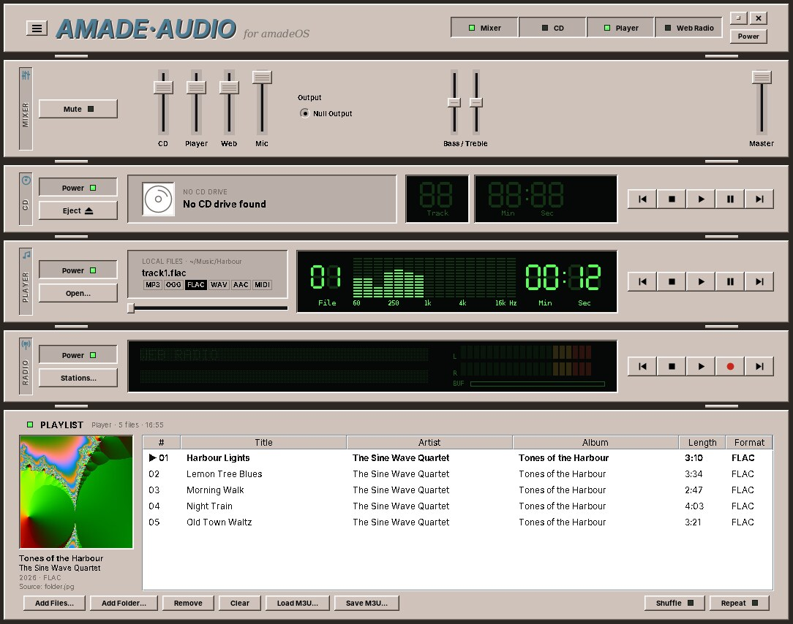

# 33. Audio

Video (chapter 32) left the hard work to a C library and kept to the window and the controls. Audio does the opposite: it plays sound in pure Java. It decodes the files, mixes, filters and measures the samples, and hands them to the sound card through Java Sound. Native code appears only where the operating system has the data: the audio CD in the drive.

amade-audio is the Audio Station of the desktop. It is a rack of devices in the style of the hi-fi systems of the 1990s: a mixer, a CD player, a file player and an internet radio, each with its own front, LCDs and transport buttons, and a playlist below. At about 11,600 lines of Java and 1,900 lines of tests it is the largest program of the book, so this chapter does not walk through all of it. It picks the ideas you will need again: a sound engine and its threads, decoders found at run time, a network stream with metadata inside, recording without decoding, a CD through JNA, a web service that wants politeness, and widgets drawn from scratch.

Two parts move into amade-commons. `Json` gets its second user, Mail. The transport symbols get theirs, Video.

## What you build



- **Four racks**: the *Mixer* with a fader per device, bass and treble, output device and master volume; the *CD* player; the file *Player*; and *Web Radio*. The header rack shows or hides them, and pressing Play on one device stops the others.
- **Files**: MP3, Ogg Vorbis, AAC, FLAC, WAV and AIFF, and MIDI rendered with Java's software synthesiser. Playlists with shuffle and repeat, M3U files, tags and the cover embedded in a file or found in its folder.
- **CDs** through libcdio on Linux and the system's CD driver on Windows, with titles from CD-Text or MusicBrainz and covers from the Cover Art Archive.
- **Internet radio**: favourites, search, genres and countries from radio-browser.info, the title that is playing, level meters, and recording to disk.
- **LCDs** with seven-segment digits, a 16-band spectrum and a scrolling dot-matrix line, in a glow that follows the desktop theme.
- **Five languages**, following the desktop.

The music in the screenshot is made up as well. FFmpeg made it from sine tones and pink noise, and the cover is a frame of its Mandelbrot test picture. The commands are at the end of the chapter.

## What you will learn

- How to build a small sound engine: a source of samples, a channel per device on its own thread, and an output you can replace in tests.
- How Java Sound finds decoders at run time, and what to do when it cannot convert in one step.
- How internet radio carries song titles inside the audio stream, and how to record a stream without decoding it.
- How a second program uses JNA differently from Video, and how to test a checksum against the reference library.
- How to keep to a web service's rate limit and cache its answers.
- How to draw an LCD from a font written as text.
- How to move a set of icons into a library that already has an icon system.

## A sound engine in four parts

Every device of the rack plays the same way. Something delivers decoded samples, a channel applies the fader and the tone control and measures the levels, and an output sends the samples to the sound card. The first part is the source:

```java title="amade-audio · service/engine/PcmSource.java"
--8<-- "amade-audio/src/main/java/eu/amadeos/apps/audio/service/engine/PcmSource.java:source"
```

One format for the whole engine, signed 16-bit little-endian PCM, keeps everything after the decoder simple. A file, a CD track and a radio stream are all `PcmSource`s: `AudioInputStreamSource` wraps what Java Sound decoded, `CdPcmSource` reads sectors from the disc, `MidiRenderer` renders a MIDI file. The output is an interface too, `PcmOutput`, with `JavaSoundOutput` as the real one.

`AudioEngine` holds one `AudioChannel` per device. Playing replaces whatever played before and starts a thread:

```java title="amade-audio · service/engine/AudioChannel.java"
--8<-- "amade-audio/src/main/java/eu/amadeos/apps/audio/service/engine/AudioChannel.java:play"
```

The thread runs this loop. It reads from the source, applies the gain and the tone control, measures, and writes:

```java title="amade-audio · service/engine/AudioChannel.java"
--8<-- "amade-audio/src/main/java/eu/amadeos/apps/audio/service/engine/AudioChannel.java:loop"
```

The gain is a multiplication with clipping. The fader is squared on the way, because the ear hears loudness roughly on a logarithmic scale, and a linear fader would do all its work in the last centimetre:

```java title="amade-audio · service/engine/AudioChannel.java"
--8<-- "amade-audio/src/main/java/eu/amadeos/apps/audio/service/engine/AudioChannel.java:gain"
```

### Which thread, and why a virtual one here

Video needed a platform thread, because `mpv_wait_event` waits inside native code for as long as it likes, and a virtual thread waiting there pins its carrier. Audio's playback threads are virtual. They wait in three places: in the decoder reading a file or a socket, which the JDK has built for virtual threads; in `lock.wait()` while paused; and in `SourceDataLine.write`, which waits for room in the line's buffer in short steps in Java code, so the native call only copies what fits. None of them blocks inside native code for long.

Stopping has to wake the thread wherever it waits. `cancel` sets the flag, wakes a paused thread, and closes the output and the source: closing the line returns a `write` that waits for buffer space, and closing a network stream returns a `read` that waits for data.

```java title="amade-audio · service/engine/AudioChannel.java"
--8<-- "amade-audio/src/main/java/eu/amadeos/apps/audio/service/engine/AudioChannel.java:cancel"
```

A stopped playback can still deliver an event or two before its thread ends: the last levels, an error from the closed stream. If they reached the listeners, the display would flicker back to the old track. So every event names its playback, and only the current one gets through:

```java title="amade-audio · service/engine/AudioChannel.java"
--8<-- "amade-audio/src/main/java/eu/amadeos/apps/audio/service/engine/AudioChannel.java:stale"
```

!!! warning "Pitfall: \"finished\" is not \"stopped\""
    When a track ends by itself the player goes on to the next one. When the user presses Stop it must not. Both end the same loop, so the channel reports them as two events: `stateChanged(STOPPED)` for both, `finished` only for the end of the source. A test checks that Stop never counts as finished.

### Testing sound without a sound card

The build machines have no sound card, and a test that plays sound would be slow anyway. The tests give the engine a `FakeOutput` that collects what is written, and a `SineSource` that computes a tone:

```java title="amade-audio · test · service/engine/SineSource.java"
--8<-- "amade-audio/src/test/java/eu/amadeos/apps/audio/service/engine/SineSource.java:read"
```

With them, a test plays half a second at full volume and checks that 22,050 frames arrived, that the level meter shows −6 dB for a half-scale sine, and that the states came in the order *loading, playing, stopped*. The fake output can also play "slowly", sleeping on every write, so that a test can catch the channel while it plays:

```java title="amade-audio · test · service/engine/AudioChannelTest.java"
--8<-- "amade-audio/src/test/java/eu/amadeos/apps/audio/service/engine/AudioChannelTest.java:stop-not-finished"
```

### Levels, spectrum and tone

`LevelAnalyzer` measures the samples on their way to the output, about 25 times a second: the peak of each channel for the meters, and a fast Fourier transform of the last 2,048 samples for the 16 bands of the spectrum. The meters show decibels, not amplitudes, because that is how loud things sound:

```java title="amade-audio · service/engine/LevelAnalyzer.java"
--8<-- "amade-audio/src/main/java/eu/amadeos/apps/audio/service/engine/LevelAnalyzer.java:meter"
```

Bass and treble are two shelving filters of the kind every equaliser uses, a "biquad" each, computed with the formulas from Robert Bristow-Johnson's *Audio EQ Cookbook*. `ToneControl` recomputes their coefficients only when a knob or the sample rate changes, and does nothing at all while both knobs are at zero.

Because the engine measures after the fader, the meters fall when you pull a fader down. That is how a mixing desk works, and it is also what users expect.

## Decoders found at run time

Java Sound decodes only WAV, AIFF and AU by itself. The other formats come as *service providers*: jar files that declare an `AudioFileReader` and a `FormatConversionProvider` in `META-INF/services`. Java Sound finds them on the class path when it needs them. Audio's `build.gradle` lists them as `runtimeOnly`, and its code never names them, except where a radio stream's codec is already known:

```java title="amade-audio · service/decode/DecoderFactory.java"
--8<-- "amade-audio/src/main/java/eu/amadeos/apps/audio/service/decode/DecoderFactory.java:class-loader"
```

The search goes through the thread's context class loader. A platform thread inherits it from the thread that started it, while a virtual thread started from a library's executor may have none, and then Java Sound finds no MP3 decoder. One line before every decoding fixes that.

Two more traps are in the build file: the fat jar must merge the providers' `META-INF/services` files instead of keeping only the first one, and signed provider jars must lose their signatures, or the merged jar is rejected. Chapter 50 shows the packaging in detail.

### A bug the screenshots found

The album in the screenshot did not play at first. The error was *Unsupported conversion: PCM_SIGNED 44100.0 Hz, 16 bit ... from FLAC 44100.0 Hz, 24 bit*. FFmpeg had written the FLAC files with 24 bits, as most high-resolution downloads are. The FLAC provider decodes only to the file's own depth, and the JDK's PCM converter turns 24 bits into 16, but Java Sound does not chain two conversions by itself. So the factory chains them:

```java title="amade-audio · service/decode/DecoderFactory.java"
--8<-- "amade-audio/src/main/java/eu/amadeos/apps/audio/service/decode/DecoderFactory.java:pcm16"
```

The test uses a quarter of a second of 24-bit FLAC that FFmpeg wrote, 11 KB in the test resources:

```java title="amade-audio · test · service/decode/DecodeTest.java"
--8<-- "amade-audio/src/test/java/eu/amadeos/apps/audio/service/decode/DecodeTest.java:flac24"
```

!!! tip "Tip: test with the files your users have"
    The tests had a WAV file written by Java itself, and every decoder worked with the sample files during development, which were all 16 bits. The users' files are not. A small set of real files in the test resources (24-bit FLAC, mono MP3, HE-AAC, a file with a broken tag) catches more than a large set of perfect ones.

## Internet radio

A radio station is an HTTP response that never ends. `RadioSession` downloads it on one virtual thread, and the decoder reads it on another. Between them sits a queue of 4 KB chunks, `BufferedRadioInputStream`. The downloader pushes into it:

```java title="amade-audio · service/webradio/BufferedRadioInputStream.java"
--8<-- "amade-audio/src/main/java/eu/amadeos/apps/audio/service/webradio/BufferedRadioInputStream.java:push"
```

The decoder starts only after 16 chunks have arrived, a few seconds of sound. A short stall in the network then empties the cushion instead of interrupting the music, and the *BUF* bar on the radio's LCD shows how full it is. When the connection drops, the downloader reconnects up to five times while the decoder plays from the cushion.

### Song titles inside the stream

Radio servers send the title that is playing inside the audio stream. A client that asks for it with the request header `Icy-MetaData: 1` gets the header `icy-metaint: 16000` in the answer, and then after every 16,000 bytes of audio one length byte and a block of text such as `StreamTitle='Artist - Title';`. A decoder that saw these blocks would play a click every few seconds or lose its place, so `IcyInputStream` takes them out:

```java title="amade-audio · service/webradio/IcyInputStream.java"
--8<-- "amade-audio/src/main/java/eu/amadeos/apps/audio/service/webradio/IcyInputStream.java:read"
```

```java title="amade-audio · service/webradio/IcyInputStream.java"
--8<-- "amade-audio/src/main/java/eu/amadeos/apps/audio/service/webradio/IcyInputStream.java:title"
```

The trick in `read` is that it never reads past the next metadata block: it asks for at most `bytesUntilMetadata` bytes, so the block always starts at the beginning of a read.

The same stream can be MP3, AAC or Ogg Vorbis, and the `Content-Type` header is often wrong. `StreamSniffer` looks at the first bytes for the frame patterns of each codec before a decoder is chosen.

### Recording without decoding

Recording does not record what you hear. It saves the bytes as they come from the station, before the decoder: an MP3 stream becomes an MP3 file, with no loss and almost no work. The downloader hands every chunk to a tap:

```java title="amade-audio · service/webradio/RadioSession.java"
--8<-- "amade-audio/src/main/java/eu/amadeos/apps/audio/service/webradio/RadioSession.java:deliver"
```

The recorder can start a new file when the title changes. It must not cut in the middle of a frame, or the new file starts with noise. So it waits for the next frame header, which in MP3 and in AAC's ADTS form starts with eleven or twelve 1-bits:

```java title="amade-audio · service/recording/FrameSync.java"
--8<-- "amade-audio/src/main/java/eu/amadeos/apps/audio/service/recording/FrameSync.java:find"
```

```java title="amade-audio · service/recording/StreamRecorder.java"
--8<-- "amade-audio/src/main/java/eu/amadeos/apps/audio/service/recording/StreamRecorder.java:write"
```

A file being written ends in `.part`. Only a finished file gets its real name, with an atomic move, the same rule as the atomic saves of chapters 20 to 31:

```java title="amade-audio · service/recording/StreamRecorder.java"
--8<-- "amade-audio/src/main/java/eu/amadeos/apps/audio/service/recording/StreamRecorder.java:close-file"
```

The test builds the chunks itself: a fake MP3 frame for the old title, the title change, then a chunk with the rest of the old frame and a new frame. The split must fall exactly at the new frame:

```java title="amade-audio · test · service/recording/RecordingTest.java"
--8<-- "amade-audio/src/test/java/eu/amadeos/apps/audio/service/recording/RecordingTest.java:split"
```

Ogg Vorbis is never split. Its pages carry a running sample count and checksums, and a file cut at a page would not start with the headers a player needs.

Recordings are for private use. Audio says so before the first recording, and the stations' terms are the user's business, not the program's.

## Audio CDs through JNA

Audio is the second program with JNA, after Video, and it uses it differently. Video kept one handle for the whole life of the player and an event thread. Audio opens the drive for each job and closes it again, because the disc can change at any time. The mapping is just as short:

```java title="amade-audio · service/cd/LibCdio.java"
--8<-- "amade-audio/src/main/java/eu/amadeos/apps/audio/service/cd/LibCdio.java:functions"
```

An audio CD has no files. It has a table of contents with the start sector of each track, and sectors of 2,352 bytes: 588 stereo frames of 16-bit samples at 44.1 kHz, which is exactly the engine's format. `CdPcmSource` reads a third of a second at a time:

```java title="amade-audio · service/cd/CdPcmSource.java"
--8<-- "amade-audio/src/main/java/eu/amadeos/apps/audio/service/cd/CdPcmSource.java:read"
```

The reader behind it is either plain libcdio or libcdio-paranoia, which reads sectors several times and corrects scratches when it is installed. On Windows, `WindowsCdDrive` sends the same requests to the system's CD driver with `DeviceIoControl`, again through JNA, so Audio needs no extra library there.

### A checksum, tested against the reference

To find the CD's titles, Audio asks MusicBrainz by *disc ID*: a SHA-1 hash of the table of contents, in a Base64 variant that fits into a URL:

```java title="amade-audio · service/cd/DiscId.java"
--8<-- "amade-audio/src/main/java/eu/amadeos/apps/audio/service/cd/DiscId.java:of"
```

Code like this is easy to get almost right: one wrong offset and every ID is different, the lookup finds nothing, and nobody knows why. The test therefore compares with what libdiscid, MusicBrainz' own C library, computes for the same table of contents:

```java title="amade-audio · test · service/cd/CdTest.java"
--8<-- "amade-audio/src/test/java/eu/amadeos/apps/audio/service/cd/CdTest.java:disc-id"
```

The expected value came from libdiscid itself, called once from Python, with no drive and no disc:

```python
import ctypes
lib = ctypes.CDLL("libdiscid.so.0")
lib.discid_new.restype = ctypes.c_void_p
lib.discid_get_id.restype = ctypes.c_char_p
lib.discid_get_id.argtypes = [ctypes.c_void_p]
lib.discid_put.argtypes = [ctypes.c_void_p, ctypes.c_int, ctypes.c_int, ctypes.POINTER(ctypes.c_int)]
disc = lib.discid_new()
offsets = (ctypes.c_int * 100)(95462, 150, 15363, 32314, 46592, 63414)  # lead-out first
lib.discid_put(disc, 1, 5, offsets)
print(lib.discid_get_id(disc))  # b'TRSpskwpCRwj67pwDQEX6V5VJlU-'
```

## Being polite to a web service

MusicBrainz is run by volunteers. It asks clients for no more than one request per second, and for a `User-Agent` header that names the program and how to reach its authors. The client keeps to it in one place:

```java title="amade-audio · service/metadata/MusicBrainzClient.java"
--8<-- "amade-audio/src/main/java/eu/amadeos/apps/audio/service/metadata/MusicBrainzClient.java:request"
```

`synchronized` makes the calls queue up, and `lastRequest` is set in `finally`, so a failed request counts too. The answers go into a cache under `~/.cache/amadeos/audio/discs/`, named after the disc ID, so a CD that was looked up once needs no network again. The order of the sources is: the cache (which also keeps what the user chose or typed), CD-Text on the disc, then MusicBrainz.

The answers are JSON, and so are radio-browser.info's station lists and the favourites file. Audio reads all of them with the `Json` class that now lives in amade-commons; more about it below.

## One device at a time

Four devices, one pair of speakers. `PlaybackCoordinator` remembers which device is active and stops the others when one starts:

```java title="amade-audio · service/PlaybackCoordinator.java"
--8<-- "amade-audio/src/main/java/eu/amadeos/apps/audio/service/PlaybackCoordinator.java:activate"
```

The rule sounds obvious, but it has cases. Inserting a CD while the radio plays shows the CD's track list only if nothing is playing (`select`), and a click on *Stations...* shows the station list without taking the speakers from the CD (`showList`). Each case has a test, without any rack on the screen.

## Widgets drawn from scratch

No Swing component looks like a seven-segment LCD, so the racks draw their own: `SevenSegmentDisplay`, `DotMatrixDisplay`, `SpectrumMeter`, `LevelMeter`, `Fader`, `Led`. They share a base class, `Widget`, and two rules.

The first rule: **the font of the dot-matrix display is text in the source.** Each character is an enum constant with seven rows of five dots, written so you can see the letter:

```java title="amade-audio · ui/widget/LcdCharacter.java"
--8<-- "amade-audio/src/main/java/eu/amadeos/apps/audio/ui/widget/LcdCharacter.java:letter"
```

The constructor turns the rows into five bytes, one per column, with a bit per dot:

```java title="amade-audio · ui/widget/LcdCharacter.java"
--8<-- "amade-audio/src/main/java/eu/amadeos/apps/audio/ui/widget/LcdCharacter.java:rows"
```

Painting is then two loops: for each column on the display, for each of the nine rows, a lit or an unlit dot. The unlit dots are drawn too, faintly, as on a real LCD:

```java title="amade-audio · ui/widget/DotMatrixDisplay.java"
--8<-- "amade-audio/src/main/java/eu/amadeos/apps/audio/ui/widget/DotMatrixDisplay.java:paint"
```

The translations brought accented letters. Instead of drawing *é*, *ñ* and *ç* by hand, `DotMatrixDisplay` splits a letter into its base letter and its accent with `java.text.Normalizer` and draws the accent in the top row. A test checks every letter the five languages use.

The second rule: **colours come from the theme.** The rack fronts, bevels and labels use `AmadeUI.theme()` at paint time, so they change at once when Settings changes the theme. The LCDs stay black, and their glow is picked to suit the theme:

```java title="amade-audio · ui/widget/LcdPalette.java"
--8<-- "amade-audio/src/main/java/eu/amadeos/apps/audio/ui/widget/LcdPalette.java:theme"
```

### Sizes

A rack of hi-fi devices is large. On a laptop with 768 lines it would not fit, so all pixel sizes of the rack fronts go through `Scale.px`, and Audio picks 60, 80 or 100 % at start-up to fit the screen. Texts shrink with the racks, but never below 9 pixels.

The screenshots found a second, smaller bug here: at 80 %, the line under the cover that names its source was drawn over the year and the format. The cover column now lays out all its lines in one column, so a line that does not fit is cut off at the bottom instead of being drawn over another.

## What moves into amade-commons

### Json

Mail had a JSON reader of 140 lines for the answers of OAuth2 token servers (chapter 22). Audio had a fuller one for MusicBrainz, radio-browser.info and its favourites file: the same parser, plus helpers that never throw and a writer. Audio's version moves to `eu.amadeos.commons.json`, and Mail's copy goes:

```java title="amade-commons · json/Json.java"
--8<-- "amade-commons/src/main/java/eu/amadeos/commons/json/Json.java:parse"
```

```java title="amade-commons · json/Json.java"
--8<-- "amade-commons/src/main/java/eu/amadeos/commons/json/Json.java:helpers"
```

The helpers explain why the class exists at all, instead of a JSON library. Web services leave members out, and send numbers as strings or strings as numbers. `Json.str(release, "date")` returns `""` for a release without a date, and `Json.integer(medium, "track-count")` returns 0, so code like `MusicBrainzClient.parse` reads like a description of the data, without a null check in every line. Objects become `LinkedHashMap`s, so a file written with `Json.write` keeps its order and stays readable for people.

A library would map JSON to records, validate it against a schema and stream gigabytes. None of the programs needs that. The test that came with Audio moves along, and Mail keeps its own test of the token answers.

### The transport buttons

Video's `TransportIcon` drew seven symbols, Audio's ten. Chapter 30 gave amade-commons a way to draw icons: a `ToolIcon` paints a `Glyph` on a 16-unit grid in the button's colours. The transport symbols become one more set of glyphs, like `StandardGlyph`:

```java title="amade-commons · swing/TransportGlyph.java"
--8<-- "amade-commons/src/main/java/eu/amadeos/commons/swing/TransportGlyph.java:paint"
```

*Next* and *forward* are now the mirror images of *previous* and *rewind*, with the `Pen.mirror()` that *redo* uses in chapter 30, and a test checks this pixel by pixel:

```java title="amade-commons · test · swing/TransportButtonsTest.java"
--8<-- "amade-commons/src/test/java/eu/amadeos/commons/swing/TransportButtonsTest.java:mirror"
```

The buttons themselves are not `ToolButtons`. A toolbar button is a shortcut for a menu command, so it never takes the focus. A player's transport buttons are its main controls and must be reachable with the keyboard. They are also wider, and Audio scales them with its racks. `TransportButtons` is a record with the scale:

```java title="amade-commons · swing/TransportButtons.java"
--8<-- "amade-commons/src/main/java/eu/amadeos/commons/swing/TransportButtons.java:sizes"
```

Audio passes its rack size, and Video uses `TransportButtons.NORMAL`:

```java title="amade-audio · ui/widget/Scale.java"
--8<-- "amade-audio/src/main/java/eu/amadeos/apps/audio/ui/widget/Scale.java:transport"
```

```java
JButton play = Scale.transport().button(TransportGlyph.PLAY, p::play);          // Audio
JButton next = TransportButtons.NORMAL.button(TransportGlyph.NEXT, () -> p.chapter(1)); // Video
```

What did not move is as instructive as what did:

- **The tooltips stay in the programs.** The same symbol means different things: *Previous* is the previous track in Audio and the previous chapter in Video. `TransportGlyph.key()` names the text, `transport.previous`, and each program translates it in its own words.
- **The favourite star** was in Audio's copy, but nothing used it any more. It was dropped, not moved. A library collects what programs share, not what one program once drew.
- **Eject and record** moved, although only Audio has them. They are transport symbols that any player may need, and the set is small; a program that needs a different symbol writes its own glyph enum, as chapter 30 showed.

## What amade-commons gives Audio

| Part | Since | Audio uses it for |
|---|---|---|
| `AmadeApplication`, `AppInfo`, `CommonsModule`, `EdtExecutor` | chapter 10 | start-up, wiring, states and levels to the event dispatch thread |
| `Messages`, `LocaleSettings`, `TranslationCheck` | chapter 10 | five languages, the language setting, the test that every text is translated |
| `AmadeUI`, `DesktopTheme` | chapter 10 | the colours of the racks and the LCD glow |
| `AppDirectories`, `PropertiesFile` | chapter 20 | `audio.conf`, the favourites, the cache of CD titles and covers |
| `LanguageChooser` | chapter 21 | the language in the settings |
| `PasswordStore` | chapter 22 | the proxy password, in the desktop keyring |
| `Texts` | chapter 22 | the texts, through `tr("...")` |
| `CommandRunner` | chapter 31 | `wpctl` and `pactl` for the sound server, `eject` |
| `Json` | **this chapter** | MusicBrainz, radio-browser.info, the favourites and the title cache |
| `TransportGlyph`, `TransportButtons` | **this chapter** | the transport buttons of the CD, the player and the radio, and the Eject symbol |

### And what stays in Audio

- **The sound engine**, the decoders and `ToneControl`. No other program plays sound; amadeOS's desktop sounds go through the sound server, not through Java.
- **Web radio and recording.** They are Audio's purpose, not a tool other programs need.
- **The CD drive.** It is native code for one device in one program.
- **The rack widgets** and `Scale`. They are Audio's look. If a second program ever wants a seven-segment display, it moves then, and not before.

## Make your own album

The album in the screenshot is five tracks of chords from sine tones, with pink noise for some width in the spectrum. `aevalsrc` computes the samples from a formula, and `anoisesrc` makes the noise:

```sh
mkdir -p album && cd album
ffmpeg -f lavfi -i "aevalsrc=0.25*sin(2*PI*220*t)*(0.6+0.4*sin(2*PI*0.5*t))+0.18*sin(2*PI*277.18*t)+0.14*sin(2*PI*329.63*t):s=44100:c=stereo" \
       -f lavfi -i "anoisesrc=color=pink:amplitude=0.06:sample_rate=44100" \
       -filter_complex "[0][1]amix=inputs=2:normalize=0" -t 190 \
       -metadata title="Harbour Lights" -metadata artist="The Sine Wave Quartet" \
       -metadata album="Tones of the Harbour" -metadata track=1 01-harbour-lights.flac
ffmpeg -f lavfi -i "mandelbrot=s=600x600" -frames:v 1 folder.jpg
cd .. && ./gradlew run --args=album/01-harbour-lights.flac
```

Change the three frequencies for the other tracks: 196, 246.94 and 293.66 Hz make a G major chord. The FLAC files have 24 bits, the case of the bug above. Add `-sample_fmt s16` to get 16 bits.

On a machine without a sound card, Java Sound finds no line at all. A PulseAudio server with a null sink gives it one that plays in real time, which is how the screenshot was taken in a container:

```sh
pulseaudio --daemonize=yes --exit-idle-time=-1 -n \
    --load="module-null-sink" --load="module-native-protocol-unix"
printf 'pcm.!default {\n  type pulse\n}\n' > ~/.asoundrc
```

ALSA's own `null` device works too, but it swallows the samples as fast as they come, so a track ends in a second.

## Exercises

1. **Gapless playback.** Between two tracks of a live album there is a short gap, because the channel drains the line, closes it and opens a new one. Let the player hand the channel the next source before the current one ends, and keep the line open when the format is the same. Which parts of `AudioChannel.Playback` change, and how do you test it with `FakeOutput`?
2. **Replay gain.** Many files carry a `REPLAYGAIN_TRACK_GAIN` tag, e.g. `-6.5 dB`. Read it with `TagReader` and apply it with `applyGain`, before the fader. What must happen to a track with a positive gain that would clip?
3. **Dither.** The 24-bit FLAC files lose their lowest 8 bits in the JDK's converter. Write your own converter that adds triangular noise of one 16-bit step before rounding. Compare the spectrum of a very quiet sine with and without it.
4. **A new character.** Add the euro sign to `LcdCharacter` and a test to `DotMatrixGlyphTest`. Where does the display fall back when a character is unknown?
5. **A volume glyph.** Video's planned volume slider (exercise 1 of chapter 32) wants a speaker symbol. Write it as a glyph in Video, not in `TransportGlyph`. When would it move into amade-commons?

## Summary

- A sound engine needs three interfaces: a source of samples in one fixed format, a channel per device on its own thread, and an output you can replace in tests.
- Virtual threads suit playback, because its waits are in Java code. Stop a playback by closing what it waits on, and drop the events of a playback that is no longer current.
- Java Sound finds decoders as service providers through the context class loader. It converts in one step only, so a 24-bit FLAC file needs two.
- Internet radio carries song titles inside the stream, every `icy-metaint` bytes. A recorder saves the bytes as they come and splits only at frame headers.
- Test a checksum against the reference implementation, not only against its own output.
- Keep to a web service's rate limit in one synchronized method, and cache its answers.
- A dot-matrix font written as text in the source is readable, testable and easy to extend.
- `Json` and the transport buttons move into amade-commons, as `eu.amadeos.commons.json.Json`, `TransportGlyph` and `TransportButtons`. Their texts stay in the programs, and an unused symbol is dropped, not moved.
- With Audio, the media programs are complete. [Chapter 34](34-screenshot.md) ends Part III with a small tool that knows the desktop around it.
