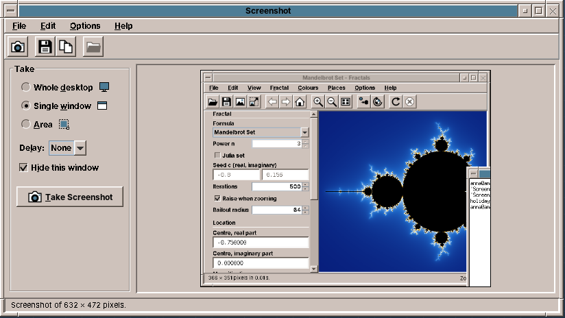
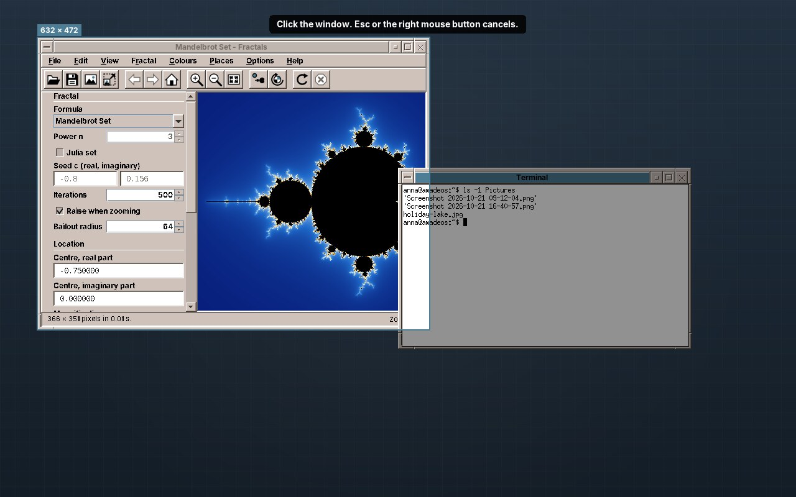
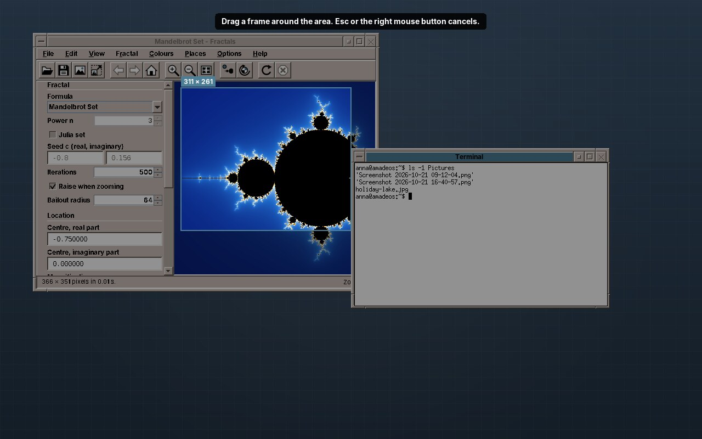

# 34. Screenshot

The programs of Part III so far were large: a fractal explorer, a scanning program, two players. Screenshot is small, about 2,400 lines of Java and 1,200 lines of tests, and it does one thing: it takes a picture of the screen. To do that well it has to know more about the desktop around it than any program before it. It reads the pixels of the whole screen, asks the X server which windows are on it, covers every screen with a window of its own while the user picks, and keeps running after its window has closed, because on X11 a copied picture lives in the program that copied it.

Two small parts move into amade-commons with this chapter, each with its third user: the user's pictures folder, and a picture on the clipboard. Fractals and Imagescan had their own copies of both.

## What you build



- **Three modes**: the whole desktop, a single window picked with a click, or an area drawn with the mouse.
- **A delay** of 3, 5 or 10 seconds, to open a menu before the picture is taken, and a choice whether Screenshot hides its own window.
- **Save** (Ctrl+S) into the pictures folder as `Screenshot 2026-10-22 14-05-33.png` without a question, or **Save As** PNG or JPEG anywhere. **Open Folder** shows the folder in the file manager.
- **Copy** (Ctrl+C) puts the picture on the clipboard. It can still be pasted after the window has closed.
- **A command line** for key bindings: `amade-screenshot --area --copy` takes an area and copies it, without the window.
- **Five languages**, following the desktop.

## What you will learn

- How to read the pixels of all screens with `java.awt.Robot`, and why the window has to get out of the way first.
- Why a screenshot program freezes the desktop before the user picks, and how a full-screen window shows the frozen picture.
- How to ask the X server for its windows through JNA, and how to keep a vanished window from ending the program.
- How the X11 clipboard works, and why a program that copied something must not end.
- How one program offers a window and a command line, with a sealed interface and a `switch`.
- How to find the user's pictures folder in their own language.

## Reading the screen

Java can read the screen without any native code of its own: `java.awt.Robot`, made for automated tests, has `createScreenCapture`. On X11 it asks the X server for the pixels of the root window, which holds everything that is visible. `RobotScreen` first adds up the bounds of all screens, so that two monitors side by side become one wide picture:

```java title="amade-screenshot · service/RobotScreen.java"
--8<-- "amade-screenshot/src/main/java/eu/amadeos/apps/screenshot/service/RobotScreen.java:bounds"
```

```java title="amade-screenshot · service/RobotScreen.java"
--8<-- "amade-screenshot/src/main/java/eu/amadeos/apps/screenshot/service/RobotScreen.java:grab"
```

The `Robot` is created on first use, because its constructor fails without a display, and the tests construct the program without one. `Screen` is an interface with these two methods; the presenter's tests answer it with a picture of their own, so they need neither a screen nor a `Robot`.

!!! note "The mouse pointer is not in the picture"
    The X server draws the pointer separately from the windows, and the root window's pixels do not contain it. For screenshots that is usually what the user wants. A tool that must show the pointer asks the XFixes extension for its image and paints it in.

## Taking a screenshot

A screenshot of the desktop should not show the screenshot program. So `take()` hides the window first, then counts down the delay, waits a little longer, and only then reads the screen:

```java title="amade-screenshot · ui/main/MainPresenter.java"
--8<-- "amade-screenshot/src/main/java/eu/amadeos/apps/screenshot/ui/main/MainPresenter.java:take"
```

Hiding is asynchronous. `setVisible(false)` returns at once, but the X server still has to unmap the window, and every program below it has to repaint what was covered. A grab right away often shows a grey hole where Screenshot was. `SETTLE_MILLIS`, 400 milliseconds, is enough on every machine we tried, and the user does not notice it after pressing a button.

The countdown and the grab run on the background executor, as every slow step in this book does; each change the user sees goes back through the `ui` executor. `Pause` is an interface, so the test that checks the countdown does not wait three seconds:

```java title="amade-screenshot · test · ui/main/MainPresenterTest.java"
--8<-- "amade-screenshot/src/test/java/eu/amadeos/apps/screenshot/ui/main/MainPresenterTest.java:fakes"
```

```java title="amade-screenshot · test · ui/main/MainPresenterTest.java"
--8<-- "amade-screenshot/src/test/java/eu/amadeos/apps/screenshot/ui/main/MainPresenterTest.java:take"
```

The test's executor runs everything on the test's thread, in order, when `runAll()` is called. That is how it can check that a second press while taking does nothing, and that the window was hidden before and shown after.

### A bug in the window manager

The first version of the program lost its window after the first screenshot. Hiding worked, but `setVisible(true)` showed nothing, and the program could not be reached any more.

The cause was in the amadeOS window manager. When a program unmaps its window, the window manager has to take its frame away and keep the window, because the program may show it again; the ICCCM, the rule book of X11 window managers, calls this the *withdrawn* state. The window manager treated an unmap like a closed window: it destroyed the frame, and with the frame the program's window inside it. No program before Screenshot hid and showed its own main window, so nobody had noticed.

The fix is in amadeos-system: on an unmap, the window manager moves the window out of its frame back to the root window, removes it from its save set, and remembers where the frame was, so that the window comes back at the same place. A test in the window manager's integration tests now hides and shows a window.

!!! tip "Tip: the program that finds a bug is often not the one that has it"
    A new program uses the desktop in a new way. When something fails in a way your code cannot explain, try the same steps with a small test program, here a `JFrame` that hides and shows itself. If it fails too, the bug is below you, and a test there protects every later program.

## Freeze first, pick later

For a window or an area, the user has to pick. Screenshot does not let the user pick on the live desktop. It takes the whole desktop first and shows that picture full-screen; the user picks on the picture, and the chosen part is cut out of it. `Capture` is that frozen moment:

```java title="amade-screenshot · service/Capture.java"
--8<-- "amade-screenshot/src/main/java/eu/amadeos/apps/screenshot/service/Capture.java:capture"
```

Freezing has three advantages. A menu that closes when the focus moves stays open in the picture. What the user sees while picking is exactly what they get. And the windows are listed at the same moment the pixels are taken, so a window that moves while the user picks does not move in the picture:

```java title="amade-screenshot · service/CaptureService.java"
--8<-- "amade-screenshot/src/main/java/eu/amadeos/apps/screenshot/service/CaptureService.java:capture"
```

`crop` copies the pixels instead of returning `getSubimage`. A sub-image shares the pixels of the whole desktop, so a 200-pixel icon would keep 30 megabytes of a 4K desktop alive for as long as it is on the clipboard.

```java title="amade-screenshot · test · service/CaptureTest.java"
--8<-- "amade-screenshot/src/test/java/eu/amadeos/apps/screenshot/service/CaptureTest.java:crop"
```

After the grab, the presenter either has its picture or opens the overlay:

```java title="amade-screenshot · ui/main/MainPresenter.java"
--8<-- "amade-screenshot/src/main/java/eu/amadeos/apps/screenshot/ui/main/MainPresenter.java:captured"
```

## Which windows are there

To light up the window under the pointer, Screenshot needs the windows' positions and their order from top to bottom. Java knows only its own windows. The X server knows all of them: the children of the root window, in stacking order from the bottom to the top. Under a window manager that puts each window into a frame, as the amadeOS one does, those children are the frames, so a picked window comes with its title bar and border.

Java cannot ask the X server for this, so Screenshot calls `libX11` through JNA, the library Video and Audio used for libmpv and libcdio ([chapter 32](32-video.md), [chapter 33](33-audio.md#audio-cds-through-jna)). The calls are declared in an interface, and JNA finds the functions in `libX11.so.6` by their names:

```java title="amade-screenshot · service/X11WindowList.java"
--8<-- "amade-screenshot/src/main/java/eu/amadeos/apps/screenshot/service/X11WindowList.java:library"
```

`XQueryTree` gives the children of the root window; `XGetWindowAttributes` fills a C structure with each one's position, size and state. Only windows that are *viewable* count, and the list is turned around, so that the top window comes first:

```java title="amade-screenshot · service/X11WindowList.java"
--8<-- "amade-screenshot/src/main/java/eu/amadeos/apps/screenshot/service/X11WindowList.java:windows"
```

`XWindowAttributes` has 23 fields. JNA lays out a `Structure` from the list of its fields, in the order of `@Structure.FieldOrder`, with the sizes of the machine it runs on: an `int` is 4 bytes, a `NativeLong` and a `Pointer` 8 on a 64-bit system. That is why JNA is used here and not the foreign function API of `LaunchFeedback` ([chapter 45](45-desktop.md#the-busy-cursor-launchfeedback)), where each field's offset is written by hand. For one event of five fields that is fine; for 23 fields, a structure that JNA lays out is easier to get right.

!!! warning "Pitfall: Xlib's default error handler ends the program"
    A window can close between `XQueryTree` and `XGetWindowAttributes`. The X server then answers with a `BadWindow` error, and Xlib's default handler for errors prints a message and calls `exit`. Your Java program ends, without an exception and without a stack trace. A program that asks about other programs' windows must install its own handler first:

    ```java title="amade-screenshot · service/X11WindowList.java"
    --8<-- "amade-screenshot/src/main/java/eu/amadeos/apps/screenshot/service/X11WindowList.java:error-handler"
    ```

    The handler itself, `IGNORE = (display, event) -> 0`, is kept in a `static final` field. JNA calls into Java through it from C, and if the garbage collector removed it, the next error would jump into freed memory.

Without `libX11` or without a display, the list is empty and a warning goes to the log; the user can still take the desktop or an area. The Debian package depends on `libx11-6`, and `build.gradle` adds JNA:

```groovy title="amade-screenshot · build.gradle"
--8<-- "amade-screenshot/build.gradle:jna"
```

### What lies on top is in the picture

A window is cut from the desktop as it looked. If another window covered part of it, that part is in the picture too. Look at the right edge of the picture at the top of the chapter: the Terminal covered the corner of the Fractals window, and so it is in the screenshot.

X11 has no simple way to read a covered window. Its pixels may not exist at all, since programs draw only what is visible. A compositing window manager keeps every window's pixels off-screen, and the XComposite extension can hand them out; the amadeOS window manager does not composite. So the rule is the same as in most screenshot tools: bring the window to the front before you take it.

## Picking on the frozen desktop

`SelectionOverlay` is an undecorated, always-on-top `JFrame` over all screens. With one screen it becomes a full-screen window, which the window manager puts above the panel; with several it covers their combined bounds:

```java title="amade-screenshot · ui/select/SelectionOverlay.java"
--8<-- "amade-screenshot/src/main/java/eu/amadeos/apps/screenshot/ui/select/SelectionOverlay.java:show"
```

Inside it, `SelectionCanvas` paints the frozen desktop, dims it, and lights up the rectangle being chosen:





The mouse events become four methods in desktop coordinates, the component's coordinates plus the capture's origin. On a second monitor left of the first, the desktop starts at a negative x, and the component still starts at 0:

```java title="amade-screenshot · ui/select/SelectionCanvas.java"
--8<-- "amade-screenshot/src/main/java/eu/amadeos/apps/screenshot/ui/select/SelectionCanvas.java:mouse"
```

The geometry itself is in `Selection`, plain static methods without Swing. `between` makes a rectangle from two corners in whichever direction the mouse was dragged, and includes both corners; `windowAt` takes the first window in the list that contains the point, which is the top one:

```java title="amade-screenshot · domain/Selection.java"
--8<-- "amade-screenshot/src/main/java/eu/amadeos/apps/screenshot/domain/Selection.java:between"
```

```java title="amade-screenshot · domain/Selection.java"
--8<-- "amade-screenshot/src/main/java/eu/amadeos/apps/screenshot/domain/Selection.java:window-at"
```

Painting dims four rectangles around the lit one, instead of dimming everything and painting the lit part again, and labels it with its size. The accent colour is the theme's title-bar colour, which the desktop uses for "active" everywhere:

```java title="amade-screenshot · ui/select/SelectionCanvas.java"
--8<-- "amade-screenshot/src/main/java/eu/amadeos/apps/screenshot/ui/select/SelectionCanvas.java:paint"
```

The four mouse methods are package-private, so a test can call them with points instead of sending mouse events to a window it would have to show:

```java title="amade-screenshot · test · ui/select/SelectionCanvasTest.java"
--8<-- "amade-screenshot/src/test/java/eu/amadeos/apps/screenshot/ui/select/SelectionCanvasTest.java:window"
```

!!! tip "Tip: test the geometry, not the mouse"
    `java.awt.Robot` can move the mouse in a test, but such tests need a visible window, a window manager that gives it the focus, and time. They break when one of them is missing. A component that turns events into calls of its own methods can be tested with those methods, and only a short manual test is left for the events.

## Saving

**Save** asks nothing. The file is called after the date and time, without colons, which some file systems and file managers do not like, and a second screenshot in the same second gets ` (2)`:

```java title="amade-screenshot · domain/FileNames.java"
--8<-- "amade-screenshot/src/main/java/eu/amadeos/apps/screenshot/domain/FileNames.java:unused"
```

Two quick presses of Ctrl+S could find the same free name, if both looked before either wrote. So the name is looked for in the same synchronized block that writes the file, on the background executor:

```java title="amade-screenshot · ui/main/MainPresenter.java"
--8<-- "amade-screenshot/src/main/java/eu/amadeos/apps/screenshot/ui/main/MainPresenter.java:write"
```

`ImageFiles` writes into a temporary file next to the target and moves it over, the atomic write of [chapter 21](21-calendar.md#the-third-atomic-write), so a full disk never leaves half a picture. For JPEG it sets the quality to 92 and makes sure the picture has no alpha channel, which the JPEG writer would otherwise refuse.

The folder is the user's pictures folder, and that is the first part that moves into amade-commons ([below](#the-pictures-folder-and-the-clipboard-move-into-amade-commons)).

## The clipboard on X11

On Windows, a program that copies a picture hands it to the system, and the system keeps it. X11 works differently. The clipboard is a *selection*: the X server only remembers which program owns it. A program that pastes asks the owner for the data, and the owner sends it at that moment. When the owner ends, the clipboard is empty.

For a text editor that hardly matters, because the user pastes while the editor is still open. For Screenshot it matters a lot: take an area, copy it, close Screenshot, paste it into a mail, and there is nothing to paste. Command-line tools like `xclip` solve this by staying in the background until another program takes the clipboard over. Screenshot does the same.

Copying puts an `ImageSelection` on the clipboard with a callback for the moment it is lost:

```java title="amade-screenshot · ui/main/MainPresenter.java"
--8<-- "amade-screenshot/src/main/java/eu/amadeos/apps/screenshot/ui/main/MainPresenter.java:copy"
```

Closing the window ends the program only if it does not own the clipboard:

```java title="amade-screenshot · ui/main/MainPresenter.java"
--8<-- "amade-screenshot/src/main/java/eu/amadeos/apps/screenshot/ui/main/MainPresenter.java:exit"
```

```java title="amade-screenshot · ui/main/MainPresenter.java"
--8<-- "amade-screenshot/src/main/java/eu/amadeos/apps/screenshot/ui/main/MainPresenter.java:clipboard-lost"
```

Why does a program without windows not end by itself? AWT keeps the JVM alive while windows are displayable, and the event thread stops a moment after the last one has been disposed. With no window and no other thread, the JVM ends, and the clipboard with it. `KeepAlive` is a thread that is not a daemon thread, so the JVM waits for it, and it waits for a latch:

```java title="amade-screenshot · service/KeepAlive.java"
--8<-- "amade-screenshot/src/main/java/eu/amadeos/apps/screenshot/service/KeepAlive.java:keep-alive"
```

The test plays the whole story without a clipboard: copy, close, nothing ends, the clipboard is lost, the program ends.

```java title="amade-screenshot · test · ui/main/MainPresenterTest.java"
--8<-- "amade-screenshot/src/test/java/eu/amadeos/apps/screenshot/ui/main/MainPresenterTest.java:clipboard"
```

!!! info "Behind the scenes: a clipboard manager"
    Desktops solve this once for all programs with a *clipboard manager*: a small program that watches the clipboard and, when the owner is about to end, takes the data over and becomes the owner itself. Then no program has to stay behind. amadeOS has none yet. When it has one, `KeepAlive` becomes unnecessary, and the clipboard manager will also remember the last few things copied.

## One program, two faces

Without arguments Screenshot opens its window. With options it takes one picture at once and ends, which is what a key binding or a script wants:

```text
amade-screenshot --desktop                        saved in the pictures folder
amade-screenshot --area --copy                    drawn with the mouse, to the clipboard
amade-screenshot --window --delay 3 --file /tmp/shot.png
```

`CommandLine.parse` turns the arguments into one of four records of a sealed interface:

```java title="amade-screenshot · domain/CommandLine.java"
--8<-- "amade-screenshot/src/main/java/eu/amadeos/apps/screenshot/domain/CommandLine.java:records"
```

and `main` decides with a `switch` that the compiler checks for completeness: a fifth record without a case would not compile.

```java title="amade-screenshot · bootstrap/AmadeScreenshotApplication.java"
--8<-- "amade-screenshot/src/main/java/eu/amadeos/apps/screenshot/bootstrap/AmadeScreenshotApplication.java:main"
```

`--help` and `--version` print and end without starting anything. The other two cases start through `AmadeApplication.launch`, so the overlay of the command line has the desktop's theme and language as well. `QuickShot` does what the window does, without the window: it waits, takes, lets the user pick, then saves, prints the path, and copies:

```java title="amade-screenshot · bootstrap/QuickShot.java"
--8<-- "amade-screenshot/src/main/java/eu/amadeos/apps/screenshot/bootstrap/QuickShot.java:deliver"
```

The exit status tells a script what happened: 0 for a picture, 1 if the user cancelled or something failed, 2 for wrong arguments. With `--copy`, the program ends when another program takes the clipboard over, as above.

!!! warning "Pitfall: the command line is an interface too"
    A script relies on the options, the output and the exit status as much as a user relies on the menus. Print the saved path alone on standard output, so that `file=$(amade-screenshot --area)` works, and messages on standard error. `CommandLineTest` checks every option and every wrong combination, such as `--save` together with `--file`.

## The pictures folder and the clipboard move into amade-commons

Fractals opens its export dialog in the user's pictures folder and copies pictures to the clipboard ([chapter 30](30-fractals.md)). Imagescan does the same with its scans ([chapter 31](31-imagescan.md)). Both had a private method `picturesDirectory()` and a private record `ImageSelection`, line for line the same. Screenshot is the third program to need them, and it needed a little more: a callback when the clipboard is lost, and a pictures folder that follows `XDG_CONFIG_HOME`. That is the moment to move them.

### The pictures folder: XdgDirectories.pictures()

The user's folders for documents, music and pictures have names in the user's language: `~/Bilder` in German, `~/Images` in French. The program `xdg-user-dirs-update` creates them at the first login and writes their names into `~/.config/user-dirs.dirs`:

```sh
XDG_DESKTOP_DIR="$HOME/Schreibtisch"
XDG_PICTURES_DIR="$HOME/Bilder"
```

`XdgDirectories` already knew the configuration directory ([chapter 44](44-settings.md#where-files-go-xdgdirectories-and-appdirectories)), so the new method lives there:

```java title="amade-commons · config/XdgDirectories.java"
--8<-- "amade-commons/src/main/java/eu/amadeos/commons/config/XdgDirectories.java:pictures"
```

The old copies in Fractals and Imagescan replaced `$HOME` anywhere in the line and looked only in `~/.config`. The new method reads `user-dirs.dirs` from the configuration directory, which follows `XDG_CONFIG_HOME`, and accepts `$HOME/...` and absolute paths, the two forms the file may contain. It does not check whether the folder exists: Screenshot creates it when it saves the first picture, while a file chooser in Fractals or Imagescan falls back to the home folder.

```java title="amade-commons · test · config/ConfigTest.java"
--8<-- "amade-commons/src/test/java/eu/amadeos/commons/config/ConfigTest.java:pictures"
```

### A picture on the clipboard: ImageSelection

Swing has `StringSelection` for text, but nothing for pictures. A `Transferable` offers the picture as `DataFlavor.imageFlavor`, and Java converts it to PNG and the other image types that the pasting program asks for:

```java title="amade-commons · desktop/ImageSelection.java"
--8<-- "amade-commons/src/main/java/eu/amadeos/commons/desktop/ImageSelection.java:class"
```

`copy(image)` is the one-liner Fractals and Imagescan need. `put(clipboard, image, lost)` is Screenshot's: the record is its own `ClipboardOwner`, and `lost` runs when another program takes the clipboard over. The test uses a private `Clipboard`, which works without a display:

```java title="amade-commons · test · desktop/DesktopTest.java"
--8<-- "amade-commons/src/test/java/eu/amadeos/commons/desktop/DesktopTest.java:image"
```

!!! warning "Pitfall: `lostOwnership` comes later"
    A `Clipboard` tells its old owner on the event dispatch thread, after `setContents` has returned. The test waits for the event thread with an empty `invokeAndWait` before it checks. Code that reacts to the loss must not assume it happens inside `setContents` either.

### Re-pinning the programs

1. amade-commons gets `XdgDirectories.pictures()` and `home()`, and `desktop.ImageSelection`, with their tests.
2. Screenshot deletes its `PicturesFolder` and its `ImageSelection`; `ScreenshotModule` asks Guice for `XdgDirectories`, which `CommonsModule` binds.
3. Fractals and Imagescan delete their `ImageSelection` records, keep a three-line `picturesDirectory()` for the file chooser's fallback, and copy with `ImageSelection.copy`.
4. All three pin the new amade-commons commit, and all their tests run.

## What amade-commons gives Screenshot

| Part | Since | Screenshot uses it for |
|---|---|---|
| `AmadeApplication`, `AppInfo`, `CommonsModule`, `EdtExecutor` | chapter 10 | start-up for the window and for the command line, results back on the event dispatch thread |
| `Messages`, `Mnemonics`, `LocaleSettings`, `TranslationCheck` | chapter 10 | five languages, the menu letters, the language menu, the test that every text is translated |
| `AmadeUI`, `DesktopTheme` | chapter 10 | the accent colour of the overlay |
| `DesktopLauncher` | chapter 11 | Open Folder |
| `AppDirectories`, `PropertiesFile` | chapter 20 | `screenshot.properties`: the mode, the delay, hiding the window |
| `ToolIcon`, `StandardGlyph`, `ToolButtons`, `@Ui` | chapter 30 | the toolbar; the camera and mode icons are its own glyphs |
| `XdgDirectories.pictures()` | **this chapter** | where Save puts the pictures |
| `ImageSelection` | **this chapter** | Copy, and noticing when another program takes the clipboard |

### And what stays in Screenshot

- **Reading the screen and the window list.** `RobotScreen` and `X11WindowList` serve one program. If a second program needs the windows of the desktop, the list moves then.
- **The overlay.** Picking a rectangle on a frozen desktop is Screenshot's purpose.
- **`KeepAlive`.** No other program should stay behind after its window has closed. The right place to solve this for every program is a clipboard manager, not a library.

## Exercises

1. **The pointer.** Add an option *Include the pointer*. The XFixes function `XFixesGetCursorImage` returns the cursor's pixels and its position; declare it in a second JNA interface for `libXfixes`, and paint the cursor into the capture. Which coordinates does it return on a second screen?
2. **The active window.** A key binding for Alt+Print wants the active window without a click. The window manager names it in the root window's property `_NET_ACTIVE_WINDOW`. Read it with `XGetWindowProperty`, find its frame with `XQueryTree`'s `parent`, and add `--active` to the command line.
3. **Print key.** The amadeOS window manager grabs one global key, Super+L for the screen lock, with `XGrabKey` on the root window. Grab Print, Alt+Print and Shift+Print the same way and start `amade-screenshot --desktop`, `--active` and `--area`. Why must each key be grabbed four times, with and without NumLock and CapsLock?
4. **Fewer bytes on the clipboard.** A 4K desktop is 33 million bytes as an `int` image. Measure how long a paste into another Java program takes, then offer the PNG bytes directly with a `DataFlavor` for `image/png`. Which programs ask for which flavour?
5. **Undo the move?** `Selection` and `FileNames` are as general as `ImageSelection`. Why did they stay in Screenshot? Write down the rule this book follows, and find a part of amade-commons that would not pass it today.

## Summary

- `java.awt.Robot` reads the pixels of all screens without native code of your own. Hide your window first and give the desktop a moment to repaint.
- Freeze the desktop before the user picks: the picture, the window list and what the user sees are then the same moment.
- The X server lists its windows as the children of the root window, bottom first. JNA makes the two calls needed, and lays out a 23-field C structure from a field list.
- Install an X error handler before asking about other programs' windows. Xlib's default handler ends the whole program.
- Test geometry with plain methods and points, not with simulated mouse events.
- On X11 the clipboard is only the name of the program that has the data. A program that copied something must stay until another program takes the clipboard over.
- One `main` can serve a window and a command line: a sealed interface for the parsed arguments and a `switch` the compiler checks.
- A new program finds bugs below it. Screenshot found one in the window manager: hiding a window destroyed it.
- `XdgDirectories.pictures()` and `ImageSelection` move into amade-commons, their third user after Fractals and Imagescan.
