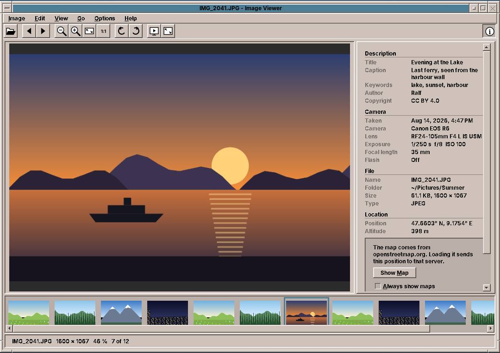

# 35. Image Viewer

An image viewer looks like the simplest program on a desktop: read a file and draw it. Then the first photo from a phone lies on its side, a folder of 400 holiday pictures takes a minute to open, and a click on the map sends every place you have been to a server you never chose. amade-imageviewer handles all three. It is a program about pictures as files: the bytes the camera wrote around the pixels, the order of files in a folder, and what may leave the computer.

The program has about 4,800 lines of Java and 2,100 lines of tests. Nothing moves into amade-commons with it. It is the second program that writes into the trash, after Files, and the first that needs a library from outside to read pictures.

## What you build



- **A folder of pictures**: JPEG, PNG, GIF, BMP, TIFF and WebP, in natural name order, with a film strip of thumbnails.
- **Zoom**: fit to the window, actual size, and zoom around the pointer; a zoomed picture is dragged.
- **Orientation**: pictures appear upright as the camera noted. Turns and flips are saved into the file, losslessly for JPEG.
- **A sidebar** with description, camera, file and location, read from XMP, IPTC and EXIF.
- **A map** from OpenStreetMap that loads only when the user allows it.
- **Full screen and slideshow** with a control bar that hides itself, pause, shuffle and loop.
- **Trash, copy, print**, and five languages.

## What you will learn

- How EXIF orientation works, and why the eight orientations are a group of 2 × 2 matrices.
- How `jpegtran` turns a JPEG without decoding it, and how to change one byte in a JPEG header in place.
- How to read metadata from three standards that say the same thing, and which one to believe.
- How to load pictures in the background so the window never waits, and how to make thumbnails cheap with subsampling.
- How to draw a picture well at any size in Java2D.
- How to show a map from map tiles, and how to respect the user and the tile server while doing it.
- How to write a full-screen window with controls that come and go, and test a slideshow without waiting for it.
- Why a fat jar loses ImageIO plugins, and how to keep them.

## The structure

| Package | Contents |
|---|---|
| `domain` | `Album` (the files of a folder and the current one), `Orientation`, `Slideshow`, `Settings`, `PhotoInfo`, `GeoPosition`, `MapTiles`, `ZoomSteps`, `ImageFiles`, `TitleText` |
| `metadata` | `MetadataReader`: from a file to a `PhotoInfo` |
| `repository` | `ViewerPreferences` (`imageviewer.properties`), `TileStore` (map tiles on disk) |
| `service` | `ImageLoader`, `ImageTransforms`, `RotationSaver`, `ExifOrientation`, `Trash` |
| `ui.main` | `MainWindow`, `MainPresenter`, `MainMenuBar`, `ImageCanvas`, `FilmStrip`, `InfoSidebar` with `InfoRows` and `MapView`, `FullScreenWindow`, `PicturePrinter` |

The presenter talks to the window through the `MainView` interface, as in every program of this book ([chapter 10](10-pad.md)). New is how much it is given from outside: a `Services` record holds the loader, the metadata reader, the saver, the trash, two executors, a clock for the slideshow and a random generator. In the tests the executors run at once, the clock ticks by hand and the random generator has a seed, so the whole viewer runs without a display and without waiting.

## A folder, in the right order

The user opens one picture and expects its neighbours. `Album.open` takes files or folders. For a single picture it takes all the pictures of its folder and starts at the one the user chose:

```java title="amade-imageviewer · domain/Album.java"
--8<-- "amade-imageviewer/src/main/java/eu/amadeos/apps/imageviewer/domain/Album.java:open"
```

Sorting by name sounds trivial until a camera numbers its files: `IMG_10` sorts before `IMG_9` as text. People count, so the comparator does too. It reads a run of digits as one number, compares numbers by length first (after dropping leading zeros) and only then digit by digit, which works for numbers of any length without parsing them:

```java title="amade-imageviewer · domain/ImageFiles.java"
--8<-- "amade-imageviewer/src/main/java/eu/amadeos/apps/imageviewer/domain/ImageFiles.java:natural"
```

## Loading without waiting

A 24-megapixel JPEG takes a few hundred milliseconds to decode. The presenter never does it on the event dispatch thread. It asks the background executor, and when the picture is ready it checks that the user still wants it. In a fast flip through a folder most pictures are decoded and then not shown:

```java title="amade-imageviewer · ui/main/MainPresenter.java"
--8<-- "amade-imageviewer/src/main/java/eu/amadeos/apps/imageviewer/ui/main/MainPresenter.java:load"
```

Decoded pictures go into a small cache of the current picture and its neighbours, and after each picture the presenter loads both neighbours in advance, so the arrow key usually finds the next picture ready. `OutOfMemoryError` is caught on purpose: a 200-megapixel panorama should give a message, not end the program.

### Thumbnails by subsampling

The film strip needs a picture of 88 pixels for each file. Decoding the whole file and scaling it down would take as long as showing every picture of the folder. ImageIO can do better: `ImageReadParam.setSourceSubsampling` makes the reader decode only every n-th pixel of every n-th row. For JPEG that skips most of the work:

```java title="amade-imageviewer · service/ImageLoader.java"
--8<-- "amade-imageviewer/src/main/java/eu/amadeos/apps/imageviewer/service/ImageLoader.java:thumbnail"
```

The film strip is a `JList` whose cell renderer asks `Thumbnails` for each cell it paints, so only visible cells cost anything. A missing thumbnail is made on a background thread, and the list repaints when it is ready. The last 300 are kept, in a `LinkedHashMap` in access order.

## Upright pictures

A camera does not turn the pixels when you hold it upright. It writes the picture as the sensor sees it and adds a note, the EXIF tag *Orientation*, with a value from 1 to 8. Value 6 means "turn a quarter clockwise to see it right". A viewer that ignores the tag shows every portrait photo on its side.

The eight values are all the ways to put a rectangle back onto its frame: four turns, each with or without a mirror. They form a group. Two of them in a row are again one of them, and each has an inverse. The viewer needs exactly that: the camera's orientation, followed by the user's turns. So `Orientation` is an enum of the eight, each a 2 × 2 matrix of 0, 1 and −1, and `then` multiplies matrices:

```java title="amade-imageviewer · domain/Orientation.java"
--8<-- "amade-imageviewer/src/main/java/eu/amadeos/apps/imageviewer/domain/Orientation.java"
```

There is no table of 64 combinations to get wrong. The tests check the group laws instead: four right turns are no turn, a mirror twice is no mirror, and every orientation has an inverse.

Drawing a turned picture is an `AffineTransform` from the same matrix, moved so that the turned picture starts at (0, 0):

```java title="amade-imageviewer · service/ImageTransforms.java"
--8<-- "amade-imageviewer/src/main/java/eu/amadeos/apps/imageviewer/service/ImageTransforms.java:affine"
```

!!! warning "Pitfall: the order of the matrix in `AffineTransform`"
    `new AffineTransform(m00, m10, m01, m11, m02, m12)` takes the matrix **column by column**, not row by row. The code above passes `m[0], m[2], m[1], m[3]` for a matrix stored as rows `{a, b, c, d}`. Pass it row by row and every quarter turn goes the wrong way, which a test with a picture that is red on the left and blue on the right finds at once.

### Saving a turn without loss

Decoding a JPEG, turning the pixels and encoding it again costs quality each time. JPEG stores the picture in blocks of 8 × 8 pixels, compressed one by one, and a block can be turned or mirrored in its compressed form. The program `jpegtran` from libjpeg-turbo does exactly that. The orientation maps directly to its options (`-rotate 90`, `-transpose` and so on), and `CommandRunner` from amade-commons ([chapter 47](47-programs-json-network.md)) runs it with a time limit:

```java title="amade-imageviewer · service/RotationSaver.java"
--8<-- "amade-imageviewer/src/main/java/eu/amadeos/apps/imageviewer/service/RotationSaver.java:jpeg"
```

Three details matter:

- **The edges.** If the width or height is not a multiple of the block size, the partial blocks at the edge cannot be turned. `-perfect` then fails rather than doing something lossy. The saver then tries `-trim`, which drops those few rows or columns, and the presenter tells the user.
- **The note.** `jpegtran -copy all` keeps all metadata, including the old orientation tag. The pixels are upright now, so the tag must say 1, or other viewers turn the picture a second time.
- **Safety.** The result is written to a `.part` file next to the original and moved over it atomically. If anything fails, the original is untouched.

The orientation tag is one 16-bit number in the TIFF structure inside the JPEG's APP1 segment. Rewriting the file with a metadata library for that would be a lot of risk for two bytes. `ExifOrientation` walks the JPEG segments, finds the TIFF header, reads its byte order (`II` for Intel, `MM` for Motorola) and changes the value in place:

```java title="amade-imageviewer · service/ExifOrientation.java"
--8<-- "amade-imageviewer/src/main/java/eu/amadeos/apps/imageviewer/service/ExifOrientation.java:find"
```

The test runs the real `jpegtran` on a picture whose left half is red and right half blue, with orientation 6, and a turn right by the user: a half turn in all, so blue must now be on the left. Where `jpegtran` is not installed, the test skips itself instead of failing, so building the application never needs it; to really run it, install `libjpeg-turbo-progs` (CI does). The package of the application only *recommends* it: without it, turning a JPEG still works on screen, and saving the turn says that `jpegtran` is missing.

```java title="amade-imageviewer · test · service/RotationSaverTest.java"
--8<-- "amade-imageviewer/src/test/java/eu/amadeos/apps/imageviewer/service/RotationSaverTest.java:jpegtran-test"
```

PNG and BMP are lossless anyway; they are turned and written again with ImageIO. GIF, TIFF and WebP are not saved turned. GIF could lose its animation, and ImageIO has no WebP writer.

## What the camera wrote

A photo can carry its description in three places:

- **EXIF**: the camera's technical data, with a few text fields.
- **IPTC**: the press agencies' fields from the 1990s, with caption, keywords and by-line.
- **XMP**: Adobe's XML packet, with Dublin Core titles in several languages.

Photo programs write one, two or all three, not always alike. [metadata-extractor](https://github.com/drewnoakes/metadata-extractor) reads them all into directories of tags. `MetadataReader` decides which value counts: XMP first, because it is the newest and what photo programs edit, then IPTC, then EXIF.

```java title="amade-imageviewer · metadata/MetadataReader.java"
--8<-- "amade-imageviewer/src/main/java/eu/amadeos/apps/imageviewer/metadata/MetadataReader.java:of"
```

`TitleText.first` takes the first value that is a real text. Many cameras fill the description with their own name, so a list of placeholders is ignored:

```java title="amade-imageviewer · domain/TitleText.java"
--8<-- "amade-imageviewer/src/main/java/eu/amadeos/apps/imageviewer/domain/TitleText.java:junk"
```

Numbers are stored as rationals and need care too. An exposure time of 1/250 s is the rational 1/250, but some cameras write 10/2500 and some 0.004. The reader writes short times as the photographer says them:

```java title="amade-imageviewer · metadata/MetadataReader.java"
--8<-- "amade-imageviewer/src/main/java/eu/amadeos/apps/imageviewer/metadata/MetadataReader.java:exposure"
```

A GPS position of exactly 0° N, 0° E, a place in the Atlantic, is what some phones write when they have none, so it counts as no position.

`InfoRows` turns a `PhotoInfo` into the translated sections of the sidebar. It knows nothing of Swing, so most sidebar tests read its rows directly:

```java title="amade-imageviewer · ui/main/InfoRows.java"
--8<-- "amade-imageviewer/src/main/java/eu/amadeos/apps/imageviewer/ui/main/InfoRows.java:sections"
```

!!! tip "Numbers that are not quantities"
    `Messages.format` formats numbers for the language, so 1600 becomes `1,600` in English and `1.600` in German. That is right for a file size, and wrong for a picture of 1600 × 1067 pixels, which reads like a decimal in German. Pixel counts are passed as strings.

## Drawing a picture well

`ImageCanvas` keeps a scale and the picture point at the centre of the view. Zooming around the pointer means keeping the picture point under the pointer where it was:

```java title="amade-imageviewer · ui/main/ImageCanvas.java"
--8<-- "amade-imageviewer/src/main/java/eu/amadeos/apps/imageviewer/ui/main/ImageCanvas.java:zoom"
```

Scaling down is where Java2D needs help. Bilinear interpolation looks at four neighbouring pixels. Scaled to a fifth, a picture loses 21 of every 25 pixels unseen, and fine detail such as grass or text starts to shimmer. The canvas halves the picture step by step, each step averaging four pixels into one, and scales the rest bilinearly. That comes close to true averaging at a fraction of its cost:

```java title="amade-imageviewer · ui/main/ImageCanvas.java"
--8<-- "amade-imageviewer/src/main/java/eu/amadeos/apps/imageviewer/ui/main/ImageCanvas.java:smooth"
```

The smooth copy is computed once per size and kept. While the window is resized, the canvas draws the quick bilinear version and computes the good one when the size has settled for 150 milliseconds:

```java title="amade-imageviewer · ui/main/ImageCanvas.java"
--8<-- "amade-imageviewer/src/main/java/eu/amadeos/apps/imageviewer/ui/main/ImageCanvas.java:paint"
```

From 200 % on, the canvas shows hard pixels (nearest neighbour), because someone who zooms that far wants to see the pixels.

## The map

### Tiles

OpenStreetMap serves its map as square pictures of 256 pixels, *tiles*. At zoom level z the world is 2^z × 2^z tiles in the Web Mercator projection. A position becomes a tile number, and the fraction is the place within the tile:

```java title="amade-imageviewer · domain/MapTiles.java"
--8<-- "amade-imageviewer/src/main/java/eu/amadeos/apps/imageviewer/domain/MapTiles.java:mercator"
```

`MapView` draws the tiles around the position and a marker on it. It asks for each missing tile once, on a background thread, and repaints when the tile arrives. A tile that failed is not asked for again while the map shows, so a missing network causes no stream of requests:

```java title="amade-imageviewer · ui/main/MapView.java"
--8<-- "amade-imageviewer/src/main/java/eu/amadeos/apps/imageviewer/ui/main/MapView.java:paint"
```

### Being a good guest

The tile servers of openstreetmap.org are run by volunteers and donations. Their usage policy asks programs to name themselves with a real User-Agent, to keep tiles for a while, not to open many connections, and to show the attribution. `TileStore` does all of it: it names the program and its version, allows two downloads at a time with a semaphore, keeps tiles for seven days in the cache directory, and falls back to an older tile on disk when the network fails:

```java title="amade-imageviewer · repository/TileStore.java"
--8<-- "amade-imageviewer/src/main/java/eu/amadeos/apps/imageviewer/repository/TileStore.java:http"
```

```java title="amade-imageviewer · repository/TileStore.java"
--8<-- "amade-imageviewer/src/main/java/eu/amadeos/apps/imageviewer/repository/TileStore.java:tile"
```

The download is an interface, so the test gives the store a fake one that records its calls, and a fixed clock:

```java title="amade-imageviewer · test · repository/RepositoryTest.java"
--8<-- "amade-imageviewer/src/test/java/eu/amadeos/apps/imageviewer/repository/RepositoryTest.java:tile-test"
```

### Asking first

Loading the tiles around a photo tells the server where the photo was taken. A folder of photos from home tells it where the user lives. That is not the viewer's decision. The sidebar shows the position as text and, instead of the map, a question that says what loading would send where:

```java title="amade-imageviewer · ui/main/InfoSidebar.java"
--8<-- "amade-imageviewer/src/main/java/eu/amadeos/apps/imageviewer/ui/main/InfoSidebar.java:question"
```

*Show Map* allows the map for this one picture; *Always show maps* is a setting. *Open in Browser* and *Copy* work without any tile, so the user can always choose a different route. The presenter keeps the allowed pictures in a set, and the test makes sure the permission does not leak to the next picture:

```java title="amade-imageviewer · test · ui/main/MainPresenterTest.java"
--8<-- "amade-imageviewer/src/test/java/eu/amadeos/apps/imageviewer/ui/main/MainPresenterTest.java:map-test"
```

!!! note "The rule"
    A program of amadeOS does not contact a server the user did not ask for. The Mailer blocks pictures from the internet in mail for the same reason ([chapter 22](22-mail.md)). When a feature needs the network, the user's click is the permission, and the text next to the button says what is sent where.

## Full screen and slideshow


`FullScreenWindow` is a second, undecorated `JFrame`. Its picture is a second `ImageCanvas`, and its controls float above it in the frame's `JLayeredPane`: the control bar in the palette layer, the *Pause* sign in the popup layer. The window takes the screen with `GraphicsDevice.setFullScreenWindow`, which does not change the display mode. Where that is not supported, a borderless window covering the screen does the same:

```java title="amade-imageviewer · ui/main/FullScreenWindow.java"
--8<-- "amade-imageviewer/src/main/java/eu/amadeos/apps/imageviewer/ui/main/FullScreenWindow.java:open"
```

A mouse move shows the bar and restarts a two-second Swing timer that hides it, and the pointer with it, by setting a transparent cursor. If the pointer rests on the bar, the timer just starts again.

The slideshow itself is in the presenter, with the order in `Slideshow`, a class of the domain. Shuffled, it shows the current picture first and then all others in random order. Looped, it shuffles anew for every round, and makes sure the first picture of a new round is not the last of the old one:

```java title="amade-imageviewer · ui/main/MainPresenter.java"
--8<-- "amade-imageviewer/src/main/java/eu/amadeos/apps/imageviewer/ui/main/MainPresenter.java:slideshow"
```

The clock is a `Ticker` interface: the window uses a `javax.swing.Timer`, the tests a `FakeTicker` that ticks when told. So a test of a slideshow of five seconds per picture runs in a millisecond:

```java title="amade-imageviewer · test · ui/main/SlideshowPresenterTest.java"
--8<-- "amade-imageviewer/src/test/java/eu/amadeos/apps/imageviewer/ui/main/SlideshowPresenterTest.java:space-test"
```

The keys of the main window and the full-screen window are bound in one method, so both windows behave the same:

```java title="amade-imageviewer · ui/main/MainWindow.java"
--8<-- "amade-imageviewer/src/main/java/eu/amadeos/apps/imageviewer/ui/main/MainWindow.java:keys"
```

## The trash

*Move to Trash* follows the freedesktop.org trash specification, like Files ([chapter 20](20-files.md)): the file goes to `~/.local/share/Trash/files`, and a `.trashinfo` file in `info` records where it came from and when. Creating the info file first with `CREATE_NEW` reserves the name, so two programs that trash a file of the same name at the same moment do not overwrite each other:

```java title="amade-imageviewer · service/Trash.java"
--8<-- "amade-imageviewer/src/main/java/eu/amadeos/apps/imageviewer/service/Trash.java:move"
```

## A fat jar that lost its plugins

ImageIO finds readers for other formats through the service loader: a jar declares its readers in a file `META-INF/services/javax.imageio.spi.ImageReaderSpi`. The TwelveMonkeys WebP plugin and its JPEG plugin (which reads CMYK JPEGs that Java's own reader refuses) both have such a file, with the same name. The fat jar of every amade program ([chapter 50](50-packaging.md)) copies all dependency jars into one, with `DuplicatesStrategy.EXCLUDE`, so the first file wins and the second plugin silently disappears. WebP pictures then simply "cannot be read".

The build joins the service files before it builds the jar:

```groovy title="amade-imageviewer · build.gradle"
tasks.register('mergeServices') {
    inputs.files(configurations.runtimeClasspath)
    outputs.dir(mergedServices)
    doLast {
        def target = mergedServices.get().dir('META-INF/services').asFile
        delete(target)
        target.mkdirs()
        Map<String, Set<String>> services = [:].withDefault { new LinkedHashSet<String>() }
        configurations.runtimeClasspath.files.findAll { it.name.endsWith('.jar') }.each { jarFile ->
            zipTree(jarFile).matching { include 'META-INF/services/*' }.each { file ->
                file.readLines('UTF-8').collect { it.replaceAll('#.*', '').strip() }.findAll { it }
                        .each { services[file.name] << it }
            }
        }
        services.each { name, lines -> new File(target, name).text = lines.join('\n') + '\n' }
    }
}
```

The jar takes the joined files and excludes the dependencies' own. The CI build lists the service file in the finished jar and fails if either plugin is missing. A test that reads a WebP picture would not catch this, because the tests run with the separate jars on the class path, where the service loader finds both files.

## What amade-commons gives Image Viewer

| Part | Since | Image Viewer uses it for |
|---|---|---|
| `AmadeApplication`, `AppInfo`, `CommonsModule`, `EdtExecutor` | chapter 10 | start-up and wiring, `--version`, file arguments and `file://` URIs from the file manager |
| `Messages`, `Mnemonics`, `LocaleSettings`, `TranslationCheck` | chapter 10 | five languages, the menu letters, the language menu, the translation test |
| `AmadeUI`, `DesktopTheme` | chapter 10 | the Motif look, the sidebar's sunken panels |
| `DesktopLauncher` | chapter 11 | *Open in Browser* and the map's attribution link |
| `AppDirectories`, `PropertiesFile`, `XdgDirectories` | chapter 20 | `imageviewer.properties`, the tile cache, the trash in the data folder, the Pictures folder for *Open* |
| `PrintJobs`, `PaperSize` | chapter 23 | printing, across the page for wide pictures |
| `ToolIcon`, `StandardGlyph`, `ToolButtons`, `@Ui` | chapter 30 | the toolbar and the control bar; the slideshow and full-screen icons are its own glyphs |
| `CommandRunner`, `ProgramMissingException` | chapter 31 | `jpegtran`, and the message when it is not installed |
| `ImageSelection` | chapter 34 | *Copy Image* |

### And what stays in Image Viewer

- **Orientation, metadata and the tiles.** No other program reads EXIF or shows maps yet. Image Scan turns pictures too, but it keeps every pixel in memory and has no orientation tag to respect.
- **The trash.** Files has the whole trash, with listing and restoring; Image Viewer only moves a file into it. It is the second program that writes into the trash, and the writing half is the next candidate for amade-commons. It stays here until the two can share one class without Files losing anything (see the exercises).
- **The image canvas.** Zoom and smooth scaling would suit Image Scan. They move when Image Scan is changed to use them.

## Exercises

1. **Set as backdrop.** Add *Image → Set as Desktop Background* for the current workspace. Settings keeps the backdrops per workspace ([chapter 62](62-settings.md)); which file does it write, and how does the desktop notice the change?
2. **Animated GIFs.** ImageIO reads every frame of a GIF with `ImageReader.read(i)` and the delays from the metadata tree. Play them in `ImageCanvas` with a Swing timer. What does *Save Rotation* have to do with an animation, and why is it simpler to refuse?
3. **The trash in commons.** Move the writing half of the trash from Files and Image Viewer into amade-commons as `Trash.move`. What must Files keep, and how do the two programs' tests show that nothing changed?
4. **Faster folders.** Open a folder of 2,000 pictures. Measure how long the film strip takes to fill, and where the time goes. Many JPEGs carry a thumbnail of 160 pixels in their EXIF data; metadata-extractor finds it as `ExifThumbnailDirectory`. Use it when it is large enough.
5. **Offline maps.** The tile cache keeps tiles for a week. Add a setting that keeps them forever, and *Load Map for This Folder*, which fetches the tiles around all positions of the folder in advance. How many tiles is that at zoom 15 for a holiday of 50 km, and what does the usage policy say about it?

## Summary

- Open the folder of a picture, not just the picture, and sort file names the way people count.
- Decode in the background, check that the picture is still wanted when it is ready, and read thumbnails with subsampling.
- EXIF orientation is one of eight elements of a group. Model them as matrices, and combinations and inverses come for free.
- `jpegtran` turns JPEGs without loss. Reset the orientation tag afterwards, and write into a `.part` file first.
- Read metadata from XMP, IPTC and EXIF in that order, and throw away what cameras write as placeholders.
- Scale pictures down in halving steps; show hard pixels when zoomed far in.
- Map tiles are a shared resource. Name your program, cache, limit connections, show the attribution, and load nothing before the user allows it.
- Put the clock and the randomness of a slideshow behind interfaces, and the tests need no waiting.
- A fat jar keeps one of several service files with the same name. Join them, and check the finished jar.
