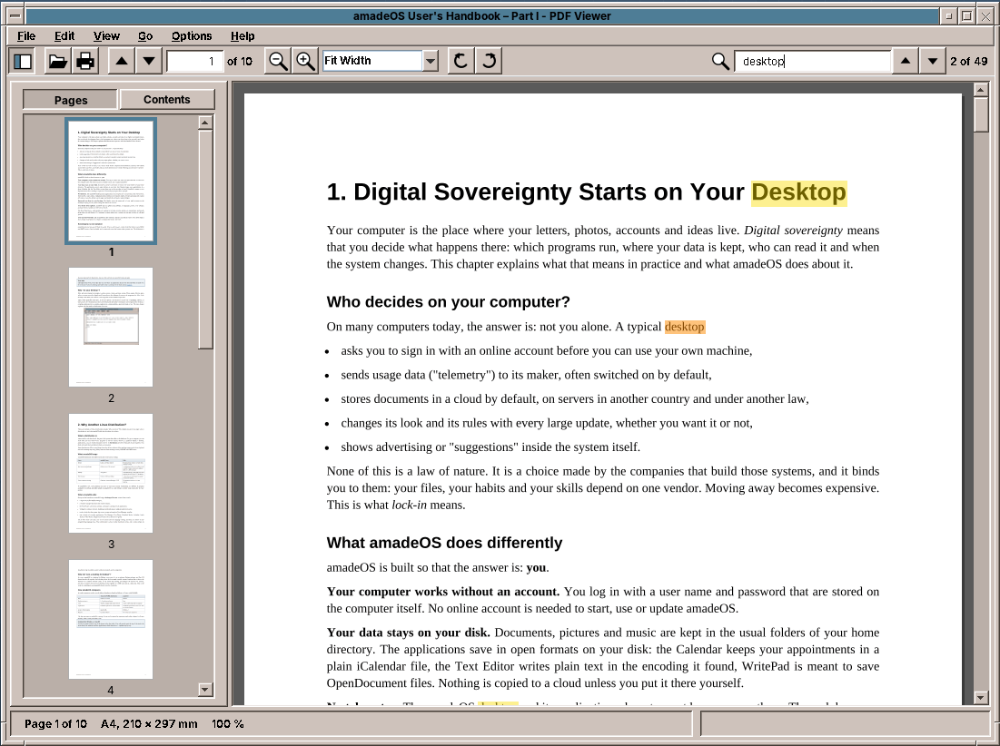
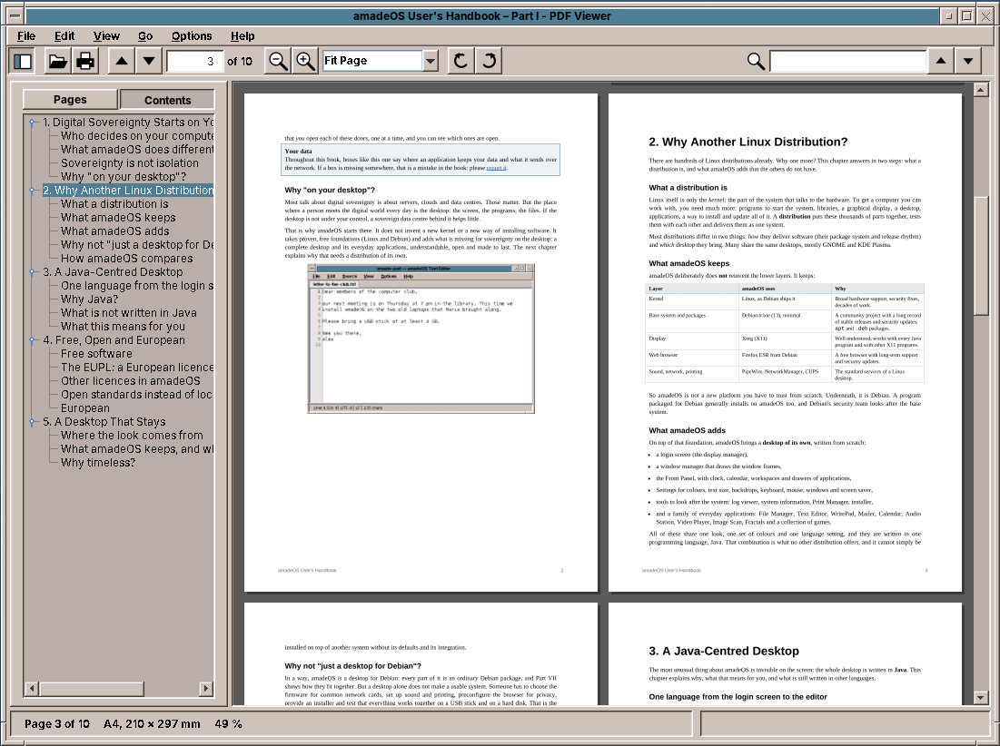

# 36. PDF Viewer

A PDF file looks like a picture of paper, and a PDF viewer like an image viewer with more pages. Then the reader zooms to 400 % on a page of A3, scrolls through a manual of 600 pages while the sidebar draws thumbnails, searches all of them for a word, and clicks a link in the table of contents, all at once and in a library that is not thread-safe. amade-pdfviewer is a program about one shared resource: a document that only one thread may touch, and a window that must never wait for it.

The program has about 4,900 lines of Java and 1,600 lines of tests. Nothing moves into amade-commons with it. It is the first program of this book that reads a complex file format with a library from outside, Apache PDFBox, and the second, after Image Viewer ([chapter 35](35-imageviewer.md)), that shows something larger than its window.

## What you build



- **Three views**: continuous, single page, and two pages side by side like a book.
- **Zoom** from 10 % to 800 %, fit page and fit width, and zoom around the mouse pointer; turning by 90°.
- **A sidebar** with thumbnails of the pages or the table of contents of the document.
- **Search** over all pages with every hit marked, **text selection** and copying.
- **Links** inside the document and to the web, with *Back* and *Forward*.
- **Printing, a presentation mode, the document's properties**, password-protected files.
- **The reading position** of every document, and **reloading** when the file changes on disk.

## What you will learn

- How to share a library that is not thread-safe: one thread, with priorities, and jobs that can be cancelled.
- How to draw pages larger than memory allows, in tiles, and what to show while they are drawn.
- How to get the text of a PDF with the place of every character, and build search and selection on it.
- How PDF coordinates, the page's own rotation and the user's rotation fit together.
- How to lay out pages in three views with one class, and how to fit them to a window without a scroll bar.
- How to follow a file that another program rewrites, and how to remember where the reader was.
- How to print with a library's own `Pageable`, and why the dialog and the printing run on different threads.

## The structure

| Package | Contents |
|---|---|
| `domain` | `PdfDocument` (the only class that uses PDFBox), `DocumentThread`, `DocumentSession` (pictures, thumbnails, texts and links of an open document), `PageLayout`, `PageText`, `Zoom`, `Rotation`, `ViewMode`, `PageSize`, `Target`, `PageLink`, `OutlineEntry`, `SearchHit`, `DocumentProperties`, `PaperNames`, `Settings`, `ReadingPosition` |
| `repository` | `PdfViewerPreferences` (`pdfviewer.properties`: view, zoom, sidebar, recent files), `ReadingPositions` |
| `ui.main` | `MainWindow`, `MainPresenter`, `MainMenuBar`, `PageView`, `Sidebar`, `PresentationWindow`, `SearchState` |

The presenter talks to the window through the `MainView` interface, as in every program of this book ([chapter 10](10-pad.md)). The tests give it a `FakeView` and real PDF files, which `TestPdfs` writes with PDFBox at the start of each test: a few pages of text, a page with links, a turned page, a document with a password.

## PDFBox, behind one class

[Apache PDFBox](https://pdfbox.apache.org/) reads PDF files, draws their pages with Java2D, and extracts their text. It is a library of the Apache Software Foundation, under the Apache License 2.0, and it is pure Java, so the program stays one jar without native code. The alternatives either need a native library (MuPDF, Poppler through JNA) or are not free.

Only `PdfDocument` imports PDFBox. Everything else sees page sizes, pictures, `PageText`, links and the outline, in types of the program. Opening reads a file of normal size into memory first:

```java title="amade-pdfviewer · domain/PdfDocument.java"
--8<-- "amade-pdfviewer/src/main/java/eu/amadeos/apps/pdfviewer/domain/PdfDocument.java:open"
```

Reading the whole file is not about speed. PDFBox reads the parts of a document when it needs them, long after opening. If it reads them from the file, and LaTeX writes the file again in the meantime, PDFBox finds half of an old document and half of a new one. With the bytes in memory, the open document stays whole until the viewer reloads it. Only files above 100 MB are read from the disk as they are needed.

A wrong password and a missing password are both an `InvalidPasswordException` in PDFBox. The viewer turns it into its own `PasswordException`, which says whether a password was given, so the dialog can say "wrong password" the second time.

## One thread for the document

PDFBox is not thread-safe. Two threads that draw two pages of the same document at once can break each other's fonts and streams. The simple answer, a lock around every call, keeps the window correct but makes it wait: while the search reads page 412, a click on the scroll bar would wait for it.

So all work on the document runs on one thread, and the window never calls PDFBox itself. It asks for a page picture, gets `null`, draws a placeholder, and is called back when the picture is ready. The jobs have priorities:

```java title="amade-pdfviewer · domain/DocumentThread.java"
--8<-- "amade-pdfviewer/src/main/java/eu/amadeos/apps/pdfviewer/domain/DocumentThread.java:priority"
```

`DocumentThread` is a `ThreadPoolExecutor` with one thread and a `PriorityBlockingQueue`. Each job knows its priority and a running number, so jobs of the same priority keep their order. The result goes to the UI executor, which is the event dispatch thread in the program and `Runnable::run` in tests. A job can be cancelled: a waiting one is taken out of the queue, a running one finishes, but its result is not passed on.

That makes scrolling cheap. When the user drags the scroll bar through 200 pages, the window asks for the pictures of the pages it passes. When the zoom changes, `cancelRendering` drops all waiting page pictures, because they are for a scale nobody wants any more. The test shows the order and the cancelling:

```java title="amade-pdfviewer · test · domain/DocumentThreadTest.java"
--8<-- "amade-pdfviewer/src/test/java/eu/amadeos/apps/pdfviewer/domain/DocumentThreadTest.java:thread-test"
```

!!! warning "Pitfall: a test marker that a cancel removes"
    `await()` puts a marker job at the end of the queue and waits until it runs. The first version gave it the priority SEARCH, and a test that cleared the search cancelled all SEARCH jobs, the marker with them. The test then waited 30 seconds for a job that no longer existed. The marker now refuses to be cancelled.

## Drawing pages

### A picture of a page

PDFBox draws a page into any `Graphics2D`. Its scale 1 is one pixel per point, 72 dpi; the viewer's 100 % is the size on a screen of 96 dpi, so 100 % is a scale of 96/72. The page's own rotation, the `/Rotate` entry of the PDF, is applied by PDFBox. The user's rotation is a turn of the `Graphics2D` before it:

```java title="amade-pdfviewer · domain/PdfDocument.java"
--8<-- "amade-pdfviewer/src/main/java/eu/amadeos/apps/pdfviewer/domain/PdfDocument.java:render"
```

!!! warning "Pitfall: black pages"
    `renderPageToGraphics` starts with `clearRect`, which fills with the background colour of the `Graphics2D`. On a new `BufferedImage` that is black, and a white `fillRect` before it does not help. `setBackground(Color.WHITE)` does.

A page of A4 with text takes 20 to 45 ms at 100 % on a normal computer, the first page of a document up to 230 ms while PDFBox loads the fonts. PDFBox scans the system fonts once and keeps a list in a cache file, by default in the home folder; `main` moves it to the program's cache folder:

```java title="amade-pdfviewer · bootstrap/AmadePdfViewerApplication.java"
--8<-- "amade-pdfviewer/src/main/java/eu/amadeos/apps/pdfviewer/bootstrap/AmadePdfViewerApplication.java:main"
```

### Tiles

At 800 % a page of A4 is 6,350 × 8,980 pixels, 57 million pixels or 228 MB as an image, of which the window shows a fiftieth. So a page above 12 million pixels is drawn in tiles of 1024 × 1024, and the window asks only for the tiles it shows:

```java title="amade-pdfviewer · domain/DocumentSession.java"
--8<-- "amade-pdfviewer/src/main/java/eu/amadeos/apps/pdfviewer/domain/DocumentSession.java:tiles"
```

A tile is the same `render` call with a region: the `Graphics2D` is moved by the tile's corner, and PDFBox draws the whole page into it, of which only the tile lands in the picture. That costs nearly as much time as a whole page, but only the memory of the tile. The test makes sure a tile shows exactly what the whole picture shows at that place, also on a turned page:

```java title="amade-pdfviewer · test · domain/PdfDocumentTest.java"
--8<-- "amade-pdfviewer/src/test/java/eu/amadeos/apps/pdfviewer/domain/PdfDocumentTest.java:tiles-test"
```

The finished tiles are kept in a `LinkedHashMap` in access order, up to 40 million pixels in all. When a new tile pushes the sum over the limit, the oldest go.

### While a page is drawn

The window paints what it has. For each tile it asks the session; if the tile is not there yet, it draws the best picture of the page there is at any scale, stretched, or a white sheet:

```java title="amade-pdfviewer · ui/main/PageView.java"
--8<-- "amade-pdfviewer/src/main/java/eu/amadeos/apps/pdfviewer/ui/main/PageView.java:paint-page"
```

The *preview* is the last whole picture of the page, or its thumbnail. When the user zooms in, the page first grows blurred and becomes sharp a moment later, instead of turning white. The last line asks for the text of the page, which the selection and the links need, at the priority TEXT, after the pictures.

## Laying out pages

`PageLayout` places the pages for one of the three views. It is a class of the domain without Swing: the sizes of the pages, the view, the scale and the size of the window go in, and a rectangle for each page comes out. Continuous puts one page per row, two pages puts two, and single page only the current one. In two pages the first page stands alone on the right, as page 1 of a book does, so that even pages are on the left.

Fit page and fit width compute the scale from the row of the current page:

```java title="amade-pdfviewer · domain/PageLayout.java"
--8<-- "amade-pdfviewer/src/main/java/eu/amadeos/apps/pdfviewer/domain/PageLayout.java:scale"
```

Two details came from trying it:

- **A page alone keeps the room of two.** In two pages the first row has one page. Fitting that one page to the width made it twice as large as the pairs after it, and the zoom jumped when the reader reached page 2.
- **One pixel per page.** The page sizes in pixels are rounded. A row that fits exactly could become one pixel wider than the window, and a horizontal scroll bar appears for one pixel. The fit leaves a pixel per page.

The window lays out again whenever the zoom, the view, the rotation or its size changes:

```java title="amade-pdfviewer · ui/main/PageView.java"
--8<-- "amade-pdfviewer/src/main/java/eu/amadeos/apps/pdfviewer/ui/main/PageView.java:relayout"
```

Which page is the current one, for the page box in the toolbar and the reading position, is the first page that fills at least half of the window, else the one that shows most:

```java title="amade-pdfviewer · domain/PageLayout.java"
--8<-- "amade-pdfviewer/src/main/java/eu/amadeos/apps/pdfviewer/domain/PageLayout.java:current"
```

## Text with a place

### Every character in a box

Search and selection need more than the text of a page. They need to know where each character is, to mark a hit and to find the character under the mouse. PDFBox's `PDFTextStripper` sorts the text of a page into reading order and calls `writeString` with the characters and their positions. The viewer overrides it and builds a `PageText`: the text as a string, and for each character its box in points, from the top left of the page:

```java title="amade-pdfviewer · domain/PdfDocument.java"
--8<-- "amade-pdfviewer/src/main/java/eu/amadeos/apps/pdfviewer/domain/PdfDocument.java:text"
```

The height of a glyph that PDFBox estimates is often too small to point at, so the box goes from above the capitals to below the descenders, from the font size. On a page turned by half, the font size is negative, hence `Math.abs`. Spaces and line breaks have no box; they are separators in the text, and only one at a time.

### Search

The search finds a phrase across line breaks: "free software" is found when "free" ends one line and "software" begins the next. Each space of the query becomes `\s+`, and the words are quoted, so a dot or a bracket in the query means itself:

```java title="amade-pdfviewer · domain/PageText.java"
--8<-- "amade-pdfviewer/src/main/java/eu/amadeos/apps/pdfviewer/domain/PageText.java:find"
```

Reading the text of 600 pages takes several seconds. The presenter searches one page per job at the lowest priority, starting at the current page, and adds the hits as they come. Between two pages, the pictures the window asks for come first, so scrolling stays smooth during a search. A new search counts up a generation number; the results of an older one are dropped when they arrive:

```java title="amade-pdfviewer · ui/main/MainPresenter.java"
--8<-- "amade-pdfviewer/src/main/java/eu/amadeos/apps/pdfviewer/ui/main/MainPresenter.java:search"
```

The search job calls `loadText` of the session directly, because it already runs on the document thread. The texts are kept in a `ConcurrentHashMap`, since the window reads them on the event dispatch thread:

```java title="amade-pdfviewer · domain/DocumentSession.java"
--8<-- "amade-pdfviewer/src/main/java/eu/amadeos/apps/pdfviewer/domain/DocumentSession.java:load-text"
```

### Selecting

A selection is two carets, the places between two characters where the drag began and where it is now. `caretAt` finds the caret nearest to the mouse. Being on the same line counts a thousand times more than being near horizontally, so a drag to the right of a line ends at the end of that line, not at the start of the next:

```java title="amade-pdfviewer · domain/PageText.java"
--8<-- "amade-pdfviewer/src/main/java/eu/amadeos/apps/pdfviewer/domain/PageText.java:caret"
```

The marking joins the boxes of the selected characters into one rectangle per line:

```java title="amade-pdfviewer · domain/PageText.java"
--8<-- "amade-pdfviewer/src/main/java/eu/amadeos/apps/pdfviewer/domain/PageText.java:areas"
```

A selection can span pages. *Copy* joins the text of all pages from the first caret to the second:

```java title="amade-pdfviewer · ui/main/PageView.java"
--8<-- "amade-pdfviewer/src/main/java/eu/amadeos/apps/pdfviewer/ui/main/PageView.java:selected-text"
```

!!! tip "Scans have no text"
    A PDF made by a scanner usually holds one picture per page and no text at all. Search finds nothing and the mouse selects nothing, which is correct. Recognising the text (OCR) is a job for the program that scans.

## Coordinates and rotation

Three coordinate systems meet on a page:

- **PDF space**: points, from the bottom left of the page's box, upwards.
- **The page as shown**: points, from the top left, after the page's own `/Rotate`.
- **The window**: pixels, after the user's rotation and the scale.

The text from PDFBox is already in the page as shown. Links are not: their rectangles are in PDF space, and the page's own rotation must be applied to them. `Rotation` does both turns, the page's and the user's, with the same method:

```java title="amade-pdfviewer · domain/Rotation.java"
--8<-- "amade-pdfviewer/src/main/java/eu/amadeos/apps/pdfviewer/domain/Rotation.java:apply-rect"
```

A turn to the right moves the top left corner of a rectangle to the right edge: its new x is the height of the page minus its bottom. The opposite method, `unapply`, turns a mouse position back, so the selection and the links work in the page's own coordinates and only the drawing knows about the user's rotation. The tests check that `unapply` after `apply` gives the same point for all four turns.

## Links and the table of contents

A link in a PDF is an annotation with a rectangle and an action: a web address, or a *destination* in the document. A destination is a page with a position, given directly or by a name that the document's catalogue resolves:

```java title="amade-pdfviewer · domain/PdfDocument.java"
--8<-- "amade-pdfviewer/src/main/java/eu/amadeos/apps/pdfviewer/domain/PdfDocument.java:links"
```

```java title="amade-pdfviewer · domain/PdfDocument.java"
--8<-- "amade-pdfviewer/src/main/java/eu/amadeos/apps/pdfviewer/domain/PdfDocument.java:target"
```

The table of contents in the sidebar is the document's *outline*, a tree of titles with the same destinations, read at opening into `OutlineEntry` records. A click on a link or a title goes through `follow`, which remembers where the reader was, so *Back* returns there. Web addresses go to the browser through `DesktopLauncher` ([chapter 11](11-web.md)):

```java title="amade-pdfviewer · ui/main/MainPresenter.java"
--8<-- "amade-pdfviewer/src/main/java/eu/amadeos/apps/pdfviewer/ui/main/MainPresenter.java:follow"
```

The window shows a hand over a link and the address in the status bar, so the reader sees where a link leads before clicking it.

## Opening, again and again

### Asking for the password

Opening runs on the document thread at the priority DOCUMENT. When the file needs a password, the failure comes back to the presenter, which asks and tries again, as long as the user gives one:

```java title="amade-pdfviewer · ui/main/MainPresenter.java"
--8<-- "amade-pdfviewer/src/main/java/eu/amadeos/apps/pdfviewer/ui/main/MainPresenter.java:open"
```

The password is kept in memory while the document is open, for reloading, and never written anywhere.

### Following the file

Someone who writes a paper in LaTeX has the PDF open beside the editor and compiles every few minutes. The viewer watches the file with `ConfigWatcher` from amade-commons ([chapter 44](44-settings.md#following-a-file-configwatcher)), the same class that follows the desktop theme. A compiler writes a file in several steps, deleting, creating, writing, so the viewer waits until the file has been quiet for 700 ms. If the file cannot be read yet, it tries again up to four times:

```java title="amade-pdfviewer · ui/main/MainPresenter.java"
--8<-- "amade-pdfviewer/src/main/java/eu/amadeos/apps/pdfviewer/ui/main/MainPresenter.java:reload"
```

Reloading keeps the page, the zoom and the search, which runs again on the new text:

```java title="amade-pdfviewer · test · ui/main/MainPresenterTest.java"
--8<-- "amade-pdfviewer/src/test/java/eu/amadeos/apps/pdfviewer/ui/main/MainPresenterTest.java:reload-test"
```

### Where the reader was

`ReadingPositions` keeps the page, the place on it, the zoom and the rotation of the last 300 documents, one line per file:

```java title="amade-pdfviewer · repository/ReadingPositions.java"
--8<-- "amade-pdfviewer/src/main/java/eu/amadeos/apps/pdfviewer/repository/ReadingPositions.java:get"
```

The file belongs in `~/.local/state` by the XDG specification, which is for state that is not worth backing up. amade-commons does not know that folder yet, so the positions are in the configuration folder for now (see the exercises).

### The title

The window shows the document's title, when it has a real one. Many programs write their own name, the file name or "Untitled" into the title field; those are ignored and the file name is shown:

```java title="amade-pdfviewer · domain/DocumentProperties.java"
--8<-- "amade-pdfviewer/src/main/java/eu/amadeos/apps/pdfviewer/domain/DocumentProperties.java:shown-title"
```

## Printing

PDFBox brings a `Pageable` that turns and fits every page to the paper. The viewer wraps it, because the print dialog asks for the number of pages on the event dispatch thread, and PDFBox must not be asked there:

```java title="amade-pdfviewer · domain/PdfDocument.java"
--8<-- "amade-pdfviewer/src/main/java/eu/amadeos/apps/pdfviewer/domain/PdfDocument.java:pageable"
```

The dialog then runs on the event dispatch thread, as Swing needs it, and the printing itself on the document thread, as PDFBox needs it:

```java title="amade-pdfviewer · ui/main/MainPresenter.java"
--8<-- "amade-pdfviewer/src/main/java/eu/amadeos/apps/pdfviewer/ui/main/MainPresenter.java:print"
```

That is why the viewer does not use `PrintJobs.printWithDialog` from amade-commons ([chapter 46](46-toolbars-and-printing.md#printing-printjobs)): it shows the dialog and prints in one call, on one thread.

## The window



The keys for reading scroll the pages while they have the focus; with the cursor in the search field, the same keys edit the text:

```java title="amade-pdfviewer · ui/main/MainWindow.java"
--8<-- "amade-pdfviewer/src/main/java/eu/amadeos/apps/pdfviewer/ui/main/MainWindow.java:keys"
```

A file dropped from a file manager arrives as a list of files from Java programs, and as `text/uri-list` from the X11 file managers:

```java title="amade-pdfviewer · ui/main/MainWindow.java"
--8<-- "amade-pdfviewer/src/main/java/eu/amadeos/apps/pdfviewer/ui/main/MainWindow.java:drop"
```

The presentation mode is a second, undecorated window on the whole screen, with `GraphicsDevice.setFullScreenWindow` as in Image Viewer. It draws one page at the size of the screen, from the same session, so the pictures it needs are drawn on the same document thread.

## What amade-commons gives PDF Viewer

| Part | Since | PDF Viewer uses it for |
|---|---|---|
| `AmadeApplication`, `AppInfo`, `CommonsModule`, `EdtExecutor` | chapter 10 | start-up and wiring, `--version`, file arguments and `file://` URIs, the UI executor of the document thread |
| `Messages`, `Mnemonics`, `LocaleSettings`, `TranslationCheck` | chapter 10 | five languages, the menu letters, the language menu, the translation test |
| `AmadeUI`, `DesktopTheme` | chapter 10 | the Motif look, the colours of the sidebar and the properties dialog |
| `DesktopLauncher` | chapter 11 | web links in the document |
| `AppDirectories`, `PropertiesFile`, `XdgDirectories` | chapter 20 | `pdfviewer.properties`, `positions.properties`, PDFBox's font cache in the cache folder |
| `ConfigWatcher` | chapter 10 | reloading the document when the file changes |
| `ToolIcon`, `StandardGlyph`, `ToolButtons`, `@Ui` | chapter 30 | the toolbar; the sidebar, rotation and page glyphs are its own |

### And what stays in PDF Viewer

- **PDFBox and everything around it.** No other program reads PDF. If WritePad or Image Scan one day write PDF files, they will use PDFBox's writing side, which has little in common with the viewer's.
- **`DocumentThread`.** A single thread with priorities and cancellable jobs is a general idea, and Image Viewer also loads its pictures in the background. But it has no library to protect and nothing to cancel by priority, so the two do not share a class yet. It moves when a second program needs exactly this.
- **Printing.** `PrintJobs` could be split into the dialog and the printing (see the exercises). Until then the viewer uses `PrinterJob` directly.

## Exercises

1. **A state folder.** Add `XdgDirectories.stateHome()` to amade-commons (`$XDG_STATE_HOME`, by default `~/.local/state`) and move `positions.properties` there. What must the viewer do on the first start after the update, so that nobody loses their positions?
2. **Printing in two steps.** Split `PrintJobs.printWithDialog` into a method that shows the dialog and one that prints, and use them in PDF Viewer. Which of Calendar and WritePad would print on a background thread too, and why does that matter for a document of 300 pages?
3. **Night mode.** Add *View → Night Mode*, which shows light text on dark pages. Inverting the picture also inverts photos; how do you keep their colours? (Hint: invert the lightness, not the colour.)
4. **Search as you type.** Start the search after each letter, 300 ms after the last one. What does the generation number protect against now, and what happens to the hits found so far when a letter is added?
5. **Thumbnails ahead.** The sidebar asks for thumbnails as it shows them. Let the document thread draw all thumbnails at the lowest priority after opening, and measure what that does to the time until the first page appears for a document of 600 pages.

## Summary

- Keep a library that is not thread-safe behind one class and one thread. Give the jobs priorities, and let the window drop the jobs it no longer needs.
- The window never waits: it asks, draws what it has, and is called back.
- Draw large pages in tiles, keep pictures within a pixel budget, and show a stretched picture until the sharp one is ready.
- Get the text with the box of every character, and search, selection and copying are all built on one `PageText`.
- Separate the three coordinate systems, and turn points back rather than drawing turned text.
- Read a document into memory when another program may rewrite its file, and wait until the file is quiet before reloading.
- Run the print dialog where Swing wants it and the printing where the library wants it.
