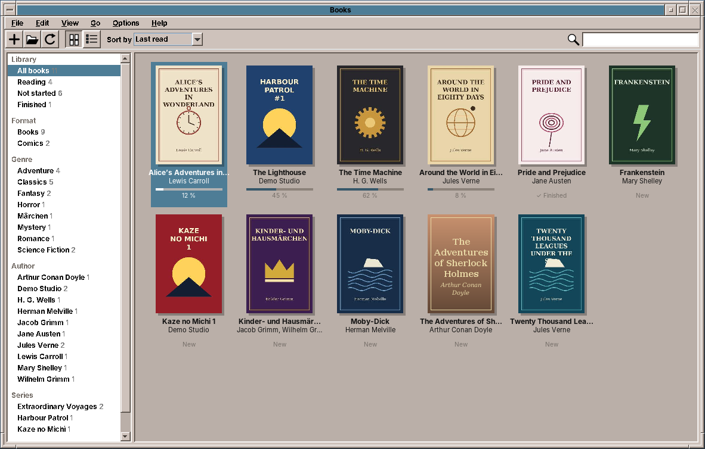
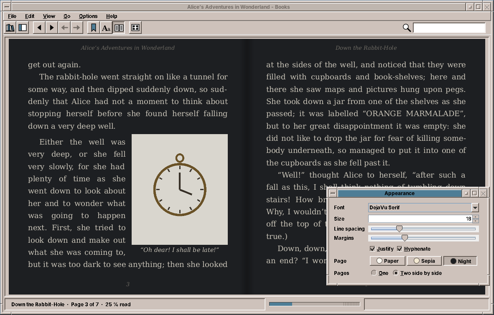
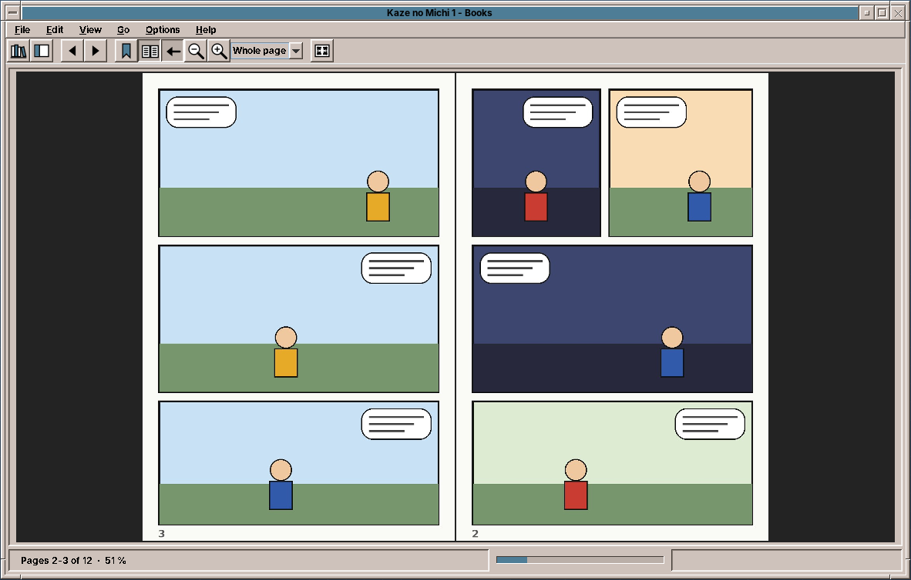
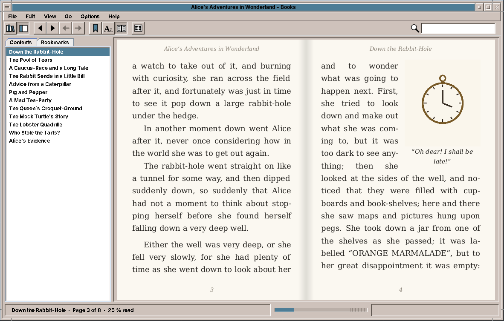

# 37. Books

An e-book is a website in a ZIP file. An EPUB holds XHTML chapters, CSS, pictures and fonts, and a reader could simply show each chapter in an HTML component and let it scroll. That would be a web page, not a book. A book has pages that you turn, text set flush on both sides with words divided at the line end, a page number, a running head and a picture that the text flows around. amade-books sets all of that itself. It is the program of this book that does the most typography, and the one where Java's text layout shows both its strength and its oddities.

The program has about 8,600 lines of Java and 2,200 lines of tests. Nothing moves into amade-commons with it. It reads two formats, EPUB 2 and 3 for books and CBZ for comics, keeps a library of both, and remembers for every book where the reader stopped.

## What you build



- **A bookshelf** of every EPUB and CBZ under `~/Books` and other folders, as covers or a table. Shelves by format, genre, author, series and the reader's own collections, five sort orders, and a search as you type.
- **A book reader** that sets the text on pages, one or two side by side, with running heads, page numbers, justification, hyphenation, pictures with text flowing around them, and captions.
- **Contents, bookmarks, search, links and footnotes**, with *Back* and *Forward*.
- **The appearance**: font, size, line spacing, margins, justify, hyphenate, and paper, sepia and night colours.
- **A comic reader** with fit to page, width or height, zoom, double pages, and right to left for manga.
- **Full screen**, a progress bar with a mark per chapter, and the reading position, bookmarks and collections of every book.

## What you will learn

- How an EPUB is put together, and how to read it with jsoup without a web engine.
- How to turn HTML and a subset of CSS into blocks of styled text, and keep one offset per character through all of it.
- How to set text into lines with `LineBreakMeasurer`, justify it with `TextLayout`, and divide words with Liang's patterns from the system's hyphenation dictionaries.
- How to place pictures, floats and captions on pages, and what to do with a picture that does not fit.
- How to keep the reader's place when the font, the size or the window changes.
- Where `TextLayout` justifies the wrong gaps and breaks a word in the wrong place, and how to work around it.
- How to show a comic two pages at a time, and when a page stands alone.

## Why it sets the text itself

The first decision was how to show an EPUB at all. There were four ways:

| Way | For | Against |
|---|---|---|
| `JEditorPane` with HTML | in the JDK | HTML 3.2 and a little CSS 1; no pages, no hyphenation, no justification worth the name |
| A web engine (JavaFX WebView, JCEF) | full HTML and CSS | a second toolkit or a native Chromium of 100 MB; pages only through CSS columns and JavaScript |
| A library such as Flying Saucer or OpenHTMLtoPDF | CSS 2.1 in Java | made for printing to PDF; no interaction, no reflow when the font changes |
| An own typesetter | pages, justification, hyphenation, offsets for everything | only the CSS that books use |

Books use little of CSS: fonts, sizes, emphasis, margins, indents, alignment, page breaks, and pictures that float. They use it much more simply than websites do. What a reader needs from the program, on the other hand, goes beyond a browser: pages that turn, a position that survives a change of the font, search hits and bookmarks as places in the text. An own typesetter gives exactly that, in pure Java and one jar. The price is that tables, vertical writing and complex layouts are not supported (see the exercises).

## The structure

| Package | Contents |
|---|---|
| `domain.epub` | `EpubBook` (the container, the package document, the contents), `EpubSession` (an open book: chapter texts, layouts, fonts, progress, links, search), `TocEntry`, `ZipPaths` |
| `domain.layout` | `Css`, `Style`, `ChapterParser`, `Block`, `ChapterText`, `Typesetter`, `ChapterLayout`, `Page`, `PageGeometry`, `Appearance`, `Hyphenator`, `Hyphenators` |
| `domain.comic` | `ComicBook`, `ComicSession`, `Spreads`, `NaturalOrder` |
| `domain.library` | `LibraryScanner`, `LibraryEntry`, `Shelf`, `ShelfFilter`, `SortOrder`, `BookState`, `Bookmark` |
| `repository` | `BooksPreferences` (`books.properties`), `ReadingStates` (`library.json`), `LibraryCache` (the scanned shelf and the covers) |
| `ui.main` | `MainWindow`, `MainPresenter`, `MainMenuBar`, `LibraryPanel`, `CoverGrid`, `PageView`, `ComicView`, `ReaderSidebar`, `AppearancePanel`, `ProgressStrip` |

The presenter talks to the window through `MainView`, as in every program of this book ([chapter 10](10-pad.md)). It gets two executors: one background thread for opening books, scanning, setting chapters and decoding comic pages, and the event dispatch thread for the results:

```java title="amade-books · bootstrap/BooksModule.java"
--8<-- "amade-books/src/main/java/eu/amadeos/apps/books/bootstrap/BooksModule.java:presenter"
```

One thread keeps the work in the order it was asked for: a book opened after a scan is shown after the scan's results, not before. The tests pass `Runnable::run` for both executors, so everything happens at once and in order. Each open and each search counts up a generation number, and a result for an older generation is dropped, as in Image Viewer and PDF Viewer.

## Reading an EPUB

### The container

An EPUB is a ZIP archive. `META-INF/container.xml` names the *package document* (`content.opf`), which has three parts: the **metadata** (title, authors, language, series, subjects), the **manifest** of every file with its media type, and the **spine**, the chapters in reading order. `EpubBook.open` reads the three with jsoup's XML parser:

```java title="amade-books · domain/epub/EpubBook.java"
--8<-- "amade-books/src/main/java/eu/amadeos/apps/books/domain/epub/EpubBook.java:open"
```

All paths in an EPUB are relative to the file that names them, so `ZipPaths.resolve` turns `../Images/cover.jpg` in `OEBPS/Text/ch1.xhtml` into `OEBPS/Images/cover.jpg`. A chapter whose file is missing is left out of the spine instead of failing the whole book.

### The contents

EPUB 3 has a navigation document, an XHTML file with a `<nav epub:type="toc">` and nested `<ol>` lists. EPUB 2 has the NCX, an XML file of `navPoint`s. Many books carry both, some neither:

```java title="amade-books · domain/epub/EpubBook.java"
--8<-- "amade-books/src/main/java/eu/amadeos/apps/books/domain/epub/EpubBook.java:toc"
```

Each entry is turned into a chapter number and an anchor at once, so a click in the sidebar knows where to go without reading the chapter.

The series is one of the things books state in several ways. EPUB 3 uses `belongs-to-collection` with a `group-position`, and Calibre, which made many of the EPUBs on people's disks, writes `calibre:series` and `calibre:series_index`. `EpubBook` reads both.

## From HTML to blocks

### A subset of CSS

`Css` reads the style sheets of a chapter: the `<link>`ed files and `<style>` elements, plus the `style` attribute. It understands selectors by element, class and id, joined as descendants and children; a rule with pseudo-classes, attributes or siblings in its selector is skipped. The properties it knows are the ones books use: `font-*`, `text-align`, `text-indent`, `margin`, `padding`, `float`, `width`, `display`, `page-break-*` and `break-*`, `vertical-align`, `text-transform`, `font-variant: small-caps` and `@font-face`. Rules apply in the order they appear, so the later one wins, and the `style` attribute last of all:

```java title="amade-books · domain/layout/Css.java"
--8<-- "amade-books/src/main/java/eu/amadeos/apps/books/domain/layout/Css.java:cascade"
```

This is not the CSS cascade: there is no specificity and no `!important`. For books that is close enough. Their style sheets have few rules, and where two rules meet, the later one is nearly always the more specific one too. Sizes in `em` and `%` are kept relative to the reader's size, and sizes in `px` and `pt` are converted to `em`. A book that sets its text at `12pt` therefore grows when the reader makes the text bigger.

### Walking the chapter

`ChapterParser` walks the XHTML of a chapter with the computed style of each element. It turns it into a list of `Block`s: `Text` (a paragraph or a heading, with styled runs), `Image` and `Rule`:

```java title="amade-books · domain/layout/ChapterParser.java"
--8<-- "amade-books/src/main/java/eu/amadeos/apps/books/domain/layout/ChapterParser.java:walk"
```

Four things happen on the way:

- **Anchors**: each `id` remembers the offset where its element begins, so a link to `ch2.xhtml#note3` finds its place.
- **Links** go down to the text runs as a resolved path, or as the address of a web page. A link marked as a note reference (`epub:type="noteref"`) remembers that too.
- **Footnotes** (`<aside epub:type="footnote">`) are taken out of the flow and kept by their id, for the popup.
- **The language** of each element (`lang` and `xml:lang`) goes with the text, so a German quotation in an English book is hyphenated as German.

White space is collapsed as a browser does, and the soft hyphens that some books put in every word are dropped, because the hyphenator finds the places itself:

```java title="amade-books · domain/layout/ChapterParser.java"
--8<-- "amade-books/src/main/java/eu/amadeos/apps/books/domain/layout/ChapterParser.java:append"
```

### One offset for everything

The result of the parser, `ChapterText`, has the blocks and the *plain text* of the chapter: every character of every block, in order. A picture or a rule is one object character. Every place in the book is a `Position`: a chapter and an offset into that plain text. That includes the reading position, a bookmark, a search hit, the start of a page and an anchor. Nothing refers to pages, because pages change with the font and the window. Offsets do not.

## Setting the text

### Pages

`PageGeometry` decides from the size of the reading area and the appearance whether one or two pages fit, and how wide the text column is. A page is never wider than 40 em, because longer lines are hard to read. The margins are a share of the page width, and the bands above and below the text hold the running head and the page number:

```java title="amade-books · domain/layout/PageGeometry.java"
--8<-- "amade-books/src/main/java/eu/amadeos/apps/books/domain/layout/PageGeometry.java:of"
```

`Typesetter` then sets one chapter into pages of the text area. It returns a `ChapterLayout`: a list of `Page`s, each with its lines (a `TextLayout` with its place and its range of offsets), its pictures and its rules. `EpubSession` keeps the last layouts by chapter, appearance and size, so turning back and forth does not set a chapter again.

### Fonts and styles

Each paragraph becomes an `AttributedString`. The reader's font family and size are combined with what the book says: italics, bold, relative sizes, superscripts and small capitals:

```java title="amade-books · domain/layout/Typesetter.java"
--8<-- "amade-books/src/main/java/eu/amadeos/apps/books/domain/layout/Typesetter.java:attributes"
```

Small capitals are capitals at 80 % of the size. The characters are replaced one for one, so the offsets stay the same. With *Publisher's font*, the fonts of the book's `@font-face` rules are loaded with `Font.createFont`:

```java title="amade-books · domain/epub/EpubSession.java"
--8<-- "amade-books/src/main/java/eu/amadeos/apps/books/domain/epub/EpubSession.java:fonts"
```

Java reads TrueType and OpenType. It does not read WOFF, or fonts that the publisher obfuscated, as the EPUB specification allows. The reader's font stands in for those.

### Lines

A paragraph is broken into lines with `LineBreakMeasurer`, the JDK's line breaker. It knows the width of every glyph, kerning, and where a line may break in many scripts. The typesetter asks it for the next line of the width that is left, and checks each line against the bottom of the page:

```java title="amade-books · domain/layout/Typesetter.java"
--8<-- "amade-books/src/main/java/eu/amadeos/apps/books/domain/layout/Typesetter.java:text"
```

Three rules of typesetting are in this loop:

- **Keep with next**: a heading does not stand alone at the bottom of a page. If the heading and two more lines do not fit, it starts the next page.
- **Orphans**: the first line of a paragraph does not stand alone at the bottom of a page.
- **Widows**: the last line of a paragraph does not stand alone at the top of a page. The line before it comes along.

The width a line may take comes from `edges`, which knows the floats on the page (see below).

### Hyphenation

`LineBreakMeasurer` breaks only between words. When the next word does not fit, the typesetter asks the hyphenator for the places where that word may be divided, and tries them from the last to the first:

```java title="amade-books · domain/layout/Typesetter.java"
--8<-- "amade-books/src/main/java/eu/amadeos/apps/books/domain/layout/Typesetter.java:line"
```

The hyphenator is Frank Liang's algorithm, the one in TeX, LibreOffice and Firefox. A language has a list of *patterns*, short pieces of words with numbers between the letters. For a word, every pattern that matches anywhere in it sets its numbers. At each place between two letters the highest number counts, and an odd number means "may be divided here":

```java title="amade-books · domain/layout/Hyphenator.java"
--8<-- "amade-books/src/main/java/eu/amadeos/apps/books/domain/layout/Hyphenator.java:points"
```

The test uses the example patterns from the TeXbook:

```java title="amade-books · test · domain/layout/HyphenatorTest.java"
--8<-- "amade-books/src/test/java/eu/amadeos/apps/books/domain/layout/HyphenatorTest.java:patterns"
```

The patterns themselves are not in the program. Debian's `hyphen-de`, `hyphen-en-us`, `hyphen-fr` and the rest put them into `/usr/share/hyphen` as `hyph_de_DE.dic`, in the format of the Hyphen library that LibreOffice uses. `Hyphenators` loads the one for a language the first time it is needed. The Debian package of amade-books recommends the five languages of the desktop. Because the amadeOS image installs no recommends, the image lists them itself.

### Justification, and a trap

The last step for a line is `TextLayout.getJustifiedLayout`. It widens the spaces of the line until it fills the width:

```java title="amade-books · domain/layout/Typesetter.java"
--8<-- "amade-books/src/main/java/eu/amadeos/apps/books/domain/layout/Typesetter.java:justify"
```

!!! warning "Pitfall: justification after a ligature"
    With ligatures on, DejaVu Serif draws "fl" and "fi" as one glyph. The JDK's justification then counts glyphs where it means characters. In the line "the floor of the hall", it widened the gaps *inside* "floor" and between the letters after it, not the spaces. The screenshots showed "fl o o r". Justified lines are therefore set without ligatures. The test counts the gaps in a drawn line and fails without the fix.

!!! warning "Pitfall: a break after an apostrophe"
    `LineBreakMeasurer` follows the Unicode line-breaking rules. In "I’ve" with a typographic apostrophe, it may break after the apostrophe, and "I’" ends one line while "ve" begins the next. `line` moves such a break back to the space before the word.

## Pictures, floats and captions

A picture is a block like a paragraph. It takes the width the book gives it (`width: 50%`, `width: 10em`) or its natural width, and never more than the column or, on the page, the text height:

```java title="amade-books · domain/layout/Typesetter.java"
--8<-- "amade-books/src/main/java/eu/amadeos/apps/books/domain/layout/Typesetter.java:picture"
```

**Floats.** A picture with `float: left` or `right` goes to that side, at most 60 % of the column wide, and the text flows around it. The typesetter keeps a list of the floats on the current page, and `edges` gives each line the room between them. The test sets a paragraph beside a picture and checks that no line runs into it:

```java title="amade-books · test · domain/layout/TypesetterTest.java"
--8<-- "amade-books/src/test/java/eu/amadeos/apps/books/domain/layout/TypesetterTest.java:floats"
```

**Deferred pictures.** A picture that does not fit at the bottom of a page does not start a new page, which would leave a gap. It is *deferred*: the text goes on below where the picture would have been, and the picture opens the next page. Printed books do the same.

**Captions.** The parser marks the text blocks inside a `<figure>`, or inside a floating `<div>` with a picture, as captions. The typesetter collects them with their picture into a `Figure`, sets them centred below it, and moves them along when the picture is deferred:

```java title="amade-books · test · domain/layout/TypesetterTest.java"
--8<-- "amade-books/src/test/java/eu/amadeos/apps/books/domain/layout/TypesetterTest.java:captions"
```

A deferred figure has a consequence for the offsets. On the first page, the text after the picture comes before the picture itself. Each page records the first and last offset it shows, and `ChapterLayout.pageOf` finds the page of an offset by these starts. The moved figure must not count for the page where it lands, or the next page would start before the text the reader saw last:

```java title="amade-books · domain/layout/Typesetter.java"
--8<-- "amade-books/src/main/java/eu/amadeos/apps/books/domain/layout/Typesetter.java:finish"
```

## Keeping the place

The reading position is the offset of the first character on the left page. When the window changes size, or the reader picks a larger font, the presenter sets the chapter again. It then shows the spread that contains the position:

```java title="amade-books · ui/main/MainPresenter.java"
--8<-- "amade-books/src/main/java/eu/amadeos/apps/books/ui/main/MainPresenter.java:relayout"
```

The position itself is changed only when the reader turns a page, not by a new layout. Make the window wider and narrower again, and you are back on exactly the same page. The window calls `relayout` 150 ms after the last resize event, so a drag of the window border does not set the chapter fifty times.

The progress bar needs the length of the whole book, and that means reading every chapter. `EpubSession` does it once, on the background thread after opening, and counts characters:

```java title="amade-books · domain/epub/EpubSession.java"
--8<-- "amade-books/src/main/java/eu/amadeos/apps/books/domain/epub/EpubSession.java:progress"
```

Characters are not pages, but they do not change with the font. They are the same on every computer, and they give the chapter marks on the bar for free.

`ReadingStates` keeps the position, the progress, the bookmarks, the collections and an appearance of every book in `~/.local/share/amadeos/books/library.json`, with `Json` from amade-commons ([chapter 47](47-programs-json-network.md)). It is written after every page turn. The file is small, and losing the place in a book is what readers mind most:

```java title="amade-books · repository/ReadingStates.java"
--8<-- "amade-books/src/main/java/eu/amadeos/apps/books/repository/ReadingStates.java:state"
```

## Links, footnotes and search

A click on the page asks `PageView` for the offset under the mouse, through `TextLayout.hitTestChar`, and the presenter looks up whether a link runs there:

```java title="amade-books · ui/main/MainPresenter.java"
--8<-- "amade-books/src/main/java/eu/amadeos/apps/books/ui/main/MainPresenter.java:follow"
```

A web address goes to Firefox through `DesktopLauncher` ([chapter 11](11-web.md)). A note reference shows the note in a popup next to the mouse, in the colours of the page:

```java title="amade-books · ui/main/MainWindow.java"
--8<-- "amade-books/src/main/java/eu/amadeos/apps/books/ui/main/MainWindow.java:footnote"
```

Any other link resolves to a position through the anchors of the parser, and *Back* remembers where the reader came from.

The search runs over the plain texts of all chapters, on the background thread. Upper and lower case and accents do not count, so "bucher" finds "Bücher". The folding keeps one character for one character, so the offsets of the hits stay valid:

```java title="amade-books · domain/epub/EpubSession.java"
--8<-- "amade-books/src/main/java/eu/amadeos/apps/books/domain/epub/EpubSession.java:search"
```

## Drawing the pages

`PageView` draws one or two pages: the background of the theme, the running head (book title on the left page, chapter on the right page, none on the first page of a chapter) and the page number. On top come the pictures (a little dimmed at night), the search and selection marks, and the lines. A link is drawn once more in the link colour, clipped to its characters, with a thin line under it:

```java title="amade-books · ui/main/PageView.java"
--8<-- "amade-books/src/main/java/eu/amadeos/apps/books/ui/main/PageView.java:paint"
```

`Line.highlight` turns a range of offsets into a shape with `TextLayout.getLogicalHighlightShape`. Search, selection and links all use it.



The appearance is saved twice, as the default and for the book in which it was changed:

```java title="amade-books · ui/main/MainPresenter.java"
--8<-- "amade-books/src/main/java/eu/amadeos/apps/books/ui/main/MainPresenter.java:appearance"
```

## Comics

A CBZ is a ZIP archive of pictures, in the order of their names. "Natural" order matters here: `page10.jpg` comes after `page9.jpg`, which plain string order gets wrong. An optional `ComicInfo.xml` (the format of ComicRack) gives the title, series, number, authors, genres, and whether it is a manga read from right to left:

```java title="amade-books · domain/comic/ComicBook.java"
--8<-- "amade-books/src/main/java/eu/amadeos/apps/books/domain/comic/ComicBook.java:open"
```

Two pages side by side are a *spread*. The cover stands alone, as the right page of a printed comic does, and a page that is wider than high is a double page that was scanned as one picture. It stands alone too:

```java title="amade-books · domain/comic/Spreads.java"
--8<-- "amade-books/src/main/java/eu/amadeos/apps/books/domain/comic/Spreads.java:spreads"
```

```java title="amade-books · test · domain/comic/ComicTest.java"
--8<-- "amade-books/src/test/java/eu/amadeos/apps/books/domain/comic/ComicTest.java:spreads"
```



The presenter shows a spread with the pages it already has decoded, decodes the missing ones in the background, and decodes the next spread ahead, so a page turn does not wait. For a manga the two pages swap places: the first page is on the right. In `arrow`, the left arrow key turns forward:

```java title="amade-books · ui/main/MainPresenter.java"
--8<-- "amade-books/src/main/java/eu/amadeos/apps/books/ui/main/MainPresenter.java:comic"
```

`ComicView` scales both pages to one height, then to the window by the fit, then by the zoom:

```java title="amade-books · ui/main/ComicView.java"
--8<-- "amade-books/src/main/java/eu/amadeos/apps/books/ui/main/ComicView.java:scale"
```

## The library

`LibraryScanner` walks the library folders on the background thread and reads title, authors, series, genres and the cover of each book. Files whose size and date have not changed are taken from the last scan:

```java title="amade-books · domain/library/LibraryScanner.java"
--8<-- "amade-books/src/main/java/eu/amadeos/apps/books/domain/library/LibraryScanner.java:scan"
```

The covers are scaled to 360 pixels high and kept as JPEG in the cache folder, and `LibraryCache` writes the whole shelf there as JSON. At start the presenter shows the shelf from the cache at once, and then scans:

```java title="amade-books · ui/main/MainPresenter.java"
--8<-- "amade-books/src/main/java/eu/amadeos/apps/books/ui/main/MainPresenter.java:start"
```

`Shelf` is the domain of the left list and the covers: the facets with their counts, and the books that a filter and the search leave, sorted. A series is sorted by the number of its volumes, and an author by the last name:

```java title="amade-books · domain/library/Shelf.java"
--8<-- "amade-books/src/main/java/eu/amadeos/apps/books/domain/library/Shelf.java:books"
```

```java title="amade-books · test · domain/library/LibraryTest.java"
--8<-- "amade-books/src/test/java/eu/amadeos/apps/books/domain/library/LibraryTest.java:shelf"
```

A book without a cover gets one drawn from its title, in a colour of its own:

```java title="amade-books · ui/main/CoverGrid.java"
--8<-- "amade-books/src/main/java/eu/amadeos/apps/books/ui/main/CoverGrid.java:plain-cover"
```

## The window



The window is a `CardLayout` of the shelf and the reader. The reader is a toolbar, the sidebar with contents and bookmarks, the pages or the comic, and a status bar with the progress strip. The toolbar shows the buttons for books or for comics, depending on what is open. Its icons are `StandardGlyph`s where amade-commons has one (open, find, zoom, refresh, full screen), and its own glyphs for the library, sidebar, bookmark, appearance, two pages and right to left.

The keys for reading work while the pages have the focus; ++space++ and ++arrow-down++ first scroll a comic page that is larger than the window:

```java title="amade-books · ui/main/MainWindow.java"
--8<-- "amade-books/src/main/java/eu/amadeos/apps/books/ui/main/MainWindow.java:keys"
```

Full screen uses `setFullScreenWindow` without changing the display mode, as in Image Viewer. Where the screen does not support it, a borderless window covers the screen:

```java title="amade-books · ui/main/MainWindow.java"
--8<-- "amade-books/src/main/java/eu/amadeos/apps/books/ui/main/MainWindow.java:fullscreen"
```

## What amade-commons gives Books

| Part | Since | Books uses it for |
|---|---|---|
| `AmadeApplication`, `AppInfo`, `CommonsModule`, `EdtExecutor` | chapter 10 | start-up and wiring, `--version`, file arguments, the UI executor |
| `Messages`, `Mnemonics`, `LocaleSettings`, `TranslationCheck` | chapter 10 | five languages, the menu letters, the language menu, the translation test |
| `AmadeUI`, `DesktopTheme` | chapter 10 | the Motif look, the colours of the shelf and the sidebar |
| `DesktopLauncher` | chapter 11 | web links in books, *Show in Folder* |
| `AppDirectories`, `PropertiesFile`, `XdgDirectories` | chapter 20 | `books.properties`, the cache of the shelf and covers, `~/Books`, `library.json` |
| `Json` | chapter 33 | `library.json` and the shelf cache |
| `ToolIcon`, `StandardGlyph`, `ToolButtons` | chapter 30 | the toolbars of the shelf and the reader, full screen |

### And what stays in Books

- **The typesetter.** No other program sets text on pages from HTML. WritePad has its own pages, made from its own document model ([chapter 23](23-writepad.md)), and the two share only `TextLayout`.
- **The hyphenator.** WritePad could divide words too, and would then need exactly `Hyphenator` and `Hyphenators`. They move into amade-commons when it does (see the exercises).
- **The comic reader.** PDF Viewer could open CBZ files with `ComicBook` and `Spreads`. Until it does, comics are Books' own.

## Exercises

1. **Hyphenation in WritePad.** Move `Hyphenator` and `Hyphenators` into amade-commons and divide words in WritePad's justified paragraphs. What must WritePad store in the ODT file, and what not?
2. **Scrolling.** Add *View → Scroll*, which shows a chapter as one long page. The typesetter already gives the lines with their heights; what does a page break become, and what happens to a deferred picture?
3. **Tables.** Set simple tables (`<table>` without merged cells) as blocks: measure each column's widest word, share out the rest of the width, and break a table between rows across pages.
4. **CBR.** Comics are often RAR archives. The only free Java libraries read RAR 4, not RAR 5. Would you call `unrar` with `CommandRunner` ([chapter 31](31-imagescan.md)), and what does the presenter show while the archive is unpacked?
5. **The CSS cascade.** Add specificity to `Css`: count ids, classes and elements of each selector, and sort the matching rules by it before applying them. Find a book where the result differs.

## Summary

- Choose a typesetter of your own when you need pages, justification and offsets more than you need all of CSS.
- Keep one offset per character from the parser to the page, and never store a page number.
- Let `LineBreakMeasurer` break lines, divide words with Liang's patterns from the system, and justify without ligatures.
- Defer a picture that does not fit, take its captions along, and leave it out of the page's range of offsets.
- Set the chapter again when the font or the window changes, and show the spread that contains the reading position.
- Read a comic's order naturally, and let the cover and double pages stand alone.
