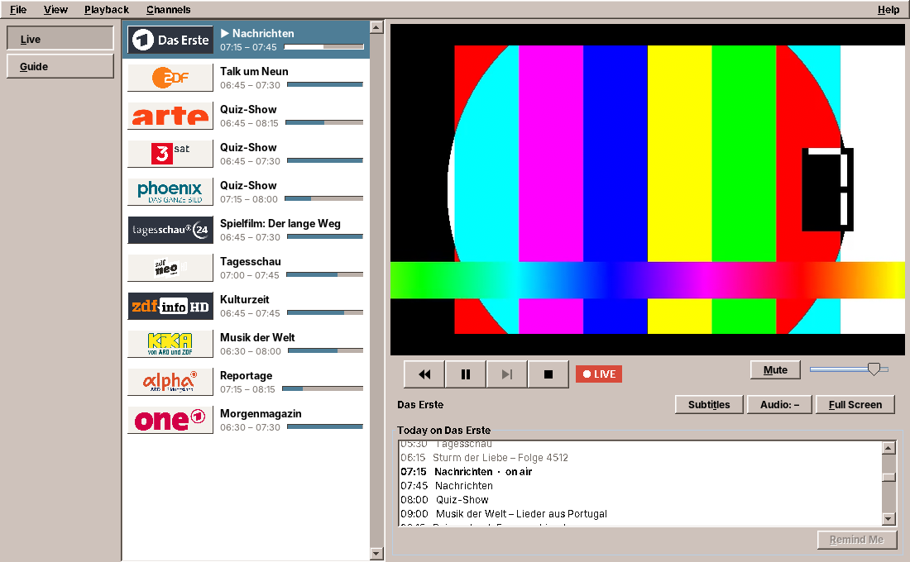
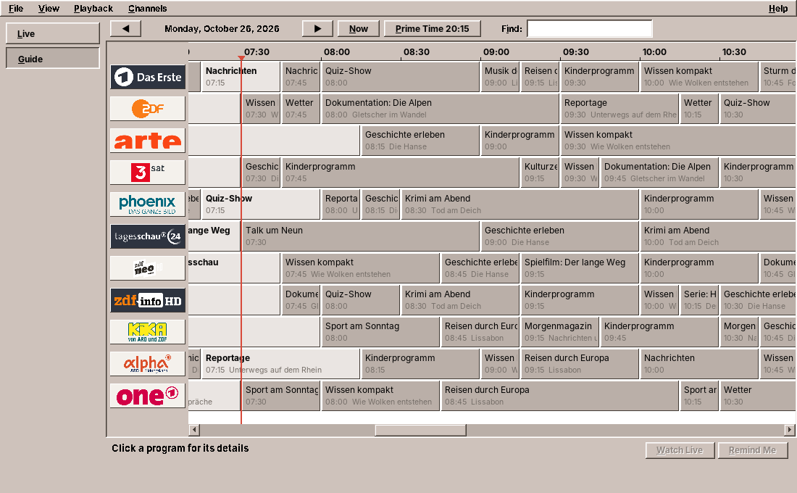

# 38. TV

Video (chapter 32) plays what the user hands it: a file, a stream address, a DVD. TV knows what to play before the user does. It has a list of channels with their stream addresses, logos and groups, and a program guide gathered from three services that were never meant for anyone but the broadcasters' own websites. Playing is the easy part, because amade-commons has the player since this chapter. Most of the work is in the data: where it comes from, what to do when a source is gone, how often a program may ask, and how to draw a day of television for a hundred channels.

amade-tv has about 4,700 lines of Java and 1,850 lines of tests. With it the libmpv binding moves into amade-commons as the package `mpv` (chapter 48), its second user after Video.

## What you build



- **Live**: the channel list with logos, what runs now and how much of it has run, the player, and today's program of the channel.
- **The guide**: all channels on a time line, one day at a time, with *Now*, *Prime Time 20:15*, the previous and next day, and a search that marks the hits.
- **Time shift**: pause, ten minutes back and *Back to Live*, as far as the stream keeps its past.
- **Volume, mute, subtitles and the audio track** (original language, audio description), and full screen.
- **Reminders** that pop up when a program starts and offer to switch to it.
- **Recordings**: *Record* in the guide or in today's list saves a program from the live stream into the videos folder, and the *Recordings* page lists what is planned, running and done.
- **Channel groups**: the 11 national channels always, and four groups switched on in the *Channels* menu: the regional channels, Austria and Switzerland, international channels, and further free German channels.
- **Five languages**, following the desktop.

The program data in the screenshots is made up and the picture is FFmpeg's test source ([chapter 32](32-video.md#make-your-own-test-video)): the services and streams are not reachable from the machine the screenshots were taken on, and the broadcasters' pictures are theirs.

## What you will learn

- How to keep a list of channels in the program and update its stream addresses from services at run time.
- How to merge program data from several sources into one immutable schedule, and which source wins.
- How to use web services that have no published API politely: a cache on disk, fixed intervals, and a program that keeps working when a source fails.
- How to draw a large time grid in Swing that paints only what is visible, with headers that scroll along.
- How to prepare logos that come in every size, orientation and colour.
- How "behind live" works for a live stream, and why *Back to Live* opens the stream again.
- How to run a long external program (ffmpeg) for minutes or hours, follow its progress and stop it so that the file stays usable.

## The structure

| Package | Contents |
|---|---|
| `domain` | `Channel`, `ChannelGroup`, `Broadcast`, `Schedule`, `Reminder`, `Recording`, `PlayerState` |
| `repository` | `ChannelCatalog` (`channels.json` and the updated stream addresses), `TvPreferences` (`tv.properties`), `ReminderStore` (`reminders.json`), `RecordingStore` (`recordings.json`) |
| `service.guide` | `GuideService`, the sources `ArdProgramSource` and `ZdfEpgSource`, `ZappService` for what runs now |
| `service.logo` | `LogoCache` |
| `service.mpv` | `MpvPlayer`, TV's player state on top of amade-commons' `Mpv` |
| `service.net` | `Web` and `HttpWeb`, `KodinerdsList` |
| `service.record` | `Recorder`: ffmpeg for each recording |
| `ui.main` | `MainWindow`, `MainPresenter`, `ChannelTile`, `LogoSource` |
| `ui.live` | `LivePage`, `ChannelCell`, `LiveControls`, `VideoCanvas` |
| `ui.guide` | `GuidePage`, `GuideGrid`, `TimelineLayout` |
| `ui.recordings` | `RecordingsPage` |

Every service gets the network through the interface `Web`, with `get`, `postJson` and `bytes`. The tests give them a fake that answers with recorded JSON, so no test goes online. The guide is put together in the module, with its two sources:

```java title="amade-tv · bootstrap/TvModule.java"
--8<-- "amade-tv/src/main/java/eu/amadeos/apps/tv/bootstrap/TvModule.java:guide"
```

The presenter runs on the event dispatch thread. Everything that waits for the network or the disk goes to the background executor of `CommonsModule`, and the results come back through `EdtExecutor` ([chapter 41](41-start-up.md#two-threads-edtexecutor-and-ui)).

## The channels

### A list in the program

The channels are a resource of the program, `channels.json`, with one entry per channel:

```json
{
  "id": "arte",
  "name": "ARTE",
  "stream": "https://artesimulcast.akamaized.net/hls/live/2030993/artelive_de/index.m3u8",
  "logo": "https://raw.githubusercontent.com/jnk22/kodinerds-iptv/master/logos/tv/arte.png",
  "logoTurn": 90,
  "guide": "ZDF",
  "guideNames": ["arte"]
}
```

`guide` says which source has the channel's day program (`ARD`, `ZDF` or `NONE`), and `guideNames` how that source calls it. `group` puts a channel in one of the groups (missing means a main channel), `kodinerds` names it in the Kodinerds list (below), and `needs` names a program its stream needs. `ChannelCatalog` reads the list:

```java title="amade-tv · repository/ChannelCatalog.java"
--8<-- "amade-tv/src/main/java/eu/amadeos/apps/tv/repository/ChannelCatalog.java:read"
```

- A few international channels stream only through YouTube, which mpv plays with the help of `yt-dlp`. Without it they could not play, so they are left out of the list, not shown as broken. The Debian package *recommends* `yt-dlp`, so it is normally there.
- The first version had `"regional": true` instead of `"group": "regional"`. A stream address kept in the cache, or a list a user edited, may still have it, and it still works.
- The constructor takes the test for installed programs as a `Predicate<String>`, so the tests decide what is installed.

`Channel.isCalled` compares names without case, spaces, dots and dashes: the ZDF service calls KiKA `KI.KA`, and ARD calls Das Erste `daserste`.

### Groups

The main channels are always there. Each group is a check box in the *Channels* menu, and the list shows the main channels and the groups switched on, in the order of the file:

```java title="amade-tv · repository/ChannelCatalog.java"
--8<-- "amade-tv/src/main/java/eu/amadeos/apps/tv/repository/ChannelCatalog.java:shown"
```

The menu is built from the enum `ChannelGroup`, so a new group needs an enum constant, its menu text in five languages, and its channels in the file. Only the main and regional channels have a day program. The guide shows rows only for them, and the Live page writes *Live stream, no program guide* under the others:

```java title="amade-tv · ui/main/MainPresenter.java"
--8<-- "amade-tv/src/main/java/eu/amadeos/apps/tv/ui/main/MainPresenter.java:show-channels"
```

### Stream addresses move

Broadcasters move their streams now and then, to another server or another path. A list in the program would then be out of date until the next release. So TV asks two services for the current addresses at every start:

- the **Zapp service** of the MediathekView project, which knows the German public channels by the same ids as `channels.json`;
- the **Kodinerds IPTV list**, a playlist on GitHub kept by volunteers, which knows the other channels by their `tvg-id`.

```java title="amade-tv · ui/main/MainPresenter.java"
--8<-- "amade-tv/src/main/java/eu/amadeos/apps/tv/ui/main/MainPresenter.java:streams"
```

The Kodinerds list is an M3U playlist. Each channel is an `#EXTINF` line with its attributes and the address on the next line:

```text
#EXTINF:-1 tvg-name="ORF eins HD" tvg-id="ORF1.at" group-title="IPTV-AT" tvg-logo="https://.../orf1hd.png",ORF eins HD
https://orf1.mdn.ors.at/out/u/orf1/q6a/manifest_6.m3u8
```

Reading it takes a few lines. Only `http` and `https` addresses count, because the list also has `rtmp` and other addresses mpv may not play:

```java title="amade-tv · service/net/KodinerdsList.java"
--8<-- "amade-tv/src/main/java/eu/amadeos/apps/tv/service/net/KodinerdsList.java:parse"
```

The new addresses are kept in the cache, `~/.cache/amadeos/tv/stream-urls.json`, so the next start uses them before the services answer. An address a service does not name stays as it was. When both services fail, the program plays with what it knows:

```java title="amade-tv · repository/ChannelCatalog.java"
--8<-- "amade-tv/src/main/java/eu/amadeos/apps/tv/repository/ChannelCatalog.java:urls"
```

The method is `synchronized` because two background tasks can update at once: the one at start and a refresh with ++f5++.

### What is not in the list

Only channels that stream freely are in the list. Private channels whose streams are encrypted or paid are not, and neither is anything that a broadcaster limits to a country. Some programs of the public channels are only licensed for Germany. Outside, the stream fails or shows a notice, and TV says that the stream may only be available in some countries. It never tries to get around such a limit.

## The program guide

### Three sources, one schedule

A day of program comes from one of two sources, and what runs now from a third:

| Source | Channels | Request |
|---|---|---|
| ARD's program service | Das Erste, tagesschau24, ONE, ARD-alpha and the regional channels | one GET per day for all channels |
| ZDF's program service | ZDF, ZDFneo, ZDFinfo, 3sat, KiKA, phoenix, ARTE | one GraphQL POST per day, with a token |
| The Zapp service | every public channel | one GET per channel: what runs now |

Each day source implements `GuideSource`: it answers the items of a day for the channels it knows, with the ids of `channels.json`. The answers end in one `Schedule`, which is immutable. `with` returns a new schedule in which the new items replace the old ones they overlap on the same channel:

```java title="amade-tv · domain/Schedule.java"
--8<-- "amade-tv/src/main/java/eu/amadeos/apps/tv/domain/Schedule.java:with"
```

The rule decides every conflict without asking where an item came from. A day from ARD replaces the single "now" item of the Zapp service it overlaps, and a refreshed day replaces the day before, even when a program moved by five minutes:

```java title="amade-tv · domain/ScheduleTest.java"
--8<-- "amade-tv/src/test/java/eu/amadeos/apps/tv/domain/ScheduleTest.java:replace"
```

Because the schedule is immutable, the background thread builds a new one and sets it in a `volatile` field. The Live page and the guide read it on the event dispatch thread without locks, as `PlayerState` crosses threads in Video ([chapter 32](32-video.md#from-events-to-one-state)).

### ARD: one request per day

ARD's service answers a day for all its channels at once, in columns of time slots:

```java title="amade-tv · service/guide/ArdProgramSource.java"
--8<-- "amade-tv/src/main/java/eu/amadeos/apps/tv/service/guide/ArdProgramSource.java:parse"
```

Each answer is read with `Json`'s forgiving helpers ([chapter 47](47-programs-json-network.md#json)): a missing member gives an empty string or list, never an exception. An item without a start or an end is skipped, and a missing title falls back to its `coreTitle`. ARD's day starts at 5 in the morning, so the night after midnight belongs to the previous day. `GuideService` therefore loads the previous day too.

All times are instants (`Instant`). The sources write them with an offset or a zone, sometimes both (`2026-10-25T20:15:00+01:00[Europe/Berlin]`). The helper `Times.parse` tries the three forms of `java.time` one after the other. Days are counted in the broadcasters' time, `Europe/Berlin` (`GuideSource.BROADCAST_ZONE`), and shown in the user's zone.

### ZDF: a token from the page

ZDF's service is the GraphQL API behind zdf.de. It wants a token that the zdf.de page hands to its own player, so TV reads the live TV page once and looks for it:

```java title="amade-tv · service/guide/ZdfEpgSource.java"
--8<-- "amade-tv/src/main/java/eu/amadeos/apps/tv/service/guide/ZdfEpgSource.java:token"
```

The token is in escaped JSON inside the page, so the pattern allows a backslash before each quote. A token can expire, so a failed request reads the page once more and tries again:

```java title="amade-tv · service/guide/ZdfEpgSource.java"
--8<-- "amade-tv/src/main/java/eu/amadeos/apps/tv/service/guide/ZdfEpgSource.java:day"
```

The request names a stored query by its hash (`persistedQuery`) instead of sending the query text. This is the most fragile part of the program: when ZDF changes the page or the stored query, the ZDF channels get no day program. The program says so in the sidebar, and the Live page falls back to the Zapp service for what runs now.

### Zapp: what runs now

For a channel with nothing known at this moment, because it has no day source or its source failed, the Zapp service tells what runs now:

```java title="amade-tv · service/guide/GuideService.java"
--8<-- "amade-tv/src/main/java/eu/amadeos/apps/tv/service/guide/GuideService.java:now"
```

So a failing source costs the day view but not the line under the channel on the Live page.

### Being polite

None of these services has published terms. They serve the broadcasters' websites, and a program that uses them must not ask more often than a website would. `GuideService` keeps every day it loads in `~/.cache/amadeos/tv/guide/ARD-2026-10-25.json` and asks again after six hours at the earliest. Past days never change, so a past day on disk is never asked again:

```java title="amade-tv · service/guide/GuideService.java"
--8<-- "amade-tv/src/main/java/eu/amadeos/apps/tv/service/guide/GuideService.java:day"
```

- A source that fails leaves what is on disk, even an old day, and its id goes into `problems()`. The sidebar shows *No program from ZDF right now*, and the rest of the program works.
- The file is written to a temporary file first and then moved, so a crash never leaves half a day.
- Zapp is asked about a channel at most every five minutes.
- `cleanUp` deletes days older than a week at every start.

```java title="amade-tv · service/guide/GuideService.java"
--8<-- "amade-tv/src/main/java/eu/amadeos/apps/tv/service/guide/GuideService.java:load"
```

These are the same rules Audio follows for MusicBrainz ([chapter 33](33-audio.md#being-polite-to-a-web-service)), with one more: the program must work when a source is gone for good.

## Drawing the guide



A day for eleven channels is 24 hours at 220 pixels per hour, 5,280 pixels wide, with some 500 items. A `JTable` or a component per item would be far too heavy. `GuideGrid` is one component that paints its items itself, and all the arithmetic of the time line is in a small record:

```java title="amade-tv · ui/guide/TimelineLayout.java"
--8<-- "amade-tv/src/main/java/eu/amadeos/apps/tv/ui/guide/TimelineLayout.java:layout"
```

`x` turns a time into a pixel and `at` turns a pixel back into a time, for a click. `span` clips an item to the day and keeps it at least three pixels wide, so a five-minute weather report does not vanish. The record needs no window, so its tests are plain arithmetic.

`paintComponent` paints only what the clip rectangle holds: the rows that touch it, and in each row the items between the times at its left and right edges:

```java title="amade-tv · ui/guide/GuideGrid.java"
--8<-- "amade-tv/src/main/java/eu/amadeos/apps/tv/ui/guide/GuideGrid.java:paint"
```

- The grid lives in a `JScrollPane`. The hours are its column header and the channel logos its row header (`setColumnHeaderView`, `setRowHeaderView`), so they scroll along with the grid in one direction and stay in the other.
- `GuideGrid` implements `Scrollable`: a unit step is a quarter of an hour or a row, a block step two hours or five rows.
- The running item is bold, a search hit yellow, the selected item in the selection colours of the desktop theme, and a reminder gets a star after its time.
- *Now* and *Prime Time 20:15* scroll the time to a third of an hour from the left edge, so the item before is still visible.

Each cell is clipped to its width, so a long title ends at the next item. The tooltip and the details below the grid show it in full.

## Logos

The logos are not part of the program. Their rights are with the broadcasters, and the Kodinerds project keeps a collection of them. Each channel names the address of its logo, and `LogoCache` downloads it on first use into `~/.cache/amadeos/tv/logos/`:

```java title="amade-tv · service/logo/LogoCache.java"
--8<-- "amade-tv/src/main/java/eu/amadeos/apps/tv/service/logo/LogoCache.java:logo"
```

The tile asks for the logo while it paints. If it is not there yet, loading starts in the background, the tile shows the channel name, and `ready` repaints the lists when the logo is there. Offline, every tile shows its name.

The logos come in every form: some with a wide transparent margin, a few lying on their side, many with white lettering for a dark background. Each is prepared once, at the size of the tile:

```java title="amade-tv · service/logo/LogoCache.java"
--8<-- "amade-tv/src/main/java/eu/amadeos/apps/tv/service/logo/LogoCache.java:prepare"
```

- `logoTurn` in `channels.json` says how far to turn it.
- `drawnArea` crops to the pixels that are not (almost) transparent.
- `isLight` measures the brightness of the drawn pixels, weighted by their opacity. A light logo gets a dark tile (`ChannelTile`), whatever the colours of the desktop.

## Playing live

### The player

`MpvPlayer` is TV's player state on top of amade-commons' `Mpv` ([chapter 48](48-video-playback.md#a-player-in-a-swing-window-mpv)). It starts the player with the options of a live TV program:

```java title="amade-tv · service/mpv/MpvPlayer.java"
--8<-- "amade-tv/src/main/java/eu/amadeos/apps/tv/service/mpv/MpvPlayer.java:attach"
```

- German audio and subtitles first. The other tracks, the original language and audio description, come with the *Audio* button (`cycle aid`).
- Subtitles are loaded but hidden, so switching them on is instant.
- `cache yes` keeps the stream's past in memory, which makes going back possible.

The window id comes from the `VideoCanvas` as in Video, and `attach` runs on the background executor, because finding the GPU can take a moment.

### Behind live

A live stream has no position that means anything to a viewer. What matters is how far the picture is behind the live edge. `PlayerState.behind` holds it in seconds. A pause adds its length:

```java title="amade-tv · service/mpv/MpvPlayer.java"
--8<-- "amade-tv/src/main/java/eu/amadeos/apps/tv/service/mpv/MpvPlayer.java:pause"
```

and a jump adds or takes away its distance. Forward stops at the live edge, because there is nothing after it:

```java title="amade-tv · service/mpv/MpvPlayer.java"
--8<-- "amade-tv/src/main/java/eu/amadeos/apps/tv/service/mpv/MpvPlayer.java:seek"
```

The pause is measured with the `Clock` of the player, so the test can let time pass without waiting:

```java title="amade-tv · service/mpv/MpvPlayerTest.java"
--8<-- "amade-tv/src/test/java/eu/amadeos/apps/tv/service/mpv/MpvPlayerTest.java:behind"
```

The test uses a real `Mpv` without calling `attach`: without a player, its commands are dropped, and the state still follows the events the test hands in. Less than half a minute behind counts as live, and the red *LIVE* mark next to the buttons turns grey and shows the minutes when the picture is further behind or paused.

*Back to Live* does not jump forward. It opens the stream again:

```java title="amade-tv · ui/main/MainPresenter.java"
--8<-- "amade-tv/src/main/java/eu/amadeos/apps/tv/ui/main/MainPresenter.java:to-live"
```

An HLS stream's playlist moves on while the player waits. After a long pause the segments it holds are gone from the server, and a jump forward can land in a gap. A fresh start always lands at the live edge, and it is what other HLS players do too.

## Recording

### What a recording is

A recording is planned from a program of the guide. Programs rarely keep to the minute, so it starts two minutes before and ends five minutes after, and a program that runs already is recorded from now on:

```java title="amade-tv · domain/Recording.java"
--8<-- "amade-tv/src/main/java/eu/amadeos/apps/tv/domain/Recording.java:plan"
```

The file name says what it is, "Tatort – Tod am Deich (Das Erste, 2026-10-26 20.15).mkv", without the characters some file systems refuse. The folder is `TV` in the user's videos folder, which `XdgDirectories.videos()` reads from `user-dirs.dirs` ([chapter 44](44-settings.md)), so a German desktop records into `~/Videos/TV` or `~/Filme/TV`, whichever the desktop calls it:

```java title="amade-tv · bootstrap/TvModule.java"
--8<-- "amade-tv/src/main/java/eu/amadeos/apps/tv/bootstrap/TvModule.java:recorder"
```

`RecordingStore` keeps the recordings in `recordings.json` like the reminders. A recording that was running when TV ended, by a crash or a power cut, is marked as stopped when the store is loaded: the file holds what was recorded until then. An entry the store cannot read is kept as it is and written back, so a new version or a strange file name never loses the list.

### ffmpeg copies the stream

The streams are HLS: a playlist of short pieces of MPEG-TS that the server adds to every few seconds. ffmpeg reads that like any input, and with `-c copy` it writes the packets into a new container without decoding them. Recording costs almost no processor time, and the picture is exactly what the broadcaster sends:

```java title="amade-tv · service/record/Recorder.java"
--8<-- "amade-tv/src/main/java/eu/amadeos/apps/tv/service/record/Recorder.java:command"
```

- **`-t`** is the length from now to the end of the recording, so ffmpeg stops by itself and TV does not have to be on time.
- **Matroska** (`.mkv`) and not MP4: an MP4 file needs its index written at the end, and a recording cut off by a power cut would be unplayable. A Matroska file can be played up to where it ends.
- **`-reconnect`** lets ffmpeg try again when the network drops for a moment.
- **`-progress pipe:1`** prints `key=value` lines on standard output once a second. TV reads `total_size` to show how big the file is.
- **`-sn -dn`**: subtitle and data streams are left out. Their formats (WebVTT, ID3 tags) do not all fit into Matroska unchanged.

The program is started through `CommandRunner` ([chapter 31](31-imagescan.md)), so the tests answer with a `FinishedProcess` that prints progress lines and never need ffmpeg. One test starts `sleep` instead, to have a process that runs until it is stopped.

### The recorder

The presenter's clock calls the recorder at every tick:

```java title="amade-tv · service/record/Recorder.java"
--8<-- "amade-tv/src/main/java/eu/amadeos/apps/tv/service/record/Recorder.java:tick"
```

For each running recording two virtual threads read ffmpeg's output: one the progress lines, one the error lines, of which the last is kept as the reason if ffmpeg fails. When the process ends, its exit code decides: 0 is *Recorded*, anything else *Failed* with that reason, and a recording the user stopped is *Stopped* whatever the code. Stopping is `Process.destroy()`, which sends SIGTERM. ffmpeg treats it like a `q` on the keyboard and closes the file properly first.

The buttons in the guide and in today's list do one of three things, depending on what the program has:

```java title="amade-tv · ui/main/MainPresenter.java"
--8<-- "amade-tv/src/main/java/eu/amadeos/apps/tv/ui/main/MainPresenter.java:record"
```

TV records only while it is open. A recording whose time passed while TV was closed is marked *Missed* at the next start, so the user sees it instead of finding nothing. On quit, TV asks before it stops a running recording, and then gives ffmpeg up to five seconds to finish its files.

## The clock

A timer ticks every 20 seconds on the event dispatch thread:

```java title="amade-tv · ui/main/MainPresenter.java"
--8<-- "amade-tv/src/main/java/eu/amadeos/apps/tv/ui/main/MainPresenter.java:tick"
```

- It repaints the progress bars and the red line of the guide.
- It shows the reminders that are due.
- It starts the recordings that are due.
- After midnight it loads the new day.
- Every five minutes it asks Zapp what runs now on the channels without a day program.

A reminder is kept in `reminders.json` with the channel and the start time, so it survives a restart. The store hands out the due ones and forgets them:

```java title="amade-tv · repository/ReminderStore.java"
--8<-- "amade-tv/src/main/java/eu/amadeos/apps/tv/repository/ReminderStore.java:due"
```

A reminder that started more than ten minutes ago, for example because the computer was off, is dropped without a word.

A program that runs for hours must not trust a date it read at start. `today` is compared at every tick, and everything that needs the time takes it from the `Clock` in the module, which the tests replace.

## Quitting

The order is the one chapter 48 asks for: the player first, then the windows, then the background executor. Before that, running recordings are stopped:

```java title="amade-tv · ui/main/MainPresenter.java"
--8<-- "amade-tv/src/main/java/eu/amadeos/apps/tv/ui/main/MainPresenter.java:quit"
```

This order came from a crash. Before `Mpv` restored AWT's X error handler, closing the window ended TV with `BadWindow` and exit code 1. The cause and the fix are in [chapter 48](48-video-playback.md#a-player-in-a-swing-window-mpv).

## What amade-commons gives TV

| Part | Since | TV uses it for |
|---|---|---|
| `AmadeApplication`, `AppInfo`, `CommonsModule`, `EdtExecutor` | chapter 10 | start-up and wiring, the background executor, results to the event dispatch thread |
| `Messages`, `Texts`, `Mnemonics`, `TranslationCheck` | chapters 10 and 22 | five languages, the menu letters, the test that all of them have every text |
| `AmadeUI`, `DesktopTheme` | chapter 10 | the Motif look, the colours of the guide, the bevels of the tiles |
| `AppDirectories`, `PropertiesFile` | chapter 20 | `tv.properties`, `reminders.json`, the caches of the guide, the logos and the stream addresses |
| `Json` | chapter 33 | the services' answers, `channels.json` and every file the program keeps |
| `TransportButtons`, `TransportGlyph` | chapter 33 | back, play and pause, *Back to Live*, stop |
| `CommandRunner` | chapter 31 | ffmpeg for the recordings, and a fake in the tests |
| `XdgDirectories.videos()`, `DesktopLauncher` | chapters 34 and 44 | the folder for recordings, *Play* and *Show in Folder* |
| `Mpv`, `MpvEvent`, `LibMpv` | this chapter | playing, see below |

### What moves in with TV

- **The libmpv binding.** TV is the second program to play with libmpv, so `LibMpv`, `MpvEvent`, `VideoOutput` and the core of Video's `MpvPlayer` (loading, options, the event thread, closing) moved into amade-commons as the package `mpv`, with `Mpv` as its class. The fix for the X error handler came along. Video and TV each keep only their own player state on top. [Chapter 48](48-video-playback.md) describes the package.

### And what stays in TV

- **The guide sources, the schedule and the channel list.** No other program has use for them. When the Mediathek part of TV comes, it will use the same `Web`, but it stays in the same program.
- **The logo cache.** Its preparation (turn, crop, light or dark) is about logos on tiles. Audio's covers are pictures of a different kind.
- **`Web` and `HttpWeb`.** TV is the third program with its own little HTTP client, after Mail and Audio. With it, the first shared part moved into amade-commons: the proxy of the desktop, which `HttpWeb` takes with its client from `Network.httpClient()` ([chapter 47](47-programs-json-network.md#the-proxy-of-the-desktop-network)). The rest stays: the three agree on the interface in front of the client, the two time limits and the `User-Agent`, and differ in what they do around them. See the exercises.

## Exercises

1. **The network in amade-commons.** Compare TV's `Web`, Audio's `HttpFetcher` and Mail's requests. Write an interface `Http` for amade-commons with `get`, `postJson` and `bytes`, time limits and a `User-Agent` from `AppInfo`, and a fake for tests. What stays in each program?
2. **A week in the guide.** The guide loads a day when it is shown. Load the next six days in the background at start, one request at a time with a pause between them. How many requests is that per week, per source? Is it still polite?
3. **Favourites.** Let the user mark channels as favourites and show them first. Where is the order kept, and what happens to a favourite that a new version of `channels.json` no longer has?
4. **A channel of your own.** Add *Channels → Add Stream...* for an address the user types. The new channel has no logo and no guide. Which of the program's classes need to know about channels that are not in `channels.json`?
5. **Recording while TV is closed.** Recordings happen only while TV runs. Write a small program that the desktop session starts, which reads `recordings.json` and starts ffmpeg at the right time on its own. Who writes the status back, and what happens when TV and the small program both run?

## Summary

- Keep the list of channels in the program, and update what changes, the stream addresses, from services at run time. Keep what you learn in a cache, so the next start does not depend on the services.
- Merge program data into one immutable schedule with one rule: new items replace the old ones they overlap. Then the order of the answers does not matter.
- Be polite to services without published terms: a cache on disk, fixed intervals, never asking about the past, and a program that works when a source is gone.
- Draw a large grid as one component that paints only its clip, with the arithmetic in a record that can be tested without a window.
- For a live stream, measure how far the picture is behind live, not where it is, and open the stream again to return to live.
- Record a stream by copying it with ffmpeg into Matroska, let ffmpeg stop by itself with `-t`, read its progress from `-progress`, and stop it with SIGTERM so the file is closed properly.
- With TV, the libmpv binding moves into amade-commons as `Mpv`, its second user after Video. The HTTP client is next: TV is its third user.
