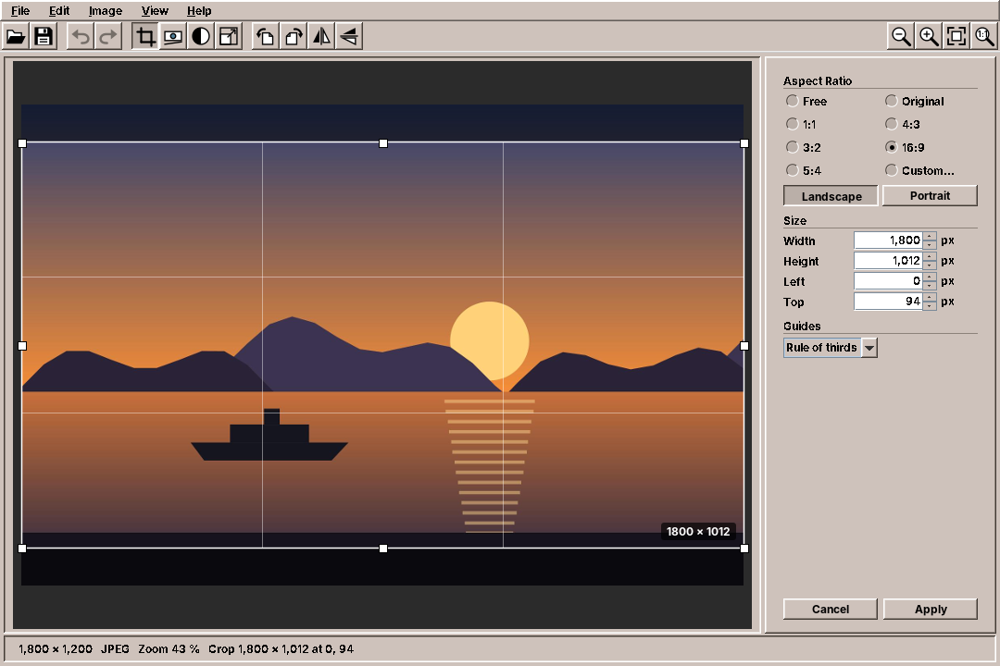
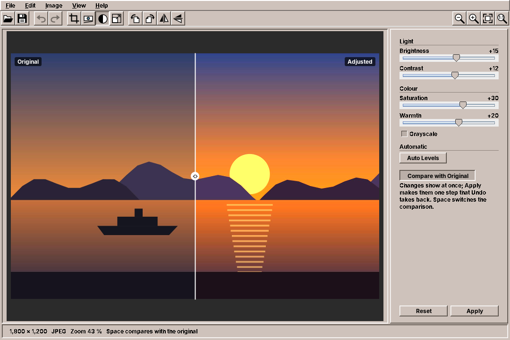

# 39. Image Editor

An image viewer only reads pictures; an image editor changes them, and every change raises a question the viewer never had to answer. What happens to the original? How far back can the user go? Does the cropped photo still carry the uncropped preview, and the place where it was taken? amade-imageeditor crops, straightens, turns, colours and resizes photos, with undo without a limit, and saves them in five formats. Its interesting parts are the history of steps, the geometry of a frame that keeps its shape, and the bytes around the pixels that a careful editor must correct or drop.

The program has about 5,000 lines of Java and 2,400 lines of tests. Nothing moves into amade-commons with it. It is the second program after Image Viewer ([chapter 35](35-imageviewer.md)) that reads EXIF and calls `jpegtran`, and the first that writes metadata.

## What you build



- **Crop** with a frame and eight handles, aspect ratios (free, original, 1:1, 4:3, 3:2, 16:9, 5:4, custom), portrait or landscape, typed sizes and guides.
- **Straighten** with a slider or a line drawn along the horizon, optionally cropped to the largest rectangle.
- **Turn and flip** by quarters; JPEGs that were only turned are saved without loss.
- **Colours**: brightness, contrast, saturation, warmth, grayscale and Auto Levels, live, with a split view against the original.
- **Resize** in pixels or percent, with presets and three qualities.
- **Undo and redo** without a limit, named in the menu.
- **Save** as JPEG, PNG, WebP, TIFF or BMP. Camera data, description and location come along from JPEG to JPEG unless the user switches them off; the orientation, the size and the preview picture are corrected.

## What you will learn

- How to keep an unlimited history in bounded memory, with steps as values and soft references.
- How a crop frame keeps its aspect ratio while any of eight handles is dragged.
- How large a rectangle fits into a picture turned by a small angle, and how to turn a line drawn on screen into an angle.
- How to show colour changes live on a 24-megapixel photo without waiting.
- What a JPEG keeps besides its pixels, how to carry it over, and which parts must change or go: orientation, size, preview, location.
- How to save a picture atomically, and how to write WebP with a program instead of a library.
- How a presenter applies an open tool before saving and asks about unsaved changes without blocking.

## The structure

| Package | Contents |
|---|---|
| `domain` | `Edit` (the steps), `History`, `CropBox`, `AspectRatio`, `Adjustments`, `ImageFormat`, `SaveOptions`, `ResizeQuality`, `Orientation`, `ZoomSteps` |
| `repository` | `EditorPreferences` (`imageeditor.properties`: save settings per format, resize quality, last folder) |
| `service` | `ImageLoader`, `ImageOperations` (the steps on pixels), `ImageSaver`, `JpegMetadata` |
| `ui.main` | `MainWindow`, `MainPresenter`, `MainMenuBar`, `EditorCanvas`, `ToolPanel`, `ResizePanel`, `SavePanel` |

The presenter talks to the window through `MainView`, as in every program of this book. `EditorCanvas` draws the picture, the frame, the level line and the split, and reports what the mouse does through a `Listener`; it never changes the picture. The `ToolPanel` at the right shows the open tool and reports through an `Actions` interface that the presenter implements. So the presenter holds all state, and the tests drive cropping, straightening, saving and the unsaved-changes question through a fake view.

## Steps as values

Every change is a record of the sealed interface `Edit`: `Crop`, `Turn`, `Straighten`, `Resize`, `Adjust` and `AutoLevels`. A step knows nothing about pixels; `ImageOperations.apply` does, and the compiler checks that it handles every kind:

```java title="amade-imageeditor · service/ImageOperations.java"
--8<-- "amade-imageeditor/src/main/java/eu/amadeos/apps/imageeditor/service/ImageOperations.java:apply"
```

Values make three things easy. The menu can say *Undo Crop*, because each step has a key for its name. A test can compare steps with `equals`. And a step can be applied again, which the history needs.

## Undo without a limit

A 24-megapixel photo takes 96 MB as `TYPE_INT_ARGB`. Keeping the picture after each of 30 steps would need almost 3 GB. Keeping only the steps and computing the current picture from the original each time would be slow. `History` does both: it keeps the original strongly, the current picture strongly, and every other result as a `SoftReference`, which the garbage collector clears before it gives up with an `OutOfMemoryError`.

```java title="amade-imageeditor · domain/History.java"
--8<-- "amade-imageeditor/src/main/java/eu/amadeos/apps/imageeditor/domain/History.java:push"
```

A new step cuts off what could have been redone, as in every editor. Undo and redo move a position. When the picture at the new position was cleared, `History` walks back to the nearest picture still kept, at worst the original, and applies the steps from there:

```java title="amade-imageeditor · domain/History.java"
--8<-- "amade-imageeditor/src/main/java/eu/amadeos/apps/imageeditor/domain/History.java:replay"
```

The test for this calls `forget()`, which clears all soft references as a full heap would, and checks that undo still gives the same pixels. *Modified* is a comparison of the position with the position of the last save, so undoing back to the saved state makes the document clean again, and a new step after an undo past the save makes the saved state unreachable.

## The crop frame

The frame is a `Rectangle` in picture pixels, never in screen pixels: the canvas converts with the zoom, so the frame stays where it was when the user zooms. `CropBox` has pure functions for everything the mouse and the fields do: a centred frame for a ratio, drawing a new one, dragging a handle, typing a size.

Dragging is where the ratio matters. Without a ratio, each handle moves its edges. With one, the frame must stay in shape, grow from a fixed point and stay inside the picture:

```java title="amade-imageeditor · domain/CropBox.java"
--8<-- "amade-imageeditor/src/main/java/eu/amadeos/apps/imageeditor/domain/CropBox.java:drag"
```

The fixed point is the opposite corner for a corner handle, and the middle of the opposite edge for an edge handle, so an edge handle grows the frame on both sides of its centre line. A corner follows the larger of the two movements. Then the frame is scaled down until it fits in the room around the fixed point. The ratio is a `double` from `AspectRatio.value`, which also turns 4:3 into 3:4 for portrait and takes *Original* from the picture.

## Straightening

Turning a picture by a few degrees leaves four empty triangles in the corners. *Crop to the largest rectangle* cuts them away. The largest rectangle with the picture's own aspect ratio, centred, fits if its corners stay inside the turned picture. With the scale `s` of the kept rectangle, that gives two inequalities, and the smaller bound wins:

```java title="amade-imageeditor · service/ImageOperations.java"
--8<-- "amade-imageeditor/src/main/java/eu/amadeos/apps/imageeditor/service/ImageOperations.java:straighten"
```

The turn itself is one `Graphics2D.rotate` around the middle with bicubic interpolation, drawn into a picture of the kept size and shifted by the kept rectangle's corner. Without cropping the corners stay transparent; a JPEG or BMP gets them white when it is saved, because `ImageOperations.flatten` paints the picture onto white before encoding a format without transparency.

The other way to straighten is a line drawn along something that should be level. The canvas reports the line, and a small function turns it into degrees:

```java title="amade-imageeditor · ui/main/EditorCanvas.java"
--8<-- "amade-imageeditor/src/main/java/eu/amadeos/apps/imageeditor/ui/main/EditorCanvas.java:levelling"
```

A line has no direction, so the angle is brought into −90° to 90° first. A line steeper than 45° was drawn along a wall, not a horizon, and should become upright, so 90° is taken off. The line is drawn on the picture as it is shown, already turned by the current angle, so the result is the current angle minus the line's angle. The tests draw lines both ways and steep ones.

## Colours, live

Brightness, contrast and warmth change each channel on its own, so they become three lookup tables of 256 entries; saturation mixes the channels and is done per pixel, towards the gray value of the pixel:

```java title="amade-imageeditor · service/ImageOperations.java"
--8<-- "amade-imageeditor/src/main/java/eu/amadeos/apps/imageeditor/service/ImageOperations.java:adjust"
```

On a 24-megapixel photo this takes most of a second, too slow for a slider. The trick is that the user never sees 24 megapixels at once. While Adjust is open, the presenter does not change the picture at all. It hands the canvas a *look*, a function from picture to picture:

```java title="amade-imageeditor · ui/main/MainPresenter.java"
--8<-- "amade-imageeditor/src/main/java/eu/amadeos/apps/imageeditor/ui/main/MainPresenter.java:adjust"
```

The canvas applies the look only to what it draws: the picture scaled to the window, which it keeps anyway for good drawing, or the visible part when zoomed in. That is a million pixels at most, and the slider follows the hand.

```java title="amade-imageeditor · ui/main/EditorCanvas.java"
--8<-- "amade-imageeditor/src/main/java/eu/amadeos/apps/imageeditor/ui/main/EditorCanvas.java:look"
```

The split view draws the same picture twice, the original clipped to the left of the split and the look to the right. Only *Apply* turns the adjustments into a step, and only then is the full picture computed, in the background:

```java title="amade-imageeditor · ui/main/MainPresenter.java"
--8<-- "amade-imageeditor/src/main/java/eu/amadeos/apps/imageeditor/ui/main/MainPresenter.java:apply-tool"
```

A tool that changes nothing (a frame around the whole picture, an angle of zero, all sliders at zero) adds no step, so it does not make the document modified.

Auto Levels builds its tables from the picture: per channel, the values below which and above which half a percent of the pixels lie are stretched to 0 and 255. Without the half percent, one white speck would stop the stretch.



## Saving

`ImageSaver.save` writes into a hidden `.name.part` next to the target and moves it into place with `ATOMIC_MOVE`. A full disk or a crash leaves the old file as it was, never half a picture. This matters more in an editor than anywhere else, because the target is often the original.

Each format has its own path:

- **PNG** and **TIFF** keep transparency; TIFF is written with LZW compression by the TwelveMonkeys plugin.
- **BMP** and **JPEG** are flattened onto white first. The JPEG quality is set on the `ImageWriteParam`.
- **WebP**: TwelveMonkeys reads WebP but cannot write it. The editor writes a temporary PNG and runs `cwebp` through `CommandRunner` ([chapter 31](31-imagescan.md)), with `-lossless -exact` or a quality. `-metadata none` because WebP gets no camera data in this version; `-exact` keeps the colour of transparent pixels, which matters to people who edit them later.

```java title="amade-imageeditor · service/ImageSaver.java"
--8<-- "amade-imageeditor/src/main/java/eu/amadeos/apps/imageeditor/service/ImageSaver.java:webp"
```

If `cwebp` is missing, `ProgramMissingException` becomes a `CwebpMissingException`, and the presenter names the package `webp`.

### Turns without loss

Image Viewer turns JPEGs with `jpegtran` ([chapter 35](35-imageviewer.md)). The editor can do the same when the only steps are quarter turns and flips. `History` sees that and combines them into one orientation:

```java title="amade-imageeditor · domain/History.java"
--8<-- "amade-imageeditor/src/main/java/eu/amadeos/apps/imageeditor/domain/History.java:only-turns"
```

The orientation that `jpegtran` must apply is the stored one (the photo was shown upright, as its EXIF tag said) followed by the user's turns. `-perfect` refuses pictures whose width or height is not a multiple of the block size; then `-trim` drops up to 15 pixels at the edge, and the user is told.

```java title="amade-imageeditor · service/ImageSaver.java"
--8<-- "amade-imageeditor/src/main/java/eu/amadeos/apps/imageeditor/service/ImageSaver.java:lossless"
```

`-copy icc` keeps only the colour profile. The rest of the metadata is put back by `JpegMetadata`, corrected, exactly as for a JPEG that was encoded anew.

## What a photo carries

A JPEG from a camera is a list of segments before the compressed picture. Three of them matter here: **EXIF** (APP1, `Exif\0\0`) with the camera, the date, the orientation, the GPS position and a preview picture; **XMP** (APP1, an XML packet) with title, keywords and, often, the position again; **IPTC** (APP13) with caption, keywords and copyright from news photography. `JpegMetadata.read` walks the segments until the picture starts:

```java title="amade-imageeditor · service/JpegMetadata.java"
--8<-- "amade-imageeditor/src/main/java/eu/amadeos/apps/imageeditor/service/JpegMetadata.java:read"
```

When a JPEG is saved, ImageIO writes a JFIF header and the pixels, nothing more. `insert` puts the chosen segments of the original after the JFIF header:

```java title="amade-imageeditor · service/JpegMetadata.java"
--8<-- "amade-imageeditor/src/main/java/eu/amadeos/apps/imageeditor/service/JpegMetadata.java:insert"
```

Copied as they are, the EXIF data would now lie in three ways. The **orientation** says "turn right", but the pixels are already upright, so every viewer would turn the photo again. The **size** in the EXIF sub-IFD is that of the uncropped photo. And the **preview picture** in IFD 1, which file managers and some viewers show instead of decoding the photo, still shows everything that was cropped away, the stranger at the edge included. `fixExif` corrects the segment in place, without rebuilding the TIFF structure inside it:

```java title="amade-imageeditor · service/JpegMetadata.java"
--8<-- "amade-imageeditor/src/main/java/eu/amadeos/apps/imageeditor/service/JpegMetadata.java:fix-exif"
```

Editing in place keeps every offset valid: the orientation is a 16-bit value inside its entry, the sizes too. Dropping the preview sets the link from IFD 0 to IFD 1 to zero and fills the preview's bytes with zeros, so the old picture is gone from the file, not just unlinked. Without *Keep location (GPS)* the GPS entry is taken out of IFD 0 and the GPS IFD is zeroed; XMP loses its `exif:GPS…` attributes and elements in `withoutGps`. The tests build an EXIF block by hand with orientation, size, GPS and a preview marked with a known byte, save through every path and read the result back with metadata-extractor.

## Saving with a tool open, and unsaved changes

Two situations in the presenter look small and are not. The user crops, does not press *Apply*, and presses ++ctrl+s++. Saving the picture without the crop would surprise; ignoring the key too. So `save` applies the open tool first. Applying runs in the background, so the save is kept in `pendingSave` and runs when the step is done, or is dropped if the step fails.

The other is the question before a picture is closed: *Save*, *Discard* or *Cancel*. Saving may itself ask (*Save As* for a GIF, a name, a format) and may be cancelled or fail. `whenSettled` takes what should happen afterwards and runs it only when the changes are really saved or given up:

```java title="amade-imageeditor · ui/main/MainPresenter.java"
--8<-- "amade-imageeditor/src/main/java/eu/amadeos/apps/imageeditor/ui/main/MainPresenter.java:settled"
```

Opening another picture, dropping one on the window and closing the window all go through it. The fake view in the tests answers the question with a preset answer, so the tests cover saving before exit, discarding, cancelling, and opening another picture over unsaved changes.

## What amade-commons gives Image Editor

| Part | Since | Image Editor uses it for |
|---|---|---|
| `AmadeApplication`, `AppInfo`, `CommonsModule`, `EdtExecutor` | chapter 10 | start-up and wiring, `--version`, the file from the command line |
| `Messages`, `Mnemonics`, `LocaleSettings`, `TranslationCheck` | chapter 10 | five languages, menu letters, the language menu, the translation test |
| `AmadeUI`, `DesktopTheme` | chapter 10 | the Motif look, sunken panels, the scale for fonts |
| `AppDirectories`, `PropertiesFile`, `XdgDirectories` | chapter 20 | `imageeditor.properties`, the Pictures folder for *Open* |
| `ToolIcon`, `StandardGlyph`, `ToolButtons`, `@Ui` | chapter 30 | the toolbar; crop, straighten, adjust, resize and flip are its own glyphs |
| `CommandRunner`, `ProgramMissingException` | chapter 31 | `jpegtran` and `cwebp`, and the messages when they are missing |
| `ImageSelection` | chapter 34 | *Copy Image* |

### And what stays in Image Editor

- **The history and the steps.** No other program has undo for pictures. WritePad and Pad have undo for text from Swing's `UndoManager`, which keeps edits, not results.
- **`JpegMetadata`.** It is the first code that writes EXIF. Image Viewer reads EXIF with metadata-extractor and turns with `jpegtran`, but never writes metadata itself. If Image Viewer learns to write titles and keywords (its chapter's planned work), the two share a writer, and it moves to amade-commons then.
- **`Orientation`.** Image Viewer and Image Editor now have the same class. It is the obvious candidate for amade-commons: two users, no dependencies, and its tests come along.
- **The canvas.** Zoom, panning and good scaling are in Image Viewer, Image Scan and Image Editor in three versions. A shared picture canvas would be welcome, but the three differ in what they draw on top.

## Exercises

1. **Orientation in commons.** Move `Orientation` from Image Viewer and Image Editor into amade-commons. Which tests move with it, and how do you make sure the two programs pin the same commons commit?
2. **Metadata for WebP.** `cwebp -metadata exif,xmp` copies metadata from its input, but the input is a PNG without EXIF. Write the corrected EXIF segment into the WebP's RIFF container yourself (a chunk `EXIF`, and the `VP8X` header's flags). What do the tests have to read back?
3. **Sharpen.** Add *Sharpen* to Adjust as an unsharp mask: blur with a small kernel, subtract, add back with a strength. Why does the live look have to blur the scaled picture with a smaller radius, and what does that do to the comparison?
4. **History on disk.** Very large pictures still need the original and the current picture in memory. Write the soft-referenced results to a cache folder instead, as PNG, and read them back on undo. When is that faster than computing again?
5. **Rotate the frame.** In many phone editors the crop frame stays upright while the picture turns under it. Combine Straighten and Crop into one tool. What does the frame's maximum size depend on now?

## Summary

- Keep the steps as values and apply them in one place; undo then is a position in a list.
- Keep the original and the current picture strongly and every other result softly; replay from the nearest kept result when one is gone.
- Keep the crop frame in picture coordinates, and drag it with pure functions that hold a fixed point and the ratio.
- The largest rectangle in a turned picture follows from two inequalities; a drawn line gives its angle with `atan2`, folded into ±45°.
- Show live changes on the scaled picture only, and compute the full picture when the user applies.
- Write into a `.part` file and move it into place atomically.
- Turns of a JPEG need no decoding: combine them, give them to `jpegtran`, and put the metadata back corrected.
- Metadata is part of what you save: set the orientation to upright, correct the size, drop the old preview, and let the user decide about the location.
- Apply an open tool before saving, and run "what comes next" only when unsaved changes are settled.
