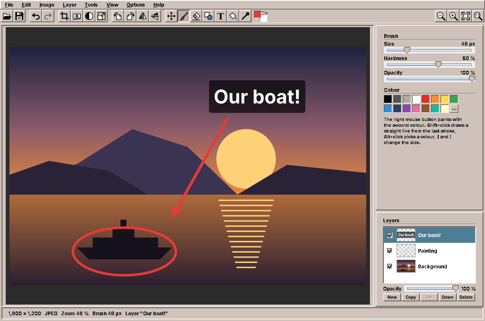

# 39. Image Editor

An image viewer only reads pictures; an image editor changes them, and every change raises a question the viewer never had to answer. What happens to the original? How far back can the user go? Does the cropped photo still carry the uncropped preview, and the place where it was taken? amade-imageeditor crops, straightens, turns, colours and resizes photos, paints on them, writes text on them and keeps the painting on layers, with undo without a limit, and saves them in six formats. Its interesting parts are the history of steps, the geometry of a frame that keeps its shape, the bytes around the pixels that a careful editor must correct or drop, and, since the second step, a document of layers whose texts stay text.

The program has about 9,000 lines of Java and 3,300 lines of tests. Nothing moves into amade-commons with it. It is the second program after Image Viewer ([chapter 35](35-imageviewer.md)) that reads EXIF and calls `jpegtran`, and the first that writes metadata.

## What you build


- **Crop** with a frame and eight handles, aspect ratios (free, original, 1:1, 4:3, 3:2, 16:9, 5:4, custom), portrait or landscape, typed sizes and guides.
- **Straighten** with a slider or a line drawn along the horizon, optionally cropped to the largest rectangle.
- **Turn and flip** by quarters; JPEGs that were only turned are saved without loss.
- **Colours**: brightness, contrast, saturation, warmth, grayscale and Auto Levels, live, with a split view against the original.
- **Resize** in pixels or percent, with presets and three qualities.
- **Undo and redo** without a limit, named in the menu.
- **Save** as JPEG, PNG, WebP, TIFF or BMP. Camera data, description and location come along from JPEG to JPEG unless the user switches them off; the orientation, the size and the preview picture are corrected.
- **Paint** with brush and eraser, draw lines, arrows and boxes that keep their handles until the next one, fill areas and pick colours, with a first and a second colour.
- **Text** as layers of their own that stay editable, with an outline, a shadow or a box behind them.
- **Layers** with a panel and a menu, and **OpenRaster** (`.ora`) files that keep them.



## What you will learn

- How to keep an unlimited history in bounded memory, with steps as values and soft references.
- How a crop frame keeps its aspect ratio while any of eight handles is dragged.
- How large a rectangle fits into a picture turned by a small angle, and how to turn a line drawn on screen into an angle.
- How to show colour changes live on a 24-megapixel photo without waiting.
- What a JPEG keeps besides its pixels, how to carry it over, and which parts must change or go: orientation, size, preview, location.
- How to save a picture atomically, and how to write WebP with a program instead of a library.
- How a presenter applies an open tool before saving and asks about unsaved changes without blocking.
- How to keep a document of layers immutable, so that the history from the first step still works.
- How to paint a brush stroke that looks even, and why the stroke is kept as points, not pixels.
- How a text can stay text while the picture under it is cropped, turned and resized.
- How to queue quick strokes while the one before is still applied, and decide their layer late.
- What OpenRaster is, and how to write a ZIP file that other programs recognise.

## The structure

| Package | Contents |
|---|---|
| `domain` | `Picture`, `Layer`, `Edit` (the steps), `History`, `TextBox`, `Brush`, `Dot`, `LineStyle`, `ShapeKind`, `ShapeFill`, `PaintSettings`, `CropBox`, `AspectRatio`, `Adjustments`, `ImageFormat`, `SaveOptions`, `ResizeQuality`, `Orientation`, `ZoomSteps` |
| `repository` | `EditorPreferences` (`imageeditor.properties`: save settings per format, resize quality, colours, brush and shapes, last folder) |
| `service` | `ImageLoader`, `ImageOperations` (the steps on one picture's pixels), `PictureOperations` (every step on a picture of layers), `Painter`, `TextRenderer`, `OpenRaster`, `ImageSaver`, `JpegMetadata` |
| `ui.main` | `MainWindow`, `MainPresenter`, `MainMenuBar`, `EditorCanvas`, `ToolPanel`, `PaintPanels`, `LayersPanel`, `ColourPair`, `ResizePanel`, `SavePanel` |

The presenter talks to the window through `MainView`, as in every program of this book. `EditorCanvas` draws the picture, the frame, the level line and the split, and reports what the mouse does through a `Listener`; it never changes the picture. The `ToolPanel` at the right shows the open tool and reports through an `Actions` interface that the presenter implements. So the presenter holds all state, and the tests drive cropping, straightening, saving and the unsaved-changes question through a fake view.

## Steps as values

Every change is a record of the sealed interface `Edit`: `Crop`, `Turn`, `Straighten`, `Resize`, `Adjust` and `AutoLevels` change the pixels of a picture and form the sealed sub-interface `PixelEdit`; the steps of the second part (strokes, shapes, texts and the layer commands, below) join them. A step knows nothing about pixels; `ImageOperations.apply` does for one picture, and the compiler checks that it handles every kind:

```java title="amade-imageeditor · service/ImageOperations.java"
--8<-- "amade-imageeditor/src/main/java/eu/amadeos/apps/imageeditor/service/ImageOperations.java:apply"
```

Values make three things easy. The menu can say *Undo Crop*, because each step has a key for its name. A test can compare steps with `equals`. And a step can be applied again, which the history needs.

## Undo without a limit

(In the second part, `History` keeps `Picture`s instead of `BufferedImage`s; nothing else in it changed.) A 24-megapixel photo takes 96 MB as `TYPE_INT_ARGB`. Keeping the picture after each of 30 steps would need almost 3 GB. Keeping only the steps and computing the current picture from the original each time would be slow. `History` does both: it keeps the original strongly, the current picture strongly, and every other result as a `SoftReference`, which the garbage collector clears before it gives up with an `OutOfMemoryError`.

```java title="amade-imageeditor · domain/History.java"
--8<-- "amade-imageeditor/src/main/java/eu/amadeos/apps/imageeditor/domain/History.java:push"
```

A new step cuts off what could have been redone, as in every editor. Undo and redo move a position. When the picture at the new position was cleared, `History` walks back to the nearest picture still kept, at worst the original, and applies the steps from there:

```java title="amade-imageeditor · domain/History.java"
--8<-- "amade-imageeditor/src/main/java/eu/amadeos/apps/imageeditor/domain/History.java:replay"
```

The test for this calls `forget()`, which clears all soft references as a full heap would, and checks that undo still gives the same pixels. *Modified* is a comparison of the position with the position of the last save, so undoing back to the saved state makes the document clean again, and a new step after an undo past the save makes the saved state unreachable.

## The crop frame

The frame is a `Rectangle` in picture pixels, never in screen pixels: the canvas converts with the zoom, so the frame stays where it was when the user zooms. `CropBox` has pure functions for everything the mouse and the fields do: a centred frame for a ratio, drawing a new one, dragging a handle, typing a size.

Dragging is where the ratio matters. Without a ratio, each handle moves its edges. With one, the frame must stay in shape, grow from a fixed point and stay inside the picture:

```java title="amade-imageeditor · domain/CropBox.java"
--8<-- "amade-imageeditor/src/main/java/eu/amadeos/apps/imageeditor/domain/CropBox.java:drag"
```

The fixed point is the opposite corner for a corner handle, and the middle of the opposite edge for an edge handle, so an edge handle grows the frame on both sides of its centre line. A corner follows the larger of the two movements. Then the frame is scaled down until it fits in the room around the fixed point. The ratio is a `double` from `AspectRatio.value`, which also turns 4:3 into 3:4 for portrait and takes *Original* from the picture.

## Straightening

Turning a picture by a few degrees leaves four empty triangles in the corners. *Crop to the largest rectangle* cuts them away. The largest rectangle with the picture's own aspect ratio, centred, fits if its corners stay inside the turned picture. With the scale `s` of the kept rectangle, that gives two inequalities, and the smaller bound wins:

```java title="amade-imageeditor · service/ImageOperations.java"
--8<-- "amade-imageeditor/src/main/java/eu/amadeos/apps/imageeditor/service/ImageOperations.java:straighten"
```

The turn itself is one `Graphics2D.rotate` around the middle with bicubic interpolation, drawn into a picture of the kept size and shifted by the kept rectangle's corner. Without cropping the corners stay transparent; a JPEG or BMP gets them white when it is saved, because `ImageOperations.flatten` paints the picture onto white before encoding a format without transparency.

The other way to straighten is a line drawn along something that should be level. The canvas reports the line, and a small function turns it into degrees:

```java title="amade-imageeditor · ui/main/EditorCanvas.java"
--8<-- "amade-imageeditor/src/main/java/eu/amadeos/apps/imageeditor/ui/main/EditorCanvas.java:levelling"
```

A line has no direction, so the angle is brought into −90° to 90° first. A line steeper than 45° was drawn along a wall, not a horizon, and should become upright, so 90° is taken off. The line is drawn on the picture as it is shown, already turned by the current angle, so the result is the current angle minus the line's angle. The tests draw lines both ways and steep ones.

## Colours, live

Brightness, contrast and warmth change each channel on its own, so they become three lookup tables of 256 entries; saturation mixes the channels and is done per pixel, towards the gray value of the pixel:

```java title="amade-imageeditor · service/ImageOperations.java"
--8<-- "amade-imageeditor/src/main/java/eu/amadeos/apps/imageeditor/service/ImageOperations.java:adjust"
```

On a 24-megapixel photo this takes most of a second, too slow for a slider. The trick is that the user never sees 24 megapixels at once. While Adjust is open, the presenter does not change the picture at all. It hands the canvas a *look*, a function from picture to picture:

```java title="amade-imageeditor · ui/main/MainPresenter.java"
--8<-- "amade-imageeditor/src/main/java/eu/amadeos/apps/imageeditor/ui/main/MainPresenter.java:adjust"
```

The canvas applies the look only to what it draws: the picture scaled to the window, which it keeps anyway for good drawing, or the visible part when zoomed in. That is a million pixels at most, and the slider follows the hand.

```java title="amade-imageeditor · ui/main/EditorCanvas.java"
--8<-- "amade-imageeditor/src/main/java/eu/amadeos/apps/imageeditor/ui/main/EditorCanvas.java:look"
```

The split view draws the same picture twice, the original clipped to the left of the split and the look to the right. Only *Apply* turns the adjustments into a step, and only then is the full picture computed, in the background:

```java title="amade-imageeditor · ui/main/MainPresenter.java"
--8<-- "amade-imageeditor/src/main/java/eu/amadeos/apps/imageeditor/ui/main/MainPresenter.java:apply-tool"
```

A tool that changes nothing (a frame around the whole picture, an angle of zero, all sliders at zero) adds no step, so it does not make the document modified.

Auto Levels builds its tables from the picture: per channel, the values below which and above which half a percent of the pixels lie are stretched to 0 and 255. Without the half percent, one white speck would stop the stretch.


## Saving

`ImageSaver.save` writes into a hidden `.name.part` next to the target and moves it into place with `ATOMIC_MOVE`. A full disk or a crash leaves the old file as it was, never half a picture. This matters more in an editor than anywhere else, because the target is often the original.

Each format has its own path:

- **PNG** and **TIFF** keep transparency; TIFF is written with LZW compression by the TwelveMonkeys plugin.
- **BMP** and **JPEG** are flattened onto white first. The JPEG quality is set on the `ImageWriteParam`.
- **WebP**: TwelveMonkeys reads WebP but cannot write it. The editor writes a temporary PNG and runs `cwebp` through `CommandRunner` ([chapter 31](31-imagescan.md)), with `-lossless -exact` or a quality. `-metadata none` because WebP gets no camera data in this version; `-exact` keeps the colour of transparent pixels, which matters to people who edit them later.

```java title="amade-imageeditor · service/ImageSaver.java"
--8<-- "amade-imageeditor/src/main/java/eu/amadeos/apps/imageeditor/service/ImageSaver.java:webp"
```

If `cwebp` is missing, `ProgramMissingException` becomes a `CwebpMissingException`, and the presenter names the package `webp`.

### Turns without loss

Image Viewer turns JPEGs with `jpegtran` ([chapter 35](35-imageviewer.md)). The editor can do the same when the only steps are quarter turns and flips. `History` sees that and combines them into one orientation:

```java title="amade-imageeditor · domain/History.java"
--8<-- "amade-imageeditor/src/main/java/eu/amadeos/apps/imageeditor/domain/History.java:only-turns"
```

The orientation that `jpegtran` must apply is the stored one (the photo was shown upright, as its EXIF tag said) followed by the user's turns. `-perfect` refuses pictures whose width or height is not a multiple of the block size; then `-trim` drops up to 15 pixels at the edge, and the user is told.

```java title="amade-imageeditor · service/ImageSaver.java"
--8<-- "amade-imageeditor/src/main/java/eu/amadeos/apps/imageeditor/service/ImageSaver.java:lossless"
```

`-copy icc` keeps only the colour profile. The rest of the metadata is put back by `JpegMetadata`, corrected, exactly as for a JPEG that was encoded anew.

## What a photo carries

A JPEG from a camera is a list of segments before the compressed picture. Three of them matter here: **EXIF** (APP1, `Exif\0\0`) with the camera, the date, the orientation, the GPS position and a preview picture; **XMP** (APP1, an XML packet) with title, keywords and, often, the position again; **IPTC** (APP13) with caption, keywords and copyright from news photography. `JpegMetadata.read` walks the segments until the picture starts:

```java title="amade-imageeditor · service/JpegMetadata.java"
--8<-- "amade-imageeditor/src/main/java/eu/amadeos/apps/imageeditor/service/JpegMetadata.java:read"
```

When a JPEG is saved, ImageIO writes a JFIF header and the pixels, nothing more. `insert` puts the chosen segments of the original after the JFIF header:

```java title="amade-imageeditor · service/JpegMetadata.java"
--8<-- "amade-imageeditor/src/main/java/eu/amadeos/apps/imageeditor/service/JpegMetadata.java:insert"
```

Copied as they are, the EXIF data would now lie in three ways. The **orientation** says "turn right", but the pixels are already upright, so every viewer would turn the photo again. The **size** in the EXIF sub-IFD is that of the uncropped photo. And the **preview picture** in IFD 1, which file managers and some viewers show instead of decoding the photo, still shows everything that was cropped away, the stranger at the edge included. `fixExif` corrects the segment in place, without rebuilding the TIFF structure inside it:

```java title="amade-imageeditor · service/JpegMetadata.java"
--8<-- "amade-imageeditor/src/main/java/eu/amadeos/apps/imageeditor/service/JpegMetadata.java:fix-exif"
```

Editing in place keeps every offset valid: the orientation is a 16-bit value inside its entry, the sizes too. Dropping the preview sets the link from IFD 0 to IFD 1 to zero and fills the preview's bytes with zeros, so the old picture is gone from the file, not just unlinked. Without *Keep location (GPS)* the GPS entry is taken out of IFD 0 and the GPS IFD is zeroed; XMP loses its `exif:GPS…` attributes and elements in `withoutGps`. The tests build an EXIF block by hand with orientation, size, GPS and a preview marked with a known byte, save through every path and read the result back with metadata-extractor.

## Part two: painting, text and layers

The first version of the editor changed one picture. The second paints on it, and the first thing that question changes is the document: a circle round the boat painted straight into the photo can never be moved or taken away again, except by undo. Every editor that paints therefore has layers, and so does this one.

### A picture of layers

A `Picture` is a width, a height and a list of `Layer`s from the bottom up. A `Layer` is a name, a `BufferedImage`, a place (`x`, `y`, so a small pasted logo needs no picture of the full size), visibility, opacity, and, for text layers, a `TextBox`. Both are immutable: every `with…` method returns a new object and shares everything that did not change. That is what keeps the history of part one working without a change: a step still turns one value into the next, and a stroke on the top layer shares the photo below it with the picture before, instead of copying 96 MB.

`Picture.composite()` draws the visible layers over each other, once, and keeps the result. A picture of one plain layer, the photo just opened, returns that layer's image itself, so a photo that nobody paints on costs nothing more than in part one. When the bottom layer is an opaque photo, the composite has no alpha channel, as JPEG wants it.

`PictureOperations.apply` is the new place where steps meet pixels. The steps of part one go through it too, now for every layer:

```java title="amade-imageeditor · service/PictureOperations.java"
--8<-- "amade-imageeditor/src/main/java/eu/amadeos/apps/imageeditor/service/PictureOperations.java:apply"
```

Cropping shows the pattern. Pixel layers are cut where they overlap the frame and moved; a layer entirely outside keeps its place in the list, name and settings, with one transparent pixel; a text layer only moves its centre:

```java title="amade-imageeditor · service/PictureOperations.java"
--8<-- "amade-imageeditor/src/main/java/eu/amadeos/apps/imageeditor/service/PictureOperations.java:crop"
```

`Adjust` and `AutoLevels` got a layer number and work on one layer; everything that changes the picture's geometry works on all.

### A stroke as a value

A stroke is the list of points the mouse passed, the brush and the colour: `Edit.Stroke`. It is a few kilobytes, so the history keeps hundreds of them easily, and replaying it gives the same pixels every time. The canvas collects the points while the button is down and draws the stroke itself as a preview; only when the button is released does the presenter make a step of it.

The stroke is painted as **dabs**, round stamps of the brush close enough together to look like a line. Drawing the dabs one over the other with half opacity would make a half-transparent brush darker wherever they overlap, which is everywhere. So `Painter` first builds a mask of how strongly each pixel is covered, taking the *maximum* where dabs overlap, and then paints the colour once through the mask:

```java title="amade-imageeditor · service/Painter.java"
--8<-- "amade-imageeditor/src/main/java/eu/amadeos/apps/imageeditor/service/Painter.java:stroke"
```

Hardness is the part of the radius that is fully covered; outside it, the cover falls off linearly to the edge. The eraser is the same stroke drawn with `AlphaComposite.DstOut`, which takes away instead of adding; on a photo without transparency it paints the second colour.

Shapes are drawn with Java2D by one method that both the canvas preview and the step use, so what the user sees while dragging is exactly what the step paints. The fill is a scanline flood fill: it fills a whole run of a row at a time and keeps a stack of rows still to look at, so a large area does not overflow the call stack as a recursive fill would.

### Which layer a stroke goes to

The user who opens a photo and paints a circle round the boat should not have to know about layers first. `target()` decides: a picture that is still one opaque photo gets a new layer *Painting* for the stroke, if *Paint on a New Layer* is on, and a text layer is never painted into, because that would turn its text into pixels:

```java title="amade-imageeditor · ui/main/MainPresenter.java"
--8<-- "amade-imageeditor/src/main/java/eu/amadeos/apps/imageeditor/ui/main/MainPresenter.java:target"
```

The answer is part of the step (`Edit.Target`, a layer and perhaps the name of a new one), so undo takes away the stroke and the layer together.

### Quick strokes

Applying a stroke to a 24-megapixel photo runs in the background, as every step does. The user does not wait for it: the next stroke can begin before the last one is applied. Part one ignored commands while busy; for strokes that would lose work. So the presenter keeps a queue. A step that comes while another runs waits there, not as an `Edit` but as a `Supplier` of one, which is called only when its turn comes:

```java title="amade-imageeditor · ui/main/MainPresenter.java"
--8<-- "amade-imageeditor/src/main/java/eu/amadeos/apps/imageeditor/ui/main/MainPresenter.java:push"
```

The late call matters. The first stroke on a photo makes the *Painting* layer; the second stroke, made a moment later, must go onto that layer and not make a second one. Only after the first step is applied does `target()` see the new layer. The same goes for a text typed right after a stroke, which belongs above the new layer. Switching between painting tools is allowed while a stroke is applied, because the tools change nothing; Crop and Straighten wait, because they need the picture as it will be. Which layer is active after a step follows from the step:

```java title="amade-imageeditor · ui/main/MainPresenter.java"
--8<-- "amade-imageeditor/src/main/java/eu/amadeos/apps/imageeditor/ui/main/MainPresenter.java:active"
```

### Text that stays text

A text painted into pixels can never be corrected. Here every text is a layer with a `TextBox`: the words, the font and its size in picture pixels, alignment, colour, an effect (outline, shadow or a box behind it) and its effect colour, the **centre** of the text in the picture and a **rotation**. The layer's image is only the text drawn, a cache that `TextRenderer` makes again whenever the box changes:

```java title="amade-imageeditor · service/TextRenderer.java"
--8<-- "amade-imageeditor/src/main/java/eu/amadeos/apps/imageeditor/service/TextRenderer.java:render"
```

The letters are glyph outlines from `Font.createGlyphVector`, one line below the other, so the outline effect is a stroked copy of the same shape and the box follows the block of lines. Everything is turned around the block's middle and placed by the box's centre. Because the text is kept by its centre and angle, the steps of part one can move it instead of resampling its pixels: crop shifts the centre, a quarter turn turns centre and angle, resize scales the centre and multiplies the size by √(sx·sy). Straightening turns the centre with the same transform as the picture and adds the angle:

```java title="amade-imageeditor · service/PictureOperations.java"
--8<-- "amade-imageeditor/src/main/java/eu/amadeos/apps/imageeditor/service/PictureOperations.java:straighten"
```

So a caption stays sharp however often the photo is cropped and turned. Mirroring is the exception: mirrored letters are not text any more, so a flipped text layer becomes pixels.

While the user types, the text is not a step yet. The presenter keeps a *draft*, shows the picture without the layer being edited, and lets the canvas draw the draft over it. A click with the Text tool on an existing text opens it again; a click elsewhere, or *Done*, makes the draft a step:

```java title="amade-imageeditor · ui/main/MainPresenter.java"
--8<-- "amade-imageeditor/src/main/java/eu/amadeos/apps/imageeditor/ui/main/MainPresenter.java:finish-text"
```

An emptied text deletes its layer; an unchanged one adds no step.

### Layers on screen

The canvas shows `composite()` and, over it, what is not a step yet: the stroke being painted, the shape with its handles, the text frame. Moving a layer with the Move tool would recompose 24 megapixels for every mouse event. Instead the presenter shows the picture without that layer once, and hands the canvas an *overlay* that draws the layer where it would be:

```java title="amade-imageeditor · ui/main/MainPresenter.java"
--8<-- "amade-imageeditor/src/main/java/eu/amadeos/apps/imageeditor/ui/main/MainPresenter.java:move"
```

It is the same idea as the *look* of Adjust: show the change cheaply, compute it once at the end. The Layers panel is a `JList` from the top down with a cell renderer; the thumbnails are cached in a `WeakHashMap` keyed by the layer's image, so they are made once for each version of a layer and go when the history drops it.

Merging a layer down keeps a photo without transparency if the upper layer lies within it, so a JPEG photo with a merged painting is still a plain JPEG-like picture:

```java title="amade-imageeditor · service/PictureOperations.java"
--8<-- "amade-imageeditor/src/main/java/eu/amadeos/apps/imageeditor/service/PictureOperations.java:merge"
```

### OpenRaster

JPEG and PNG hold one picture. To keep layers, the editor writes **OpenRaster**, an open format that GIMP, Krita and MyPaint read too: a ZIP file with one PNG per layer, a `stack.xml` that lists the layers, a merged picture and a thumbnail. Programs recognise it the way they recognise ODF documents: the first entry is called `mimetype`, stored without compression, and holds `image/openraster`, so the bytes `mimetypeimage/openraster` stand at a fixed place near the start of the file:

```java title="amade-imageeditor · service/OpenRaster.java"
--8<-- "amade-imageeditor/src/main/java/eu/amadeos/apps/imageeditor/service/OpenRaster.java:write"
```

`stack.xml` lists the top layer first, the opposite of `Picture`. Texts are written as attributes in an own namespace, which other programs ignore; they see a pixel layer, and this editor sees text again:

```java title="amade-imageeditor · service/OpenRaster.java"
--8<-- "amade-imageeditor/src/main/java/eu/amadeos/apps/imageeditor/service/OpenRaster.java:stack"
```

Reading parses `stack.xml` with DOCTYPE declarations switched off (`disallow-doctype-decl`), because a file from somewhere else must not make the parser load other files, and lays nested stacks out flat:

```java title="amade-imageeditor · service/OpenRaster.java"
--8<-- "amade-imageeditor/src/main/java/eu/amadeos/apps/imageeditor/service/OpenRaster.java:read"
```

The file is written atomically like every other format. Saving a picture with layers into a format without them would lose them silently, so the presenter asks once per file: save merged, save merged and keep an `.ora` of the same name next to it, or choose another format. *Save As* suggests `.ora` for a layered picture. The `.ora` copy is written after the picture and leaves the picture's own file name as it is.

The tests of part two follow the pattern of part one: `PainterTest` checks the even half-transparent line, the eraser and the fill's tolerance; `PictureOperationsTest` crops, turns and resizes texts and checks their centres; `OpenRasterTest` writes a picture of three layers, checks the ZIP's first entry and reads it back pixel for pixel, and refuses a `stack.xml` with a DOCTYPE; `PaintingPresenterTest` paints, types, moves and saves through the fake view, with a background executor that runs only when the test says, to check that quick strokes wait their turn. A window test paints with the mouse on the real canvas.

## Saving with a tool open, and unsaved changes

Two situations in the presenter look small and are not. The user crops, does not press *Apply*, and presses ++ctrl+s++. Saving the picture without the crop would surprise; ignoring the key too. So `save` applies the open tool first. Applying runs in the background, so the save is kept in `pendingSave` and runs when the step is done, or is dropped if the step fails.

The other is the question before a picture is closed: *Save*, *Discard* or *Cancel*. Saving may itself ask (*Save As* for a GIF, a name, a format) and may be cancelled or fail. `whenSettled` takes what should happen afterwards and runs it only when the changes are really saved or given up:

```java title="amade-imageeditor · ui/main/MainPresenter.java"
--8<-- "amade-imageeditor/src/main/java/eu/amadeos/apps/imageeditor/ui/main/MainPresenter.java:settled"
```

Opening another picture, dropping one on the window and closing the window all go through it. The fake view in the tests answers the question with a preset answer, so the tests cover saving before exit, discarding, cancelling, and opening another picture over unsaved changes.

## What amade-commons gives Image Editor

| Part | Since | Image Editor uses it for |
|---|---|---|
| `AmadeApplication`, `AppInfo`, `CommonsModule`, `EdtExecutor` | chapter 10 | start-up and wiring, `--version`, the file from the command line |
| `Messages`, `Mnemonics`, `LocaleSettings`, `TranslationCheck` | chapter 10 | five languages, menu letters, the language menu, the translation test |
| `AmadeUI`, `DesktopTheme` | chapter 10 | the Motif look, sunken panels, the scale for fonts |
| `AppDirectories`, `PropertiesFile`, `XdgDirectories` | chapter 20 | `imageeditor.properties`, the Pictures folder for *Open* |
| `ToolIcon`, `StandardGlyph`, `ToolButtons`, `@Ui` | chapter 30 | the toolbar; crop, straighten, adjust, resize and flip are its own glyphs |
| `CommandRunner`, `ProgramMissingException` | chapter 31 | `jpegtran` and `cwebp`, and the messages when they are missing |
| `ImageSelection` | chapter 34 | *Copy Image* |

### And what stays in Image Editor

- **The history and the steps.** No other program has undo for pictures. WritePad and Pad have undo for text from Swing's `UndoManager`, which keeps edits, not results.
- **`JpegMetadata`.** It is the first code that writes EXIF. Image Viewer reads EXIF with metadata-extractor and turns with `jpegtran`, but never writes metadata itself. If Image Viewer learns to write titles and keywords (its chapter's planned work), the two share a writer, and it moves to amade-commons then.
- **`Orientation`.** Image Viewer and Image Editor now have the same class. It is the obvious candidate for amade-commons: two users, no dependencies, and its tests come along.
- **The canvas.** Zoom, panning and good scaling are in Image Viewer, Image Scan and Image Editor in three versions. A shared picture canvas would be welcome, but the three differ in what they draw on top.
- **Painting, text and OpenRaster.** Only the editor paints. `TextRenderer` could serve a future presentation or diagram program; it moves when there is one.

## Exercises

1. **Orientation in commons.** Move `Orientation` from Image Viewer and Image Editor into amade-commons. Which tests move with it, and how do you make sure the two programs pin the same commons commit?
2. **Metadata for WebP.** `cwebp -metadata exif,xmp` copies metadata from its input, but the input is a PNG without EXIF. Write the corrected EXIF segment into the WebP's RIFF container yourself (a chunk `EXIF`, and the `VP8X` header's flags). What do the tests have to read back?
3. **Sharpen.** Add *Sharpen* to Adjust as an unsharp mask: blur with a small kernel, subtract, add back with a strength. Why does the live look have to blur the scaled picture with a smaller radius, and what does that do to the comparison?
4. **History on disk.** Very large pictures still need the original and the current picture in memory. Write the soft-referenced results to a cache folder instead, as PNG, and read them back on undo. When is that faster than computing again?
5. **Selections.** Add a rectangle selection that limits painting, fill and *Adjust Colours* to a part of the layer. Where does the selection live: in the step, in the presenter, or in the picture? What must undo restore?
6. **Blend modes.** OpenRaster's `composite-op` knows *multiply*, *screen* and more. Add them to `Layer` and to `composite()`, and read and write them. Which of them can Java2D's `AlphaComposite` do, and which need your own loop?
7. **Rotate the frame.** In many phone editors the crop frame stays upright while the picture turns under it. Combine Straighten and Crop into one tool. What does the frame's maximum size depend on now?

## Summary

- Keep the steps as values and apply them in one place; undo then is a position in a list.
- Keep the original and the current picture strongly and every other result softly; replay from the nearest kept result when one is gone.
- Keep the crop frame in picture coordinates, and drag it with pure functions that hold a fixed point and the ratio.
- The largest rectangle in a turned picture follows from two inequalities; a drawn line gives its angle with `atan2`, folded into ±45°.
- Show live changes on the scaled picture only, and compute the full picture when the user applies.
- Write into a `.part` file and move it into place atomically.
- Turns of a JPEG need no decoding: combine them, give them to `jpegtran`, and put the metadata back corrected.
- Metadata is part of what you save: set the orientation to upright, correct the size, drop the old preview, and let the user decide about the location.
- Apply an open tool before saving, and run "what comes next" only when unsaved changes are settled.
- Keep a picture of layers immutable and share unchanged layers between versions; the history then needs no change.
- Keep a stroke as points and paint it through a coverage mask, taking the maximum where dabs overlap.
- Queue steps as suppliers, so that a step made while another is applied sees the picture that one leaves.
- Keep text as text, placed by its centre and angle, and let crop, turn and resize move it instead of its pixels.
- OpenRaster is a ZIP with an uncompressed `mimetype` first; write own data in an own namespace, and parse foreign XML without DOCTYPEs.
