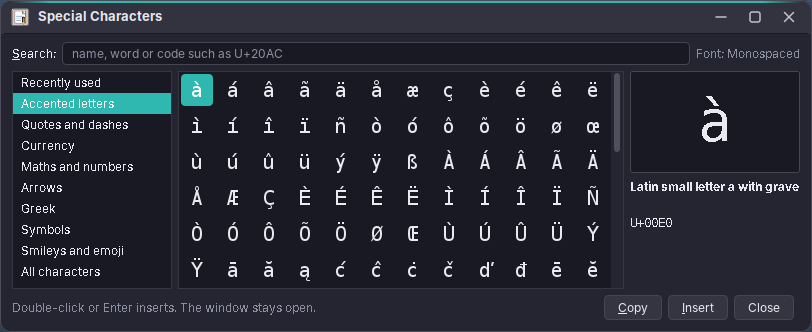
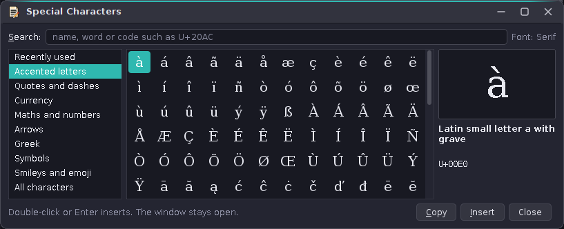
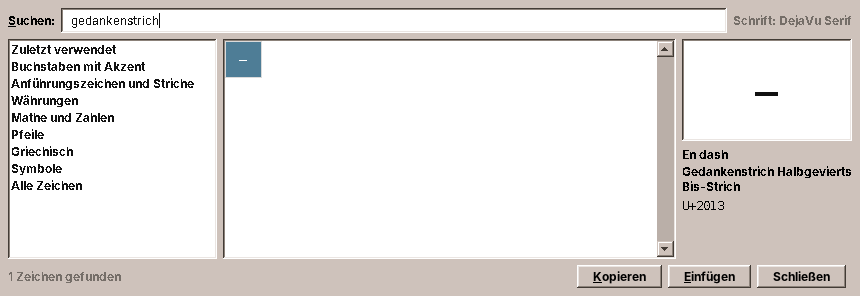

# 49. Special Characters

A keyboard has room for the letters of one language. Everything else, the € on an English keyboard, the „German quotes“ on a French one, the en dash, the °, the ½, the é in a name, has to come from somewhere. Every program that takes text therefore offers the same window: *Special Characters*, in the package `chars`. WritePad has it in its Insert menu, Pad in its Edit menu, Mail's compose window in its Format menu, and all three open it with **Ctrl+Shift+U**.



This chapter is a little different from the others in Part IV. The other parts of the library came from a program that needed them first. This one went straight into amade-commons, because three programs wanted it on the same day, and a window that looks different in every program is no help to anyone.

## The window

The window does four things.

- **Categories** on the left: *Recently used*, *Accented letters*, *Quotes and dashes*, *Currency*, *Maths and numbers*, *Arrows*, *Greek*, *Symbols*, and *All characters*, which is the whole of Unicode up to U+1FFFF without control, private and unassigned code points.
- **The grid** in the middle draws the characters in the font of the text they go into. A character that font lacks is drawn in Java's `Dialog` font, which falls back across the installed fonts, and the preview says so. The arrow keys, Page Up, Page Down, Home and End move through it, and the tooltip names the character.
- **The preview** on the right shows the selected character large, its Unicode name in sentence case, its usual name in the user's language if our word list has one, and its code.
- **The search** at the top has the cursor when the window opens. Enter in the search field inserts the first result, so *Ctrl+Shift+U*, `euro`, *Enter* types € without touching the mouse.

A double-click, Enter or *Insert* puts the character at the cursor of the program, replacing a selection. The window stays open, because one special character rarely comes alone. *Copy* puts the character on the clipboard instead, and Escape closes the window.



The window follows the desktop's look like every other part of the library, because it is made of standard Swing components plus a grid that paints with `UIManager` colours. In Horizon the grid drops its lines and gets the rounded selection of the flat look (`HorizonUI.active()`, [chapter 42](42-look.md#the-flat-look-of-horizon-horizonui)).

## Using it: SpecialCharacters

*Package `chars` · introduced in this chapter for WritePad, Pad and Mail · source: [`SpecialCharacters`](https://github.com/amadeos-eu/amade-commons/blob/main/src/main/java/eu/amadeos/commons/chars/SpecialCharacters.java)*

**What it is for.** One line that gives a window the menu item, the key and a dialog that inserts into the window's text fields.

```java
--8<-- "amade-commons/src/main/java/eu/amadeos/commons/chars/SpecialCharacters.java:install"
```

WritePad passes its *Insert* menu, Pad its *Edit* menu, Mail's compose window its *Format* menu:

```java
SpecialCharacters.install(this, editMenu, locale);
```

The menu text comes from amade-commons in five languages, with its own menu letter: *Special C&haracters…*, *&Sonderzeichen…*, *Caractères &spéciaux…*. A program whose menu already uses that letter can set another with `Mnemonics.apply(item, …)` on the returned item ([chapter 43](43-languages.md#menu-letters-mnemonics)).

**The key.** Ctrl+Shift+U is the key GTK programs use to type a character by its code, so Linux users know it already. In amade programs it opens the window, and typing the code into its search field (`20ac`, *Enter*) does what GTK's key does.

```java
--8<-- "amade-commons/src/main/java/eu/amadeos/commons/chars/SpecialCharacters.java:key"
```

A program that already uses Ctrl+Shift+U in a window does not install the dialog in that window. Mail's main window has *View Source* on that key, so the dialog lives in the compose window, which is a window of its own.

**Where the character goes.** The dialog is not modal, so by the time the user double-clicks a character, the focus is in the dialog and not in the program. `SpecialCharacters` therefore remembers which editable text field of the window had the focus last. It listens to the `permanentFocusOwner` of the `KeyboardFocusManager` and keeps a weak reference to the field:

```java
--8<-- "amade-commons/src/main/java/eu/amadeos/commons/chars/SpecialCharacters.java:focus"
```

In Mail's compose window, that is the body, the subject or the To field, whichever the user was typing in. Fields of the program's own dialogs (a Find dialog, say) do not count, because their window is not the program's window, and neither do the editors of combo boxes and spinners: in WritePad, a click into the font size must not make the next € land there. When the window closes, the listener is removed and the dialog disposed, so the many compose windows of a long Mail session do not pile up.

If there is no field (nothing had the focus yet, or the field became read-only or was closed with its tab), the character goes to the clipboard and the status line says so:

```java
--8<-- "amade-commons/src/main/java/eu/amadeos/commons/chars/SpecialCharactersDialog.java:insert"
```

A program that creates its editor before the window is shown can name the field itself with `SpecialCharacters.setTarget(window, editor)`. A program whose text does not live in a `JTextComponent` hands the dialog a function instead. A terminal, for example, types the character into the shell:

```java
--8<-- "amade-commons/src/main/java/eu/amadeos/commons/chars/SpecialCharacters.java:open"
```

For a toolbar button or a context menu, `SpecialCharacters.action(window, locale)` gives the `Action` behind the menu item, with name and key. For a window without a fitting menu, `installKey(window, locale)` binds only the key.

**When to choose something else.** The dialog is for characters a person picks. A program that needs a fixed character (a bullet in a list, the € in a price) writes it into its own code or texts. And the dialog does not offer colour emoji: Java2D cannot draw the colour emoji fonts (their glyphs are bitmaps in `CBDT` tables), so they would show as empty boxes. The *Symbols* category has the black and white ones that DejaVu and FreeSerif draw: ★ ♥ ✓ ☀ ☂ ✈ ☺.

## The characters and the search: CharacterCatalog

*Package `chars` · source: [`CharacterCatalog`](https://github.com/amadeos-eu/amade-commons/blob/main/src/main/java/eu/amadeos/commons/chars/CharacterCatalog.java)*

**What it is for.** The data behind the window, without Swing: the categories, the word lists and the search. That makes the search easy to test, and a program could build a different picker on it.

The categories are strings of characters in the order a person looks for them, small letters before capitals, the common ones first:

```java
--8<-- "amade-commons/src/main/java/eu/amadeos/commons/chars/CharacterCatalog.java:categories"
```

**The search** understands three kinds of input:

```java
--8<-- "amade-commons/src/main/java/eu/amadeos/commons/chars/CharacterCatalog.java:search"
```

- **A code.** `U+20AC` and `0x20ac` give exactly that character. Four to six hex digits without a prefix (`2014`) put the character first and still search the words, because `face` and `cafe` are hex numbers too.
- **One letter.** `e` gives é è ê ë ē ė ę ě and the capitals. The search decomposes each Latin letter to NFD (`é` becomes `e` and a combining accent) and keeps the ones that start with the letter typed. A short list adds the letters Unicode does not decompose but people look for under their base letter: ø and œ under o, æ under a, ß under s, ł under l, đ and ð under d, þ under t.
- **Words.** Every word typed must start a word of the character's name. Case and accents do not matter, so `wahrung` finds *Währung*. `ash` does not find the dash, because it starts no word. Names come from two places: Java's `Character.getName` gives the English Unicode name of every character, and our own word list gives the usual names, in English and in the user's language.

**The word lists** are `words.properties`, `words_de.properties` and so on, next to the class. A key is a code point in hex, the value is words, the usual name first:

```properties
# words_de.properties
2013=Gedankenstrich Halbgeviertstrich Bis-Strich
20AC=Euro Währung
00A0=geschütztes Leerzeichen
```

They cover the eighty or so characters people search for most: umlauts and accents, all kinds of quotes, the dashes, the spaces, currency, the usual maths. English words always count, so `euro` works in every language, and the words of the user's language count too. A character that has words comes before one that only has a Unicode name, the categories' characters come next, the rest of Unicode last. There are at most 600 results.

In German, `gedankenstrich` finds the en dash, and the preview shows its German name under the English one:



**Adding a word** means adding a line to `words.properties` and to each translation. The test `everyCategoryHasATextInEveryLanguage` checks that every language has a word list.

**All of Unicode, fast enough.** *All characters* and the word search need every offered code point and its name. Building that list takes a moment (`Character.getName` for some 150,000 characters), so it is built once, in a background thread that `SpecialCharacters` starts the first time a window opens (`CharacterCatalog.warmUp()`), and kept in static arrays after that. The grid paints only its visible rows, so scrolling through all of Unicode costs no more than scrolling through the currency signs.

## Recently used: RecentCharacters

*Package `chars` · source: [`RecentCharacters`](https://github.com/amadeos-eu/amade-commons/blob/main/src/main/java/eu/amadeos/commons/chars/RecentCharacters.java)*

The characters inserted or copied last, newest first, at most 24, in `~/.config/amadeos/special-characters.properties`:

```properties
recent=20AC,2014,E4,201E,201C
```

The file belongs to the desktop, not to one program, so a character inserted in WritePad is the first one in Mail's window too. The list is read again whenever the window comes to the front, and written with `PropertiesFile` like every settings file ([chapter 44](44-settings.md#settings-files-propertiesfile)). While it is empty, the category shows a few common characters (ä ö ü ß € „ “ – — … ° ×), so the first look at the window is not an empty grid. If the home directory is read-only, inserting still works and the list just does not grow.

## Testing

`CharacterCatalogTest` checks the search without a screen: codes, words in English and German, letters with marks, that words must start a word, that every category has a text in every language, and the recent list in a temporary directory. `SpecialCharactersTest` needs a display (`xvfb-run`): it installs the menu item in German and checks its text and key, then searches for `euro` in the dialog, presses Enter in the search field and checks that `Preis: 49 ` became `Preis: 49 €` and that € leads the recent list.

## What uses it

| Program | Where | Into |
|---|---|---|
| WritePad | *Insert > Special Characters…* | the page |
| Pad | *Edit > Special Characters…* | the editor of the current tab |
| Mail | compose window, *Format > Special Characters…* | the body, the subject, To, Cc or Bcc, whichever had the cursor last |

The User's Handbook describes the window for users in chapter 40, *What all amade applications share*.
