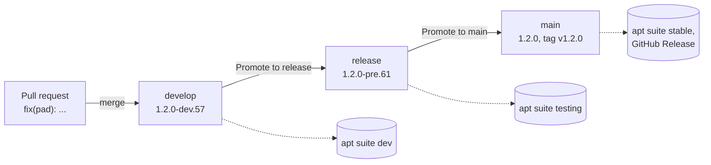

# 51. Versions and Releases

[Chapter 50](50-packaging.md) ended with a package that CI builds on every change. It also left a question open: which version does the package have? For a long time the answer was "0.1.0, always", written by hand into `build.gradle`. That is fine as long as the packages only reach users inside a new ISO image. It stops working when amadeOS gets updates from a package repository (ROADMAP M16), because apt offers an update only when the version number grows.

This chapter explains how the amadeOS repositories number their versions, how CI works out the number on its own, and how a change travels from your commit to a user's update. Nobody writes a version by hand any more. The pilot is amade-calculator ([chapter 24](24-calculator.md)), and amade-commons itself works the same way.

## The whole workflow in one picture



Every repository has three branches. Each one has a single job:

| Branch | What is on it | Builds | Who uses the builds |
|---|---|---|---|
| `develop` | All finished work. The default branch, so pull requests go here. | `1.2.0-dev.57` | Developers, testers who want the newest state |
| `release` | A frozen state of develop that is being tested | `1.2.0-pre.61` | QEMU and hardware tests before a release |
| `main` | What has been released | `1.2.0`, tag `v1.2.0`, GitHub Release | Everyone |

Nobody commits to `release` or `main`. A workflow called **Promote** moves them forward, and only forward: "promote to release" sets release to where develop is now, and "promote to main" sets main to where release is. These moves are *fast-forwards*. No new commit is made, the branch pointer just moves on. So the three branches always hold the same commits, only some are further ahead than others.

## Your change, step by step

Say you fix a bug in Pad, and the last release of amade-pad is 1.1.0.

1. **You commit** with a subject in the Conventional Commits form: `fix(pad): keep the cursor after Undo`. You open a pull request against `develop`. CI tests it, builds a package `1.1.1-dev.203` for you to try, and checks that every commit subject has the right form.
2. **The pull request is merged.** CI builds develop again: `amade-pad_1.1.1~dev.204_all.deb`. Once the apt repository exists, this lands in the suite `dev`.
3. **Promote to release.** When enough has come together, you run *Actions → Promote → Run workflow* in the amadeos-ci repository, with "to: release". release now holds your fix, and CI builds `1.1.1-pre.205`. This build goes into QEMU or onto a laptop for testing.
4. **Promote to main.** The tests pass, so you run Promote again, with "to: main". CI builds `1.1.1`, tags the commit `v1.1.1` and publishes a GitHub Release with release notes and the package. Users get the update.

If the test in step 3 finds a bug, fix it on develop and promote to release again. The next pre build carries the fix. Nothing is ever taken back from release.

## Commit messages decide the version

A commit subject has the form `type(scope): text`. The scope is optional and names the area of the change, in lower case. The type says what kind of change it is:

| Commit subject | Kind | Next version after 1.1.0 |
|---|---|---|
| `feat(panel): battery cell in the status slot` | new feature | 1.2.0 |
| `fix(wm): closing a dialog activates its owner` | bug fix | 1.1.1 |
| `perf(files): read folders in the background` | faster | 1.1.1 |
| `docs(handbook): chapter 51`, `refactor`, `test`, `build`, `ci`, `chore`, `style`, `revert` | everything else | 1.1.1 |
| `feat(settings)!: one file for all settings` | breaking change | 2.0.0 |
| any type, with a body line `BREAKING CHANGE: the old file is no longer read` | breaking change | 2.0.0 |

Since the last release, the biggest change wins. Ten fixes and one feature give 1.2.0, not 1.1.10. Merge commits do not count, because the commits they bring in are counted themselves.

What does "breaking" mean? For a library like amade-commons, it is a change that stops an existing application from compiling or working: a removed method, or a changed meaning. For an application, it is a change users have to adapt to: a file format the old version cannot read, a removed feature, or a changed command line. Most changes are not breaking. When you are unsure, it is not.

!!! tip "Tip: one change, one commit"
    The release notes are built from the commit subjects, so write them for the people who will read the notes. `fix(mail): attachments with umlauts in the name` helps a reader, `fix: stuff` does not. When a pull request does two things, make two commits.

## How the number is worked out

CI runs a small script from the repository [amadeos-ci](https://github.com/datazuul/amadeos-ci) at the start of every build. It finds the newest tag `vX.Y.Z`, reads the commits after it and applies the table above:

```bash title="amadeos-ci · scripts/next-version.sh"
--8<-- "amadeos-ci/scripts/next-version.sh"
```

- A repository without any tag starts at **1.0.0**. The commits from before the switch, which are not Conventional Commits, do not matter: the first release is 1.0.0 whatever they say.
- The suffix depends on the branch: `-dev.N` on develop and in pull requests, `-pre.N` on release, none on main. `N` is the number of the CI run (`GITHUB_RUN_NUMBER`), which only grows, so a later build always has a higher number.
- Builds on your own machine have no run number and become `-dev.0`, lower than any CI build of the same version.
- Only plain `vX.Y.Z` tags count as releases.

You can run it yourself in any repository, for example `../amadeos-ci/scripts/next-version.sh dev` in amade-calculator, to see what the next build would be called.

### Why Debian packages use ~ instead of -

SemVer and Debian sort pre-releases differently. In SemVer, `1.2.0-dev.57` comes before `1.2.0`. Debian reads the part after the last `-` as the *Debian revision* of the package, so for apt `1.2.0-dev.57` comes **after** `1.2.0`. A user who had a dev build would then never get the release. A tilde fixes this: in Debian, `~` sorts before everything, even before the end of the version.

```console
$ dpkg --compare-versions 1.2.0~dev.57 lt 1.2.0~pre.61 && echo yes
yes
$ dpkg --compare-versions 1.2.0~pre.61 lt 1.2.0 && echo yes
yes
$ dpkg --compare-versions 1.2.0-dev.57 lt 1.2.0 && echo yes
$
```

So the jar and the About dialog say `1.2.0-dev.57`, and the package says `1.2.0~dev.57`. `build.gradle` converts one into the other:

```groovy title="amade-calculator · build.gradle"
--8<-- "amade-calculator/build.gradle:version"
```

and uses `debVersion` in the control file and the file name of the package. CI passes the version as `-PappVersion`. Without it, a build on your machine is `0.0.0-dev.0`, and `buildDistribution.sh` passes `X.Y.Z-dev.0` from the script.

## What CI does on each branch

The build workflow of amade-calculator starts with the full history, because the script needs the tags and commits, and lets the `version` action of amadeos-ci work out the number:

```yaml title="amade-calculator · .github/workflows/build.yml (job test)"
--8<-- "amade-calculator/.github/workflows/build.yml:version"
```

The action decides the channel from the branch (develop gives `dev`, release gives `pre`, main gives `release`). It runs `next-version.sh` and gives the result to the later steps as `steps.version.outputs.version` and `deb-version`. The package step passes it on to Gradle:

```yaml title="amade-calculator · .github/workflows/build.yml (job test)"
--8<-- "amade-calculator/.github/workflows/build.yml:package"
```

After the tests and the package checks of chapter 50, a second job runs only for a release. It takes the package from the first job, creates the tag and publishes the GitHub Release:

```yaml title="amade-calculator · .github/workflows/build.yml"
--8<-- "amade-calculator/.github/workflows/build.yml:release"
```

The release action writes the release notes from the commits since the previous tag, grouped under "Breaking changes", "Features", "Fixes" and "Other changes". `ci`, `chore`, `test`, `style` and `build` commits are left out, because users don't care about them. When the tag already exists, the action does nothing, so a rebuild of a released commit cannot release twice.

A third job checks every pull request. A commit like `Pad: keep the cursor` fails it, with a message that shows the right form:

```yaml title="amade-calculator · .github/workflows/build.yml"
--8<-- "amade-calculator/.github/workflows/build.yml:commits"
```

To fix such a commit, rename it with `git rebase -i` and push with `--force-with-lease`. That is fine on your own pull request branch, never on develop.

| Event | Version | What happens |
|---|---|---|
| Pull request | `1.2.0-dev.N` | tests, package as a download, commit check |
| Push to develop (a merge) | `1.2.0-dev.N` | tests, package (later: apt suite `dev`) |
| Promote to release | `1.2.0-pre.N` | tests, package (later: apt suite `testing`) |
| Promote to main | `1.2.0` | tests, package, tag `v1.2.0`, GitHub Release (later: apt suite `stable`) |

!!! note "Until the release branches exist"
    A repository whose develop branch has not been created yet still merges pull requests into main. As long as there is no develop, the version action treats main like develop and builds `-dev.N` versions without tagging anything. The first promotion to main after the one-time setup gives 1.0.0.

## What's new, in Software

Software shows what changed in each version when the AppStream metadata lists releases. Nobody keeps that list by hand either. The version action writes the `<releases>` of the metainfo file in the CI checkout, right before the package is built, so the list goes into the package and not into git. It lists the last ten release tags with their dates and changes:

```xml
<releases>
  <release version="1.2.0~dev.57" type="snapshot" date="2026-11-02">
    <description>
      <ul>
        <li>tape: copy the whole tape</li>
      </ul>
    </description>
  </release>
  <release version="1.1.0" type="stable" date="2026-10-28">
    ...
```

A dev build gets an extra entry of type `snapshot` at the top, and a pre build one of type `development`. The workflow then runs `appstreamcli validate` on the result.

## Libraries and their pins

Apps and games pin amade-commons and amade-game-engine by commit hash on JitPack (chapter 0). A release tag of a library is a JitPack version too: `com.github.datazuul:amade-commons:v1.2.0`. Two rules keep this simple:

- **On develop, pin whatever you need.** An app that needs a new commons method pins the commons commit that has it, as before. Cross-repository work does not have to wait for a release.
- **Before main, pin a release.** Promote refuses to move an app to main when its pin is a commit that no release of the library contains. Release the library first, then raise the pin to its tag, for example `build(deps): amade-commons v1.2.0`. Promote handles the libraries first and waits until their tag exists.

Code excerpts in the handbooks are pinned to commits too, in `handbook.yml`. A fast-forward promotion keeps every commit, so these pins stay valid on all three branches. Merge pull requests with a merge commit, not by squashing, so that the commits a chapter pins reach develop unchanged.

## Promoting

Promote runs in the amadeos-ci repository, for all repositories at once or for a list of them:

- *Actions → Promote → Run workflow*, with "to" set to `release` or `main` and "repositories" empty for all of `repositories.list` (libraries first) plus amadeos.
- Or on your own machine: `scripts/promote.sh release amade-calculator` in a checkout of amadeos-ci. It uses your own git credentials.

For each repository, the script checks that the move is a fast-forward and that the pins are releases (for main only). Then it pushes the branch, which starts the build there. Repositories without release branches are skipped. A ruleset on main and release blocks force pushes and deletion, and since a push that is not a fast-forward counts as a force push, GitHub itself makes sure these branches only move forward.

The workflow needs a token that may push to all the repositories, workflow files included. Pushes made with the built-in token of a workflow would also start no further workflows. So the token is a fine-grained personal access token of the owner, stored as the secret `PROMOTE_TOKEN`, with *Contents* and *Workflows* set to read and write, in the amadeos-ci repository only. [Setting it up once](#the-token-for-promote) shows how to create it.

### A hotfix that cannot wait

Sometimes release needs a fix while develop already holds half-finished work. Then branch from release, fix the bug, open the pull request against `release` and merge it. Promote to main as usual. Because main now has a commit that develop lacks, Promote merges main back into develop right away. The next promotion to release is a fast-forward again. Use this only when you have to: the normal path is always develop first.

## Setting it up once

### The token for Promote

The Promote workflow pushes branches in all the repositories, so it needs a token of the owner. A workflow reads it from a *secret*, which is a password stored in the repository. Nobody can read a secret back, not even the owner, and workflows only see it while they run. Creating the token and the secret takes a few minutes, once:

1. On github.com, signed in as the owner: profile picture → **Settings** → **Developer settings** (at the bottom left) → **Personal access tokens** → **Fine-grained tokens** → **Generate new token**.
2. Token name `amadeOS Promote`, an expiration date (one year, or none if GitHub offers that), resource owner **datazuul**.
3. Repository access: **All repositories**. A new game repository then works without changing the token.
4. Repository permissions: **Contents** *Read and write* and **Workflows** *Read and write*. GitHub adds *Metadata* read-only by itself. Everything else stays at *No access*.
5. **Generate token**, and copy it right away: GitHub shows it only once.
6. In the repository amadeos-ci: **Settings** → **Secrets and variables** → **Actions** → **New repository secret**, name `PROMOTE_TOKEN`, the token as the secret, **Add secret**.

The token goes nowhere else: not into a file, a chat or an issue. If it does leak, delete it under *Fine-grained tokens* and create a new one. When it expires, Promote stops with an authentication error. Then create a new token the same way and replace the secret, under the same name.

!!! note "Why not the workflow's own token?"
    Every workflow run gets a token of its own, `GITHUB_TOKEN`, but it may only write to the repository the workflow runs in. It also may not push commits that change files under `.github/workflows`, and pushes made with it start no further workflows. Promote needs all three, so it uses the owner's token.

### The release branches

Each repository needs a one-time setup, which the owner does with the GitHub CLI (`gh auth login` first):

```console
$ cd amadeos-ci
$ scripts/setup-release-branches.sh                       # all repositories
$ scripts/setup-release-branches.sh amade-calculator      # or just some
```

The script creates develop and release at the current main, makes develop the default branch and adds the ruleset. It skips repositories that have develop already, so it can run again. Merge open pull requests first, or change their base branch to develop afterwards.

Then, per repository, the build workflow gets the version, release and commit jobs shown above, and `build.gradle` gets `appVersion` and `debVersion`. amade-calculator and amade-commons were the first. A new program starts with them from day one: add them to the checklist of [chapter 50](50-packaging.md#checklist-for-a-new-program).

## When you want to...

| ... | do this |
|---|---|
| ship a bug fix | `fix(scope): ...`, pull request to develop, merge, then promote to release and to main |
| add a feature | `feat(scope): ...`; the next release raises the minor version |
| know the next version | `../amadeos-ci/scripts/next-version.sh release` in the repository |
| try the newest state | install the package of the latest develop build (Actions → Build → artifacts) |
| test before a release | promote to release, test the `-pre` build in QEMU |
| release everything | Promote to main with "repositories" empty |
| use a new commons method in an app | pin the commons commit on develop; release commons and pin its tag before the app goes to main |
| fix a commit message in your pull request | `git rebase -i`, reword, `git push --force-with-lease` |
| mark a breaking change | `feat(scope)!: ...` or a `BREAKING CHANGE:` line in the body |

## Exercises

1. **Predict the version.** Since `v1.3.2` there are the commits `docs(handbook): typo`, `fix(tape): empty lines`, `feat(keys): Ctrl+Backspace` and a merge commit. Which version does main get? And which version does the third build on release before it get, if the run number is 88? Check your answers with a throwaway repository and `next-version.sh`.
2. **A changelog file.** Debian packages usually ship `/usr/share/doc/<package>/changelog.gz`. Let the deb task write one from `release-notes.sh`, with an entry for every release tag. What does `lintian` say before and after?
3. **The channel in About.** Show "development build" or "test build" next to the version in the About dialog when the version has a `-dev` or `-pre` suffix.
4. **A second hotfix.** Two hotfixes go into release one after the other, and you promote to main after each. Draw the three branches after each step. When does Promote merge main back into develop, and why can the next promotion from develop to release still be a fast-forward?

## Summary

- Versions follow Semantic Versioning and start at 1.0.0. CI works them out from the Conventional Commits since the last tag: `!` or `BREAKING CHANGE` raises the major version, `feat` the minor version, anything else the patch version.
- develop builds `X.Y.Z-dev.N`, release builds `X.Y.Z-pre.N`, and main builds `X.Y.Z` with a tag and a GitHub Release. Debian packages use `~` instead of `-`, so apt moves from dev builds to pre builds to the release.
- Pull requests go to develop. release and main only move forward, by fast-forward, through the Promote workflow, so all three branches hold the same commits and the pins stay valid.
- The metainfo releases and the release notes come from the commit subjects, so write them for users.
- Libraries are released first. An app goes to main only with a released library pin.
