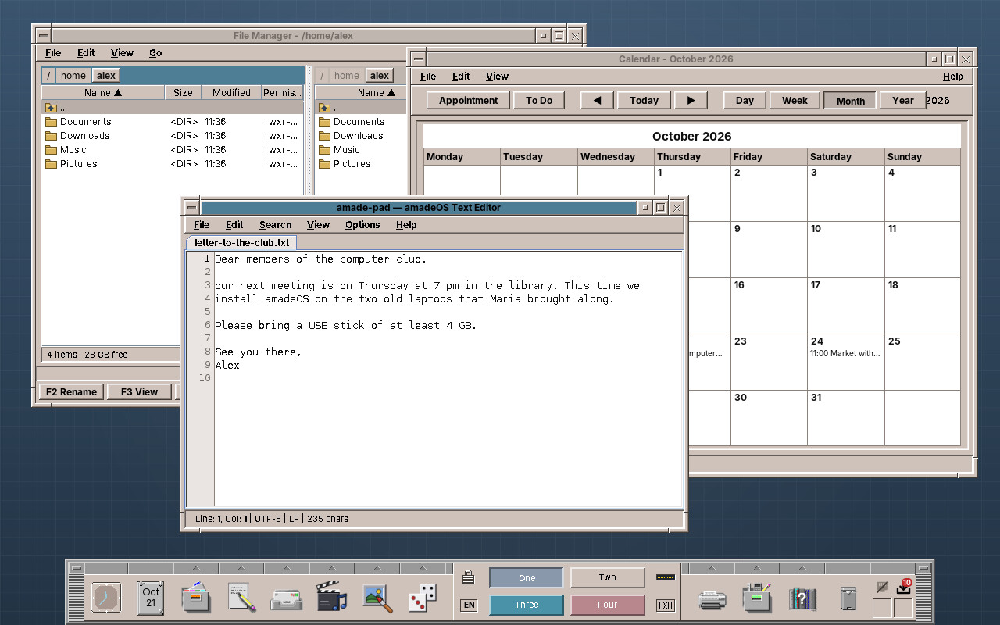
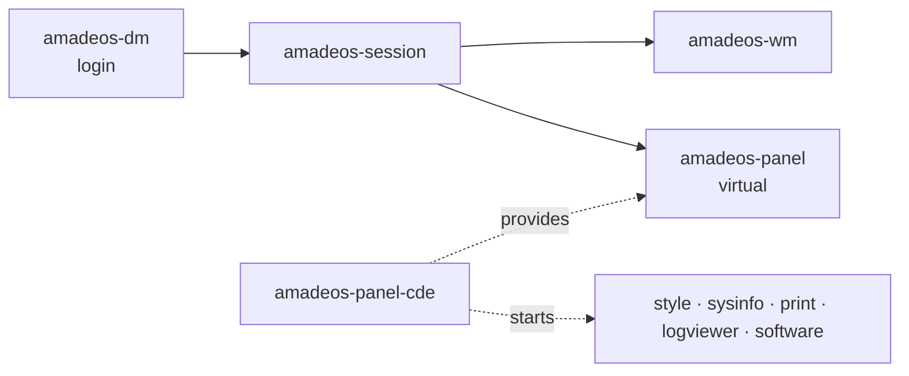

# 60. The Desktop and Its Modules

The applications of this book run on a desktop, and the desktop is Java too: the window manager that draws the frames, the Front Panel at the bottom of the screen, the login screen, the screen lock, Settings and the small tools around them. Part VI looks at that side. This chapter is the map: which modules there are, how they start one another, which of them use amade-commons and how, and how to run them on your own computer. The chapters after it build on that map. They take the smallest tool step by step (System Information), then Settings, the Front Panel, the Software program, the clipboard manager and the window manager's Alt+Tab switcher, and end with a checklist for writing a module of your own.



## What you will learn

- How the desktop is cut into modules and Debian packages, and what each one does.
- The two kinds of module: desktop modules that talk to X11 directly, and tool programs built like the applications of this book.
- Which parts of amade-commons the desktop shares with the applications, and which it does not.
- How the desktop and the applications agree on the theme and the language without knowing each other.
- How to run a module without installing it.

## One repository, one package per module

The desktop lives in the repository [amadeos-system](https://github.com/datazuul/amadeos-system), a Gradle multi-project with one module and one Debian package per component. The applications (Pad, Files, Mail, ...) keep their repositories, and the [amadeos](https://github.com/datazuul/amadeos) repository builds the live image from all packages.

| Module | Package | What it is |
|---|---|---|
| `base` | in every desktop package | The library under the desktop modules: Xlib, PAM and libc through JNA, the EWMH helper, desktop entries, icons and backdrops, launching programs |
| `wm` | `amadeos-wm` | The window manager: Motif frames, four workspaces, the root menu, the Alt+Tab switcher ([chapter 66](66-window-switcher.md)) |
| `panel-cde` | `amadeos-panel-cde` | The CDE Front Panel: clock, calendar, workspace switch, drawers of applications, network and updates cells |
| `dm` | `amadeos-dm` | The display manager: starts Xorg and the login greeter, authenticates through PAM, starts the session |
| `session` | `amadeos-session` | The session (window manager, autostart, panel), the screen lock, the screen saver, the polkit agent, the clipboard manager ([chapter 65](65-clipboard.md)) |
| `settings` | `amadeos-settings` | Settings, formerly the Style Manager: Color, Font, Backdrop, Keyboard, Mouse, Beep, Screen, Window, Clipboard |
| `logviewer` | `amadeos-logviewer` | Session diagnostics and logs |
| `print` | `amadeos-print` | The print manager: printers and jobs over IPP |
| `sysinfo` | `amadeos-sysinfo` | System information on one page |
| `packages` | `amadeos-packages` | The one place that talks to apt, with a root helper |
| `software` | `amadeos-software` | Software: find, install, update and remove programs |

The packages depend on each other the way the desktop starts: `amadeos-dm` depends on `amadeos-session`, which depends on `amadeos-wm` and on `amadeos-panel`. That last one is a *virtual* package: `amadeos-panel-cde` provides it and registers `/usr/bin/amadeos-panel` as an alternative. A second panel, say a task bar, could provide it the same way and take the Front Panel's place. The window manager knows no panel by name; any window of type `_NET_WM_WINDOW_TYPE_DOCK` is treated as the panel ([chapter 63](63-front-panel.md#a-window-that-is-a-dock)).



## Two kinds of module

Look at the `build.gradle` of the repository, and you find the modules split in two:

```groovy title="amadeos-system · build.gradle"
--8<-- "amadeos-system/build.gradle:desktop-modules"
```

**Desktop modules** (`wm`, `panel-cde`, `dm`, `session`, `style`, `logviewer`) are the desktop itself. They run before or around everything else, talk to the X server directly through JNA, and log through `java.util.logging`, so that their logs end up in the session log the log viewer shows. They do not use amade-commons' Guice start-up, and the build removes Guice from them altogether:

```groovy title="amadeos-system · build.gradle"
--8<-- "amadeos-system/build.gradle:desktop-config"
```

**Tool programs** (`sysinfo`, `print`, `software`) are ordinary programs that the panel starts. They are built exactly like the applications of this book: `AmadeApplication.launch`, a Guice module, Model-View-Presenter, texts in five languages. [Chapter 61](61-system-information.md) builds the smallest of them step by step.

Why not one style for all? A window manager cannot wait for Swing to start before it manages windows, a login greeter runs before any user's settings exist, and a panel must be on the screen within a second of logging in. They start with `main`, open their X connection and go. A tool program is opened by a user who waits for a window, and gains more from the shared start-up, wiring and languages than it loses.

## What the desktop takes from amade-commons

Every module, desktop or tool, depends on amade-commons. The desktop modules take the look (`DesktopTheme`, `ThemeRegistry`, `ThemeStore`, `AmadeUI`) and, where they show text, the languages. The tool programs take the whole start-up, like any application.

| Module | Uses from amade-commons |
|---|---|
| `base` | `DesktopTheme`, `ThemeRegistry`, `ThemeStore`, `AmadeUI`, `LocaleResolution`, `Messages` |
| `wm` | `DesktopTheme`, `AmadeUI` |
| `panel-cde` | `DesktopTheme`, `AmadeUI`, `Language`, `LocaleResolution`, `LocaleStore`, `Messages` |
| `dm` | `DesktopTheme`, `Language`, `LocaleResolution`, `LocaleStore` |
| `session` | `DesktopTheme`, `AmadeUI`, `ThemeStore`, `PropertiesFile`, `LocaleResolution`, `Messages` |
| `style` | `DesktopTheme`, `AmadeUI`, `PropertiesFile`, `LocaleResolution`, `LocaleStore`, `Messages`, `Mnemonics` |
| `logviewer` | `DesktopTheme` |
| `sysinfo` | `AmadeApplication`, `AppInfo`, `EdtExecutor`, `Messages`, `Mnemonics`, `CommandRunner` |
| `print`, `software` | `AmadeApplication`, `AppInfo`, `EdtExecutor`, `DesktopLauncher`, `Messages`, `Mnemonics` |

The repository pins amade-commons to a commit, like every application, and builds a checkout next to it instead when there is one (`settings.gradle`). [Chapter 61](61-system-information.md#a-time-limit-that-holds) re-pins it, because System Information becomes the next user of `CommandRunner`.

!!! note "Base is the desktop's own library"
    `base` holds what several desktop modules share and no application needs: JNA bindings for Xlib, Xss, Xkb, PAM and libc, the EWMH helper, desktop entries and categories, the icon theme lookup, backdrops, `ProcessLauncher`, the session dialogs and the network service. It has `XdgDirectories` and `LaunchFeedback` of its own, older than amade-commons' and built on JNA instead of the foreign function API. The rule of the book applies here too: a part moves into amade-commons when an application needs it, not before.

## Who writes, who follows

The desktop and the applications never call each other. They agree through files and X11 properties:

| What | Written by | Followed by |
|---|---|---|
| The theme, `~/.config/amadeos/theme.conf`, `icon_theme.conf` and `font.conf` | Settings, through `ThemeManager` in `base` | every application (`ThemeStore`), the panel and the window manager |
| The theme as the root window property `_AMADEOS_THEME` | Settings | panel and window manager, which poll it |
| The language, `~/.config/amadeos/locale.conf` | login greeter (through the session) and the panel's language button | every application at start (`LocaleStore`), the panel |
| "A program is starting", the X11 message `_AMADEOS_LAUNCH` | panel, Files, every `DesktopLauncher` | window manager, which shows the busy cursor |
| The panel, a window of type `_NET_WM_WINDOW_TYPE_DOCK` with a strut | panel | window manager, which keeps it above the others and out of the way |
| The installed applications, `/usr/share/applications/*.desktop` | each package | panel drawers, Software |

That is why the applications of this book follow Settings without a line of code ([chapter 42](42-look.md#following-the-desktop-themestore)): Settings writes the same files `ThemeStore` watches. [Chapter 62](62-settings.md) shows the writing side.

## Running a module

You do not need amadeOS to work on the desktop. Every module runs from the build:

```sh
./gradlew :sysinfo:run          # a tool program, in any desktop
./gradlew :settings:run         # Settings; it writes your real ~/.config/amadeos/theme.conf
./gradlew :panel-cde:run        # the Front Panel on your current desktop
wm/run-xephyr.sh                # window manager and panel in a nested X server
dm/run-greeter.sh               # the login greeter in a nested X server (user amadeos, password amadeos)
```

The nested X server, Xephyr, is a window on your desktop that behaves like a screen of its own. A window manager can take it over without touching your real desktop, which is the only safe way to try one. `./gradlew deb` builds the packages, and `./gradlew :sysinfo:installToAmadeOs` puts one where the image build finds it ([chapter 50](50-packaging.md#into-the-amadeos-image)).

!!! warning "Pitfall: Settings writes your settings"
    Settings from the build writes `~/.config/amadeos/theme.conf` like the installed one. On your own desktop that is harmless: your amade applications switch colours. Run it with another home (`HOME=/tmp/try ./gradlew :settings:run`) to keep your settings out of the experiment.

## Summary

- The desktop is one repository with a module and a Debian package per component. The packages depend on each other in the order the desktop starts, with a virtual package for the panel.
- Desktop modules talk to X11 directly, start without Guice and log through `java.util.logging`. Tool programs are built like the applications of this book.
- Both use amade-commons for the look. The tool programs use its start-up, texts and helpers as well.
- The desktop and the applications never call each other. They agree through the files in `~/.config/amadeos`, X11 properties and messages, and desktop entries.
