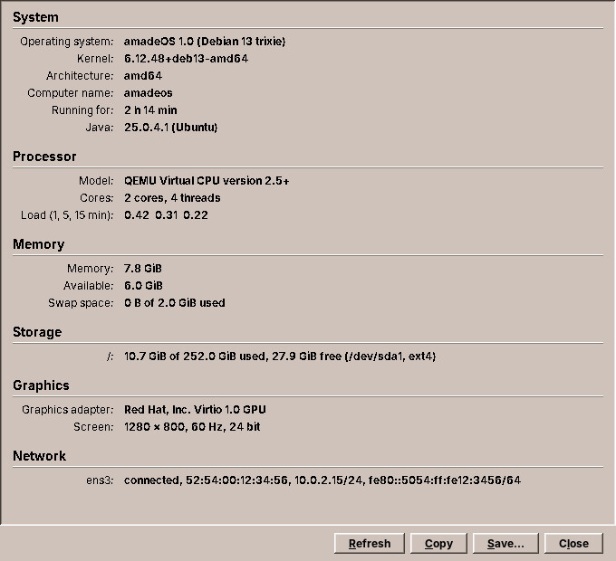

# 61. System Information

The smallest tool program of the desktop shows what is inside the computer: the operating system, processor, memory, disks, graphics, network and battery, on one page that can be copied or saved as text. It sits in the Front Panel's Tools drawer as *Hardware & System Info*. It is small enough to read in one sitting, and it has every part a desktop module needs, so this chapter goes through it from `main` to the Debian package. At the end it gets one improvement: the command it runs gets a time limit that holds.



## What you will learn

- The parts of a tool program, from the start-up to the desktop entry.
- Reading Linux's own files (`/proc`, `/etc/os-release`) so that tests need no real system.
- Keeping the sources of information behind an interface.
- Using `CommandRunner` from amade-commons in a program that runs another one.

## Start-up and wiring

A tool program starts like every application of this book ([chapter 41](41-start-up.md#starting-a-program-amadeapplication)):

```java title="amadeos-system · sysinfo/bootstrap/AmadeSysinfoApplication.java"
--8<-- "amadeos-system/sysinfo/src/main/java/eu/amadeos/system/sysinfo/bootstrap/AmadeSysinfoApplication.java"
```

The `AppInfo` names it `amadeos-sysinfo` for the system, *System Information* for people and `sysinfo` for its directory below `~/.config/amadeos`. The module binds the texts and the one service the window needs:

```java title="amadeos-system · sysinfo/bootstrap/SysinfoModule.java"
--8<-- "amadeos-system/sysinfo/src/main/java/eu/amadeos/system/sysinfo/bootstrap/SysinfoModule.java"
```

The background executor, the `EdtExecutor`, the theme and the language come from `CommonsModule`. The window asks for them in its constructor.

## The report

What the page shows is a record of sections and items, with every text already translated:

```java title="amadeos-system · sysinfo/domain/Report.java"
--8<-- "amadeos-system/sysinfo/src/main/java/eu/amadeos/system/sysinfo/domain/Report.java"
```

The window draws it as a column of headings and aligned label and value pairs, and `toText` turns the same record into plain text for *Copy* and *Save…*. One record, two views: the text cannot say something the page does not.

## Linux's own files

Most of the information is in files. Linux describes itself in `/proc` (the processor, the memory, the mounted disks, the time since boot) and the distribution in `/etc/os-release`. These are text files with simple formats, and `SystemFiles` has a parser for each, as pure functions from text to values:

```java title="amadeos-system · sysinfo/service/SystemFiles.java"
--8<-- "amadeos-system/sysinfo/src/main/java/eu/amadeos/system/sysinfo/service/SystemFiles.java:meminfo"
```

Pure functions are easy to test with the text of a real file pasted into the test, including the odd ones: a virtual machine that leaves out the core ids, a mount point with a blank in it (`/media/user/My\040Disk`), a live system whose root is an overlay.

`SystemProbe` puts the parsed values into the report. It reads the files below a `root` directory, `/` on a real computer and a temporary folder in tests, so a test writes `etc/os-release` and `proc/meminfo` and checks the page that results:

```java title="amadeos-system · sysinfo/service/SystemProbe.java"
--8<-- "amadeos-system/sysinfo/src/main/java/eu/amadeos/system/sysinfo/service/SystemProbe.java:memory"
```

Every value has a fallback. A file that is missing or unreadable gives *unknown* or leaves a line out, never an exception: System Information runs in containers, virtual machines and on hardware nobody tested, and a half-filled page is still useful.

## Sources that are not files

Three things do not come from files: the graphics card (from the command `lspci`), the network interfaces (from the JDK) and the screens (from AWT). They are behind an interface:

```java title="amadeos-system · sysinfo/service/SystemProbe.java"
--8<-- "amadeos-system/sysinfo/src/main/java/eu/amadeos/system/sysinfo/service/SystemProbe.java:sources"
```

`LocalSources` is the real one. Tests use an anonymous class that returns a graphics card, an interface and a screen, so the whole report is tested without `lspci`, a network or a display.

## The window

The window collects the report on the background executor and shows it on the EDT, with *Refresh* off meanwhile ([chapter 41](41-start-up.md#two-threads-edtexecutor-and-ui)):

```java title="amadeos-system · sysinfo/ui/MainWindow.java"
--8<-- "amadeos-system/sysinfo/src/main/java/eu/amadeos/system/sysinfo/ui/MainWindow.java:load"
```

There is no presenter here. The window has one action that does work, and that action is the four lines above. When a window grows a second or third action with logic of its own, that is the moment to move them into a presenter and test it, as [chapter 11](11-web.md#where-is-the-presenter) discusses for Web.

## A time limit that holds

`lspci` usually answers in a fraction of a second. `LocalSources` gave it five seconds, but its old code read the output first and only then waited with the time limit:

```java
Process process = new ProcessBuilder(command).redirectError(ProcessBuilder.Redirect.DISCARD).start();
byte[] output = process.getInputStream().readAllBytes();      // waits for the end of the output
if (!process.waitFor(5, TimeUnit.SECONDS)) { ... }            // too late
```

`readAllBytes` returns when the program closes its output, which is when it ends. A `lspci` that hangs without printing anything, on a broken PCI bus or a slow virtual machine, keeps the page at *Collecting the information…* forever, and the time limit is never reached. It is the bug [chapter 31](31-imagescan.md#the-command-runner-moves-into-amade-commons) found in Audio's runner, and the reason `CommandRunner` in amade-commons reads and waits at the same time. System Information becomes its next user:

```java title="amadeos-system · sysinfo/service/LocalSources.java"
--8<-- "amadeos-system/sysinfo/src/main/java/eu/amadeos/system/sysinfo/service/LocalSources.java:run"
```

`output` gives the standard output of a program that succeeded and throws an `IOException` with the program's own message otherwise. A program that is not installed is a `ProgramMissingException`. For System Information each of these means the same thing, *no answer*, so `run` turns all of them into an empty `Optional` and the page leaves the graphics line out. The module passes `CommandRunner.system()`, and the test answers with `FinishedProcess`:

```java title="amadeos-system · test/sysinfo/service/LocalSourcesTest.java"
--8<-- "amadeos-system/sysinfo/src/test/java/eu/amadeos/system/sysinfo/service/LocalSourcesTest.java:answers"
```

Using `CommandRunner` needed a newer amade-commons than the repository had. Its `build.gradle` pinned a commit from before the `process` package, so the pin moved to the current one for all modules at once. They all compile against it, because the 26 commits in between added packages and changed none of the theme, look and settings classes the desktop modules use.

## Five languages

The texts are in `sysinfo/src/main/resources/eu/amadeos/system/sysinfo/messages*.properties`, in the five languages, with the buttons' menu letters marked by `&`. Sizes are formatted in the user's locale and in binary units (`7,8 GiB` in German), and `TranslationCheck` keeps the translations complete ([chapter 43](43-languages.md#a-test-for-every-translation-translationcheck)).

## The package

A module's `build.gradle` gives the main class and the `debian` block. Everything else, the fat jar, the launcher in `/usr/bin` and the package, comes from the repository's shared build:

```groovy title="amadeos-system · sysinfo/build.gradle"
--8<-- "amadeos-system/sysinfo/build.gradle"
```

`recommends` installs `pciutils` with it when apt installs recommended packages, which Debian does by default; without `lspci` the graphics line is simply missing. `conflicts` and `replaces` take over from the package's old name.

The desktop entry puts it into the Front Panel. `Categories=System;Monitor;` sends it to the Tools drawer, where the panel also has a fixed entry for it ([chapter 63](63-front-panel.md#drawers-from-desktop-entries)):

```ini title="amadeos-system · sysinfo/packaging/amadeos-sysinfo.desktop"
--8<-- "amadeos-system/sysinfo/packaging/amadeos-sysinfo.desktop"
```

## Exercises

1. **Sound cards.** Add a section with the sound cards from `/proc/asound/cards`. Write the parser in `SystemFiles` first, with the text of a real file in its test.
2. **Temperatures.** Read `/sys/class/thermal/thermal_zone*/temp` (millidegrees). Where does the formatting go, and what does the page show in a virtual machine that has no thermal zones?
3. **A slow source.** Make the test's `lspci` sleep for ten seconds through a `CommandRunner` that returns a process which never ends. What does the page show after five seconds?

## Summary

- A tool program is an application: `AmadeApplication`, a Guice module, the background executor and the EDT, texts in five languages, a Debian package and a desktop entry.
- Linux's own files are parsed by pure functions, read below a root directory that tests replace.
- Sources that are not files sit behind an interface, so the whole report is tested without the hardware.
- System Information now runs `lspci` through `CommandRunner`, whose time limit holds even for a program that prints nothing.
