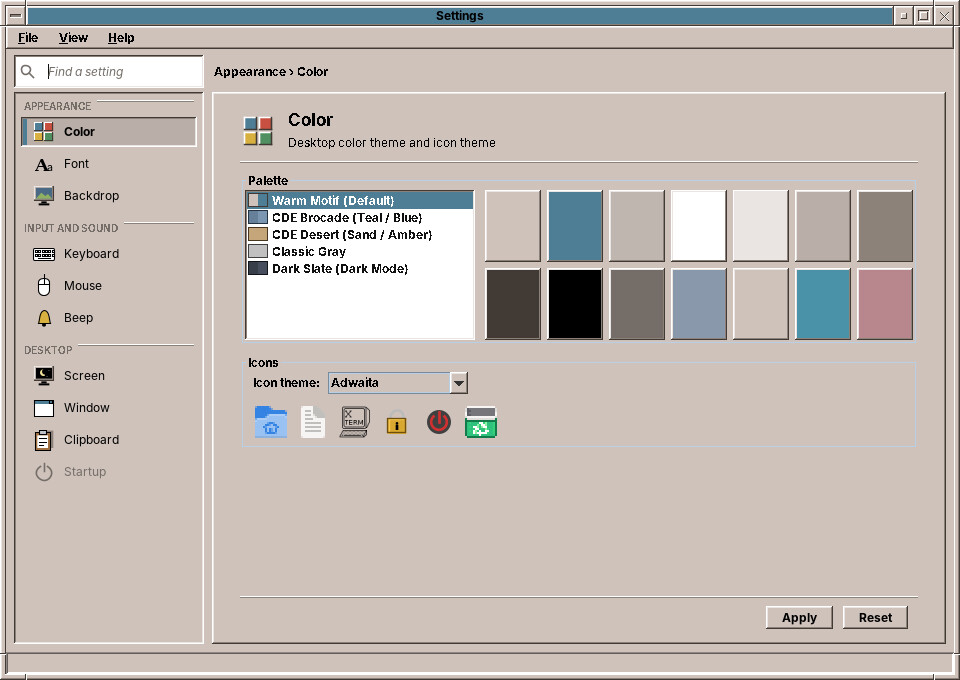
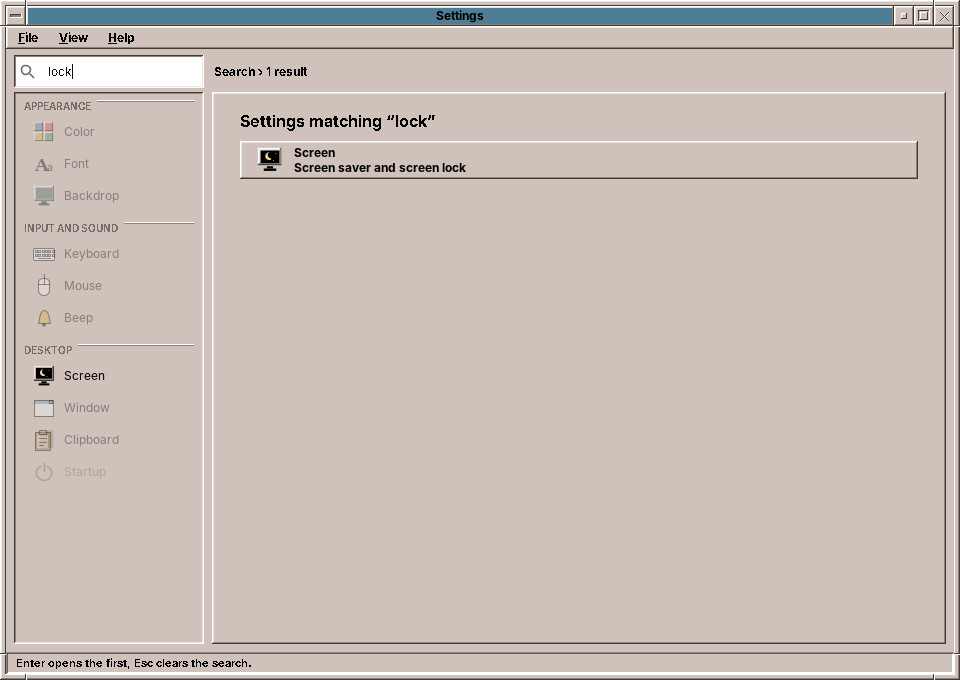
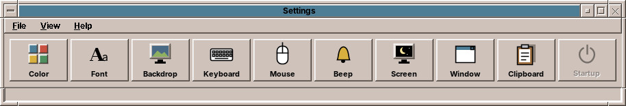
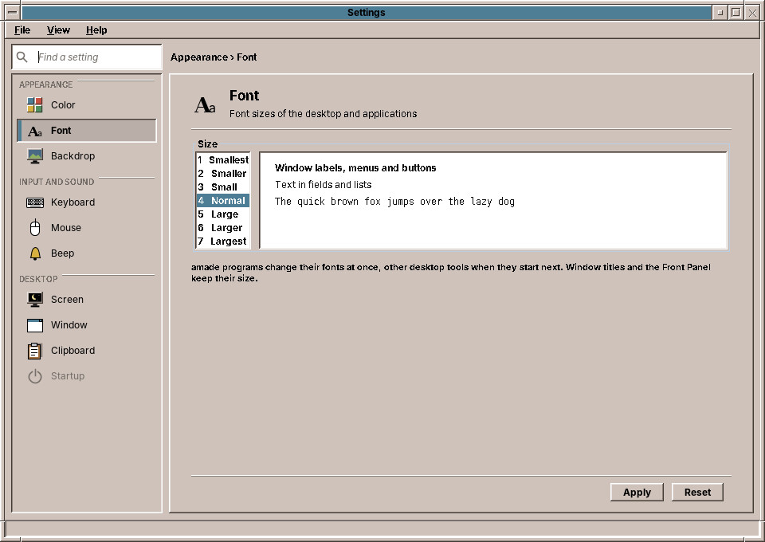
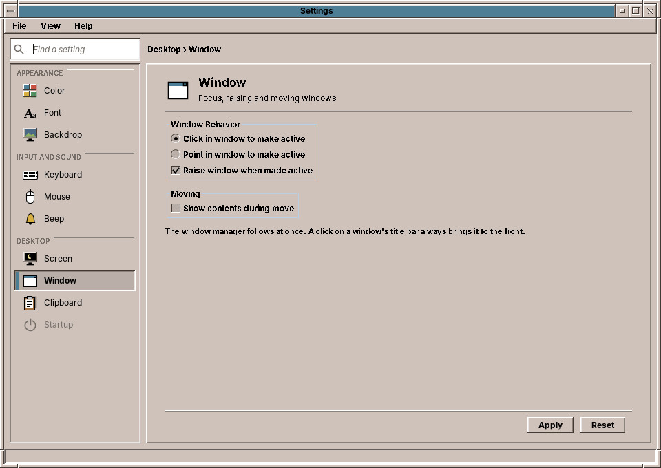
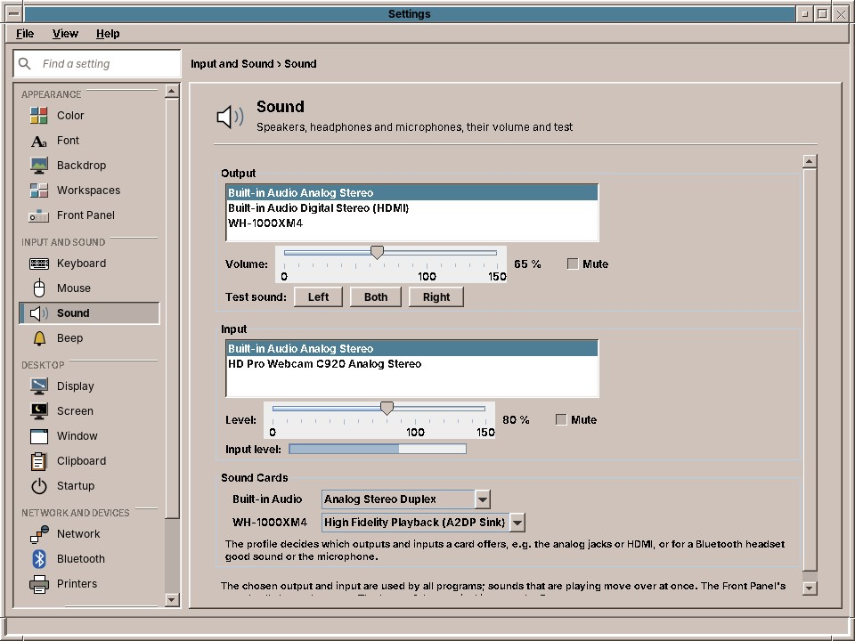
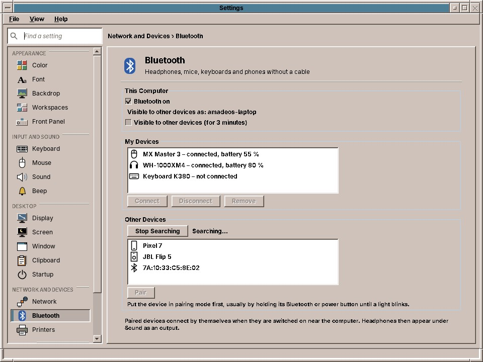
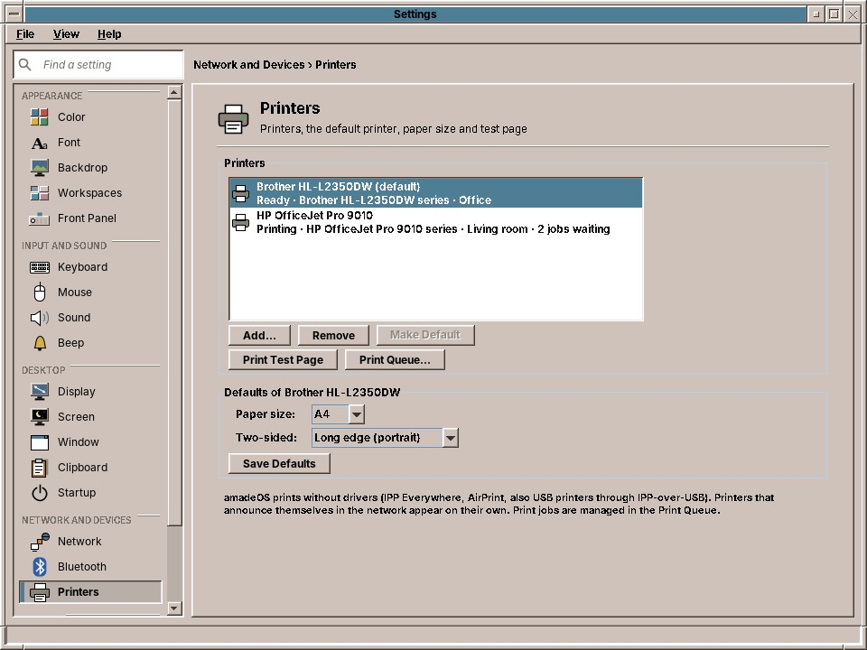

# 62. Settings

Every application of this book follows the desktop theme ([chapter 42](42-look.md#following-the-desktop-themestore)). This chapter is the other end: Settings, amadeOS's successor of CDE's Style Manager (dtstyle), where the user picks the theme, the text size, the backdrop, the workspace names and the Front Panel, keyboard, mouse, bell, the resolution and arrangement of the monitors, screen saver, window behaviour, clipboard and what starts at login, the network, Bluetooth, the printers and the sound devices, and, for the system, the keyring, the updates, the language and the time zone. It is a desktop module, so it starts without Guice and talks to X11. It writes the files the applications and the window manager follow, and it applies some settings by running the X server's own tools.



## What you will learn

- How one window offers a sidebar with a search and, for CDE users, the old row of buttons, from the same pages.
- How the desktop writes the theme and the text size that `ThemeStore` reads in every application, and why it writes atomically.
- How the window manager and the panel hear about a new theme without watching files, and how the window manager follows `window.conf`.
- Applying input settings with `xset`, `xmodmap` and `xrdb`, from pure functions that tests can check.
- Changing the resolution with `xrandr` safely, with a countdown back to the old layout, and how the desktop follows a new screen size.
- How pages that reach the keyring, the package manager and the time zone stay testable, and how a user switches off a service of the system without touching a file of a package.
- Pages that act at once on NetworkManager, PipeWire, BlueZ and CUPS, and a Bluetooth pairing agent of your own over D-Bus.

## Pages, a sidebar and a search

CDE's Style Manager was a row of buttons, each opening a small dialog. That works for a handful of controls, and amadeOS has more of them every release, so Settings shows them in a sidebar in five groups, *Appearance*, *Input and Sound*, *Desktop*, *Network and Devices* and *System*, with the page of the selected control on the right. The controls are an enum, `SettingsCategory`, in CDE's order; each knows its group, whether amadeOS has it yet (a control that is not ready is shown dimmed with a tooltip) and the words a search finds it by:

```java title="amadeos-system · settings/SettingsCategory.java"
--8<-- "amadeos-system/settings/src/main/java/eu/amadeos/system/settings/SettingsCategory.java"
```

The keywords are texts like any other, `category.screen.keywords=screen saver, lock, password, idle, blank`, so a German user finds *Bildschirm* by *Sperre*. Typing into the search field (or ++ctrl+f++) dims the controls that do not match and lists the ones that do; ++enter++ opens the first, ++esc++ clears the search.



Each control is a `SettingsPage`, a panel with its controls and two methods: `apply()` saves and applies and returns a line for the status bar, `cancelled()` undoes a preview that was not applied (the screen saver, the bell, the font preview):

```java title="amadeos-system · settings/SettingsPage.java"
--8<-- "amadeos-system/settings/src/main/java/eu/amadeos/system/settings/SettingsPage.java"
```

An exception from `apply` becomes a status line instead of a crash, and the page stays as it is, so the user can correct the value. The window puts a page into a frame of its own: a heading with the control's icon, name and description, the page in a scroll pane, and *Apply* and *Reset* below. Pages are created the first time they are shown and kept, so changes that were not applied wait on their page while the user looks at another one; *Reset* throws the page away and builds it anew from the saved settings.

```java title="amadeos-system · settings/SettingsWindow.java"
--8<-- "amadeos-system/settings/src/main/java/eu/amadeos/system/settings/SettingsWindow.java:page"
```

## The compact view

*View → Compact (CDE controls)* shows the row of CDE instead, built from the same enum:



```java title="amadeos-system · settings/SettingsWindow.java"
--8<-- "amadeos-system/settings/src/main/java/eu/amadeos/system/settings/SettingsWindow.java:compact"
```

A button opens the same page in a `ControlDialog` with CDE's three buttons: *OK* applies and closes, *Apply* applies and stays, *Cancel* and the window's close button call `cancelled()`. The pages do not know in which view they are. The chosen view is kept in `~/.config/amadeos/settings.conf`.

The jar has more entry points: `amadeos-settings mouse` opens the window at a control, and `amadeos-settings input` applies the keyboard, mouse and bell settings without a window; the session runs the latter at login from `/etc/amadeos/autostart.d/10-amadeos-input`, and `amadeos-settings display-apply` from `15-amadeos-display` (see *Display* below). The package was called `amadeos-style` before; it `Provides`, `Replaces` and `Conflicts` that name, so an update removes the old package, and a small script `/usr/bin/amadeos-style` still starts Settings.

## Writing the theme

The Color page (in the picture at the top) lists the themes with a swatch each, shows the selected palette as fourteen chips (base, title bars, bevel shades, text and the four workspace colours) and lets the user choose an icon theme with a preview of six icons.

On *Apply* it hands the theme to `ThemeManager` in `base`, the desktop's side of theming:

```java title="amadeos-system · settings/ColorPage.java"
--8<-- "amadeos-system/settings/src/main/java/eu/amadeos/system/settings/ColorPage.java:apply"
```

```java title="amadeos-system · base/theme/ThemeManager.java"
--8<-- "amadeos-system/base/src/main/java/eu/amadeos/system/base/theme/ThemeManager.java:apply"
```

`ThemeManager` uses the same `ThemeRegistry` as every application, so a custom theme in `~/.config/amadeos/themes` appears in the list too ([chapter 42](42-look.md#custom-themes-themeregistry)). It installs the theme into its own process with `AmadeUI.install`, clears the icon cache, writes the file and tells its listeners. The Settings window is such a listener; they restyle with `AmadeUI.apply`, like any application.

The file is written atomically, a temporary file renamed over the old one:

```java title="amadeos-system · base/theme/ThemeManager.java"
--8<-- "amadeos-system/base/src/main/java/eu/amadeos/system/base/theme/ThemeManager.java:persist"
```

That matters more here than anywhere else. A dozen programs watch `theme.conf` with a `ConfigWatcher` ([chapter 44](44-settings.md#following-a-file-configwatcher)), and each of them reads it within 150 ms of a change. A file written in place could be read while it holds half an id, and that program would fall back to Warm Motif while the others switch to Dark Slate. A rename is seen as one change from the old content to the new.

## Telling the desktop

The applications watch the file. The window manager and the panel learn it another way: `ColorPage.apply` also sets the property `_AMADEOS_THEME` on the X root window, and both poll that property. The panel reads it twice a second, together with the current workspace and the busy flag it needs anyway, and switches when the id differs from its own:

```java title="amadeos-system · panel-cde/AmadeDesktopPanel.java"
--8<-- "amadeos-system/panel-cde/src/main/java/eu/amadeos/system/panel/cde/AmadeDesktopPanel.java:poll"
```

Why two channels? The window manager and the panel are X11 programs that read root window properties anyway, for the workspace and the busy cursor, so one more property costs them nothing. The applications know nothing of X11 properties and rely on the file alone.

!!! note "Programs read, the desktop writes"
    `ThemeStore` in amade-commons has no method to write a theme, and `ThemeManager` in `base` has one. That split is the whole design: one program decides, everyone else follows ([chapter 42](42-look.md#following-the-desktop-themestore)).

## Keyboard, mouse and bell

Keyboard repeat and click, mouse handedness, double-click time and acceleration, and the bell are settings of the X server. Settings does not set them through Xlib calls. It runs the X server's standard tools from `x11-xserver-utils`, which every X desktop has: `xset` for repeat, click, acceleration and the bell, `xmodmap` for the button order of left-handed use, `xrdb` for the double-click time that X toolkits, AWT included, read at start.

The translation from settings to commands is a pure function, so tests check the command lines without an X server:

```java title="amadeos-system · settings/input/XCommands.java"
--8<-- "amadeos-system/settings/src/main/java/eu/amadeos/system/input/XCommands.java:keyboard"
```

`InputApplier` runs the commands and reports the ones that failed. The settings themselves are stored in `~/.config/amadeos/input.conf` with `PropertiesFile` from amade-commons ([chapter 44](44-settings.md#settings-files-propertiesfile)). A broken file gives the defaults, never an exception at login.

!!! tip "Tip: settings that survive a restart of the X server"
    Settings applied with `xset` live in the X server and are gone at the next login. That is why the session runs `amadeos-settings input` at every start: the file is the truth, the X server's state is a copy of it.

## Backdrop and screen

The **Backdrop** page paints the root window: an image (fill, fit, stretch, tile or centre), a plain colour, or one of CDE's pattern backdrops, X bitmaps coloured with the backdrop colour of the theme. `WallpaperManager` in `base` stores the choice in `~/.config/amadeos/wallpaper.conf` and exports the picture as the root pixmap, so that programs with transparent windows see it too.

As in CDE, each workspace can have a backdrop of its own. The page opens on the current workspace, which it reads from `_NET_CURRENT_DESKTOP`, and lists the four under the names the Front Panel published in `_NET_DESKTOP_NAMES` ([chapter 63](63-front-panel.md#workspace-names)), with *All workspaces* first. The file keeps the common backdrop as before (`wallpaper`, `mode`, `color`) and the same three keys under `workspace.2.` for each workspace with one of its own; `WallpaperManager.backdropOf(int)` returns a `Backdrop` record, falling back to the common one. Settings paints the root window only when the workspace it changed is the current one. The window manager does the rest at each switch: it reads the file anew, because Settings is another program, renders each backdrop once into a server pixmap and from then on only swaps pixmaps:

```java title="amadeos-system · wm/x11/X11WindowManagerService.java"
--8<-- "amadeos-system/wm/src/main/java/eu/amadeos/system/wm/x11/X11WindowManagerService.java:backdrop"
```

The `Backdrop` record is the key of the cache: when the user picks another picture, scaling or colour for a workspace, its record changes, the next switch renders the new one and the pixmap nobody uses any more is freed. *Refresh Desktop* in the root menu empties the cache, for a picture that changed on disk under the same name.

The **Screen** page sets the screen saver of the session module: which saver (Qix, Swarm, Starfield, Floating Logo, Blank), after how many minutes it starts and whether it locks. The page previews the chosen saver while it is shown, and *Test* runs it on the whole screen.

## Font: one number for every program

The *Font* page offers seven sizes, from *Smallest* to *Largest*, with a preview in the fonts of the look. *Apply* hands the number to `ThemeManager.applyFontSize`, which keeps it in the theme value, installs it in its own process and writes `~/.config/amadeos/font.conf` atomically, like the theme. Every program built on amade-commons reads the file with `ThemeStore` and scales the fonts of its look by the same factor ([chapter 42](42-look.md#text-size-fontscale)), so the change needs no code in the applications.



The window manager's title bars and the Front Panel keep their size on purpose: the panel's slots and the frames are drawn to a fixed grid, and the desktop around a larger text stays where the user knows it.

## Window: settings the window manager follows

The *Window* page sets CDE's window behaviour: whether a click or the pointer makes a window active, whether the active window comes to the front, and whether a moved window shows its contents or an outline.



The settings are a record in `base`, so that Settings and the window manager share it:

```java title="amadeos-system · base/window/WindowSettings.java"
--8<-- "amadeos-system/base/src/main/java/eu/amadeos/system/base/window/WindowSettings.java"
```

`WindowSettingsStore` reads and writes `~/.config/amadeos/window.conf` (`focus=click` or `pointer`, `raise.when.active`, `move.contents`), with the defaults for a missing or broken file. The window manager reads the store at start and follows the file with a `ConfigWatcher` ([chapter 44](44-settings.md#following-a-file-configwatcher)), so *Apply* takes effect on the next click. With pointer focus it selects `EnterNotify` on each frame and makes the window under the pointer active, ignoring the crossings caused by a move, a grab or a child window. A click into a window raises it only if *Raise window when made active* is on; a click on the title bar always does. With *Show contents during move*, the drag moves the frame itself with `XMoveWindow` instead of drawing the XOR outline CDE used.

## Display: the monitors through xrandr

The *Display* page sets the resolution, refresh rate and rotation of each monitor, which monitors are on, where they stand next to each other and which is the primary one. Like the input settings, it does not talk to the X server's RandR extension through native calls. It runs `xrandr`, from the same `x11-xserver-utils` package, and keeps the pieces apart so that tests need no monitor:


- `Xrandr.parse` reads the text of `xrandr --query` into `Output` records: the connector, whether a monitor is connected and on, its place, its current mode and rotation, its size in millimetres and the `DisplayMode`s it offers with their refresh rates (`*` marks the current one, `+` the one the monitor asks for, sometimes separated by a space). The geometry in the header line is after rotation, so a monitor turned left reports `1080x1920`; the record keeps the mode before rotation and `OutputSetting.screenWidth()` turns it again.
- `Xrandr.command` writes the opposite direction, one call for all monitors:

```java title="amadeos-system · settings/display/Xrandr.java"
--8<-- "amadeos-system/settings/src/main/java/eu/amadeos/system/display/Xrandr.java:command"
```

One call matters: two monitors that change places in two calls would overlap in between, and X refuses a layout in which two CRTCs need more screen than it has. The positions are moved so the leftmost and topmost monitor start at 0,0, whatever the user dragged.

- `DisplayApplier` runs `xrandr` like `InputApplier` runs `xset`, with a protected `run` that a test replaces by a fake xrandr that answers `--query` with the layout it was last given.

### Apply, then ask

A wrong resolution can leave the user with a black monitor and no way to click *Cancel*. Every desktop answers this the same way, and so does this page: *Apply* sets the new layout, then asks whether to keep it, and without an answer the old layout comes back after 15 seconds. Only a kept layout is saved:

```java title="amadeos-system · settings/DisplayPage.java"
--8<-- "amadeos-system/settings/src/main/java/eu/amadeos/system/settings/DisplayPage.java:apply"
```

The question is a `KeepQuestion` the page asks, a modeless dialog with a Swing `Timer` by default; a test sets one that answers at once. `apply()` returns `null`, so the status line waits for the answer instead of saying *applied* too early.

`DisplaySettingsStore` keeps one layout per set of connected monitors in `~/.config/amadeos/display.conf`, the key being their sorted names, `eDP-1+HDMI-1.HDMI-1=1920x1080 60.00 1920 0 normal primary`. A laptop then has one layout at the desk and another on the road. At login `amadeos-settings display-apply` asks xrandr which monitors are connected and sets the layout kept for exactly those, or nothing.

### The desktop follows a new size

Changing the resolution changes the size of the root window, and the window manager, the backdrop and the Front Panel had read it once at start. RandR tells every client that selected `StructureNotifyMask` on the root with a `ConfigureNotify` for the root window, and the window manager already selects it. It takes the new size from the event, because Xlib's `DisplayWidth` keeps the size the connection was opened with:

```java title="amadeos-system · wm/x11/X11WindowManagerService.java"
--8<-- "amadeos-system/wm/src/main/java/eu/amadeos/system/wm/x11/X11WindowManagerService.java:resize"
```

The Front Panel is a Swing window and gets no such event for the root. It checks the screen size in the poll it runs twice a second anyway (see *Telling the desktop* above) and places itself again when it differs. `X11EwmhHelper.screenWidth()` asks the server for the root window's geometry for the same reason the window manager reads the event:

```java title="amadeos-system · panel-cde/AmadeDesktopPanel.java"
--8<-- "amadeos-system/panel-cde/src/main/java/eu/amadeos/system/panel/cde/AmadeDesktopPanel.java:place"
```

!!! tip "Testing under Xvfb"
    Xvfb offers RandR with one mode only, so a test cannot switch resolutions. It can shrink the screen: `xrandr --fb 320x240` makes the root smaller (with an error about the CRTC, which is expected), and the window manager's integration test checks that a window moves back onto the smaller screen.

All monitors together still form one root window, so a maximized window covers all of them. Maximizing on one monitor needs the window manager to know the monitors' rectangles, which `xrandr --listmonitors` or RandR's `XRRGetMonitors` provide; see the exercises.

## Workspaces and Front Panel: files the panel follows

The *Workspaces* page names the four workspaces, the *Front Panel* page chooses an analog or a digital clock, whether the network and updates cells are shown, and whether the busy light shows disk and network activity. Neither page talks to the panel. They write `workspaces.conf` and `panel.conf`, and the panel follows both files with one `ConfigWatcher`, as the window manager follows `window.conf`. The settings of the panel are a record in `base`, beside the store that reads and writes them:

```java title="amadeos-system · base/panel/PanelSettings.java"
--8<-- "amadeos-system/base/src/main/java/eu/amadeos/system/base/panel/PanelSettings.java"
```

The panel had a file of its own for the clock, `clock.conf`, written by the clock's context menu. `PanelSettingsStore` reads it when `panel.conf` has no clock yet, and the menu now writes `panel.conf`, so the page and the menu always agree. For the workspace names the panel stays the only writer of `_NET_DESKTOP_NAMES` ([chapter 63](63-front-panel.md#workspace-names)): when `workspaces.conf` changes, it reloads the names and publishes them again, and Settings never touches the root window.

## Startup: switching off without changing a package

The session runs the scripts of `/etc/amadeos/autostart.d` at login. They belong to packages, and a user must not edit them. So the Startup page writes the names of the scripts the user switched off into `~/.config/amadeos/startup.conf` (`disabled=40-amadeos-clipboard`), and `amadeos-session` skips them. Some scripts the desktop cannot do without, the input settings, the polkit agent and the screen lock; the page shows them checked and greyed out.


The user's own programs follow the freedesktop.org autostart convention: a desktop entry in `~/.config/autostart/` per program, the folder other desktops use too. *Add…* copies the entry of an installed program there, *Remove* deletes the copy. After the scripts, the session runs `amadeos-session autostart`, which launches the entries with `XdgDesktopEntry.launch()`, so field codes such as `%U` are handled like a start from the Front Panel, and skips entries whose program is gone.

## The System pages: keyring, packages and time zone

*Passwords*, *Updates* and *Language* reach beyond the files of the user: the login keyring on the session bus, the package manager through `pkexec`, the computer's time zone through `timedatectl`. The window gets all of that as one record, so a test hands in stand-ins and never needs a keyring, apt or root:

```java title="amadeos-system · settings/SystemAccess.java"
--8<-- "amadeos-system/settings/src/main/java/eu/amadeos/system/settings/SystemAccess.java"
```

The keyring is an interface in the session module, which already depends on dbus-java for the polkit agent:

```java title="amadeos-system · session/keyring/Keyring.java"
--8<-- "amadeos-system/session/src/main/java/eu/amadeos/system/keyring/Keyring.java"
```


`SecretServiceKeyring` reads the default collection's `Locked` and `Items` properties through the freedesktop.org Secret Service, and locks with its `Lock` method. The Secret Service has no method to unlock with a password or to change one: a client asks for a *prompt*, and the keyring shows its own window. amadeOS wants the question in its own Motif dialog, so for these two it uses GNOME Keyring's own interface, `UnlockWithMasterPassword` and `ChangeWithMasterPassword`. The password travels as a Secret Service secret in a `plain` session on the user's own session bus, and the byte array is overwritten as soon as the call returns. A wrong password comes back as an error, which the page shows on its status line.

All three pages do their work in a `SwingWorker`: reading the keyring, asking apt for the waiting updates, switching automatic security updates (which asks for the administrator's password) and setting the time zone. `apply()` returns a status line such as *saving…* at once, and the worker puts the result there when it is done.

## Devices: pages that act at once

Most pages collect changes and save them on *Apply*. The device pages do not: joining a WLAN, choosing a loudspeaker, pairing a mouse or adding a printer happens in the system the moment the user clicks, and there is nothing to keep back. `SettingsCategory.immediate()` names them, *Sound*, *Bluetooth* and *Printers*; the sidebar view hides *Apply* and *Reset* for them, and `ControlDialog` in the compact view offers only *Close*. The Network page is both: its *Connections* tab acts at once, its *Proxy* tab waits for *Apply* as before. They live in a new group, *Network and Devices*, with *Sound* in *Input and Sound*.

Each page gets its backend from `SystemAccess` (above), as an interface, so `DevicePagesTest` builds all four with the fakes of `FakeDevices` and never needs NetworkManager, PipeWire, BlueZ or CUPS. Each backend talks to the system the way the rest of amadeOS already does:

| Page | Interface | Implementation | Talks to |
|---|---|---|---|
| Network, *Connections* | `NetworkService` (`base`) | `NmcliNetworkService` | NetworkManager through `nmcli`, like the network cell |
| Sound | `SoundService` (`base`), `SoundCheck` | `PactlSoundService`, `PulseSoundCheck` | PipeWire through `pactl`, `paplay` and `parec`, like the sound cell ([chapter 63](63-front-panel.md#the-sound-cell)) |
| Bluetooth | `BluetoothService` (`base`) | `BluezBluetoothService` | `bluetoothd` on the system bus, with dbus-java |
| Printers | `PrinterService` | `CupsPrinterService` | CUPS through `CupsClient` of the print module (IPP) and `lpadmin`, `lpinfo`, `lpoptions`, `lp` |

All calls run off the event dispatch thread, and each page shows *busy* while one is out, so a slow `nmcli --wait` or a pairing that waits for the user never freezes the window. The pages read their state again after every action, and the Bluetooth page also follows the signals of BlueZ.


### Network: the rest of nmcli

`NetworkService` grew default methods for the page: `devices()` lists the wired and wireless devices, `details(device)` parses `nmcli device show` into a `DeviceDetails` record (addresses, gateway, DNS, hardware address, speed), and `connectHidden(ssid, password)` joins a network that does not announce itself with `nmcli device wifi connect … hidden yes`. As in the cell, the password is an argument of `nmcli`, briefly visible in the process list; the ROADMAP keeps a D-Bus client as the fix.

### Sound: profiles and a test tone



Beyond the cell, the page sets the volume of any device (`set-sink-volume` with the device's name instead of `@DEFAULT_SINK@`), up to 150 %, and the *profile* of each card, which decides whether HDMI or the analog jacks, or for a Bluetooth headset good sound or the microphone, are offered. `Pactl.parseCards` reads `pactl list cards`; a profile line looks like `output:hdmi-stereo: Digital Stereo (HDMI) Output (sinks: 1, sources: 0, priority: 5900, available: no)`, and descriptions may contain parentheses themselves, so the parser takes the last bracket that starts with `sinks:`, `sources:` or `priority:`. Profiles that are not available, an HDMI port with no screen, stay in the list but are marked.

`PulseSoundCheck` builds a short WAV of two soft rising tones, on the left, the right or both channels, writes it to a temporary file and plays it with `paplay --device=<sink>`. The level meter starts `parec` on the chosen source with raw 16-bit samples at 8000 Hz and shows the loudest sample of each tenth of a second; the process ends when the page is hidden.

### Bluetooth: an agent of our own



BlueZ has no command line that a program should parse, `bluetoothctl` is interactive, so the page speaks D-Bus like the polkit agent of the session. `BluezObjects` turns `GetManagedObjects` of `org.bluez` into `BluetoothStatus`: the adapter (`Adapter1`) and the devices (`Device1`) with their name, icon, paired, connected and, from `Battery1`, the charge. The Front Panel uses the same service, so it is in `base`, and `base` depends on dbus-java now.

Pairing needs an *agent*: bluetoothd asks it to compare a number, to show a passkey to type on a keyboard, or for a PIN. Desktops register one for the session; amadeOS has none running, so the page registers its own for the length of one pairing, with the capability `KeyboardDisplay`:

```java title="amadeos-system · base/bluetooth/BluezBluetoothService.java"
--8<-- "amadeos-system/base/src/main/java/eu/amadeos/system/base/bluetooth/BluezBluetoothService.java:pair"
```

`Pair` is called asynchronously with a timeout of 90 seconds, because it returns only when the user has answered on both devices; when the time is up, `CancelPairing` ends it. A paired device is set `Trusted`, so headphones switched on later connect by themselves. The agent itself only forwards the questions to a `PairingAgent`, which the page implements with Motif dialogs:

```java title="amadeos-system · base/bluetooth/BluezBluetoothService.java"
--8<-- "amadeos-system/base/src/main/java/eu/amadeos/system/base/bluetooth/BluezBluetoothService.java:agent"
```

A refusal goes back to bluetoothd as a D-Bus error. dbus-java names the error after the exception class, so `org.bluez.Error.Rejected` is a class `Rejected` nested in `org.bluez.Error`, in a package of that name in `base`.

### Printers: driverless only



The list comes from CUPS over IPP, through `CupsClient` of the print module, the same code as the Print Manager. Everything that changes CUPS goes through its own tools, which members of the group `lpadmin` may run without a password:

```java title="amadeos-system · settings/printers/Lpadmin.java"
--8<-- "amadeos-system/settings/src/main/java/eu/amadeos/system/printers/Lpadmin.java:commands"
```

`lpinfo --include-schemes dnssd` finds the printers announced in the network and the USB printers that `ipp-usb` makes look like network printers; `lpadmin -m everywhere` asks the printer itself for its abilities and writes a PPD from the answer. So the page needs no driver database, and printers that need a driver are left to the CUPS web pages. A typed host becomes `ipp://host/ipp/print`, the path of IPP Everywhere. The defaults for paper and two-sided printing are `lpadmin -o PageSize-default=…` and `Duplex-default=…`, which every program's print dialog starts from.

## Network: one proxy for every program

The proxy is the one setting of Settings that the applications read too. So its store is not in Settings but in amade-commons, `ProxyStore` with `proxy.conf` and the password in the keyring ([chapter 47](47-programs-json-network.md#the-proxy-of-the-desktop-network)); the Network page only edits it.


The *Proxy* tab reaches three places, each in its own way:

| Who | How the proxy gets there |
|---|---|
| The applications | They follow `proxy.conf` through `ConfigWatcher`, and change their `ProxySelector` while they run. |
| Everything started at login | `amadeos-session` turns the file into `http_proxy`, `https_proxy` and `no_proxy` with `/usr/libexec/amadeos-proxy-env`, before it starts the window manager and the panel. |
| Programs started later | `ProcessLauncher`, which the panel and the drawers use, writes the proxy as it is now into each program's environment, so a change needs no new login. |
| apt | With *Also for installing software and updates*, the package helper writes `/etc/apt/apt.conf.d/80amadeos-proxy`. |

apt runs as root, so the proxy goes through the same helper as the updates, behind polkit. A password in the proxy URL must not show in the process list, where every user can read command lines; the helper therefore reads the URLs from standard input and checks them strictly before they go into apt's configuration, because a `"` in a URL would end apt's string:

```bash title="amadeos-system · packages/packaging/root/usr/libexec/amadeos-packages"
--8<-- "amadeos-system/packages/packaging/root/usr/libexec/amadeos-packages:commands"
```

`apply()` writes the file and the keyring first and calls the helper only when the part apt sees has changed, so pressing Apply twice asks for the administrator's password once:

```java title="amadeos-system · settings/NetworkPage.java"
--8<-- "amadeos-system/settings/src/main/java/eu/amadeos/system/settings/NetworkPage.java:apply"
```

*Test* hands the settings, not yet saved, to `ProxyCheck` from amade-commons, which asks `deb.debian.org` through them; the page turns the outcome (works, password needed, password refused, HTTP error, no connection) into a translated line.

## Five languages without Guice

Settings speaks the five languages of the applications. Its texts are in `messages.properties` and its translations, with the menu letters marked by `&` ([chapter 43](43-languages.md#texts-messages)). What a tool program gets from Guice, Settings does itself in a small class: it resolves the language once, the way `CommonsModule` does for the applications, from the desktop language in `locale.conf` and then from the environment:

```java title="amadeos-system · settings/SettingsTexts.java"
--8<-- "amadeos-system/settings/src/main/java/eu/amadeos/system/settings/SettingsTexts.java:texts"
```

Everything with a name asks it: `SettingsCategory.label()` reads `category.keyboard` and `keywords()` `category.keyboard.keywords`, the pages their labels, the status line `status.applied` with the control's name as its argument. Two details show where texts hide. The scaling modes of the backdrop are an enum in `base`, whose `toString` the combo box used to show; a renderer now shows `backdrop.scale.fill` and its translations instead, and `base` stays free of the texts of Settings. And the status lines are built from parts (`Bildschirm: Schoner nach 10 Min., Sperre aus`), so each part is a text of its own with `{0}` for the number, never English glued to a translation.

`SettingsTextsTest` runs `TranslationCheck` over the five files and checks a German and a French line. `SettingsWindowTest` compares English texts, so it sets the language with `SettingsTexts.use(Locale.ENGLISH)` before it starts: a test must not depend on the language of the computer it runs on.

## Exercises

1. **Following the language switch.** Settings reads the language at start. Let it follow the panel's language button while it is open: `LocaleStore` can watch `locale.conf`. Which texts are already on the screen, and how do you replace them?
2. **Resuming the session.** Let the Startup page offer CDE's *Resume current session*: at logout, record the programs whose windows are open (`WM_COMMAND`, or the desktop entry of their `WM_CLASS`), and at the next login start them again from `amadeos-session autostart`. Which programs cannot be resumed that way, and what should the page say about them?
3. **One monitor at a time.** With two monitors a maximized window covers both. Let the window manager ask RandR for the monitors (`XRRGetMonitors`, or `xrandr --listmonitors` at each root `ConfigureNotify`) and maximize a window on the monitor that holds its centre. Where should the Front Panel go, and what does `_NET_WORKAREA` have to say then?
4. **Fixed addresses.** Add a *Settings…* button to the wired connection of the Network page: IPv4 automatic or manual, address with prefix, gateway and DNS, written with `nmcli connection modify <name> ipv4.method manual ipv4.addresses … ipv4.gateway … ipv4.dns …`. How do you test the command without NetworkManager, and what has to happen to the active connection afterwards?
5. **A theme editor.** Add *New…* to the Color page: pick a base colour, derive the rest with `DesktopTheme.fromBase`, show the palette and write `~/.config/amadeos/themes/<id>/theme.properties`.

## Summary

- Settings is a desktop module: it starts without Guice and runs the X server's own tools.
- One set of pages serves two views, the sidebar with a search and CDE's row of buttons; the controls are an enum with groups and translated keywords.
- It writes `theme.conf` through `ThemeManager`, atomically, because a dozen programs read the file within milliseconds of a change.
- The window manager and the panel also follow the root window property `_AMADEOS_THEME`; the applications follow the file alone.
- The text size travels with the theme in `font.conf`; the window settings are a record in `base` that the window manager follows through `window.conf`, and the panel follows `panel.conf` and `workspaces.conf` the same way.
- Startup switches off a script of the system in a file of the user's, `startup.conf`, and keeps the user's programs as desktop entries in `~/.config/autostart`.
- The System pages get the keyring, the package manager and the time zone as one record, so tests hand in stand-ins; the keyring is unlocked through GNOME Keyring's own interface, in Settings' own dialog.
- *Sound*, *Bluetooth* and *Printers* act at once and have no *Apply*; their backends are interfaces in `SystemAccess`, over `pactl`, BlueZ on D-Bus with an agent of their own, and CUPS with `lpadmin -m everywhere`.
- The Network page edits the proxy that amade-commons keeps for every program; the session exports it at login, the launcher at every start, and the package helper writes apt's copy from standard input.
- Settings of the X server are files first and commands second, so the session can apply them again at every login.
- The Display page sets all monitors in one `xrandr` call, saves only a layout the user kept within 15 seconds, one per set of monitors; the window manager and the panel follow the new root size themselves.
- Without Guice, a small class resolves the language from `locale.conf` and loads the texts; status lines are built from translated parts.
