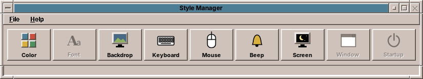
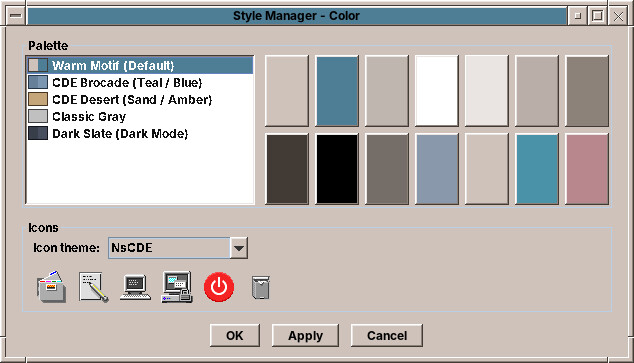

# 62. Style Manager

Every application of this book follows the desktop theme ([chapter 42](42-look.md#following-the-desktop-themestore)). This chapter is the other end: the Style Manager, amadeOS's version of CDE's dtstyle, where the user picks the theme, the backdrop, keyboard, mouse, bell and screen saver. It is a desktop module, so it starts without Guice and talks to X11. It writes the files the applications follow, and it applies settings by running the X server's own tools.



## What you will learn

- How the desktop writes the theme that `ThemeStore` reads in every application, and why it writes atomically.
- How the window manager and the panel hear about a new theme without watching files.
- The CDE dialog pattern: OK, Apply, Cancel, with previews undone on Cancel.
- Applying input settings with `xset`, `xmodmap` and `xrdb`, from pure functions that tests can check.

## One window, one dialog per control

The Style Manager's window is a row of buttons, one per control, in the order of CDE: Color, Font, Backdrop, Keyboard, Mouse, Beep, Screen, Window, Startup. The controls amadeOS does not have yet (Font, Window, Startup) are shown disabled with a tooltip, so the window looks as users of CDE know it and tells them what is missing. Each button opens the control's dialog, or brings it to the front when it is open already.

The jar has a second entry point: `amadeos-style input` applies the keyboard, mouse and bell settings without a window. The session runs it at login from `/etc/amadeos/autostart.d/10-amadeos-input`.

## OK, Apply, Cancel

Every control dialog has CDE's three buttons, built once in an abstract base class:

```java title="amadeos-system · style/StyleDialog.java"
--8<-- "amadeos-system/style/src/main/java/eu/amadeos/system/style/StyleDialog.java:layout"
```

A subclass builds its controls and implements `apply()`, which returns a line for the Style Manager's status bar. *OK* applies and closes, *Apply* applies and stays, *Cancel* and the window's close button call `cancelled()`, where a dialog that previews (the screen saver, the bell) undoes the preview. An exception from `apply` becomes a status line instead of a crash, and the dialog stays open, so the user can correct the value.

## Writing the theme

The Color control lists the themes with a swatch each, shows the selected palette as fourteen chips (base, title bars, bevel shades, text and the four workspace colours) and lets the user choose an icon theme with a preview of six icons:



On *Apply* it hands the theme to `ThemeManager` in `base`, the desktop's side of theming:

```java title="amadeos-system · style/ColorDialog.java"
--8<-- "amadeos-system/style/src/main/java/eu/amadeos/system/style/ColorDialog.java:apply"
```

```java title="amadeos-system · base/theme/ThemeManager.java"
--8<-- "amadeos-system/base/src/main/java/eu/amadeos/system/base/theme/ThemeManager.java:apply"
```

`ThemeManager` uses the same `ThemeRegistry` as every application, so a custom theme in `~/.config/amadeos/themes` appears in the list too ([chapter 42](42-look.md#custom-themes-themeregistry)). It installs the theme into its own process with `AmadeUI.install`, clears the icon cache, writes the file and tells its listeners. The Style Manager's own windows are such a listener; they restyle with `AmadeUI.apply`, like any application.

The file is written atomically, a temporary file renamed over the old one:

```java title="amadeos-system · base/theme/ThemeManager.java"
--8<-- "amadeos-system/base/src/main/java/eu/amadeos/system/base/theme/ThemeManager.java:persist"
```

That matters more here than anywhere else. A dozen programs watch `theme.conf` with a `ConfigWatcher` ([chapter 44](44-settings.md#following-a-file-configwatcher)), and each of them reads it within 150 ms of a change. A file written in place could be read while it holds half an id, and that program would fall back to Warm Motif while the others switch to Dark Slate. A rename is seen as one change from the old content to the new.

## Telling the desktop

The applications watch the file. The window manager and the panel learn it another way: `ColorDialog.apply` also sets the property `_AMADEOS_THEME` on the X root window, and both poll that property. The panel reads it twice a second, together with the current workspace and the busy flag it needs anyway, and switches when the id differs from its own:

```java title="amadeos-system · panel-cde/AmadeDesktopPanel.java"
--8<-- "amadeos-system/panel-cde/src/main/java/eu/amadeos/system/panel/cde/AmadeDesktopPanel.java:poll"
```

Why two channels? The window manager and the panel are X11 programs that read root window properties anyway, for the workspace and the busy cursor, so one more property costs them nothing. The applications know nothing of X11 properties and rely on the file alone.

!!! note "Programs read, the desktop writes"
    `ThemeStore` in amade-commons has no method to write a theme, and `ThemeManager` in `base` has one. That split is the whole design: one program decides, everyone else follows ([chapter 42](42-look.md#following-the-desktop-themestore)).

## Keyboard, mouse and bell

Keyboard repeat and click, mouse handedness, double-click time and acceleration, and the bell are settings of the X server. The Style Manager does not set them through Xlib calls. It runs the X server's standard tools from `x11-xserver-utils`, which every X desktop has: `xset` for repeat, click, acceleration and the bell, `xmodmap` for the button order of left-handed use, `xrdb` for the double-click time that X toolkits, AWT included, read at start.

The translation from settings to commands is a pure function, so tests check the command lines without an X server:

```java title="amadeos-system · style/input/XCommands.java"
--8<-- "amadeos-system/style/src/main/java/eu/amadeos/system/input/XCommands.java:keyboard"
```

`InputApplier` runs the commands and reports the ones that failed. The settings themselves are stored in `~/.config/amadeos/input.conf` with `PropertiesFile` from amade-commons ([chapter 44](44-settings.md#settings-files-propertiesfile)). A broken file gives the defaults, never an exception at login.

!!! tip "Tip: settings that survive a restart of the X server"
    Settings applied with `xset` live in the X server and are gone at the next login. That is why the session runs `amadeos-style input` at every start: the file is the truth, the X server's state is a copy of it.

## Backdrop and screen

The **Backdrop** control paints the root window: an image (fill, fit, stretch, tile or centre), a plain colour, or one of CDE's pattern backdrops, X bitmaps coloured with the backdrop colour of the theme. `WallpaperManager` in `base` stores the choice in `~/.config/amadeos/wallpaper.conf` and exports the picture as the root pixmap, so that programs with transparent windows see it too.

The **Screen** control sets the screen saver of the session module: which saver (Qix, Swarm, Starfield, Floating Logo, Blank), after how many minutes it starts and whether it locks. The dialog previews the chosen saver while you pick it, and *Test* runs it on the whole screen.

## What stays to be done

The Style Manager's texts are English only, written into the code. Translating it is the first exercise.

## Exercises

1. **Five languages.** Move the texts of the Style Manager (window, dialogs, `StyleCategory`) into `messages.properties` with translations, load them with `Messages`, and add a `TranslationCheck` test. How does a desktop module without Guice get its `Locale`? Look at how the panel does it.
2. **Font.** Implement the Font control: a scale factor for the desktop's fonts, stored in `~/.config/amadeos/font.conf`. Which programs would have to follow it, and through which class of amade-commons should they?
3. **A theme editor.** Add *New…* to the Color control: pick a base colour, derive the rest with `DesktopTheme.fromBase`, show the palette and write `~/.config/amadeos/themes/<id>/theme.properties`.

## Summary

- The Style Manager is a desktop module: it starts without Guice and runs the X server's own tools.
- It writes `theme.conf` through `ThemeManager`, atomically, because a dozen programs read the file within milliseconds of a change.
- The window manager and the panel also follow the root window property `_AMADEOS_THEME`; the applications follow the file alone.
- Settings of the X server are files first and commands second, so the session can apply them again at every login.
