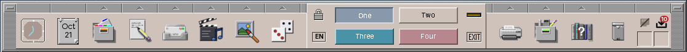

# 63. The Front Panel

The Front Panel is the bar at the bottom of the screen, built after CDE's: the clock and calendar on the left, then the drawers of applications, the workspace switch in the middle, and on the right the printers, tools, help, trash and the status cells. It is a desktop module, a single Swing window with no Guice and no presenter, and it is the program users touch most. This chapter shows how a Swing window becomes a dock, how the drawers fill themselves from the installed applications, and how the status cells show what the system is doing.



## What you will learn

- How a window tells the window manager that it is a dock, and keeps space free for itself.
- How the drawers fill themselves from desktop entries, so a package that installs an application also puts it into the panel.
- How the panel starts programs, and shows the busy cursor while they start.
- How the workspace buttons are renamed in place, as in CDE, and how the panel tells the other programs the names.
- The status cells: small widgets that read the system in the background and appear only when they have something to show.

## Start-up

The panel starts with `main`, as every desktop module does ([chapter 60](60-desktop.md#two-kinds-of-module)):

```java title="amadeos-system · panel-cde/AmadeDesktopPanel.java"
--8<-- "amadeos-system/panel-cde/src/main/java/eu/amadeos/system/panel/cde/AmadeDesktopPanel.java:main"
```

The panel is the session's main program: `amadeos-session` starts the window manager and the autostart programs, then runs the panel and ends when the panel ends. Three things happen before the window appears. A file lock in the home directory (`~/.amadeos-panel.lock`) makes sure only one panel runs, even if the session's autostart and a user both start one. The X connection is opened through `X11EwmhHelper` from `base`, and without one the panel ends at once: a panel without a display has nothing to do. And the window is created on the event dispatch thread, like every Swing window.

## A window that is a dock

A Swing `JFrame` is a normal window to the window manager: it gets a frame, a title bar and a place in the window list. The panel must be none of that. It says so with two properties of the Extended Window Manager Hints (EWMH), the standard every X11 window manager reads:

```java title="amadeos-system · base/x11/X11EwmhHelper.java"
--8<-- "amadeos-system/base/src/main/java/eu/amadeos/system/base/x11/X11EwmhHelper.java:dock"
```

- `_NET_WM_WINDOW_TYPE_DOCK` tells the window manager not to frame the window, to keep it above the others on every workspace, and to leave it out of the window list and Alt+Tab.
- `_NET_WM_STRUT` and `_NET_WM_STRUT_PARTIAL` reserve the bottom 85 pixels of the screen, so that maximised windows end above the panel instead of under it.

Swing has no API for either. The helper sets them on the native window with `XChangeProperty` through JNA, which needs the window's X11 id; the panel gets it from AWT's peer, with JNA's `Native.getWindowID` as fallback. That is why `main` calls `addNotify` first: it creates the native window before it is shown.

!!! warning "Pitfall: AWT overwrites the window type"
    `main` calls `registerAsDock` twice, before and after `setVisible`. AWT's X11 toolkit writes `_NET_WM_WINDOW_TYPE_NORMAL` itself while it maps a window, so a type set only before mapping is gone afterwards. amadeOS's window manager recognises the panel by its strut in that moment, and the second call puts the type right for every other program that reads it.

Because the window manager looks for the type and not for a name, any program that sets these properties is a panel to it. That is what makes the virtual package `amadeos-panel` possible ([chapter 60](60-desktop.md#one-repository-one-package-per-module)).

## Slots and widgets

The panel is a row of slots, each a `DockWidget`:

```java title="amadeos-system · panel-cde/widget/DockWidget.java"
--8<-- "amadeos-system/panel-cde/src/main/java/eu/amadeos/system/panel/cde/widget/DockWidget.java"
```

A widget is a Swing component with a life: `start` after the panel is built (the clock starts its timer here), `stop` when it goes, and `onThemeChanged` when the Style Manager picks another palette. The panel keeps them in a list and passes each event on, so a new kind of slot needs no change to the panel beyond adding it. The width of the panel follows the slots: it is the preferred width of its content, centred on the screen.

The look is CDE's and drawn by hand: `CdePanelChrome` paints the chiselled frame and the row of drawer tabs, each widget its bevels, all in the colours of the current `DesktopTheme` ([chapter 42](42-look.md)). Nothing in the panel has a colour of its own.

## Drawers from desktop entries

Most slots are drawers: a button that starts the main application of its kind, and above it a tab that opens a list of the others. Here is the Tools drawer open:


A drawer is not a fixed list. It is filled from the desktop entries of the installed applications, the `.desktop` files every package puts into `/usr/share/applications`. Each drawer stands for one or more freedesktop.org categories:

```java title="amadeos-system · base/xdg/XdgCategory.java"
--8<-- "amadeos-system/base/src/main/java/eu/amadeos/system/base/xdg/XdgCategory.java:categories"
```

Each constant maps the categories that a desktop entry may name (`Categories=Graphics;Viewer;`) to a drawer and its icon. The matching is generous on purpose: an entry that says `Viewer` or `Scanning` without `Graphics` still lands in the Graphics drawer, and an entry with no category at all lands in *Other*. `XdgApplicationManager` reads the entries from `~/.local/share/applications`, `/usr/local/share/applications` and `/usr/share/applications`, skips those with `NoDisplay=true`, and answers by category.

A category drawer puts the installed applications first and the panel's own entries after them. Its button starts the first application of the category, and a fallback when there is none:

```java title="amadeos-system · panel-cde/AmadeDesktopPanel.java"
--8<-- "amadeos-system/panel-cde/src/main/java/eu/amadeos/system/panel/cde/AmadeDesktopPanel.java:drawer"
```

Some drawers mix both kinds. Tools has fixed entries for the desktop's own programs and then everything that calls itself Settings or Monitor, without the ones that only start what a fixed entry already starts:

```java title="amadeos-system · panel-cde/AmadeDesktopPanel.java"
--8<-- "amadeos-system/panel-cde/src/main/java/eu/amadeos/system/panel/cde/AmadeDesktopPanel.java:tools"
```

`startsOnly` decides what a duplicate is: an entry whose `Exec` is just one of the fixed programs, with or without its directory and field codes such as `%U`, and without `Terminal=true`. So Debian's `xterm.desktop` (`Exec=xterm`) stays out next to *Terminal*, but a user's entry `Exec=xterm -title Backup -e backup.sh` is shown. Leaving out every entry of a fixed program would hide exactly the entries users write for their own scripts.

That is how *amadeOS Software* and the installer of the live image appear in the screenshot: nobody wrote them into the panel. Software's desktop entry says `Categories=System;Settings;PackageManager;`, and the panel did the rest. For the applications of this book, the desktop entry is part of the package ([chapter 50](50-packaging.md#categories-and-the-front-panel-drawers)); the right `Categories` line is all it takes to get into the right drawer.

!!! tip "Tip: which categories go where"
    [Chapter 50](50-packaging.md#categories-and-the-front-panel-drawers) has the table of categories and drawers from the application's side. Give a program its one main category and the specific ones that fit: Mail says `Network;Email;`, and `Email` puts it first in *Mail & Internet*.

### Drawers that follow

A drawer that is filled once is out of date as soon as Software installs a program. So the panel watches the directories of the desktop entries, and when a package has written its entries and nothing has changed for two seconds, it reads them again in the background and fills every drawer again on the EDT:

```java title="amadeos-system · panel-cde/AmadeDesktopPanel.java"
--8<-- "amadeos-system/panel-cde/src/main/java/eu/amadeos/system/panel/cde/AmadeDesktopPanel.java:follow"
```

`ApplicationsWatcher` in `base` is a `WatchService` with a settle time, the same pattern as the package watcher of [chapter 64](64-software.md#knowing-when-something-changed). That is why each drawer above is built from *suppliers*, not lists: `createCategoryDrawer` and `fixedDrawer` keep a small `Runnable` per drawer that asks the suppliers again and hands the result to `DrawerDockWidget.update`, which closes an open drawer, replaces its entries and, for a category drawer, the program its button starts. A new graphics program is in the Graphics drawer a few seconds after its installation, and after its removal it is gone.

A directory that does not exist yet is watched too. A new user has no `~/.local/share/applications` until the first desktop entry is saved there, and a `WatchService` can only watch a directory that exists. So `ApplicationsWatcher` watches the nearest existing parent for `ENTRY_CREATE`, ignores everything else created there, and registers the directory itself as soon as it appears. After registering a parent it looks again, because `mkdir -p` may have created the next level in the meantime.

## Starting programs

A program started from the panel or the window manager's root menu must not depend on the program that started it. The session restarts a window manager that crashed, and the user's editor must not go down with it. `ProcessLauncher` in `base` starts every program the same way:

```java title="amadeos-system · base/process/ProcessLauncher.java"
--8<-- "amadeos-system/base/src/main/java/eu/amadeos/system/base/process/ProcessLauncher.java:start"
```

- `setsid` gives the program a session of its own, so it does not get the panel's signals.
- Standard input is `/dev/null`, so a program that reads it gets an end of file instead of waiting.
- Both outputs go to a log file of its own in `~/.cache/amadeos/logs`, named after the program, where Session Diagnostics & Logs shows them. Without that, the output would go to a pipe nobody reads: a program that writes a lot would block once about 64 KB fill the pipe, and die from `SIGPIPE` on its next write after the program that started it has ended.

`XdgDesktopEntry.launch` turns the `Exec` line into a command (without the field codes such as `%F`) and starts it through the same method, so a drawer entry and a fixed entry behave alike.

### The busy cursor

A Java program needs a second or two before its window appears, and a click without any answer gets clicked again. The public `start` method announces each start to the window manager with the X11 message `_AMADEOS_LAUNCH` (`LaunchFeedback`). The window manager shows a watch as the cursor until a new window is mapped, at most twenty seconds, and meanwhile sets `_AMADEOS_LAUNCH_BUSY` on the root window. The panel reads that flag in its timer, twice a second, and shows the watch over itself too:

```java title="amadeos-system · panel-cde/AmadeDesktopPanel.java"
--8<-- "amadeos-system/panel-cde/src/main/java/eu/amadeos/system/panel/cde/AmadeDesktopPanel.java:poll"
```

The same timer follows the workspace (switched with a key or the root menu, not only with the panel's buttons) and the theme ([chapter 62](62-style-manager.md#telling-the-desktop)). The panel's own clock, `launchedAt`, shows the watch for the first second even before the window manager has answered. The applications of this book announce their own starts the same way: `DesktopLauncher` in amade-commons sends the same message ([chapter 45](45-desktop.md#the-busy-cursor-launchfeedback)).

## Workspace names

The four workspace buttons are called *One* to *Four* in the panel's language until the user renames them. Renaming works as in CDE: a click on the button of the current workspace turns it into a text field. So the button's action listener first asks whether its workspace is the current one already:

```java title="amadeos-system · panel-cde/widget/WorkspaceSwitcherDockWidget.java"
--8<-- "amadeos-system/panel-cde/src/main/java/eu/amadeos/system/panel/cde/widget/WorkspaceSwitcherDockWidget.java:rename"
```

A double click on another button is then a switch and a rename, as in CDE. Each button sits in a small `CardLayout` with a `JTextField`; `startRename` shows the field in the button's colours with the old name selected, Return or leaving the field keeps the new name, Escape the old one, and an empty name gives back the default. The field needs the keyboard, which a dock does not get from the window manager, so the panel brings its window to the front and asks for the focus itself.

`WorkspaceNames` in `base` keeps the names in `~/.config/amadeos/workspaces.conf`, one line per renamed workspace, cut to 24 characters on one line. The panel then publishes all four in the root window's `_NET_DESKTOP_NAMES`, the EWMH property for workspace names: `X11EwmhHelper.setDesktopNames` writes them NUL-separated in UTF-8. The window manager watches the property with a `PropertyNotify` and uses the names in its root menu; the Style Manager reads it for its Backdrop control ([chapter 62](62-style-manager.md#backdrop-and-screen)). So the panel is the only program that renames, and the others only read.

## Status cells

The rightmost slot is a grid of small cells: the network and, while updates are waiting, the software updates. Sound, battery and Bluetooth are to follow. Each cell is a `StatusCell`, and the slot shows only those that report themselves `available`:

```java title="amadeos-system · panel-cde/AmadeDesktopPanel.java"
--8<-- "amadeos-system/panel-cde/src/main/java/eu/amadeos/system/panel/cde/AmadeDesktopPanel.java:status"
```

The cells take their services in the constructor, `NmcliNetworkService` for the network and `AptPackageService` for the updates ([chapter 64](64-software.md)), and the actions to open the settings, so a test builds a cell with fakes. Their texts, like all of the panel's, are in `desktop.properties` and its translations ([below](#the-panels-language)).

The updates cell is the most careful one, because what it reads takes time. It reads the waiting updates on a thread of its own, twenty seconds after login so the session can settle first, then every thirty minutes, and whenever the installed packages or the package lists change:

```java title="amadeos-system · panel-cde/status/UpdatesCell.java"
--8<-- "amadeos-system/panel-cde/src/main/java/eu/amadeos/system/panel/cde/status/UpdatesCell.java:start"
```

`service.watch` covers changes the panel did not make: apt in a terminal, unattended-upgrades in the night, Debian's daily refresh of the lists. The result goes to the EDT with `invokeLater`, and the cell tells the slot to lay itself out again only when it appears or goes away, not at every read:

```java title="amadeos-system · test/panel/cde/status/UpdatesCellTest.java"
--8<-- "amadeos-system/panel-cde/src/test/java/eu/amadeos/system/panel/cde/status/UpdatesCellTest.java:shown"
```

The number on the cell is red when security updates are among them. A click opens a menu with the first eight updates, *Install all*, *Install security updates only*, *Check now*, and *Show updates*, which starts the Software program on its Updates tab.

## The panel's language

Everything the panel says is in `desktop.properties` and its four translations: the drawer titles and the fixed entries, the tooltips, the Application Manager and its tabs, the clock and the calendar, the workspace names. `PanelTexts` loads them once, in the language of the session. That is deliberate: the session exports the language of `locale.conf` as `LANG` at login, and the panel's language button says that the panel follows at the next login, like the terminals. So `PanelTexts` resolves the language from the environment only ([chapter 43](43-languages.md#which-language-localeresolution)), where the Style Manager, a program started later, reads `locale.conf` itself ([chapter 62](62-style-manager.md#five-languages-without-guice)).

Dates follow the language too. The calendar's tooltip used a fixed English pattern (`EEEE, MMMM d, yyyy`); it now uses `DateTimeFormatter.ofLocalizedDate(FormatStyle.FULL)` in the panel's locale, so a German session reads *Donnerstag, 22. Oktober 2026*, and the month on the calendar sheet is the short name in that language. The session dialog behind the exit button lives in `base` and has its own `session.properties`, so `base` does not depend on the panel's texts.

## Exercises

1. **A drawer per user.** Let users add their own entries to a drawer, stored in `~/.config/amadeos/panel.conf` with `PropertiesFile`. How does such an entry survive a refill?
2. **A battery cell.** Write a `StatusCell` that reads `/sys/class/power_supply/BAT0/capacity` and `status` every minute and is `available` only when there is a battery. Test it with a temporary directory in place of `/sys`, as System Information does with `/proc` ([chapter 61](61-system-information.md#linuxs-own-files)).
3. **Twice in one drawer.** WritePad says `Office;WordProcessor;`. Why does it appear once in the Text & Office drawer and not twice? Find the line that makes sure, and what would happen without it.

## Summary

- The panel is a Swing window that sets the EWMH dock type and a strut through JNA; the window manager knows panels by these properties, not by name.
- Widgets are slots with a life cycle and a theme. The panel draws CDE's look in the colours of the current theme.
- Drawers fill themselves from desktop entries by category, so a package that installs a desktop entry also puts its program into the panel.
- Programs start in a session of their own with their output in a log file, and the busy cursor shows until their window appears.
- Drawers fill themselves again a few seconds after programs are installed or removed.
- A click on the current workspace's button renames it; the panel stores the names and publishes them in `_NET_DESKTOP_NAMES` for the window manager and the Style Manager.
- Status cells read in the background, show only when they have something to say, and take their services in the constructor so tests can fake them.
- The panel's texts and dates are in the session's language, resolved once at start.
