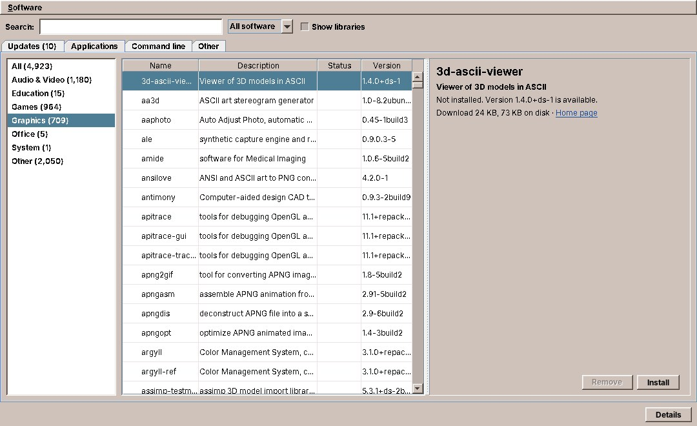

# 64. Software

Software is the program that installs, updates and removes software on amadeOS. Its window has a tab for the waiting updates and tabs for everything the Debian repositories offer: applications, command-line programs and the rest. The Front Panel's updates cell uses the same code underneath. This chapter is about the part a desktop program rarely has: changing the system as root, safely, from a program that runs as the user. It shows the three layers that share the work, how they talk to each other, and how they are tested without touching the computer's packages.



## What you will learn

- Splitting a program that needs root into the user's program, a library and a small privileged helper.
- Asking for the administrator's password with pkexec and polkit, and what the answers mean.
- Following a long operation: progress lines from apt, turned into a progress bar.
- Testing all of it, the root helper included, with a fake `apt-get`.
- Noticing changes that other programs make to the system.

## Three layers

| Layer | Runs as | What it does |
|---|---|---|
| `software` (package `amadeos-software`) | the user | The window: tabs, search, details, confirmations, the progress bar |
| `packages` (a library in the jars of `software` and `panel-cde`) | the user | `PackageService`: reads what is installed and on offer, starts the helper and follows it |
| `/usr/libexec/amadeos-packages` (package `amadeos-packages`) | root, through pkexec | A bash script that runs `apt-get` and nothing else |

The rule is in the interface's first lines: `PackageService` is the one place in amadeOS that talks to apt. The panel's updates cell ([chapter 63](63-front-panel.md#status-cells)) and the Software window both use it, and no other module parses apt's output.

```java title="amadeos-system · packages/PackageService.java"
--8<-- "amadeos-system/packages/src/main/java/eu/amadeos/system/packages/PackageService.java"
```

Every method blocks, some for minutes. The interface says so, and leaves the threads to the caller: the window runs them on the background executor, the panel on a thread of its own.

## Reading needs no root

Most of what Software shows can be read by any user. The installed packages come from `dpkg-query`, the packages on offer from `apt-cache`, and what an installation would bring with it from a *simulation*: `apt-get -s install gimp` prints the packages it would install, upgrade and remove, without doing anything and without root.

`Apt` holds these command lines and the parsers for their output, as pure functions tested with real output pasted into the tests, as in System Information ([chapter 61](61-system-information.md#linuxs-own-files)). `AptPackageService` runs them through a small `CommandRunner` interface of its own, so that tests answer with recorded output.

Some of that output is large, every package Debian offers with its fields, so it is handed over line by line instead of collected. And like every program the desktop runs, apt gets a time limit. Here the library had the bug System Information had ([chapter 61](61-system-information.md#a-time-limit-that-holds)): it read the output to its end and only then waited with its limit, so a command that hung without closing its output blocked for good. The output is now read on a thread of its own, and the limit covers the end of the program and of its output together:

```java title="amadeos-system · packages/AptPackageService.java"
--8<-- "amadeos-system/packages/src/main/java/eu/amadeos/system/packages/AptPackageService.java:lines"
```

The test is the one that would have caught the bug, a program that prints one line and then hangs:

```java title="amadeos-system · test/packages/AptPackageServiceTest.java"
--8<-- "amadeos-system/packages/src/test/java/eu/amadeos/system/packages/AptPackageServiceTest.java:hang"
```

`exec` makes the shell become `sleep`, so stopping the program stops the sleep too. Otherwise the shell may run `sleep` as a child that keeps the output open after its parent is gone, which is the next exercise.

## Changing needs root: the helper

Installing, upgrading and removing need root. The obvious ways are the wrong ones: running the whole Java program as root puts a Swing program with a web renderer and a YAML parser under root, and `sudo` in a terminal leaves the desktop out. amadeOS does it the way most Linux desktops do: a small program that only root may run does the change, and polkit decides who may start it.

The helper is a bash script with six commands:

```sh title="amadeos-system · packages/packaging/root/usr/libexec/amadeos-packages"
--8<-- "amadeos-system/packages/packaging/root/usr/libexec/amadeos-packages:commands"
```

It knows nothing of the desktop and nothing of Java. It checks its arguments, takes the dpkg lock, runs `apt-get` with the right options and reports in lines on standard output. Because pkexec lets any local program start it, it trusts no caller: a package name that starts with `-` would be an option to apt (`-oDpkg::Pre-Invoke=...` runs a command as root), so the script refuses anything that is not a package name. `PackageService` checks the names too, so that a bad name never even reaches the password dialog, and both checks have a test.

### pkexec and polkit

`PackageService` starts the helper through `pkexec`, unless the program already runs as root:

```java title="amadeos-system · packages/AptPackageService.java"
--8<-- "amadeos-system/packages/src/main/java/eu/amadeos/system/packages/AptPackageService.java:helper"
```

pkexec asks polkit whether the user may run the program. The answer is in the policy file the package installs, `/usr/share/polkit-1/actions/eu.amadeos.packages.policy`; without its descriptions and their translations, it says:

```xml
<action id="eu.amadeos.packages.manage">
  <defaults>
    <allow_any>no</allow_any>
    <allow_inactive>no</allow_inactive>
    <allow_active>auth_admin_keep</allow_active>
  </defaults>
  <annotate key="org.freedesktop.policykit.exec.path">/usr/libexec/amadeos-packages</annotate>
</action>
```

Only the user at the computer (`allow_active`) may do it, and only with an administrator's password (`auth_admin`), which polkit then remembers for a few minutes (`_keep`), so installing two programs in a row asks once. The password dialog itself is the polkit agent of the session, a Motif dialog in `session`. A rule in `/usr/share/polkit-1/rules.d` makes one exception: `amadeos-packages refresh` only fetches the package lists and changes no software, so the active local user may run it without a password. That is *Check now* in the panel's updates cell.

The environment variable `AMADEOS_PACKAGES_HELPER` replaces the helper command, for trying the desktop on a computer without the package. pkexec starts the helper with a clean environment, so the variables the tests use to fake `apt-get` cannot reach a real run.

## Following the helper

An upgrade takes minutes, and the user wants to see it move. apt reports its progress in machine-readable lines when asked to (`-o APT::Status-Fd=3`): `dlstatus:` while it downloads, `pmstatus:` while dpkg installs, `pmerror:` when a package fails. The helper passes them on, adds its own lines starting with `@@` (`@@done`, `@@reboot-required`, `@@error locked ...`), and sends apt's messages to standard error and its log file `/var/log/amadeos-packages.log`.

One pure function reads a line of standard output into a sealed type:

```java title="amadeos-system · packages/HelperOutput.java"
--8<-- "amadeos-system/packages/src/main/java/eu/amadeos/system/packages/HelperOutput.java:parse"
```

`runHelper` starts the helper, reads apt's messages on a second thread and the status lines on its own, and hands both to a `ProgressListener` one call at a time. A `switch` over the sealed type makes the compiler check that every kind of line is handled:

```java title="amadeos-system · packages/AptPackageService.java"
--8<-- "amadeos-system/packages/src/main/java/eu/amadeos/system/packages/AptPackageService.java:run-helper"
```

The `Result` tells the caller how it ended, from the helper's own lines and the exit code:

| Status | When | What the user sees |
|---|---|---|
| `DONE` | exit code 0 and `@@done` | "Installed", and a restart bar when an upgrade asked for one (`@@reboot-required`) |
| `LOCKED` | `@@error locked` or exit code 3 | Another package operation is running: unattended-upgrades, or apt in a terminal. Try again later |
| `NOT_AUTHORIZED` | pkexec's exit code 126 (dialog closed) or 127 (refused) | Nothing in the panel, a short line in Software: closing the password dialog is a choice, not an error |
| `FAILED` | anything else | apt's last error, and the window opens the log |

!!! note "Not CommandRunner"
    `runHelper` uses `ProcessBuilder` itself, not `CommandRunner` from amade-commons ([chapter 47](47-programs-json-network.md#running-a-program-commandrunner)). `CommandRunner.run` returns what a program printed when it has ended; the helper's output must be read while it runs, line by line, to move the progress bar. `start` would fit, and the `packages` library predates the `process` package; moving it over is an exercise.

## Tests with a fake apt

The helper is a script, and scripts break as easily as Java. The tests of `AptPackageService` run the real helper with `bash`, and replace only `apt-get`: a small script, written into a temporary directory, that prints recorded status lines and remembers its arguments. The helper takes the paths of `apt-get`, its log file and the reboot marker from environment variables that exist for this purpose:

```java title="amadeos-system · test/packages/AptPackageServiceTest.java"
--8<-- "amadeos-system/packages/src/test/java/eu/amadeos/system/packages/AptPackageServiceTest.java:service"
```

A test then installs a package and checks everything on the way: the progress the listener heard, apt's messages, the command line the helper built, and the log file:

```java title="amadeos-system · test/packages/AptPackageServiceTest.java"
--8<-- "amadeos-system/packages/src/test/java/eu/amadeos/system/packages/AptPackageServiceTest.java:install"
```

pkexec's answers need no polkit either. A command that exits with 126 is a dismissed password dialog:

```java title="amadeos-system · test/packages/AptPackageServiceTest.java"
--8<-- "amadeos-system/packages/src/test/java/eu/amadeos/system/packages/AptPackageServiceTest.java:dismissed"
```

The same fake makes apt fail with a busy lock or an unknown package, so every row of the table above has a test, and none of them needs root, a network or Debian.

## Knowing when something changed

Software is not the only program that changes packages. Debian fetches the package lists once a day, unattended-upgrades installs security updates in the background, and the user may run apt in a terminal. `PackageService.watch` calls back after any of these, so the panel's updates cell and the Software window always show the current state.

`PackageWatcher` watches the two directories where the state lives, `/var/lib/dpkg` (only its `status` file counts) and `/var/lib/apt/lists`, with Java's `WatchService`. An apt run writes these files many times within seconds, so the watcher waits until nothing has changed for five seconds and then calls back once:

```java
WatchKey key = watcher.take();
if (!relevant(key)) continue;
// Wait until the changes have settled.
WatchKey next;
while ((next = watcher.poll(settleMillis, TimeUnit.MILLISECONDS)) != null) {
    relevant(next);
}
onChange.run();
```

The callback comes on the watcher's thread. The caller reads the new state on its own background thread and shows it on the EDT.

## The window

Software is a tool program like System Information: `AmadeApplication`, a Guice module that binds `PackageService` to `AptPackageService`, texts in five languages. The panel starts it with `--updates` to open the Updates tab.

Every change asks first, with what it really does. Installing a package can bring dozens of others, and occasionally remove one; the window simulates first and shows the user what else changes before anything happens:

```java title="amadeos-system · software/ui/MainWindow.java"
--8<-- "amadeos-system/software/src/main/java/eu/amadeos/system/software/ui/MainWindow.java:install"
```

`perform` runs every change the same way. The listener passes progress and messages to the EDT, the result comes back on the EDT, and afterwards the updates and the catalog are read again:

```java title="amadeos-system · software/ui/MainWindow.java"
--8<-- "amadeos-system/software/src/main/java/eu/amadeos/system/software/ui/MainWindow.java:perform"
```

`background` is the window's one helper for "work here, answer there", a `CompletableFuture` on the background executor that completes on the `EdtExecutor` from amade-commons ([chapter 41](41-start-up.md#two-threads-edtexecutor-and-ui)):

```java title="amadeos-system · software/ui/MainWindow.java"
--8<-- "amadeos-system/software/src/main/java/eu/amadeos/system/software/ui/MainWindow.java:background"
```

### Names, icons and screenshots: AppStream

A Debian package has a name and a one-line description written for administrators: `gimp`, "GNU Image Manipulation Program". The catalog tabs show applications the way people know them, with an icon, a description of several paragraphs and screenshots. That comes from AppStream, metadata that Debian's repositories publish beside the package lists. With the package `appstream` installed, apt fetches it into `/var/lib/apt/lists`, and Software reads it from there; an apt setting the package installs makes apt fetch the icons too.

Packages that the repositories do not describe, such as the amade applications or a `.deb` installed by hand, get what their installed desktop entry and metainfo file say. That is why each amade application ships a metainfo file with a description and screenshots ([chapter 50](50-packaging.md#appstream-metadata)): it is what Software shows for it.

## Exercises

1. **CommandRunner for the helper.** Replace the `ProcessBuilder` in `runHelper` with `CommandRunner.start` from amade-commons, and let the tests pass a `CommandRunner` instead of a helper command line. Which tests become simpler?
2. **Children that hold the output.** `lines` stops the program it started, but a child of that program that keeps the output open goes on running, and the reading thread waits for it. `Process.descendants()` lists the children; stop them too when the time is up, and write the test with `sh -c 'sleep 30 & echo started'`.
3. **Remove what is no longer needed.** Add the command `autoremove` to the helper and to `PackageService`, with a simulation first that lists what would go. What does the helper have to refuse?

## Summary

- A program that changes the system as root is split in three: the user's window, a library that runs as the user, and a small helper that runs as root and trusts no caller.
- pkexec and a polkit policy decide who may run the helper; exit codes 126 and 127 mean the password dialog was closed or refused.
- apt's status lines and the helper's own `@@` lines become progress and a `Result` through one pure parser and a `switch` over a sealed type.
- The tests run the real helper with a fake `apt-get`, so the root part is tested without root.
- A watcher on dpkg's and apt's directories notices changes made by any program, and calls back once they have settled.
