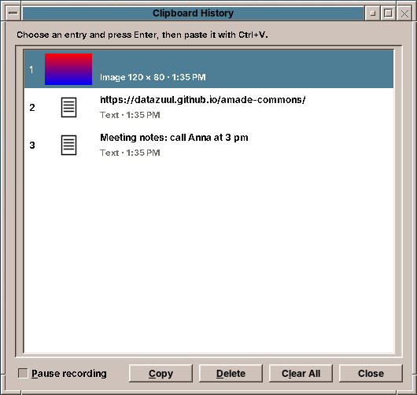
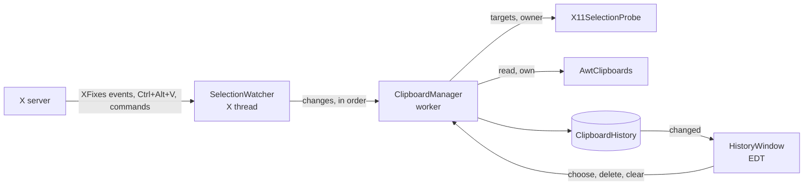
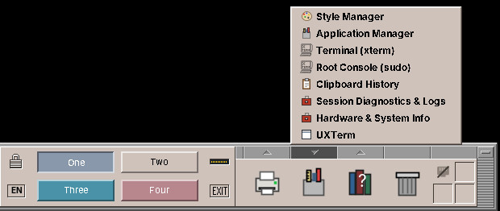
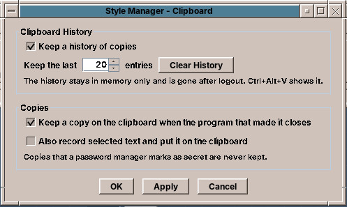

# 65. The Clipboard Manager

Copy a line in Pad, close Pad, press Ctrl+V somewhere else: on a bare X11 desktop nothing comes. The clipboard manager of amadeOS fixes that, and keeps a history of what was copied besides. Unlike the modules of the chapters before, it has no window most of the time. It is a small program that runs for the whole session, listens to the X server and steps in when a copy would be lost. This chapter shows how the X11 clipboard works, how a program watches it without asking every second, and how the manager is tested without an X server.



## What you will learn

- What the X11 clipboard really is: a name for the program that has the data.
- Watching selections with the XFixes extension instead of polling.
- Splitting a session program into an X thread, a worker and the event dispatch thread.
- Reading and offering clipboard data through AWT, and peeking at the formats first.
- The freedesktop.org convention for handing the clipboard to a manager before a program closes.
- Testing such a program with fakes, and by hand with `xclip` under Xvfb.

## The clipboard is a name, not a store

X11 has two clipboards that matter. `CLIPBOARD` is the one of Ctrl+C and Ctrl+V. `PRIMARY` is the selected text, which the middle mouse button pastes. Both are *selections*: the X server keeps no data for them, only the window of the program that last claimed them, the *owner*.

Pasting is a conversation. The pasting program asks the server to convert the selection into a *target*, a format such as `UTF8_STRING`, `text/html` or `image/png`. The server passes the request to the owner, which writes the data into a property of the requester's window and answers. The special target `TARGETS` returns the list of formats the owner offers.

So when the owner closes, the copy is gone: there is nobody left to ask. That is why amade-screenshot had to keep running after its window closed ([the Screenshot tool's README](https://github.com/datazuul/amade-screenshot) calls it `KeepAlive`), and why every Java program loses its copies when it ends.

A clipboard manager is the program that is always there to ask. It reads every copy as soon as it is made, and when the owner goes away it claims the clipboard itself and offers what it read.

## Who does what

The manager is part of the session package: `amadeos-session clipboard`, package `eu.amadeos.system.clipboard`, started by `/etc/amadeos/autostart.d/40-amadeos-clipboard` like the screen saver and the polkit agent. It is a desktop module ([chapter 60](60-desktop.md#two-kinds-of-module)): no Guice, `java.util.logging`, JNA for X11.

| Class | Thread | What it does |
|---|---|---|
| `SelectionWatcher` | X thread | Its own X connection: XFixes events, the Ctrl+Alt+V grab, commands from other programs, requests to save |
| `ClipboardManager` | worker | The decisions: record, skip, take over, save. No X11, no Swing, so it can be tested |
| `X11SelectionProbe` | worker | A second X connection for the questions the manager asks: owner, targets, mouse buttons |
| `AwtClipboards` | worker | Reads and offers the data through AWT's clipboard |
| `ClipboardHistory` | any | The entries, newest first, in memory only; thread-safe |
| `HistoryWindow` | event dispatch thread | The history with previews |
| `ClipboardDaemon` | | `main`: wires the parts, runs the X thread, reloads the settings |

Reading a copy can take a moment (an image from a slow program, a program that does not answer at all), so it never runs on the X thread, which must keep listening, nor on the event dispatch thread, which must keep the window alive. One worker does it, one change after the other, in the order the X server reported them. Order matters here: the manager has to know whether a new owner is itself before it reads, and it learns its own window only when it first takes the clipboard over.



## Watching without polling

AWT's clipboard can report changes too, through a `FlavorListener`. On X11 it does so by asking for `TARGETS` several times a second and comparing the lists, so a second copy of plain text (same formats, other text) goes unnoticed. The XFixes extension does better: the server itself sends an event whenever a selection gets a new owner, and when an owner's window is destroyed or its program's connection closes. `base` has a small JNA binding for it, `LibXfixes`, and the watcher asks for all three events on both selections:

```java title="amadeos-system · session/clipboard/SelectionWatcher.java"
--8<-- "amadeos-system/session/src/main/java/eu/amadeos/system/clipboard/SelectionWatcher.java:watch"
```

The extension's events have no fixed number. `XFixesQueryExtension` tells the program its *event base*, and the selection event is that number plus 0. Everything else the watcher hears is core X11: the key press of Ctrl+Alt+V, which it grabs on the root window like the window manager grabs Super+L, a client message with a command, and selection requests.

One manager per session is enough. The watcher claims a selection of its own, `_AMADEOS_CLIPBOARD`, and stops with exit code 3 when another program already owns it, which also tells the autostart script not to start it again. That selection's owner is also where commands go: `amadeos-clipboard`, the Front Panel's *Clipboard History* entry, sends a client message to it, and the Style Manager's *Clear History* button sends another (`ClipboardCommand`). It is the trick the screen lock plays with `_AMADEOS_LOCK`: whoever owns the selection is running, the X server releases it when that program dies, and the owner's window is an address other programs can write to.

## Recording a copy

When a program copies, the manager first looks at the formats it offers, then reads:

```java title="amadeos-system · session/clipboard/ClipboardManager.java"
--8<-- "amadeos-system/session/src/main/java/eu/amadeos/system/clipboard/ClipboardManager.java:record"
```

The look comes first because of passwords. A password manager marks a copied password with an extra target, `x-kde-passwordManagerHint` (KeePassXC sets it) or one of the nspasteboard.org types. AWT drops targets it does not know as flavors, so the manager asks for `TARGETS` itself, through the probe, and never reads a marked copy at all.

`AwtClipboards` reads what AWT can map: a file list (`text/uri-list`), text, HTML and an image. A copy from a web page brings text and HTML, a copy in the file manager the files and their names as text, a copy in a spreadsheet text and a picture of the cells. The manager keeps all of them in one `ClipEntry`, so that it can offer them all again later.

The history drops a copy that is already there and puts the new one on top. Images can be big, a screenshot of a 4K screen takes 33 MB as pixels, so besides the number of entries there is a memory budget for images, and the oldest images go first:

```java title="amadeos-system · session/clipboard/ClipboardHistory.java"
--8<-- "amadeos-system/session/src/main/java/eu/amadeos/system/clipboard/ClipboardHistory.java:add"
```

The history stays in memory. Nothing is written to disk, so after logout it is gone, and a password that slipped through without a hint is not lying in a file.

## Taking over

All decisions about the clipboard are in one method:

```java title="amadeos-system · session/clipboard/ClipboardManager.java"
--8<-- "amadeos-system/session/src/main/java/eu/amadeos/system/clipboard/ClipboardManager.java:changed"
```

Four cases, each with its reason:

- **The owner is gone** (window destroyed, connection closed): offer the entry that belongs to the current copy, if it is still in the history and nobody else has claimed the clipboard meanwhile.
- **The new owner is None**: a program cleared the clipboard on purpose. A password manager does that after some seconds, so the manager must not bring the old copy back.
- **The new owner is the manager**: its own take-over, nothing to do.
- **Otherwise** a program copied: record it. `current` is the entry for what is on the clipboard now, or null for a password or a copy that could not be read. Only `current` is ever taken over, never an older entry in its place.

Taking over is `Clipboard.setContents` with a `Transferable` that offers the entry's formats. AWT does the rest of the protocol, including sending big images in pieces (`INCR`). Afterwards the manager asks the server who owns the clipboard: that is AWT's window, and the next event naming it is the manager's own.

## Programs that close right away

The take-over has a gap. A program that copies and closes at once is gone before the worker has read anything. amade-screenshot's `--copy` is such a program: it grabs the screen, puts the picture on the clipboard, and has nothing else to do.

The freedesktop.org clipboard manager specification closes the gap. The manager owns a selection called `CLIPBOARD_MANAGER`. A program about to close asks to convert it into the target `SAVE_TARGETS`, and keeps serving the clipboard while it waits for the answer. The watcher passes such a request on to the worker:

```java title="amadeos-system · session/clipboard/SelectionWatcher.java"
--8<-- "amadeos-system/session/src/main/java/eu/amadeos/system/clipboard/SelectionWatcher.java:save-request"
```

The worker reads the clipboard from the waiting program, takes it over and answers through the probe: the request's property for success, None for refusal.

```java title="amadeos-system · session/clipboard/ClipboardManager.java"
--8<-- "amadeos-system/session/src/main/java/eu/amadeos/system/clipboard/ClipboardManager.java:save"
```

GTK and Qt programs ask like this on their own when they close. A Java program has to do it itself; amade-screenshot does it in `X11ClipboardHandoff` with a handful of libX11 calls: find the owner of `CLIPBOARD_MANAGER`, `XConvertSelection(CLIPBOARD_MANAGER, SAVE_TARGETS, ...)`, wait up to five seconds for the `SelectionNotify`. When the manager has taken over, AWT reports the lost ownership and the program ends. Without a manager nobody answers, and the program keeps the clipboard the old way.

## The window and the settings

Ctrl+Alt+V or *Clipboard History* in the Tools drawer shows the history next to the mouse pointer. Each row shows a line of the text, the names of the files or a thumbnail of the image, and below it the kind and the time. Enter or a double click puts the selected entry back on the clipboard and closes the window; the keys 1 to 9 choose an entry directly. Pausing the recording, deleting an entry and clearing everything are there as well. The labels set `html.disable`: a copied text that starts with `<html>` would otherwise be rendered by `JLabel` as HTML.



The settings are a control of the Style Manager ([chapter 62](62-style-manager.md)), the first one CDE did not have. `ClipboardDialog` writes `~/.config/amadeos/clipboard.conf` through `ClipboardSettingsStore`; the manager notices the new file within two seconds, as the screen saver does with `screen.conf`.



*Also record selected text* watches `PRIMARY` too and puts selected text on the clipboard. Selecting is not one event: the owner is set when the selection starts, while the mouse is still moving. So the worker asks the probe whether a mouse button is down and tries again a tenth of a second later, and drops the attempt when a newer selection has started meanwhile. That is what `handle` returning false means.

## Testing

`ClipboardManager` knows X11 and AWT only through two small interfaces, `SelectionProbe` and `SystemClipboards`. The test fakes them with maps, and each test tells a little story:

```java
@Test
void passwordsAreNeitherRecordedNorKept() {
    copy("public");
    targets.add("x-kde-passwordManagerHint");
    copy("secret");
    ownerCloses();
    assertEquals(List.of("public"), texts());
    assertTrue(owned.isEmpty(), "the older copy must not come back in place of the password");
}
```

The X11 parts are tested by hand, under Xvfb with the window manager running, and `xclip` as the program that copies and closes:

```sh
amadeos-session clipboard --daemon &
echo "hello world" | xclip -selection clipboard
pkill -x xclip                         # the owner closes
xclip -selection clipboard -o          # still "hello world"
xclip -selection clipboard -t image/png -i picture.png; pkill -x xclip
xclip -selection clipboard -o -t image/png > back.png
echo secret | xclip -selection clipboard -t x-kde-passwordManagerHint; pkill -x xclip
xclip -selection clipboard -o -t TARGETS   # nothing: the password is not kept
xdotool key ctrl+alt+v                 # the history window
```

## Exercises

1. **Paste directly.** After choosing an entry, the user still presses Ctrl+V. Remember the window that had the focus before the history opened, give it the focus back and send it Ctrl+V with the XTEST extension. Which programs paste with something else (terminals use Ctrl+Shift+V)?
2. **Plain text.** Add *Paste as plain text*: put the entry on the clipboard with its text only, without HTML and image.
3. **Every Java program.** Pad loses nothing, because the manager reads every copy at once. But a program that copies and quits within a few milliseconds still does. Move `X11ClipboardHandoff` into amade-commons, through the foreign function API like `LaunchFeedback`, and call it when an application closes while it owns the clipboard.
4. **Search.** With a hundred entries, typing should filter the list. Which keys does the window then have to give up?

## Summary

- An X11 selection names its owner; the data stays with the owner, and with it goes when the owner closes.
- XFixes reports owner changes and lost owners, so the manager reads each copy at once instead of polling.
- An X thread listens, one worker decides in order, the event dispatch thread shows; the decisions are in a class without X11 or Swing.
- The manager peeks at `TARGETS` before it reads, to leave passwords alone, and never brings back an older copy in place of one it skipped.
- `CLIPBOARD_MANAGER` and `SAVE_TARGETS` let a program hand its copy over before it closes.
