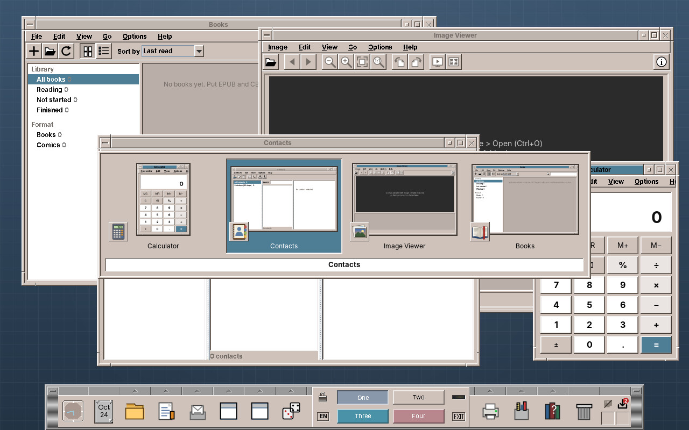

# 66. The Window Switcher

Hold Alt, press Tab, and a row of small pictures of the open windows comes up; let go of Alt, and the chosen window is in front. Everyone who has used Windows expects that, and CDE never had it. This chapter adds it to the window manager. It is a small feature, but it touches three things no other module of this part needs: a key that belongs to the whole desktop rather than to a window, pictures of windows that the X server does not keep, and a Swing window shown by the window manager itself.



## What you will learn

- Taking a key for the whole desktop with a passive grab, and the keyboard with an active grab while the switcher is open.
- Ordering windows by when they were last active.
- Getting pictures of windows without a compositor: read the screen while a window is in full view.
- Reading an `XImage` and the `_NET_WM_ICON` property through JNA.
- Showing a Swing popup from the window manager without the window manager managing it.

## What the switcher does

| Keys | What happens |
|---|---|
| ++alt+tab++ | Opens the switcher with the window that was active before selected |
| ++tab++ / ++shift+tab++, ++right++ / ++left++ (Alt held) | Next / previous window |
| Releasing ++alt++, or ++enter++ | Brings the selected window to the front, restoring it if it was minimized |
| ++esc++ | Closes the switcher; nothing changes |
| Pointing at a tile, clicking it | Selects it, picks it |

A quick ++alt+tab++, pressed and released at once, switches without showing anything: the two windows you work with take turns. The switcher shows the windows of the current workspace, minimized ones included, but not dialogs; a dialog comes to the front with its window.

## Who does what

The switcher is part of the window manager. Three of its classes know neither X11 nor the window manager and are tested on their own; the X11 side sits next to the window manager in the package `x11`.

| Class | Package | What it does |
|---|---|---|
| `RecentWindows` | `switcher` | The windows in the order they were last active |
| `SwitcherSelection` | `switcher` | One round: the windows and which one is selected; moving wraps around |
| `PreviewArea` | `switcher` | Which part of a window can be read from the screen, if any |
| `SwitcherPopup` | `switcher` | The popup on the event dispatch thread: tiles, highlight, mouse |
| `SwitcherEntry` | `switcher` | One window of a round: title, preview, icon, minimized |
| `WindowPreviews` | `x11` | Reads previews from the screen and icons from `_NET_WM_ICON` |
| `X11WindowManagerService` | `x11` | The keys, when to read a preview, opening and closing a round |

## A key for the whole desktop

An X client gets the keys of the window that has the focus. A window manager that wants Alt+Tab whatever window is active asks the server for a *passive grab*: from now on, this key with these modifiers goes to the window manager, wherever the focus is. The screen lock's Super+L works the same way. The catch is in the modifiers: the server compares them exactly, and Num Lock and Caps Lock are modifiers too (`Mod2Mask` and `LockMask`). A grab for Alt alone does nothing while Num Lock is on, so the window manager grabs every combination:

```java title="amadeos-system · wm/x11/X11WindowManagerService.java"
--8<-- "amadeos-system/wm/src/main/java/eu/amadeos/system/wm/x11/X11WindowManagerService.java:alt-tab-keys"
```

The passive grab brings the first Tab. Everything after it, the further Tabs, the arrows, Esc and above all the *release* of Alt, comes from the window the user typed into, unless the window manager takes the whole keyboard. That is an *active grab*, `XGrabKeyboard`, held from the first Tab to the release of Alt. With it, every key event goes to the window manager, without an event mask. The release of Alt is a `KeyRelease` of one of the keycodes of `Alt_L`, `Alt_R`, `Meta_L` or `Meta_R`. Do not test the modifier state of that event: it is the state *before* the event, so Alt is still in it.

!!! warning "Pitfall: a quick Alt+Tab is over before the grab"
    Someone who taps Alt+Tab may release Alt before the window manager has read the Tab and grabbed the keyboard. The release then went to the application, and the switcher would wait for a release that never comes. After the grab, the window manager therefore asks the server which modifiers are down right now (`XQueryPointer` returns them in its mask) and switches at once if Alt is up.

## Most recently used first

Windows lists the windows in the order they were last active, so that one Alt+Tab goes back to the window before. `RecentWindows` is that order: `touch` moves a window to the front, the window manager calls it in `focusClient`, the one method every way of activating a window goes through. `order` takes the windows the switcher may show, in stacking order, and puts the recently active ones first; a window that was never active, mapped while the user was busy elsewhere, follows in stacking order. `SwitcherSelection` then starts on the second entry, or on the last for Alt+Shift+Tab.

## Pictures without a compositor

Windows and GNOME draw their previews from the *compositor*: every window is drawn into an image of its own and the compositor puts the screen together, so it has a picture of every window, covered or not. amadeOS has no compositor. The X server draws windows straight onto the screen and keeps nothing of the parts that are covered. What a covered window looks like, nobody knows until it is uncovered and draws itself again.

So the window manager reads a window's picture while the window is in full view and keeps it. A window is in full view in a few moments the window manager knows about:

- when it loses the focus, before the new active window is raised over it;
- before a new window is mapped, which will usually cover the active one;
- just before it is minimized;
- when Alt+Tab opens, for every window that nothing covers.

Each of these calls `capturePreview`, which first asks `PreviewArea` whether the window is really in full view. A window is covered if any window stacked above it overlaps it, or one of the icons of minimized windows, which lie on top of everything. The part behind the Front Panel is cut off, except for a full-screen window, and so is anything outside the screen.

```java title="amadeos-system · wm/x11/X11WindowManagerService.java"
--8<-- "amadeos-system/wm/src/main/java/eu/amadeos/system/wm/x11/X11WindowManagerService.java:preview"
```

During a round nothing is read: the popup is on the screen then, and it would end up in the pictures. A window that was never in full view has no preview; its tile shows the application's icon large instead. A minimized window keeps the picture from the moment before it was minimized, faded a little towards the panel colour.

### Reading the screen

`XGetImage` copies a rectangle of a drawable from the server. Reading from the root window rather than the frame gives what is on the screen and never fails for a frame that is partly off the screen, which an `XGetImage` on the window itself does with `BadMatch`. The result is a C struct, `XImage`, which `WindowPreviews` reads by offset instead of declaring a JNA `Structure` for twenty fields it does not need:

```java title="amadeos-system · wm/x11/WindowPreviews.java"
--8<-- "amadeos-system/wm/src/main/java/eu/amadeos/system/wm/x11/WindowPreviews.java:read-screen"
```

At 24 or 32 bits a pixel is 32 bits in memory, `0x00RRGGBB` on a little-endian machine, exactly what `BufferedImage.TYPE_INT_RGB` wants. The row length is `bytes_per_line`, which the server may pad; reading row by row respects it. On a 16-bit screen the window manager does without previews rather than converting.

!!! tip "Tip: scale down by halves"
    A window 1200 pixels wide becomes a preview of 196. One bilinear step from 1200 to 196 reads only a few source pixels for each target pixel, and text turns into noise. `scaleDown` halves the picture until the next half would be too small, then takes the last step. That is close to an area average and costs a few milliseconds. The previews are kept at twice the tile size, 392 by 264 at most, so a window costs about 400 KB.

## The application's icon

EWMH has applications put their icons into the property `_NET_WM_ICON`: for each size, the width, the height and then width × height pixels as ARGB, all in one list of `CARDINAL`s. Java sets it from `setIconImages`, and so do GTK and Qt. `WindowPreviews.pickIcon` walks the list and takes the smallest icon of at least 32 pixels, or the largest one if they are all smaller.

!!! warning "Pitfall: format 32 is a C long"
    A property of format 32 arrives as an array of C `long`s, eight bytes each on a 64-bit machine, even though each holds 32 bits. Reading it as `int`s gives every other value and garbage icons. `WindowPreviews` reads `NativeLong`s, as the window manager does for every other format-32 property.

The icons are read once per window and read again when the application changes the property (`PropertyNotify`). Programs that set none, `xterm` for example, get the generic window icon of the icon theme.

## A popup the window manager does not manage

The popup is a `JWindow` of type `Window.Type.POPUP`, like the root menu and the window menu. On X11, Java makes a popup *override-redirect*: the window manager gets no `MapRequest` for it, so it does not frame it, and it stays above the other windows. `setFocusableWindowState(false)` keeps Java from giving it the focus; the keyboard stays with the window manager's grab anyway.

The window manager and the popup live on different threads and even on different X connections: the window manager's event loop with its own `Display`, the popup on the event dispatch thread with AWT's. `SwitcherPopup` takes the entries and the selected index and does all its Swing work in `invokeLater`; what the mouse does comes back through an `Actions` interface whose implementation hands over to the X thread with `runOnEventThread`, as the root menu does. The model, `SwitcherSelection`, is only ever touched on the X thread.

```java title="amadeos-system · wm/x11/X11WindowManagerService.java"
--8<-- "amadeos-system/wm/src/main/java/eu/amadeos/system/wm/x11/X11WindowManagerService.java:open-switcher"
```

On a narrow screen the tiles wrap into rows (`SwitcherPopup.columns`), so even twenty windows fit.

## Testing

The ordering, the selection, the visibility rule and the icon choice are plain Java and have unit tests: `RecentWindowsTest`, `SwitcherSelectionTest`, `PreviewAreaTest`, `WindowPreviewsTest`. The integration test of the window manager starts Xvfb with two `xmessage` windows. No Alt key is held there, so `openSwitcher` takes the quick Alt+Tab path:

```java
wm.focusClient(a);
wm.focusClient(b);
wm.openSwitcher(false);
assertTrue(wm.getFrameForClient(a).isActive(), "Alt+Tab brings back the window active before");
```

The rest is tested by hand under Xvfb, with the window manager, the Front Panel and a few applications, and `xdotool` holding Alt:

```sh
xdotool keydown alt; xdotool key Tab; sleep 1
import -window root alt-tab.png        # the popup with the previews
xdotool key Tab shift+Tab Escape; xdotool keyup alt
xdotool key alt+Tab                    # a quick one: back to the window before
```

## Exercises

1. **All workspaces.** Ctrl+Alt+Tab could show the windows of all four workspaces and switch to the workspace of the chosen one. Which windows can have previews then?
2. **Live previews.** With the Composite extension, `XCompositeRedirectWindow` with `CompositeRedirectAutomatic` makes the server keep every frame in a pixmap of its own while still drawing the screen as before. Read the previews from there, at Alt+Tab, and compare the memory it costs with the pictures read from the screen.
3. **Close from the switcher.** Windows closes the selected window with Delete while the switcher is open. Add it: what has to happen to the round when the window goes?
4. **Windows of one program.** Alt+` (the key above Tab) could switch between the windows of the active program only. Which property tells you that two windows belong to the same program?

## Summary

- A passive grab with every lock combination takes Alt+Tab for the desktop; an active keyboard grab gets the other keys and the release of Alt while the switcher is open.
- A quick Alt+Tab can end before the grab, so the window manager checks the modifiers after grabbing.
- `RecentWindows` gives the order Windows users expect; `focusClient` is the one place that touches it.
- Without a compositor the server keeps no picture of covered windows. The window manager reads a window from the screen whenever it is in full view and keeps the picture.
- `XImage` and `_NET_WM_ICON` are read through JNA; format-32 properties are C longs.
- The popup is an override-redirect Swing window on the event dispatch thread; the window manager keeps the model and the keyboard.
