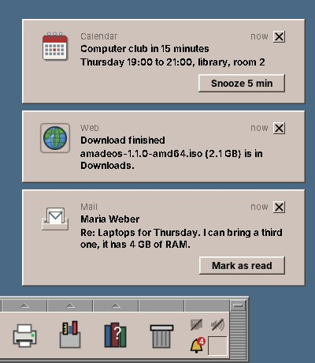

# 67. Notifications

A reminder is due while the Calendar is minimized; a download finishes in Firefox; updates have arrived. On Windows, GNOME or KDE a small window comes up in a corner and goes away by itself a few seconds later. CDE had nothing like it, and a bare X11 desktop drops these messages: Firefox asks the session bus for a notification service, finds none and stays silent. This chapter adds the service to amadeOS. It is the first desktop module that *offers* a D-Bus interface rather than calling one, and its pop-ups are windows that must never take the keyboard away from the user.



## What you will learn

- The freedesktop.org notification specification: one method that does most of the work, two signals, and hints.
- Offering a D-Bus service with dbus-java: exporting objects, taking a well-known name, knowing who called.
- Windows that never take the focus, placed above the panel by reading the docks' struts.
- Keeping the decisions (Do not disturb, per-program settings, which notification may still act) in one class without D-Bus or Swing, so they can be tested.
- A client in amade-commons that needs no D-Bus library: `gdbus` from GLib.

## What the user gets

| Part | What it does |
|---|---|
| Pop-ups | Up to four in a corner above the Front Panel, the newest nearest the corner; six seconds by default, paused while the mouse is over them; critical ones with a red bar until closed |
| History | `amadeos-notifications`: today, yesterday, older; kept 7 days, at most 100, in `~/.cache/amadeos/notifications.json`; its buttons still work while the program runs |
| Bell cell | In the Front Panel: the count of unseen notifications, crossed out during Do not disturb; a click shows the history, the menu has Do not disturb, Clear all and the settings |
| Do not disturb | For an hour, until tomorrow morning, until turned off, on a schedule, and while a window is full screen; notifications go silently into the history, critical ones still show |
| Settings > Notifications | Corner, how long, beep, Do not disturb, and per program *Pop-up and history*, *History only* or *Off*; `~/.config/amadeos/notifications.conf` |


## The specification

The [Desktop Notifications Specification](https://specifications.freedesktop.org/notification-spec/latest/) is small. A program calls `Notify` on the object `/org/freedesktop/Notifications` of whoever owns the bus name `org.freedesktop.Notifications`:

```
Notify(app_name, replaces_id, app_icon, summary, body, actions, hints, expire_timeout) -> id
```

- `actions` is a flat list of pairs, key and label: `["snooze", "Snooze 5 min", "default", ""]`. The key `default` is not a button but the click on the notification itself.
- `hints` is a dictionary of variants for everything else: `urgency` (a byte, 0 to 2), `category`, `desktop-entry` (the program's desktop file, which gives its name and icon), `image-data` (pixels), `image-path`, `transient` (not into the history), `resident` (stays after a button was pressed), `suppress-sound`.
- `expire_timeout` is in milliseconds; -1 leaves it to the desktop, 0 means until closed.

The answers come as broadcast signals: `ActionInvoked(id, key)` when the user pressed a button, `NotificationClosed(id, reason)` when it went away (1 expired, 2 dismissed by the user, 3 closed by `CloseNotification`, 4 other). A program listens for the ids it got back from `Notify`. `GetCapabilities` tells the program what the server can do (`body-markup`, `actions`, `persistence`, ...), and `GetServerInformation` names it.

Everything that uses libnotify (`notify-send`, Thunderbird, LibreOffice) or the desktop portal (Firefox) speaks this, so the one service serves them all.

## Who does what

The service is part of the session package: `amadeos-session notifications`, package `eu.amadeos.system.notify`, started by `/etc/amadeos/autostart.d/45-amadeos-notifications`, which starts it again should it die. The D-Bus interfaces and a small client live in `base`, because the Front Panel and Settings talk to the service too.

| Class | Module | What it does |
|---|---|---|
| `Notifications`, `NotificationCenter` | base `notify.dbus` | The D-Bus interfaces: the specification's, and amadeOS's own for the bell (`ShowHistory`, `ClearAll`, `SetDoNotDisturb`, the signal `StateChanged`) |
| `NotificationClient` | base `notify` | Sends notifications and controls the service, for the panel and Settings |
| `NotificationServer` | session | Turns the D-Bus arguments and hints into a `Notification` |
| `NotificationCore` | session | The decisions: the id, history or not, pop-up or not, which buttons still work. No D-Bus, no Swing |
| `NotificationHistory` | session | The entries, newest first, and the JSON file |
| `NotificationSettings`, `NotificationSettingsStore` | session | The settings and `notifications.conf` |
| `PopupStack`, `PopupCard` | session | The pop-up windows on the event dispatch thread |
| `HistoryWindow` | session | The history |
| `NotificationDaemon` | session | `main`: the bus, the X connection for struts, full screen and the lock, the worker |
| `NotificationCell`, `DesktopNotices` | panel-cde | The bell, and the panel's own notification: updates have arrived |
| `NotificationsPage` | settings | Settings > Notifications |

Three threads, as in the clipboard manager ([chapter 65](65-clipboard.md#who-does-what)): dbus-java calls the exported methods on its own threads, the pop-ups and the history window live on the event dispatch thread, and one worker serializes everything that changes the state. `NotificationCore` is `synchronized`, so a `Notify` that arrives while the user clicks a button sees a consistent history.

## Offering a service with dbus-java

The polkit agent and the keyring client *call* services. Offering one takes three steps: export the objects at their paths, then ask for the well-known name. In that order, so that a program that sees the name appear finds the objects already there.

```java title="amadeos-system · session/notify/NotificationDaemon.java"
--8<-- "amadeos-system/session/src/main/java/eu/amadeos/system/notify/NotificationDaemon.java:export"
```

`requestBusName` throws when another program owns the name: a second daemon, or the notification service of another desktop started by a stray autostart file. The daemon then ends with exit code 3, and the autostart script stops trying.

!!! warning "Pitfall: a struct return value must be generic"
    `GetServerInformation` returns four strings as a D-Bus struct, `(ssss)`. dbus-java models it as a `Tuple`, and refuses to export a method whose return type is a `Tuple` subclass with plain `String` fields: *Exporting non-exportable type*. The class must be generic, `ServerInformation<A, B, C, D>`, and the interface returns `ServerInformation<String, String, String, String>`; dbus-java reads the types from the generic signature.

`NotificationServer` reads the hints. Each is a `Variant`, and programs disagree about the details: libnotify sends `urgency` as a byte, which Java sees as a signed `Byte`, some programs send the spec's older names (`image_data`, `icon_data`), and `image-path` may be a `file://` URL.

```java title="amadeos-system · session/notify/NotificationServer.java"
--8<-- "amadeos-system/session/src/main/java/eu/amadeos/system/notify/NotificationServer.java:hints"
```

The sender's unique bus name (`:1.42`) comes from `AbstractConnection.getCallInfo().getSource()`, which dbus-java fills for the thread that runs the call. The daemon listens to `NameOwnerChanged`: when a sender leaves the bus, its notifications can no longer act, and nobody would hear an `ActionInvoked`. A click on such an entry in the history starts the program from its desktop entry instead.

## The decisions

`NotificationCore.notify` is the heart of the service. It picks the id (the old one when the notification replaces another), remembers a new program for the Settings list, applies the program's mode and Do not disturb, and holds back critical notifications while the screen is locked, so that nobody reads them on a locked screen:

```java title="amadeos-system · session/notify/NotificationCore.java"
--8<-- "amadeos-system/session/src/main/java/eu/amadeos/system/notify/NotificationCore.java:notify"
```

A pop-up whose time is up leaves the screen but stays *open* in the history, as GNOME does: the reminder's *Snooze* still works there ten minutes later. Only the ×, a button or `CloseNotification` closes it for the sender:

```java title="amadeos-system · session/notify/NotificationCore.java"
--8<-- "amadeos-system/session/src/main/java/eu/amadeos/system/notify/NotificationCore.java:invoke"
```

`NotificationCore` gets the outside world through two interfaces, `Screen` (pop up, beep, full screen, locked, start a program) and `Signals` (the three D-Bus signals). `NotificationCoreTest` gives it fakes that record what happened, with a fixed clock, and checks Do not disturb by schedule, the locked screen, replacing, the per-program modes and the history's limits without a bus or a display.

## Windows that never take the focus

A pop-up that took the focus would swallow the next keystrokes of someone typing a letter. The pop-ups are `JWindow`s of type `Window.Type.POPUP`, which Java maps to an *override-redirect* window on X11: the window manager never sees a request to map it, frames nothing and gives nothing the focus. `setFocusableWindowState(false)` keeps Java itself from focusing it on a click.

```java title="amadeos-system · session/notify/PopupStack.java"
--8<-- "amadeos-system/session/src/main/java/eu/amadeos/system/notify/PopupStack.java:popup-window"
```

Placing them above the Front Panel means knowing where the panel is. Docks announce the screen edges they reserve in `_NET_WM_STRUT_PARTIAL` (or the older `_NET_WM_STRUT`), four numbers: left, right, top, bottom. `X11EwmhHelper.reservedEdges` reads them from every top-level window and keeps the largest per edge; the window manager does the same to keep maximized windows off the panel.

```java title="amadeos-system · session/notify/NotificationDaemon.java"
--8<-- "amadeos-system/session/src/main/java/eu/amadeos/system/notify/NotificationDaemon.java:area"
```

!!! warning "Pitfall: who comes first at login"
    The autostart scripts run before the panel starts, so the first notifications of a session may come up when there is no panel and no strut yet, and the panel, mapped later, covers them. `PopupStack` therefore places its pop-ups again every two seconds while any are shown, and raises them.

The body may hold `<b>`, `<i>`, `<u>`, `<a href>` and `<br>`. `BodyMarkup` keeps these, escapes everything else, and allows links only to `http`, `https` and `mailto`. A label with HTML in Swing does not wrap on its own; `PopupCard` measures the text with the `View` that Swing's HTML renderer builds and gives the label the exact height for the card's width.

## Do not disturb and full screen

Do not disturb has four sources: the bell's menu (for an hour, until tomorrow morning at 07:00 or the end of the schedule, until turned off), stored as `dnd.until` with an epoch time or `on`; a daily schedule, which may run over midnight (22:00 to 07:00); and a full-screen window. `NotificationSettings.doNotDisturb(now, zone, fullscreen)` combines them. Whether the active window is full screen is one EWMH question: `_NET_ACTIVE_WINDOW` on the root window, then `_NET_WM_STATE_FULLSCREEN` in that window's `_NET_WM_STATE`.

The bell learns about all this from the signal `StateChanged(unseen, doNotDisturb)`, which the core sends only when one of the two changed. A program that wants to know whether to beep itself can ask `DoNotDisturb()`.

## The panel's own notification

The Front Panel is a client like any other. `DesktopNotices` announces each new set of waiting updates once, with a *Show* button that opens Software, replaces its notification when more arrive and takes it back when the updates are installed. The low battery warning is not the panel's: the power manager of the session sends it, with the thresholds of Settings > Power.

```java title="amadeos-system · panel-cde/status/DesktopNotices.java"
--8<-- "amadeos-system/panel-cde/src/main/java/eu/amadeos/system/panel/cde/status/DesktopNotices.java:updates"
```

## The client in amade-commons

The amade programs send through `eu.amadeos.commons.desktop.Notifications` ([chapter 45](45-desktop.md#notifications-notifications)). A D-Bus library in amade-commons would land in every program, including the games, so the client calls `gdbus` instead, which every Debian desktop has (package `libglib2.0-bin`), and `gdbus monitor` for the signals. That brought up one detail of the service: each `gdbus call` is a process of its own whose bus connection ends at once, so the service would take the program for gone and grey out its buttons. The client therefore sends its process id in the hint `sender-pid`, and the service ties such notifications to that process instead of the bus connection.

## Who sends notifications

Five amade programs use the client, each for the moment the user may not be looking at its window:

| Program | When | Buttons | Chapter |
|---|---|---|---|
| Calendar | a *popup* reminder is due | *Snooze 5 min*; a click opens the day | [21](21-calendar.md#reminders) |
| Mail | the inbox of an account has more unread mail than at the last check | a click opens the inbox | [22](22-mail.md) |
| Backup | a job is overdue, or a backup failed (critical) | *Open Backup & Sync* | [26](26-backup.md) |
| TV | a program with a reminder starts | *Watch* | [38](38-tv.md) |
| Webcam | a photo, a burst or a video is saved while the window is in the background | *Open* | [28](28-webcam.md) |

They share three rules. Every action goes to the EDT first, because the client calls it on its own thread. If `send` returns 0 (no notification service, so the client used the system tray of [chapter 45](45-desktop.md#notifications-notifications)) and there is no system tray either, the program falls back to what it did before: Calendar's and TV's dialogs, Backup's notice window. And a notification that would only repeat itself replaces the last one: Mail's count of new mail, Backup's reminder for the same job.

Mail counts the unread messages of the inbox folders per account and announces only an increase, and never on the first look at an account after the start, which would greet the user with "214 new messages":

```java title="amade-mail · ui/main/MainPresenter.java"
--8<-- "amade-mail/src/main/java/eu/amadeos/apps/mail/ui/main/MainPresenter.java:new-mail"
```

Backup's helper has no window to bring forward; *Open Backup & Sync* starts the program. Reminders are `NORMAL`, failures `CRITICAL`, so a failed backup stays on the screen until the user has seen it:

```java title="amade-backup · ui/notice/NoticeWindows.java"
--8<-- "amade-backup/src/main/java/eu/amadeos/apps/backup/ui/notice/NoticeWindows.java:notice"
```

Webcam shows the opposite case: while its window is in front, the status line says "Saved Photo …" and a pop-up would be noise. It only sends when the window is not active, as after a self-timer or at the end of a time lapse, and marks the notification *transient*, so it does not fill the history:

```java title="amade-webcam · ui/main/MainWindow.java"
--8<-- "amade-webcam/src/main/java/eu/amadeos/apps/webcam/ui/main/MainWindow.java:saved"
```

## Testing by hand

Under Xvfb with a private session bus, the daemon and `notify-send` are enough:

```sh
xvfb-run -s "-screen 0 1280x800x24" dbus-run-session -- sh -c '
  amadeos-session notifications --daemon &
  sleep 3
  notify-send -a Calendar -A snooze="Snooze 5 min" "Computer club in 15 minutes" "Thursday 19:00" &
  sleep 2; import -window root popups.png
  gdbus call --session --dest org.freedesktop.Notifications --object-path /eu/amadeos/Notifications \
      --method eu.amadeos.NotificationCenter1.SetDoNotDisturb -- -1'
```

`gdbus monitor --session --dest org.freedesktop.Notifications` shows every signal. Note the `--` before `-1`: without it, `gdbus` takes the number for an option.

## Exercises

1. **Text on the lock screen.** Let the lock screen show "2 new notifications" without their text. Which part learns about the lock, and how does the lock screen ask?
2. **Group by program.** Five mails in a minute make five pop-ups. Fold notifications of the same program that arrive within ten seconds into one pop-up with a count.
3. **Inline reply.** The specification has the capability `inline-reply` (KDE's) for a text field in the notification. What does a pop-up need that cannot take the focus?
4. **Sound per category.** Play a different sound for `email.arrived` than for `device.error`, through the sound theme of `~/.config/amadeos`.

## Summary

- One `Notify` method with hints and two signals make the whole protocol; everything that uses libnotify or the portal works with it.
- Export the objects first, then take the name; a struct return value needs a generic `Tuple` in dbus-java.
- `NotificationCore` holds every decision without D-Bus or Swing and is tested with fakes and a fixed clock.
- Override-redirect pop-ups never take the focus; struts tell where the panel is, and placing again every two seconds copes with a late panel.
- A notification whose pop-up expired stays open in the history; the sender's connection, or its `sender-pid`, decides whether its buttons still work.
- amade programs send through `Notifications` in amade-commons, which needs only `gdbus`.
