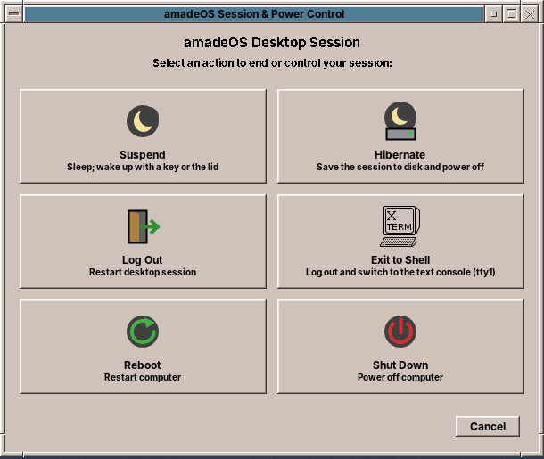
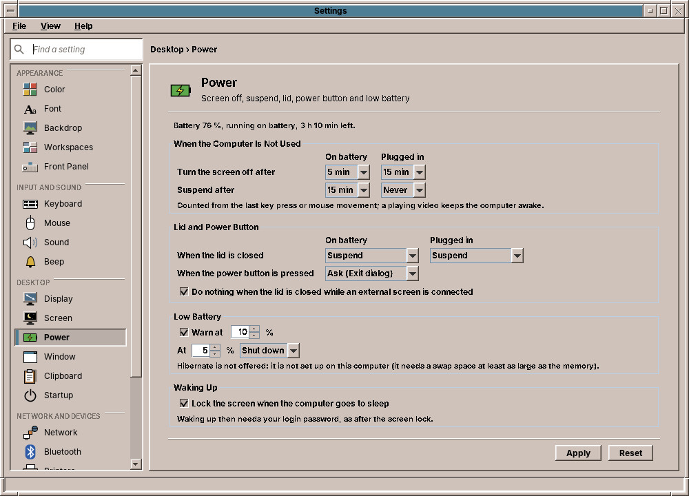

# 68. Power Management

A laptop that cannot sleep is only half a laptop. This chapter gives the desktop what every other one has: **Suspend** and **Hibernate** in the EXIT window, an action for the closed lid, a power button that asks first, a screen that goes dark and a computer that sleeps when nobody uses it, a warning before the battery is empty, and a screen lock that is up before the computer sleeps. None of it needs root, and almost none of it needs a new daemon: systemd-logind already knows how to sleep, and the session already has a program that watches the idle time.





## What you will learn

- Calling systemd-logind over D-Bus: `Suspend`, `Hibernate`, `PowerOff`, `CanHibernate`, the properties `LidClosed` and `Docked`, the signal `PrepareForSleep`.
- Taking the lid and the power button away from logind with *inhibitor locks*, and delaying sleep long enough to lock the screen.
- Holding an inhibitor without passing file descriptors over D-Bus.
- Turning the screen off through the X server's DPMS.
- Keeping the decisions in a pure class that a test drives second by second.

## Who does what

| Class | Module, package | What it does |
|---|---|---|
| `PowerSettings`, `PowerSettingsStore`, `PowerAction` | base, `base.power` | The settings in `~/.config/amadeos/power.conf`: a profile for battery and one for mains (screen off, suspend, lid), power button, low battery, lock before sleep |
| `PowerControl`, `LogindPowerControl` | base, `base.power` | What the desktop asks logind and tells it to do; tests use stand-ins |
| `Inhibitor` | base, `base.power` | A logind inhibitor lock held by a `systemd-inhibit` child |
| `SessionDialogHelper` | base, `base.ui` | The EXIT window, now with Suspend and Hibernate |
| `PowerPolicy` | session, `power` | Pure logic: what the settings ask for at this moment |
| `PowerManager`, `ScreenPower` | session, `power` | Carries it out, from the screen saver's poll loop |
| `PowerButton` | wm, `wm.power` | The key XF86PowerOff, grabbed by the window manager |
| `PowerPage` | settings | The Settings page |

## Talking to logind

logind is the part of systemd that knows the sessions, the seats and what the computer may do. Its manager object `/org/freedesktop/login1` on the system bus has the methods every desktop uses. The interface for dbus-java names only the members the desktop calls; the argument of the three actions is *interactive*: polkit may ask for a password, through the desktop's own polkit agent ([chapter 60](60-desktop.md)). The user of the active session at the computer needs none; with other users logged in, polkit asks for an administrator.

`CanHibernate` answers `yes`, `no`, `na` or `challenge`. It already knows whether there is a swap space large enough for the memory in use and whether the kernel may write it (Secure Boot's lockdown forbids it). The EXIT window greys Hibernate out on anything but `yes` or `challenge`, and the Power page leaves it out of its lists:

```java title="amadeos-system · base/ui/SessionDialogHelper.java"
--8<-- "amadeos-system/base/src/main/java/eu/amadeos/system/base/ui/SessionDialogHelper.java:dialog"
```

Suspend and Hibernate run on a thread of their own: logind answers at once, but a polkit question would block the event dispatch thread.

## Taking over the lid and the button

By default logind suspends when the lid closes and powers off at the power button, whatever the desktop thinks. A desktop that wants to decide takes an **inhibitor lock**: `handle-lid-switch` and `handle-power-key` in mode `block` tell logind to leave these to the holder. GNOME and KDE do exactly that. The lock lives as long as a file descriptor that logind hands out with `Inhibit()`, and that is the catch for Java: dbus-java's native Unix socket transport cannot receive file descriptors.

The way round is `systemd-inhibit`, which takes the lock and runs a command while it holds it. The command is `cat`, reading from a pipe that only the desktop's process writes:

```text
systemd-inhibit --what=handle-lid-switch --who=amadeOS --why=… --mode=block cat
```

Closing the pipe ends `cat`, `systemd-inhibit` exits and the lock is gone. If the desktop crashes, the pipe closes too, so logind never keeps waiting for a dead desktop. `systemd-inhibit --list` shows the locks.

!!! tip "Who holds what"
    Whoever handles an event holds its lock. The session's screen daemon handles the lid and holds `handle-lid-switch`; the window manager grabs the power key and holds `handle-power-key`. At the login screen neither runs, and logind's defaults apply again.

The lid has no X event. The screen daemon reads logind's `LidClosed` property once a second, in the poll it does anyway for the screen saver, and `Docked`, which is true with an external monitor connected: that is the "do nothing while an external screen is connected" of the page.

The power button is a key, `XF86PowerOff`, that the kernel's input layer reports like any other. The window manager grabs it like Super+L ([chapter 66](66-window-switcher.md#a-key-for-the-whole-desktop)) and asks `PowerButton` what to do. Some firmware sends the key twice, so presses closer than one and a half seconds count once:

```java title="amadeos-system · wm/power/PowerButton.java"
--8<-- "amadeos-system/wm/src/main/java/eu/amadeos/system/wm/power/PowerButton.java:pressed"
```

## Locking before the computer sleeps

The screen must be locked *before* the computer sleeps, otherwise the desktop shows for a moment on waking up. logind has a second kind of inhibitor for this, mode `delay` on `sleep`: before it sleeps, logind sends the signal `PrepareForSleep(true)` and waits up to five seconds for the delay locks to go. The daemon starts the screen lock, waits until the lock owns its X selection, then closes its delay lock; after `PrepareForSleep(false)` it takes a new one. That works for every way of sleeping, EXIT, lid, button, idle or `systemctl suspend` in a terminal, without any of them knowing about the lock.

## One second at a time

`PowerManager.poll` runs in the screen saver daemon's loop, with the idle time it already read from the X server:

```java title="amadeos-system · session/power/PowerManager.java"
--8<-- "amadeos-system/session/src/main/java/eu/amadeos/system/power/PowerManager.java:poll"
```

The decisions are in `PowerPolicy`, which knows neither X11 nor D-Bus. It gets the idle time, the power source, the charge, the lid and whether the screen is locked, and returns steps. Three details make it more than comparisons:

- **Idle suspend happens once per idle period.** After waking up, the X server's idle time still counts the time asleep: without care, the computer would go straight back to sleep. The policy suspends once and then waits for input, which it sees as an idle time smaller than the last one; after `PrepareForSleep(false)` it is told so too.
- **The lid acts on the closing edge**, not while it stays closed.
- **The battery warning and the low-battery action happen once** while discharging; plugging in re-arms them. Hibernate falls back to Suspend for the lid and the button, and to Shut down for a nearly empty battery, where a suspended computer would die anyway.

The warning goes out as a notification ([chapter 67](67-notifications.md)) through `NotificationClient`: critical, so it stays until closed and shows through Do not disturb, with the desktop entry of Settings, whose page a click opens. Where no notification daemon answers, `send` returns 0 and the old small window shows instead:

```java title="amadeos-system · session/power/PowerManager.java"
--8<-- "amadeos-system/session/src/main/java/eu/amadeos/system/power/PowerManager.java:warning"
```

The screen does not go dark through the policy at all. The X server already has a timer for that, DPMS: `xset dpms 0 0 300` turns the monitors off after five minutes without input, and any input turns them on again. The manager only sets the timeout when the profile changes, for example when the cable is pulled.

## The page

`PowerPage` shows two columns, *On battery* and *Plugged in*, only where `PowerSupplies` finds a battery ([chapter 63](63-front-panel.md)); a desktop computer sees one column and the power button. The tables are `GridBagLayout`s whose first columns get the same width, so the choices of both sections line up:

```java title="amadeos-system · settings/PowerPage.java"
--8<-- "amadeos-system/settings/src/main/java/eu/amadeos/system/settings/PowerPage.java:idle"
```

Like every page it only writes its file; the daemon and the window manager notice the new modification time on their next read.

## Testing it

| Test | What it checks |
|---|---|
| `PowerSettingsStoreTest` | Defaults, round trip, unknown or unfit values (an action that does not fit the event) |
| `PowerPolicyTest` | Idle suspend once, never plugged in by default, no suspend right after waking, lid edge and docked, warn then act once |
| `PowerManagerTest` | DPMS timeout follows the power source, lid lock, Hibernate's fallbacks, the warning as a critical notification or the window, translations |
| `PowerButtonTest` | Ask, not while locked, double press, Do nothing |
| `PowerPageTest` | Saving on a laptop, the battery column kept on a desktop, the minute texts |

A stand-in for `PowerControl` records "suspend", "hibernate" and "power-off" instead of putting the test machine to sleep. What only real hardware shows, a lid, a battery, a resume, needs a laptop.

!!! planned "Planned"
    Power profiles (power-profiles-daemon), screen brightness and keyboard backlight; the power button while the screen is locked, which today goes to the lock and does nothing.
