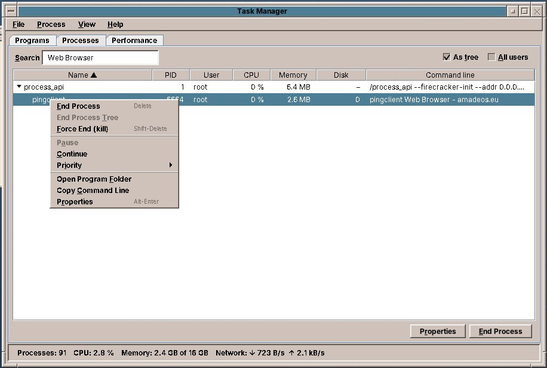
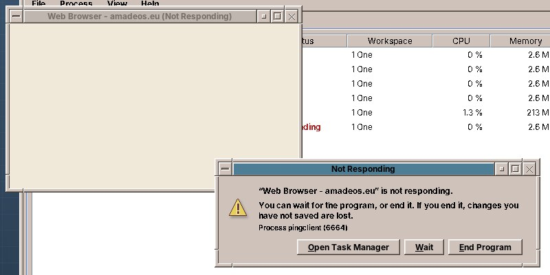

# 69. The Task Manager

A program hangs, and the user wants it gone. Or the fan is loud, and the user wants to know which program keeps the computer busy. On Windows, both questions start with Ctrl+Shift+Esc. amadeOS answers them with `amadeos-taskmanager`, a desktop module of amadeos-system with three tabs: the program windows, all processes, and graphs of the last minute.

The chapter has two halves. The Task Manager reads everything it shows from `/proc`, with no native library, no `ps` and no `top`. The window manager finds out on its own that a window has stopped answering, through the freedesktop.org ping, and brings up the Task Manager's question.



## What you will learn

- Reading the processor, memory, network and disk counters and every process from `/proc`, and turning counters into rates.
- Testing all of that against a fake `/proc` tree in a temporary folder.
- Finding the process behind a window with `_NET_WM_PID`.
- Ending, pausing and reprioritizing processes with `kill` and `renice`, and with `pkexec` for other users' processes.
- Finding hanging windows with `_NET_WM_PING`, and where that method stops working.

## Who does what

The module is a desktop module, like the window manager: it is in `desktopModules` of the root `build.gradle`, starts with `main`, and loads its texts with `Messages.load` ([chapter 60](60-desktop.md#two-kinds-of-module)). It talks to X through `base`, and its model has no Swing in it.

| Class | Package | What it does |
|---|---|---|
| `ProcFs` | `proc` | Reads `/proc`: the counters of the whole computer, the processes, the details of one |
| `ProcessInfo`, `SystemCounters` | `proc` | What one read gives: counters, not rates |
| `Sampler` | `model` | Two reads make one `Sample`: percentages and bytes per second; keeps the 60-second histories |
| `ProcessTree` | `model` | The rows of the Processes tab: tree or list, sorted, searched, branches closed |
| `ProgramRow` | `model` | One line of the Programs tab: a window and its processes added up |
| `X11Windows` | `x` | The program windows from `_NET_CLIENT_LIST`, with their process, workspace and state |
| `ProcessControl` | `control` | `kill`, `renice`, and `pkexec` when they need it |
| `Monitor` | `ui` | One thread that samples every second and hands the result to the event dispatch thread |
| `MainWindow`, `ProgramsPanel`, `ProcessesPanel`, `PerformancePanel` | `ui` | The window and its tabs |
| `EndProcessDialog`, `NotRespondingDialog`, `PropertiesDialog` | `ui` | Ending politely, then by force; the question for a hanging window; the details of a process |
| `PingTracker` | `wm` › `hang` | In the window manager: which window was pinged when, which have not answered |

## Everything from /proc

Linux shows its state as text files under `/proc`. The ones for the whole computer are:

| File | What the Task Manager takes from it |
|---|---|
| `/proc/stat` | Processor time since boot, as a whole (`cpu`) and per core (`cpu0`, `cpu1`, ...), in ticks of 1/100 s |
| `/proc/meminfo` | `MemTotal`, `MemAvailable`, `Buffers`, `Cached`, `SReclaimable`, the swap |
| `/proc/net/dev` | Bytes received and sent per network device since it came up; `lo` is left out |
| `/proc/diskstats` | Sectors read and written per disk; only whole disks count, not their partitions, or every byte would count twice |
| `/proc/loadavg`, `/proc/uptime`, `/proc/cpuinfo` | Load average, time since boot, the processor's name |

A line of `/proc/stat` has the time spent in each state: user, nice, system, idle, iowait, irq, softirq, steal. *Busy* is everything but idle and iowait. The time of virtual machines (guest) is already counted in user, so the sum stops at steal:

```java title="amadeos-system · taskmanager/proc/ProcFs.java"
--8<-- "amadeos-system/taskmanager/src/main/java/eu/amadeos/system/taskmanager/proc/ProcFs.java:counters"
```

Each process is a folder `/proc/<pid>`. `stat` holds its parent, its state, its processor time, its priority and its start time in one line; `status` holds the user and the resident memory; `cmdline` holds the command line with `\0` between the words; `io` holds the bytes it read and wrote:

```java title="amadeos-system · taskmanager/proc/ProcFs.java"
--8<-- "amadeos-system/taskmanager/src/main/java/eu/amadeos/system/taskmanager/proc/ProcFs.java:processes"
```

!!! warning "Pitfall: the name in /proc/[pid]/stat may contain anything"
    The second field is the program's name in parentheses, and a program may call itself `(sd-pam)` or `a b) c`. Splitting the line at spaces then shifts every field after it. Take the name from the first `(` to the *last* `)`, and split only what comes after.

Processes come and go while the folder is read. A process that ends between listing the folder and reading its `stat` throws `NoSuchFileException`; `process` returns empty and the process is left out. The `io` file of another user's process cannot be read at all: its disk column shows "–", not 0.

### Counters become rates

Every figure in `/proc` is a counter since boot. The Task Manager shows how much happened since the last look, so `Sampler` keeps the previous read and divides by the time in between:

```java title="amadeos-system · taskmanager/model/Sampler.java"
--8<-- "amadeos-system/taskmanager/src/main/java/eu/amadeos/system/taskmanager/model/Sampler.java:sample"
```

A process's CPU is its ticks since the last sample divided by the ticks of the *whole* computer. That makes it a share of all cores together, as on Windows: a program that keeps one of four cores busy shows 25 %, and the CPU column adds up to the processor graph. Process IDs are reused. A process with the same ID but a different start time is a new one, and comparing its ticks with the old one would give nonsense, so the start time is part of the check.

!!! tip "Tip: a fake /proc for the tests"
    `ProcFs` takes the root folder in its constructor; the program passes `/proc`, the tests a temporary folder. `FakeProc` writes `stat`, `meminfo`, `net/dev`, `diskstats` and a few process folders there, and changes them between two samples. `SamplerTest` then checks that a process with 200 of the machine's 1000 ticks has 20 %, that 2048 more bytes in `net/dev` within one second are 2048 bytes per second, that another user's unreadable `io` gives "–", and that a reused ID starts at 0 %. No test needs a real process to be busy.

## Windows and their processes

The Programs tab shows windows, but CPU and memory belong to processes. The window manager lists the windows in `_NET_CLIENT_LIST`; most programs say which process they are in `_NET_WM_PID`. `base` reads those with the EWMH helper, together with what the Task Manager needs to sort out windows that are not programs:

```java title="amadeos-system · base/x11/X11EwmhHelper.java"
--8<-- "amadeos-system/base/src/main/java/eu/amadeos/system/base/x11/X11EwmhHelper.java:window-process"
```

Dialogs are left out: a window with `WM_TRANSIENT_FOR`, or of type `_NET_WM_WINDOW_TYPE_DIALOG`, belongs to a program that already has its line. The Task Manager's own dialogs need one more rule. AWT gives a `JDialog` without an owner neither of the two, so the Task Manager hides every window of its own process except the main window.

A program is often more than one process: Firefox starts a dozen, the Text Editor's spell checker runs as a child. So a line adds up the process of the window and everything below it in the tree:

```java title="amadeos-system · taskmanager/model/ProgramRow.java"
--8<-- "amadeos-system/taskmanager/src/main/java/eu/amadeos/system/taskmanager/model/ProgramRow.java:programs"
```

A window without `_NET_WM_PID` (old X programs such as `xterm` without its option) still gets a line, with "–" in the columns, and can be switched to but not ended.

## Ending, pausing, priority

Signals go through the programs `kill` and `renice` rather than `ProcessHandle`. `ProcessHandle.destroy` only works for processes the JVM may signal anyway, and it cannot pause or continue; the commands work the same for every process, and for another user's process the same command goes through `pkexec`, which shows the polkit agent's password window ([chapter 64](64-software.md#changing-needs-root-the-helper)):

```java title="amadeos-system · taskmanager/control/ProcessControl.java"
--8<-- "amadeos-system/taskmanager/src/main/java/eu/amadeos/system/taskmanager/control/ProcessControl.java:signals"
```

Ending is polite first. `EndProcessDialog` sends SIGTERM, which a program can catch to save and quit, and watches `/proc/<pid>` with a progress bar. A process still there after 5 seconds gets the offer *Force End*: SIGKILL, which cannot be caught. Lowering a process's priority (raising its nice value) is allowed for its owner; raising it again needs root, so `setPriority` compares with the current value. An exit code 126 or 127 of `pkexec` means the user cancelled the password window; that is no error and shows no message.

!!! warning "Pitfall: never PID 1, and think twice about the desktop"
    Signalling PID 1, systemd, as root can bring down the computer; `ProcessControl` refuses PID 1 and below whatever the user chooses. The Task Manager also warns before ending a part of the desktop or the system: the window manager, the panel, the session, the display manager, Xorg, D-Bus, PipeWire, NetworkManager, polkit. Ending some of them logs the user out.

## A window that does not respond

How does anyone know that a program hangs? The window manager cannot see inside it. It can ask. EWMH has the message for that: the window manager sends `_NET_WM_PING` to a window, and a program whose event loop runs sends the same message back to the root window at once. A program that is stuck in a long computation, or waits for a lock forever, does not.

The window manager pings in two moments: when the user asks a window to close, and every 2 seconds the active window. Only windows that put `_NET_WM_PING` into their `WM_PROTOCOLS` take part; GTK, Qt, Firefox and Java's AWT all do. `PingTracker` keeps the time of the unanswered ping per window and never sends a second one while the first is open, so a hanging window does not pile up messages:

```java title="amadeos-system · wm/x11/X11WindowManagerService.java"
--8<-- "amadeos-system/wm/src/main/java/eu/amadeos/system/wm/x11/X11WindowManagerService.java:ping"
```

The answer is a `ClientMessage` of type `WM_PROTOCOLS` at the root window, with `_NET_WM_PING` in `data[0]` and the client window in `data[2]`; the event loop checks for it before any other client message. A window that has not answered for 5 seconds is marked once:

- the frame's title gets "(Not Responding)", in the desktop's language (`HangTexts`, `FrameWindow.setTitleSuffix`);
- the client window gets the property `_AMADEOS_NOT_RESPONDING`, a `CARDINAL` 1, which the Task Manager reads for its Status column;
- the window manager starts `amadeos-taskmanager --not-responding <window>`.



The Task Manager runs once per display: a second start hands its arguments over a Unix socket in `$XDG_RUNTIME_DIR` and exits. So the window manager does not need to know whether it is open. `NotRespondingDialog` offers *Wait*, *End Program* and *Open Task Manager*, reads the property every second and closes itself when the window answers again and the window manager has taken the mark off. A Task Manager started only for the question exits with the dialog.

The keys are the window manager's too, with the passive grab of [chapter 66](66-window-switcher.md#a-key-for-the-whole-desktop), in every combination with Num Lock and Caps Lock:

```java title="amadeos-system · wm/x11/X11WindowManagerService.java"
--8<-- "amadeos-system/wm/src/main/java/eu/amadeos/system/wm/x11/X11WindowManagerService.java:task-manager-keys"
```

!!! warning "Pitfall: Ctrl+Alt+Del on the text console"
    Under X, Ctrl+Alt+Del is a key like any other, and the window manager may take it. On a text console it is not: the kernel hands it to systemd, which reboots the computer. Do not tell users that the keys work everywhere; they work on the desktop.

!!! note "Where the ping stops working: Java programs"
    AWT answers `_NET_WM_PING` on its own toolkit thread, not on the event dispatch thread. A Swing program whose event dispatch thread is blocked therefore keeps answering the ping, and is never marked. For the amade programs that is one more reason for the rule of [chapter 41](41-start-up.md#two-threads-edtexecutor-and-ui): long work never on the event dispatch thread. The Task Manager can still end them.

## Testing

The model and the reading of `/proc` are plain Java with unit tests against `FakeProc`: `ProcFsTest`, `SamplerTest`, `ProcessTreeTest`. `ProcessControlTest` runs `ProcessControl` with a recording command runner instead of `kill`; `InstanceChannelTest` hands arguments to a second instance over a socket; `GraphTest` checks the graph's scale. In the window manager, `PingTrackerTest` plays the timeouts through with a given clock: sent at 0, nothing at 4999 ms, marked at 5000, marked only once, unmarked on the answer.

What the tests do not show is the whole chain. Under Xvfb with the window manager, a small Xlib client that answers pings stands in for a program; `kill -STOP` makes it hang and `kill -CONT` lets it answer again. That is how the pictures of this chapter were taken.
