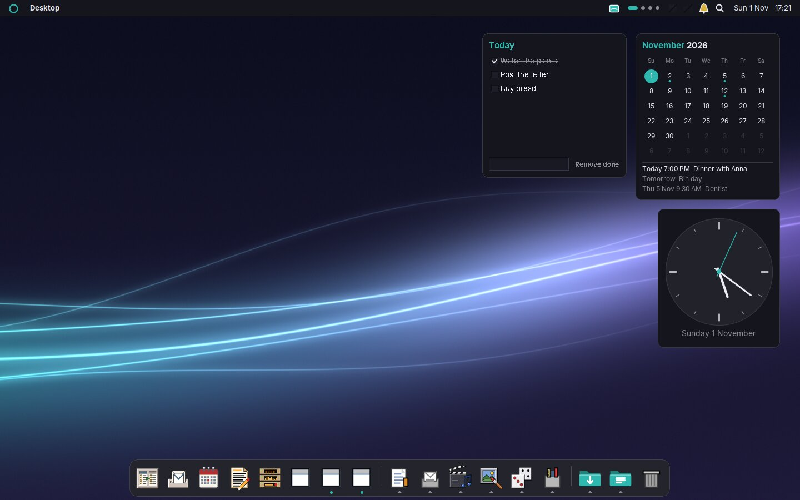
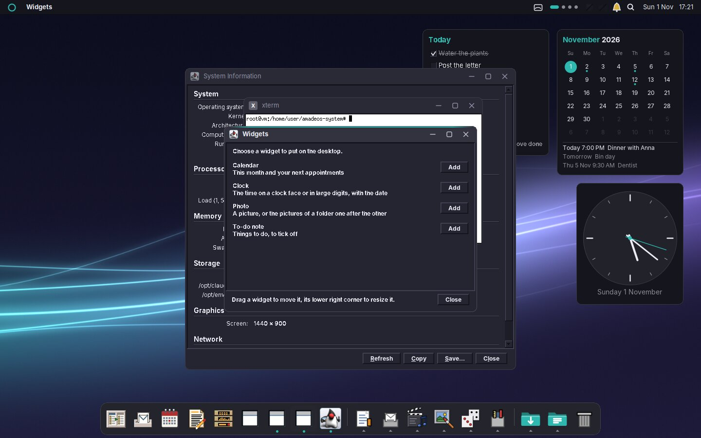

# 70. Desktop Widgets

In the Horizon look the desktop is more than a backdrop: a clock, a photo, a to-do note and the month of the Calendar sit on it as small cards, always below the windows. Super+D clears the windows away to show them. This chapter builds both. The widgets are a new kind of program: not one process per widget, but one host, `amadeos-widgets`, that loads widgets from the jars of the applications. An application that wants a widget implements one interface from amade-commons and installs a two-line file; the Calendar is the first.



## What you will learn

- Showing the desktop the EWMH way, with `_NET_SHOWING_DESKTOP`, and why the windows are hidden rather than minimised.
- A window property of our own that the window manager reads to keep a window below all others.
- Plugins in Java without a framework: `ServiceLoader`, a `URLClassLoader` per jar and a file that names the jar.
- An API in amade-commons that keeps the widget away from the host: `DesktopWidget` and `WidgetContext`.
- Writing a widget for an application, with the Calendar's month widget as the example.

## What the user gets

| Part | What it does |
|---|---|
| Show desktop | Super+D, the screen button left of the workspace dots, the dock's right-click menu, or Workspace Menu > Window Management. The windows of the current workspace go away; Super+D again, a click on a program in the dock or a new window brings them back |
| Widget gallery | System menu or dock menu > Widgets: every widget there is, with one line about it and Add. A new widget goes into the first free place along the right edge |
| On the desktop | Drag a widget to move it, its lower right corner to resize it. The right-click menu has Settings…, Add widgets… and Remove from desktop |
| Built in | Clock (a face or large digits), Photo (one picture or a folder, changing every few minutes), To-do note (tick off, remove what is done) |
| From applications | Calendar: this month, the days with appointments and the next appointments; a click opens the Calendar |



## Showing the desktop

The [EWMH](https://specifications.freedesktop.org/wm-spec/latest/) has a property for it on the root window, `_NET_SHOWING_DESKTOP`, a CARDINAL that is 1 while the desktop is shown. A program asks for the mode with a client message to the root; the window manager does it and sets the property, which the top bar reads to light its button. `X11EwmhHelper` in `base` has both sides:

```java title="amadeos-system · base/x11/X11EwmhHelper.java"
--8<-- "amadeos-system/base/src/main/java/eu/amadeos/system/base/x11/X11EwmhHelper.java:show-desktop"
```

What "showing the desktop" means is left to the window manager. Minimising every window would be the simple way, but it has two faults here: the Horizon dock would get a ring under every program, and in the classic look every window would become an icon on the desktop. So the window manager only unmaps the frames of the current workspace and remembers them. Coming back maps the same frames in the same order, and the window that had the keyboard gets it again:

```java title="amadeos-system · wm/x11/X11WindowManagerService.java"
--8<-- "amadeos-system/wm/src/main/java/eu/amadeos/system/wm/x11/X11WindowManagerService.java:show-desktop"
```

Two rules end the mode without the user asking: when any window is activated (a click in the dock, Alt+Tab, a new window) and when the user switches workspace. Both paths start with `if (showingDesktop) setShowingDesktop(false, false)`, the `false` because the window being activated gets the focus anyway. Super+D is grabbed on the root with every combination of Num Lock and Caps Lock, as Super+Space was for the search.

## A window that stays below

A widget is an ordinary Swing window, but the window manager must neither frame it nor raise it, and Alt+Tab, the dock and show desktop must leave it alone. EWMH has `_NET_WM_WINDOW_TYPE_DESKTOP` for the one window that *is* the desktop; for small windows on top of it there is nothing. So amadeOS adds a property of its own, like `_AMADEOS_FRAMELESS` for the search window: the host sets `_AMADEOS_DESKTOP_WIDGET` before the window is mapped,

```java title="amadeos-system · widgets/WidgetWindow.java"
--8<-- "amadeos-system/widgets/src/main/java/eu/amadeos/system/widgets/WidgetWindow.java:on-desktop"
```

and the window manager, on the `MapRequest`, maps it as it is and lowers it below everything else. It never enters the client list, so nothing that walks the list sees it:

```java title="amadeos-system · wm/x11/X11WindowManagerService.java"
--8<-- "amadeos-system/wm/src/main/java/eu/amadeos/system/wm/x11/X11WindowManagerService.java:desktop-widget"
```

`addNotify()` before `setVisible(true)` is the trick that makes this work: it creates the X window without mapping it, so the property is there when the window manager first hears of the window.

## One host, many widgets

A process per widget would be the simplest model and the most wasteful one: each Java process costs some 60 MB before it draws a pixel. The host runs once per session and keeps all widgets in one JVM. It is started by the Horizon top bar, ends by itself when the look changes to classic, and takes care of everything a widget should not have to do:

| The host | The widget |
|---|---|
| finds the widgets, shows the gallery | says what it is: id, name, one line, default size |
| keeps the layout in `~/.config/amadeos/widgets.conf` | draws its content |
| keeps each copy's settings in `~/.config/amadeos/widgets/<id>.conf` | reads and writes its settings through the context |
| paints the card in the desktop colours, follows the theme | uses the colours it is given |
| moves, resizes, removes, stops the timers of a removed copy | asks for a timer |

### Finding widgets

The host's own widgets are listed in its jar under `META-INF/services/eu.amadeos.commons.widget.DesktopWidget`, which `ServiceLoader` reads. An application's widgets are in the application's jar, which the host does not have on its class path. So the application installs a small file into `/usr/share/amadeos/widgets/` that names the jar:

```properties title="amade-calendar · packaging/amade-calendar.widget"
--8<-- "amade-calendar/packaging/amade-calendar.widget"
```

and the host gives every such jar its own class loader, with the host's class loader as the parent:

```java title="amadeos-system · widgets/WidgetCatalog.java"
--8<-- "amadeos-system/widgets/src/main/java/eu/amadeos/system/widgets/WidgetCatalog.java:load-jar"
```

The parent matters. Class loaders ask their parent first, so `DesktopWidget` and everything else from amade-commons and Swing comes from the host, and the widget's class implements the same interface the host knows. The application's own classes (`CalendarService`, the iCalendar reader) come from its jar. The application's jar carries its own copy of amade-commons as well, unused; that is the cost of fat jars, and it is why a widget must not rely on a newer commons than the host's. A broken jar or a widget that throws while loading is logged and skipped, so one bad widget never keeps the others from the desktop. `~/.local/share/amadeos/widgets/` is read as well, for a widget under development.

## The API in amade-commons

The package `eu.amadeos.commons.widget` has what a widget writer needs, and nothing of the host:

```java title="amade-commons · widget/DesktopWidget.java"
--8<-- "amade-commons/src/main/java/eu/amadeos/commons/widget/DesktopWidget.java:interface"
```

Each copy on the desktop gets a context. It is the widget's only way to the outside, which keeps widgets testable (a test hands in a small context of its own) and lets the host clean up after a copy that is removed:

```java title="amade-commons · widget/WidgetContext.java"
--8<-- "amade-commons/src/main/java/eu/amadeos/commons/widget/WidgetContext.java:interface"
```

The rest is small: `WidgetSettings` is a form and what OK does; `WidgetColors` takes the card, text, dim, line and accent colours from a `DesktopTheme` the way the top bar does; `WidgetCard` paints the rounded card; and `WidgetPreview.show(widget)` puts a widget into a window with a context that keeps its settings in memory, so a widget can be tried from a `main` method without the host and without Horizon.

## A widget for the Calendar

The Calendar's widget shows this month and the next appointments. It runs inside the host, not inside the Calendar, and that changes two things against the application code of [chapter 21](21-calendar.md). It has no Guice and no `Texts`: `Texts` would find the host's texts, so the widget loads its own bundle with `Messages.load(MonthWidget.class, ...)`. And it reads `calendar.ics` itself, with the same `IcsCalendarRepository` and `CalendarService` the application uses, once a minute and only when the file has changed. The Calendar writes the file atomically, so the widget never reads half of it.

```java title="amade-calendar · widget/MonthWidget.java"
--8<-- "amade-calendar/src/main/java/eu/amadeos/apps/calendar/widget/MonthWidget.java:month-widget"
```

What is worth testing has no Swing in it: which appointments are next (an appointment already over today is left out, one over several days counts once), the first day of the grid (Monday in Britain, Sunday in the United States), the lines with *Today* and *Tomorrow*. The painting gets one test that paints into an image and looks for today's accent-coloured circle. And one test runs `ServiceLoader` the way the host does, so a typo in the services file fails the build rather than the desktop.

The application's side, in short:

1. A class that implements `DesktopWidget`, with a public constructor without arguments.
2. Its name in `src/main/resources/META-INF/services/eu.amadeos.commons.widget.DesktopWidget`.
3. `packaging/<app>.widget` with `jar=/opt/<app>/<app>.jar`, copied by the `deb` task into `usr/share/amadeos/widgets/`.
4. The texts in the application's bundle, under `widget.*`.

## Planned

- Widgets for Audio (what is playing, with the transport buttons) and News (the newest headlines).
- Widgets in the classic CDE look, which has its own desktop icons today.
- A widget from a script, for those who would rather not write Java: a command whose output the host shows.
