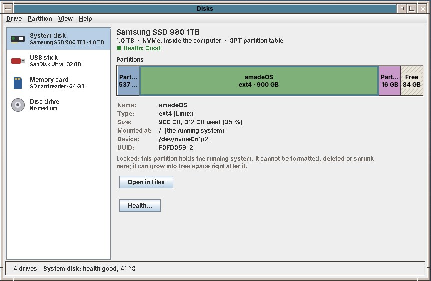
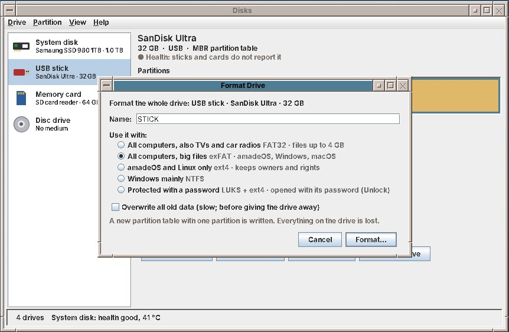
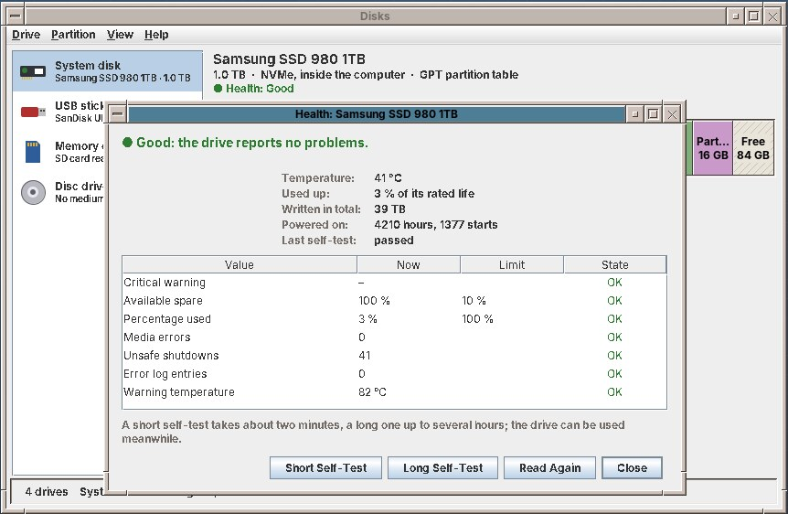

# 71. Disks

Formatting a USB stick is one of the first things people try on a new system, and one of the few where a wrong click destroys data. amadeOS does it with `amadeos-disks`, a desktop module of amadeos-system that shows the drives with a partition map, formats sticks and cards, changes partitions, shows disk health and writes disk images.

Disks never runs anything as root itself. Everything goes through **udisks2**, the system service that file managers on Linux use to mount sticks. udisks runs `mkfs`, the partitioning library and `fsck` as root, and it asks polkit first. So this chapter is mostly about talking to a system service over D-Bus from Java. It also covers two things the earlier D-Bus chapters did not need: receiving a file descriptor over the bus, and calls that take minutes.



## What you will learn

- Reading udisks' whole object tree with `GetManagedObjects`, and following changes with signals.
- Declaring udisks interfaces for dbus-java, structs included, and calling methods that can take hours.
- Formatting and partitioning through udisks, with the options that matter, and an fstab line through udisks.
- Receiving an open device as a file descriptor (`OpenForRestore`, `OpenForBackup`), and why that needs the junixsocket transport.
- Keeping the running system safe, in the model and again in the service.
- Testing all of it without a single real disk.

## Who does what

The module is a desktop module like the Task Manager ([chapter 69](69-task-manager.md)): it is in `desktopModules` of the root `build.gradle`, starts with `main` and loads its texts with `Messages.load` ([chapter 60](60-desktop.md#two-kinds-of-module)). The window only knows the interface `DiskService`; udisks is one implementation of it, `FakeDisks` in the tests is the other.

| Class | Package | What it does |
|---|---|---|
| `DiskService` | `service` | What the window may ask: the drives, progress, format, partitions, mount, check, health, open for images |
| `UDisksService` | `udisks` | `DiskService` on udisks2 over the system bus |
| `UDisksObjects` | `udisks` | Turns the object tree into `Drive`s, `Volume`s and the `Segment`s of the map; plain Java, no D-Bus |
| `SystemMounts` | `udisks` | What the kernel says is mounted and swapped on, from `/proc` |
| `HealthReader` | `udisks` | SMART attributes (SATA) and the NVMe health log become a `Health` with a verdict |
| `Block`, `Partition`, `PartitionTable`, `Filesystem`, `Encrypted`, `Drive`, `DriveAta`, `NvmeController`, `Manager`, `Job` | `udisks.dbus` | The udisks interfaces, declared for dbus-java |
| `Drive`, `Volume`, `Segment`, `Layout`, `Safety`, `FsChoice`, `Sizes` | `model` | The model: drives, partitions, free space, the rules |
| `ImageCopy`, `ImageJobs` | `image` | Copying in blocks with SHA-256; write with read-back, save with xz |
| `MainWindow`, `PartitionMap`, `FormatDialog`, `NewPartitionDialog`, `ResizeDialog`, `HealthDialog`, `ImageDialog`, `Dialogs` | `ui` | The window, the map and the dialogs |

## The object tree

udisks publishes one D-Bus object per drive (`/org/freedesktop/UDisks2/drives/…`) and one per block device (`/org/freedesktop/UDisks2/block_devices/sdb1`), each with a set of interfaces: a partition has `Block`, `Partition` and, when it holds a file system, `Filesystem`; a stick's whole device has `Block` and `PartitionTable`. All of it comes in one call of the standard `ObjectManager` interface:

```java title="amadeos-system · disks/udisks/UDisksService.java"
--8<-- "amadeos-system/disks/src/main/java/eu/amadeos/system/disks/udisks/UDisksService.java:objects"
```

The values arrive as `Variant`s; `unwrap` turns them into plain Java (strings, numbers, lists, maps), and byte arrays with a closing NUL, such as mount points, into strings. From then on `UDisksObjects` works on maps only. That is the whole trick for testing: the tests build the same maps by hand, a stick here, an NVMe disk with three partitions there, and check the drives that come out. No D-Bus, no disks.

`UDisksObjects` does the work a user never wants to see: which block is the whole drive and which are its partitions (`Partition.Table`), what kind of drive it is (`ConnectionBus` usb, `Removable`, an `mmcblk` device for a card, `Optical` for a disc drive), where free space lies between the partitions, and which LUKS volume is the unlocked contents of which partition (`CryptoBackingDevice`). It leaves out what Disks does not manage: `zram`, `ram`, device-mapper and RAID devices.

For live updates the service adds handlers for `InterfacesAdded`, `InterfacesRemoved` and `PropertiesChanged` on the bus. A stick that is plugged in sends a burst of them; the window reads the tree again 400 ms after the last one.

## Declaring udisks for dbus-java

dbus-java needs a Java interface for each D-Bus interface, with the methods named exactly as on the bus:

```java title="amadeos-system · disks/udisks/dbus/Block.java"
--8<-- "amadeos-system/disks/src/main/java/eu/amadeos/system/disks/udisks/dbus/Block.java:interface"
```

Every udisks method takes a last argument `a{sv}`, the options; in Java that is `Map<String, Variant<?>>`. Arguments that are structs on the bus are Java classes extending `Struct` with `@Position` on their fields: `AddConfigurationItem` takes `(sa{sv})`, `ConfigurationItem` in the module; `Manager.CanResize` returns `(bts)`, `ResizeAbility`. 64-bit unsigned numbers (offsets and sizes) are `UInt64`.

!!! warning "Pitfall: `a{sv}` and the D-Bus types of the values"
    dbus-java guesses a variant's D-Bus type from the Java value. A `String[]` becomes `as`, which is what `mkfs-args` wants; a `byte[]` becomes `ay`, which is what fstab entries want, but only with a closing NUL byte. When the guess is wrong, udisks answers with a type error that names neither the option nor the value. Give the signature yourself (`new Variant<>(value, "as")`) when in doubt.

### Calls that take long

dbus-java waits 20 seconds for an answer by default. Formatting a 64 GB card with *Overwrite all old data* takes half an hour, and the call does not even start before the user has typed the password into the polkit dialog. So the service sets a long default once, and calls run on a worker thread, never on the event dispatch thread:

```java title="amadeos-system · disks/udisks/UDisksService.java"
--8<-- "amadeos-system/disks/src/main/java/eu/amadeos/system/disks/udisks/UDisksService.java:call"
```

The method is called by reflection because several udisks interfaces share method names (`Format` on `Block`, `Resize` on `Partition` and `Filesystem`), and one `call` translates every failure into a `DiskException` with a reason the window can explain: the user closed the password dialog (no message at all), not allowed, the drive is busy, a tool is missing.

!!! warning "Pitfall: asynchronous calls lost their answers"
    dbus-java also has `callMethodAsync`. In testing, the answers of `Format` sometimes never arrived, and the window waited forever. A plain call on a worker thread with a long timeout has no such problem, and it is easier to read.

While a step runs, the window polls udisks every 700 ms for a `Job` object that names the block device; formatting with overwrite and checking report their progress there, and the window shows it as a bar. Only one step runs at a time:

```java title="amadeos-system · disks/ui/MainWindow.java"
--8<-- "amadeos-system/disks/src/main/java/eu/amadeos/system/disks/ui/MainWindow.java:run"
```

## Formatting

Formatting a whole stick is two udisks calls: `Block.Format` with a partition table type writes an empty table, and `PartitionTable.CreatePartitionAndFormat` makes one partition over all of it and formats it:

```java title="amadeos-system · disks/udisks/UDisksService.java"
--8<-- "amadeos-system/disks/src/main/java/eu/amadeos/system/disks/udisks/UDisksService.java:format-drive"
```

The options that matter:

| Option | Why |
|---|---|
| `auth.no_user_interaction` = false | polkit may ask the user. Without it udisks refuses at once when a password is needed. |
| `tear-down` = true | Unmounts the file systems on the device and locks LUKS volumes first, instead of failing with *busy*. |
| `erase` = `zero` | *Overwrite all old data*: zeros over the whole space before formatting. |
| `label` | The name. `FsChoice` cuts it to what the file system allows (FAT 11 characters in capitals, exFAT 15, ext4 16, NTFS 32). |
| `take-ownership` = true | For ext4: the new file system's root folder belongs to the user, not to root. |
| `encrypt.passphrase`, `encrypt.type` = `luks2` | *Protected with a password*: udisks creates the LUKS container and formats the inside. |
| `mkfs-args` = `["-F", "32"]` | `mkfs.vfat` picks FAT16 for small sticks; the dialog promised FAT32. |
| `update-partition-type` = true | When one partition is formatted with another file system, its type in the table changes with it, so Windows sees an NTFS partition as such. |

The partition table is MBR (`dos`) for sticks and cards below 2 TB, because TVs, car radios and cameras often read nothing else, and GPT for everything else.

### A partition that is mounted at every start

*Mount at every start* in the new partition dialog adds a line to `/etc/fstab`. Disks does not write the file: udisks does, as root, through `AddConfigurationItem`:

```java title="amadeos-system · disks/udisks/UDisksService.java"
--8<-- "amadeos-system/disks/src/main/java/eu/amadeos/system/disks/udisks/UDisksService.java:fstab"
```

`nofail` keeps the computer starting when the disk is gone one day; `x-gvfs-show` shows the partition in file managers. The folder `/mnt/NAME` does not exist yet, so the mount right after usually fails, and that is fine: systemd creates the folder at the next start.

### Resizing

Growing a partition means making the partition bigger first and then the file system; shrinking goes the other way round. udisks has both steps, and `Manager.CanResize` tells for each file system type whether its tools are installed and whether it can grow or shrink while mounted:

```java title="amadeos-system · disks/udisks/UDisksService.java"
--8<-- "amadeos-system/disks/src/main/java/eu/amadeos/system/disks/udisks/UDisksService.java:resize"
```

`Filesystem.Resize` with size 0 means "fill the partition". ext4 grows while mounted, which is how the system partition can grow into free space right after it.

## Keeping the running system safe

The rules are in the model, so the window can hide buttons that do not fit and the tests can check them:

```java title="amadeos-system · disks/model/Safety.java"
--8<-- "amadeos-system/disks/src/main/java/eu/amadeos/system/disks/model/Safety.java:safety"
```

A locked volume cannot be formatted, deleted or shrunk. A drive that holds a locked volume is the *System disk*: it cannot be formatted as a whole or overwritten with an image. LVM and RAID members are locked too: Disks does not manage them, so it leaves them alone.

Where the mount points come from matters. udisks reports them, but only for block devices it knows; inside a container, or with the root file system on a device udisks ignores, it reports nothing, and the system disk would look like an empty drive. So `SystemMounts` reads the kernel's own view as a second opinion: `/proc/self/mountinfo` for the mounts, `/proc/swaps` for active swap, and `/sys/class/block/*/slaves` to follow device-mapper volumes back to their partitions. A volume is locked when either source says it holds the system.

The service checks again before every destructive call (`formatDrive`, `formatVolume`, `deletePartition`, shrinking, `openForRestore`) and refuses with `NOT_ALLOWED`. The window should never get that far; the second check is for the day someone adds a menu entry and forgets the rule.

Every step that loses data asks once, in the same way:

```java title="amadeos-system · disks/ui/Dialogs.java"
--8<-- "amadeos-system/disks/src/main/java/eu/amadeos/system/disks/ui/Dialogs.java:confirm"
```



## Health

SATA disks report SMART attributes through `Drive.Ata` (`SmartGetAttributes`, `SmartSelftestStart`), NVMe drives a health log through `NVMe.Controller` (`SmartGetAttributes` with other keys). `HealthReader` turns both into one `Health`: the values a person understands (temperature, life used, data written, hours, last self-test), the raw rows, and a verdict:

| Verdict | When |
|---|---|
| Good | Nothing below. |
| Watch it | SATA: some reallocated, pending or uncorrectable sectors (attributes 5, 196, 197, 198), or 60 °C and more. NVMe: a warning about temperature, or 90 % of the rated life used. |
| Replace soon | The drive itself says it fails (`SmartFailing`), an attribute at or below its threshold, more than 100 damaged sectors; NVMe: a critical warning about spare, reliability or read-only, the rated life used up, or the spare area below its limit. |
| Unknown | USB sticks and most cards report nothing; the dialog says so. |

The rules are in `HealthReader`, a pure class; `HealthReaderTest` checks them with sets of values for a healthy and a worn NVMe drive, critical warnings, a healthy SATA disk, one with bad sectors and one past its limit.



## Images: a file descriptor over the bus

Writing an `.iso` to a stick needs the stick's device file open for writing, which only root may do. udisks has the call for it: `Block.OpenForRestore` checks polkit, opens the device as root, and sends the open file to the caller as a **file descriptor** in the D-Bus reply (the type `h`). `OpenForBackup` does the same for reading. The program then writes with plain Java streams, at full speed, without a helper process:

```java title="amadeos-system · disks/udisks/UDisksService.java"
--8<-- "amadeos-system/disks/src/main/java/eu/amadeos/system/disks/udisks/UDisksService.java:open"
```

A file descriptor travels over a Unix socket as ancillary data (`SCM_RIGHTS`). The transport dbus-java uses by default, `dbus-java-transport-native-unixsocket` on the JDK's own `UnixDomainSocketAddress`, cannot receive that: the reply never arrives, and the call ends with *no reply*. The junixsocket transport can, so Disks uses that one. dbus-java takes the first transport it finds, so the module has to leave the other one out of its runtime classpath, which `base` would otherwise bring along:

```groovy title="amadeos-system · disks/build.gradle"
--8<-- "amadeos-system/disks/build.gradle:transport"
```

!!! warning "Pitfall: `junixsocket-core` is only a POM"
    The artifact `junixsocket-core` has no classes, only dependencies on `junixsocket-common` and `junixsocket-native-common`. The fat jar of a module cannot unpack a POM and fails with *Cannot expand ZIP*. Exclude it and name the two jars directly, as `disks/build.gradle` does.

The copy itself is a loop over 4 MB blocks that computes the SHA-256 on the way and checks a stop flag before each block:

```java title="amadeos-system · disks/image/ImageCopy.java"
--8<-- "amadeos-system/disks/src/main/java/eu/amadeos/system/disks/image/ImageCopy.java:copy"
```

Writing is copy, `sync`, then read the same number of bytes back and compare the checksums; `.img.xz` is unpacked on the way with org.tukaani:xz:

```java title="amadeos-system · disks/image/ImageJobs.java"
--8<-- "amadeos-system/disks/src/main/java/eu/amadeos/system/disks/image/ImageJobs.java:write"
```

Before writing, `ImageDialog` looks for a published checksum next to the image (`NAME.sha256`, `NAME.sha256sum`, `SHA256SUMS`) and compares it with the file, so a broken download is found before the stick is erased. Saving goes to a hidden `.part` file that is renamed at the end; a stopped run leaves nothing half-done behind.

## Started from Files

The File Manager's drive menu has *Format…* while `amadeos-disks` is installed. It starts `amadeos-disks --format /dev/sdb`; Disks selects the drive and opens the format dialog at once. Disks runs once per display (`InstanceChannel`, as the Task Manager): a second start hands its arguments to the running window. `--drive DEV` only selects a drive.

## Testing

`FakeDisks` is a `DiskService` with a computer in memory: an NVMe system disk with EFI, system and swap partitions and free space, a FAT32 stick, an exFAT card and an empty disc drive. Its steps change the drives; its images are byte arrays. The window tests (`MainWindowTest`) run on it: the system disk offers only safe steps, the stick offers everything, a disc drive without a disc offers nothing. `DisksDemo` opens the window on it in a chosen scene and language for the pictures of the handbooks.

The rest is tested without the window. `UDisksObjectsTest` builds object trees by hand (the system disk, sticks with and without partitions, cards and discs, encrypted partitions, a loop device, LVM members, a running job), `SystemMountsTest` feeds `mountinfo` and `swaps` texts, `HealthReaderTest` recorded SMART and NVMe values, `ModelTest` the layout and the rules, `ImageCopyTest` checksums, xz and the stop flag, and `TranslationTest` checks that all five languages have every key.

The real udisks was tried with loop devices: `losetup -P -f stick.img` makes a file look like a drive, and udisks shows it (as *Disk image*). Formatting with FAT32, exFAT, ext4 and NTFS, partitions with an fstab line, growing and shrinking, checking, and writing and saving images were run that way. LUKS needs device-mapper, which the test container did not have; it was not tried there.

## Exercises

1. Add *Benchmark* to the Drive menu: read 1 GB from `OpenForBackup` and show MB/s. Why is writing harder to measure safely?
2. `HealthReader` decides on fixed thresholds. Write a test with a disk whose reallocated sector count grows from one reading to the next, and think about where a history of readings would be kept.
3. The fstab line uses `UUID=`. When would `PARTUUID=` be the better choice?

## Summary

- udisks2 does the root work and asks polkit; a program only needs D-Bus.
- `GetManagedObjects` plus three signals give the whole picture and keep it current; parse it into a model with plain maps, and test it without D-Bus.
- Long calls: a long default timeout and a worker thread; the options decide whether the user is asked and whether mounted file systems are torn down.
- A file descriptor over D-Bus needs a transport that receives `SCM_RIGHTS`: junixsocket, with the native transport excluded.
- The running system is protected in the model and again in the service, from udisks and from `/proc`.
