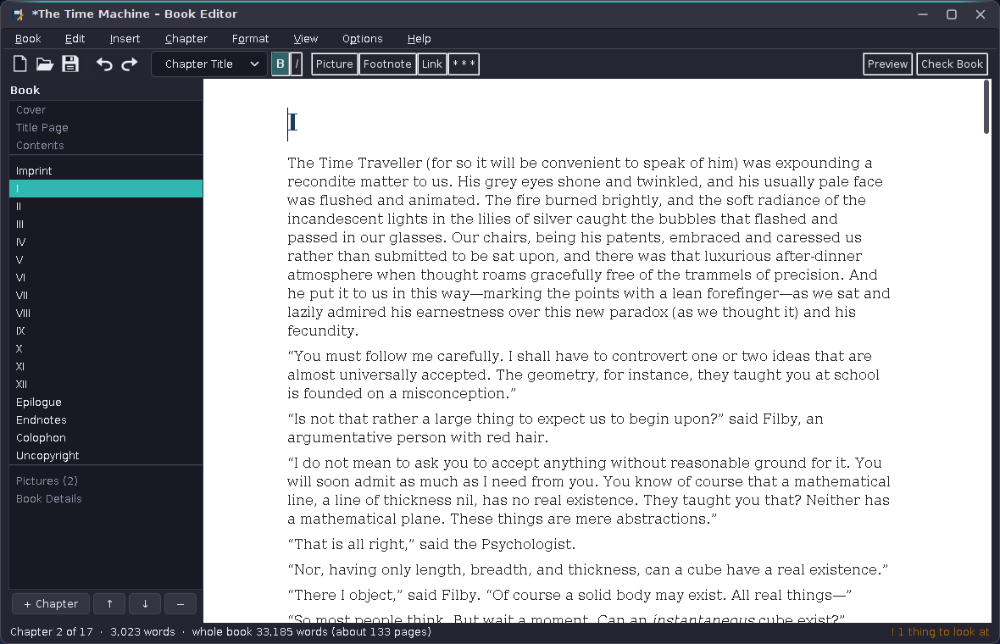
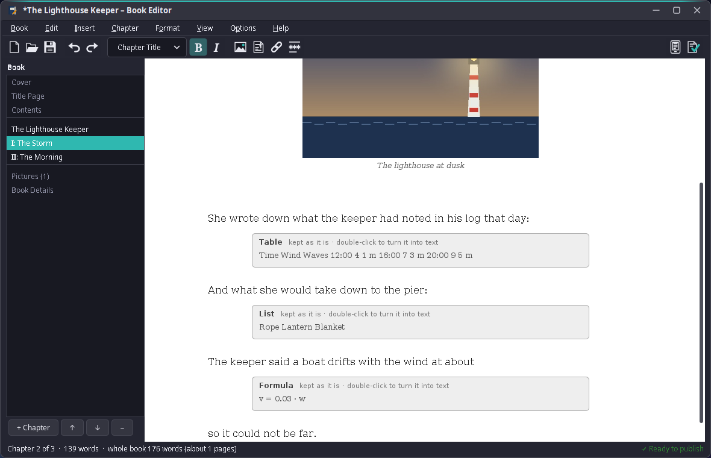
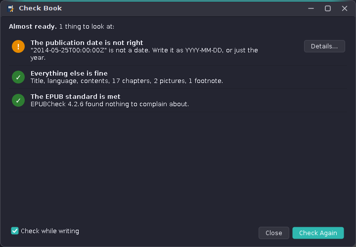
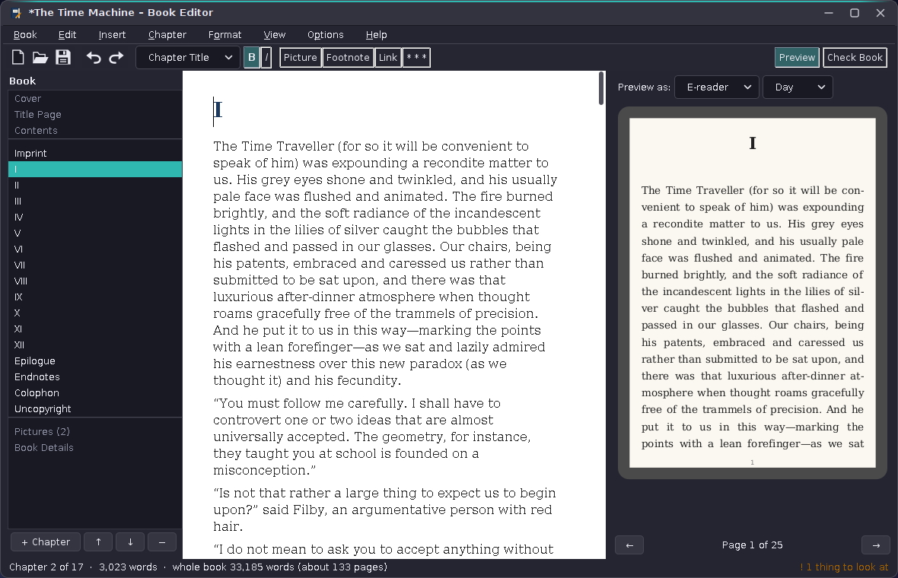

# 80. Book Editor

Books ([chapter 37](37-books.md)) reads e-books. The Book Editor makes them. An EPUB is a ZIP of XHTML, CSS and a package document, and a writer who is not a programmer should never see any of it: they write chapters in a window that behaves like a word processor, pick a look, and get a file that every e-reader and every shop accepts. That one sentence decides most of the design of this chapter.

The program has about 10,000 lines of Java and 2,300 lines of tests. It brings nothing new to amade-commons, but it takes something out of an application: the typesetter of Books moved into amade-commons as `eu.amadeos.commons.typeset`, so that the editor's preview sets pages exactly as Books does.

## What you build



- **New Book**: title, author, language and one of four looks; empty, or from a Word or OpenDocument document, a `.txt` or a Markdown file, split into chapters.
- **Edit a copy** of an EPUB made by another program: what the editor has styles for comes over, the rest stays as grey boxes.
- **An outline** of cover, title page, dedication, contents, chapters, pictures and details; chapters added, moved, split, joined and deleted.
- **A chapter editor** with ten paragraph styles, bold and italic, footnotes, links to chapters or the web, pictures with descriptions, and scene breaks.
- **Book Details**, a **cover maker**, a **preview** on a phone, a tablet or an e-reader, and **Check Book** with EPUBCheck.
- **Saving** through a temporary file, autosave every two minutes, and the last ten versions as backups.

## What you will learn

- Why a model of chapters and blocks is better than editing XHTML, and what it costs.
- How to map that model onto Swing's `StyledDocument` and back, with pictures and footnotes as single characters.
- How to write an EPUB 3 that passes EPUBCheck: the `mimetype` entry, the package document, navigation, NCX and accessibility metadata.
- How to read back only what you wrote, and say so clearly for everything else.
- How to take over somebody else's EPUB without losing what you cannot edit.
- How to read the parts of ODT and DOCX a book needs, and when to let LibreOffice do the rest.
- How to check a book in plain words, and run a Java tool from Debian on the side.
- How to test a whole window without a single modal dialog.

## The decision: a model, not a web page

The obvious way to edit an EPUB is to edit its XHTML. There were three ways to do that:

| Way | For | Against |
|---|---|---|
| `JEditorPane` with `HTMLEditorKit` | in the JDK, edits HTML directly | HTML 3.2; writes its own markup back, not XHTML; no `epub:type`, no figures, no asides |
| A web engine with `contenteditable` | real HTML and CSS | a second toolkit of 100 MB; the browser decides what markup a keystroke makes |
| An own model, written as XHTML on saving | the editor decides every tag; valid by construction | only what the model knows can be in the book |

The third way trades power for safety, and for this program that is the right trade. A non-programmer cannot break the markup, because there is none to break: a chapter is a list of `Block`s, a paragraph a list of `Inline`s, and the writer only ever sees styles. Every book the editor saves is valid, and the tests prove it with EPUBCheck. The price is visible in the scope: a chapter cannot contain what the model does not know, such as a table. Step 1 therefore opened only the editor's own books. Step 2 adds one block type, `Block.Kept`, for everything else, and with it the editor can take over other people's EPUBs (see [Books made elsewhere](#books-made-elsewhere)).

## The structure

| Package | Contents |
|---|---|
| `domain.book` | `Book`, `BookInfo`, `Chapter`, `Block` (paragraph, picture, scene break, kept content), `Inline` (text, footnote), `ParaStyle`, `KeptKind`, `Mark`, `Look`, `Resource`, `License`, `Person`, `Role` |
| `domain.epub` | `EpubWriter`, `ChapterWriter`, `EpubReader`, `ForeignEpubReader`, `KeptText`, `BookTexts`, `Xml` |
| `domain.importer` | `BookImport`, `OfficeImport` (ODT and DOCX), `LibreOfficeConverter`, `TextImport` (plain text and Markdown) |
| `domain.check` | `BookCheck`, `Finding`, `EpubCheckRunner` |
| `domain.cover` | `CoverDesign`, `CoverMaker`, `Pictures` |
| `repository` | `EditorPreferences`, `Backups` |
| `ui.editor` | `ChapterEditor`, `ChapterDocument`, `EditorStyles`, the icons of pictures, footnotes, scene breaks and kept content |
| `ui.dialogs` | New Book, Book Details, Make a Cover, Picture, Link, Footnote, Check Book |
| `ui.main` | `MainWindow`, `OutlinePanel`, `Pages`, `PreviewPanel`, `Ask`, `SwingAsk` |

The start is the usual one:

```java title="amade-bookeditor · bootstrap/AmadeBookEditorApplication.java"
--8<-- "amade-bookeditor/src/main/java/eu/amadeos/apps/bookeditor/bootstrap/AmadeBookEditorApplication.java:main"
```

There is no presenter this time. Most of what the window does is moving between the outline, the editor and the book, and the logic that matters (writing, reading, checking, importing) lives in the domain packages, where it is tested without Swing. What a presenter would give the tests, a window without dialogs, comes from `Ask` (see below).

## Chapters in a styled document

Swing's `JTextPane` edits a `StyledDocument`: characters with attributes, grouped into paragraph elements. The editor keeps its own attributes next to Swing's: the paragraph style as a `ParaStyle`, a link target, and three kinds of **objects**. A picture, a footnote and a scene break are each one character, U+FFFC, with the block or the footnote text as an attribute and an icon that draws it. A footnote number is therefore one character the writer can select, delete, cut and paste; double-click opens it.

```java title="amade-bookeditor · ui/editor/ChapterDocument.java"
--8<-- "amade-bookeditor/src/main/java/eu/amadeos/apps/bookeditor/ui/editor/ChapterDocument.java:from"
```

The way back walks the paragraph elements. An object on a line of its own becomes a block of its own; text and footnotes become inlines with the marks set on the characters, not the ones a heading style only shows:

```java title="amade-bookeditor · ui/editor/ChapterDocument.java"
--8<-- "amade-bookeditor/src/main/java/eu/amadeos/apps/bookeditor/ui/editor/ChapterDocument.java:to"
```

Two details keep the round trip exact. Swing always has an empty paragraph at the end of a document, which `toBlocks` drops; the window puts one back after a closing title or picture, so that the writer can type below it. And a heading is drawn bold through the paragraph style, not through the characters, so that turning a heading back into text does not leave bold words behind. The test `everyChapterOfTheTestBookComesBackUnchanged` takes every chapter of a book with every kind of content through the document and back.

Enter is the one key with a meaning of its own. After a heading, an epigraph or a picture the next paragraph is text again, as in every word processor:

```java title="amade-bookeditor · ui/editor/ChapterEditor.java"
--8<-- "amade-bookeditor/src/main/java/eu/amadeos/apps/bookeditor/ui/editor/ChapterEditor.java:enter"
```

The window takes the document into the book half a second after the writer stops typing, compares the blocks with the chapter's, and only then calls the book changed. Comparing is cheap, because blocks and inlines are records, and it is the only reliable test: `DefaultStyledDocument` fires *changed* events of its own later, when it updates its styles, which are no changes at all.

## Writing the EPUB

An EPUB is a ZIP with one rule that ZIP tools break by default: the first entry is `mimetype`, stored without compression, so that a program can recognise the format from the first bytes:

```java title="amade-bookeditor · domain/epub/EpubWriter.java"
--8<-- "amade-bookeditor/src/main/java/eu/amadeos/apps/bookeditor/domain/epub/EpubWriter.java:zip"
```

`save` writes into a temporary file in the same folder and moves it over the old one atomically, so a crash or a full disk never leaves half a book behind; before that, `Backups` keeps a copy of the old file.

Each chapter becomes an XHTML file with the semantics a reading app needs: `epub:type` and ARIA roles for chapters, the dedication, footnotes and back links, `h1` to `h3` for the headings, `figure` with `figcaption` and an `alt` text for pictures, `hr` for a scene break:

```java title="amade-bookeditor · domain/epub/ChapterWriter.java"
--8<-- "amade-bookeditor/src/main/java/eu/amadeos/apps/bookeditor/domain/epub/ChapterWriter.java:write"
```

The chapter label ("Chapter 3", "Kapitel 3") is written in the language of the book, not of the program, from `BookTexts`; a German book written on an English desktop still says *Kapitel*. The package document carries Dublin Core, the people with their MARC roles, and the schema.org accessibility metadata that shops in the EU ask for since the European Accessibility Act:

```java title="amade-bookeditor · domain/epub/EpubWriter.java"
--8<-- "amade-bookeditor/src/main/java/eu/amadeos/apps/bookeditor/domain/epub/EpubWriter.java:metadata"
```

Every look is one style sheet in the resources. It uses only the CSS that the typesetter of Books understands (no `+` selectors, for example), so a paragraph after a heading gets `class="first"` instead of a sibling selector. What the preview shows is then what every reader shows.

## Reading back only what you wrote

The package document carries a mark, `<meta property="amadeos:editor">`, in an own prefix. `EpubReader` opens a book only when it finds it, and reads the chapters back by the same rules `ChapterWriter` used:

```java title="amade-bookeditor · domain/epub/EpubReader.java"
--8<-- "amade-bookeditor/src/main/java/eu/amadeos/apps/bookeditor/domain/epub/EpubReader.java:chapter"
```

Any other EPUB raises `NotEditableException`. The window then asks: *Edit a Copy*, *Open in Books* or *Cancel*. Reading other EPUBs means deciding, for every tag and class the editor does not know, whether to drop it, keep it untouched or turn it into the nearest style. That design is the next section; `EpubReader` stays strict, so an own book never goes through guesswork.

## Books made elsewhere



An EPUB from a shop, a converter or another editor is a small website: its own XHTML, classes and style sheets, often a chapter split over several files, notes at the end of the book, a cover page that is just a picture. `ForeignEpubReader` does not open such a book, it **takes it over** into a new one:

```java title="amade-bookeditor · domain/epub/ForeignEpubReader.java"
--8<-- "amade-bookeditor/src/main/java/eu/amadeos/apps/bookeditor/domain/epub/ForeignEpubReader.java:intro"
```

Three rules decide what happens to each element:

| Element | Becomes |
|---|---|
| something the model has a style for (`h1`–`h6`, `p`, `blockquote`, `hr`, `figure`, `img`, `em`, `strong`, `sup`, `sub`, `a`) | that style, mark or link |
| something the model has no style for, but the reader needs (`table`, `ul`, `ol`, `dl`, `math`, `svg`) | `Block.Kept`, unchanged |
| something an e-book should not carry (`video`, `audio`, `script`, `form`, `iframe`, pictures from the internet) | nothing; counted and reported |

### Which heading starts a chapter

Many older e-books put the book's title in the one `h1` and the chapters in `h2`. Taking `h1` as the chapter level would make one chapter of the whole book, so the reader takes the highest level that is used **more than once**; a level above it is the book's own title inside the text and stays as centred text:

```java title="amade-bookeditor · domain/epub/ForeignEpubReader.java"
--8<-- "amade-bookeditor/src/main/java/eu/amadeos/apps/bookeditor/domain/epub/ForeignEpubReader.java:level"
```

A file starts a chapter, and a file with several top headings is split at each. A heading grouped with its subtitle (`<hgroup><h2>I</h2><p>Down the Rabbit-Hole</p></hgroup>`) becomes one title, "I: Down the Rabbit-Hole". A file whose name says it is the continuation of the previous one (`…_split_001.html`, as converters make them) and that starts without a heading joins the previous chapter. The chapters are not counted: the titles already carry the numbers, and counting can be switched on per chapter.

### Notes at the other end of the book

EPUB 3 marks a note reference with `epub:type="noteref"` and the note with `aside`. Older books link a small superscript number to a paragraph in a notes file. The reader handles both in a first pass over all files, before any chapter is built:

```java title="amade-bookeditor · domain/epub/ForeignEpubReader.java"
--8<-- "amade-bookeditor/src/main/java/eu/amadeos/apps/bookeditor/domain/epub/ForeignEpubReader.java:notes"
```

The note elements are remembered, so the second pass leaves them out of the text. A notes file that only had notes then has nothing left but its heading and disappears; its notes live on as footnotes where they are referred to.

### Formatting set through classes

Converters rarely write `<strong>`. They write `<span class="calibre7">` and put `font-weight: bold` into the style sheet. The reader therefore reads the book's CSS, but only the simplest rules (one class, with or without an element name) and only four properties: bold, italic, vertical alignment and centring. Everything else in the style sheet (fonts, sizes, margins, colours) is the look's business and is dropped together with the style sheet.

### Kept content

```java title="amade-bookeditor · domain/book/Block.java"
record Kept(KeptKind kind, String xhtml, String text) implements Block
```

`Block.Kept` holds the element as XHTML, cleaned: ids and classes removed (they would clash with the editor's own and point to a style sheet that is gone), scripts and event attributes removed, links to other files of the old book unwrapped, pictures moved into the book and their paths rewritten to `../images/`. `ChapterWriter` writes it back inside `<div class="kept" data-kind="table">`, `EpubReader` recognises that div, and `ChapterWriter.properties` adds `mathml` or `svg` to the manifest item when a chapter needs it, so the book stays valid. A table of contents inside the text (mostly links into the book) is not kept, because the editor makes its own.

In the editor, a kept block is one more object character with an icon: a grey box with its kind and the start of its text. Double-clicking asks whether to turn it into plain paragraphs, a row or a list item each:

```java title="amade-bookeditor · ui/main/MainWindow.java"
--8<-- "amade-bookeditor/src/main/java/eu/amadeos/apps/bookeditor/ui/main/MainWindow.java:kept"
```

### A copy, not the original

The taken-over book has no file. The window sets it as a new, changed book, suggests "Name (edited).epub" next to the original, and says in one message what came over, what is kept and what had to stay behind:

```java title="amade-bookeditor · ui/main/MainWindow.java"
--8<-- "amade-bookeditor/src/main/java/eu/amadeos/apps/bookeditor/ui/main/MainWindow.java:take-over"
```

The look becomes *Classic*: taking over the old style sheet would bring back the markup the writer cannot see or change.

### Testing with real books

`ForeignBooks` in the tests builds two small EPUBs as other programs make them (an EPUB 3 with navigation document, `hgroup` titles, asides, a table, a list, a formula and a video; an EPUB 2 with NCX, guide, cover meta, a book title in `h1`, a split chapter, class formatting and an endnotes file), and the tests check what comes over and that the saved copy passes EPUBCheck. During development the reader also took over all 15 books of `amadeos-sample-books`, made by two different producers; every copy passed EPUBCheck.

## Word processor documents

Most books start in a word processor. `OfficeImport` reads OpenDocument Text and Word documents into the same raw list of blocks and headings, and then decides the chapter level as the EPUB reader does:

```java title="amade-bookeditor · domain/importer/OfficeImport.java"
--8<-- "amade-bookeditor/src/main/java/eu/amadeos/apps/bookeditor/domain/importer/OfficeImport.java:intro"
```

Both formats are ZIPs of XML. For ODT the reader needs `content.xml` (with its automatic styles) and `styles.xml` (the named ones); for DOCX `word/document.xml`, `styles.xml`, `numbering.xml`, `footnotes.xml`, `endnotes.xml` and the relationships that name pictures and link targets. The style names decide the role of a paragraph: *Heading n* or an outline level makes a heading, *Quotation*, *Quote* or *Block Text* a quote, *Preformatted Text* code, *Caption* the caption of the picture before it, and *Title*, *Subtitle* and *Author* the document's title block, which is left out before the first heading because the book has a title page. Bold or italic that a **named** style sets is not copied onto the characters: a heading style is bold because headings look like that, and the look decides how they appear.

`.doc` and `.rtf` are not read directly. `LibreOfficeConverter` turns them into ODT with `soffice --convert-to odt` in a temporary profile (as WritePad does for `.doc`); without LibreOffice, the window says so and suggests saving the file as `.odt` or `.docx`. `BookImport` chooses by the extension.

The tests read one short manuscript in four versions: written to ODT and DOCX by pandoc, and the same files saved again by LibreOffice. All four must give the same chapters, footnotes, picture, caption, table and marks.

### Why not WritePad's readers?

WritePad ([chapter 23](23-writepad.md)) reads ODT, DOCX and RTF already, and moving its readers into amade-commons was the first plan. They are the wrong tool here: they build WritePad's `StyledDocument` with page settings, tab stops, tables as paragraphs and floating pictures, and they skip footnotes, because a page-based word processor has no use for them in that form. A book needs the opposite: footnotes, headings as structure, and nothing of the page. The two readers share the formats, not the purpose, so each program keeps its own.

## Starting from a text file

Many writers already have their book in a file. `TextImport` reads plain text (UTF-8, or Windows-1252 for older files) and splits it at lines like "Chapter 3", "Kapitel IV" or "Capítulo tres"; Markdown is split at `#` headings, and brings emphasis, links, footnotes (`[^1]`), quotations, code blocks and the pictures next to the file. Pictures that are not found are listed for the writer instead of failing the import.

## Checking a book

`BookCheck` looks for what a writer can fix: no title, an empty chapter, a picture without description, a link to a deleted chapter, a bad web address, an empty footnote, an impossible date or ISBN, a missing cover or description, a picture too large for small readers. Each `Finding` has a severity (*problem* or *hint*), the chapter and an **action**, which the dialog turns into a button: *Describe…* opens the picture, *Show* the chapter with the place selected, *Details…* the right tab of Book Details.

```java title="amade-bookeditor · domain/check/BookCheck.java"
--8<-- "amade-bookeditor/src/main/java/eu/amadeos/apps/bookeditor/domain/check/BookCheck.java:check"
```



Then the real test: [EPUBCheck](https://www.w3.org/publishing/epubcheck/), the W3C's checker that shops run. Debian packages it as a jar, so the editor runs it with the Java it runs on, through `CommandRunner` from amade-commons, and reads its JSON report:

```java title="amade-bookeditor · domain/check/EpubCheckRunner.java"
--8<-- "amade-bookeditor/src/main/java/eu/amadeos/apps/bookeditor/domain/check/EpubCheckRunner.java:run"
```

It runs on the background executor; the dialog shows the editor's own findings at once and EPUBCheck's a few seconds later. The tests replace the program with `FinishedProcess.printing(report)`, so they run the parsing and the dialog without EPUBCheck installed. The domain tests use EPUBCheck as a library instead (`org.w3c:epubcheck` as a test dependency) and fail on every error or warning in a saved book.

## The preview



The preview writes the chapter with `ChapterWriter`, as it will be saved, and gives the XHTML to the typesetter from amade-commons, in a background thread, a moment after the last keystroke:

```java title="amade-bookeditor · ui/main/PreviewPanel.java"
--8<-- "amade-bookeditor/src/main/java/eu/amadeos/apps/bookeditor/ui/main/PreviewPanel.java:typeset"
```

Each run takes a ticket; a result for an older ticket is dropped, as in Image Viewer and Books, so fast typing never shows an older page last. Because the preview goes through the same writer and the same typesetter, it tests the saving on every keystroke as a side effect.

## A cover in a minute

A book without a cover looks unfinished in every reading app. `CoverMaker` draws one from a `CoverDesign` (title, subtitle, author, colour, an optional photo, where the text goes and which type) in 1600 × 2400 pixels, the size shops ask for, fitting long titles over up to four lines and picking black or white text by the background's brightness:

```java title="amade-bookeditor · domain/cover/CoverMaker.java"
--8<-- "amade-bookeditor/src/main/java/eu/amadeos/apps/bookeditor/domain/cover/CoverMaker.java:draw"
```

## Testing a window without dialogs

The window asks the writer many things: a file, a picture, the details, a link, whether to save. Each of those is a modal dialog, and a test that opens one waits forever. All the questions therefore go through one interface, `Ask`, with `SwingAsk` for the real dialogs. The tests give the window a `FakeAsk` that answers what the test prepared and records what was asked, and then drive the real `MainWindow` on the event dispatch thread: create a book, type, split a chapter at the cursor, insert a footnote and a link, save, open, autosave, run Check Book against a fake EPUBCheck. Twenty-two window tests run in a few seconds under Xvfb.

## What amade-commons gives Book Editor

- `AmadeApplication`, `Messages`, `Mnemonics`, `LocaleSettings` and the language menu, as everywhere.
- `ToolButtons` and `ToolIcon` for the whole toolbar: `StandardGlyph` for New, Open, Save, Undo and Redo, and the editor's own `BookGlyph` for bold, italic, picture, footnote, link, scene break, preview and Check Book, drawn like WritePad's. The tooltips name what the buttons did when they still showed words.
- `SpecialCharacters` for Ctrl+Shift+U.
- `CommandRunner` and `FinishedProcess` for EPUBCheck.
- `AppDirectories` and `PropertiesFile` for `book-editor.properties` and the backups.
- And now `typeset`: `ChapterParser`, `Css`, `Typesetter`, `Hyphenators` for the preview.

### And what stays in Book Editor

- **The book model and the EPUB writer.** No other program writes EPUB. If WritePad ever exports e-books, the writer moves.
- **`ChapterDocument`.** WritePad has its own styled document for pages and ODT; the two have similar ideas (objects as one character, styles as attributes) but different models.
- **`TextImport`.** A Markdown reader would fit amade-commons once a second program needs one.
- **`ForeignEpubReader` and `OfficeImport`.** They read into the book model, which only this program has.

## Exercises

1. **Tables.** Add a `Block.Table` with rows and cells of inlines. How does it appear in the `JTextPane` (an object with an editor of its own, or a grid of paragraphs)? Which CSS does the typesetter need for it?
2. **Keep the old look.** Offer to keep the taken-over book's style sheet as a fifth look. Which rules can stay, and which would fight the editor's own classes?
3. **Lists as a style.** Lists come in as paragraphs starting with "•". Make *List item* a paragraph style that `ChapterWriter` groups into `ul`, as it groups poems into stanzas. What happens to numbered lists, and to a list inside a list?
4. **Find and replace** across all chapters. The current chapter is a document, the others are blocks: where does the search run, and how does a replacement in another chapter reach the editor?
5. **Word count goals.** Add a target per chapter or for the book and show progress in the status line. Where does the goal live, in the EPUB or in the preferences?
6. **Print.** Set the book into A5 pages with the typesetter and print it with `PrintJobs`. What has to change in `PageGeometry` for printed pages?

## Summary

- Edit a model, not markup: then every saved book is valid, and the scope of the model is the scope of the program.
- Map the model onto `StyledDocument` with own attributes; make pictures and footnotes one character each.
- Decide whether something changed by comparing values, not by counting document events.
- Write `mimetype` first and uncompressed, save through a temporary file, and keep backups.
- Give the XHTML the semantics reading apps need: `epub:type`, ARIA roles, figures with `alt`, footnotes as asides, and accessibility metadata.
- Read back only what you wrote, mark it, and say clearly when a file is not yours.
- Take over other files into the model, keep what the model cannot hold unchanged, and never overwrite the original.
- Check in plain words with a button to each problem, and let the standard's own checker have the last word.
- Put every question to the user behind one interface, and the whole window becomes testable.
