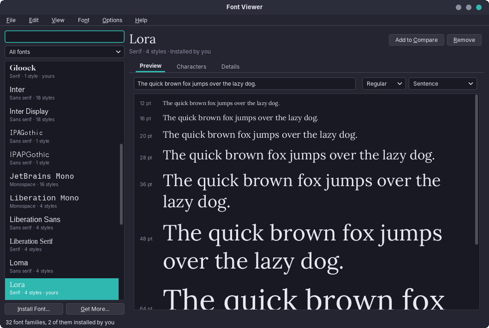
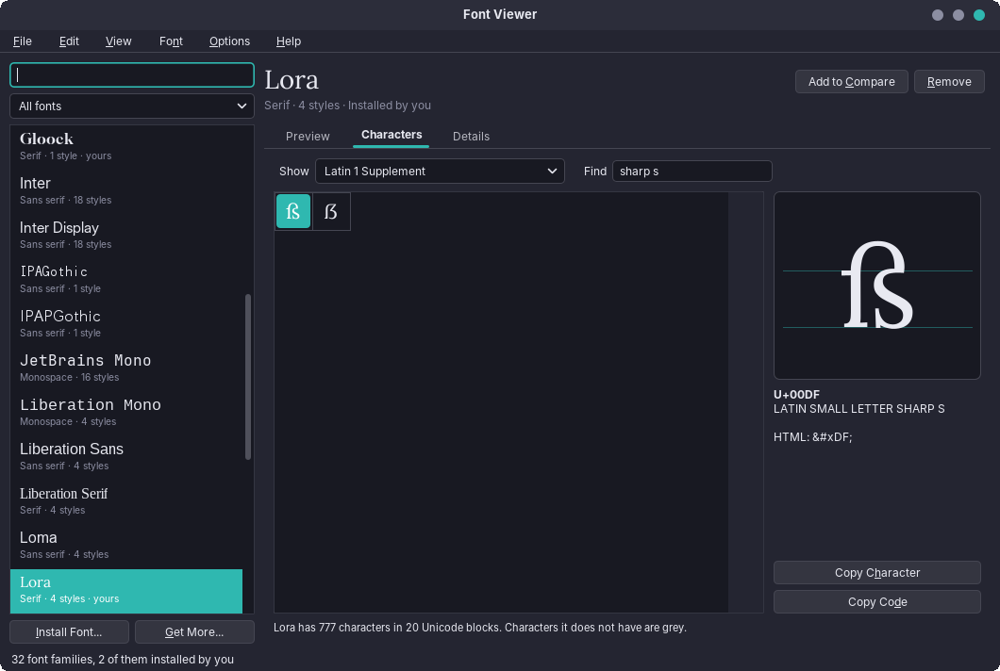
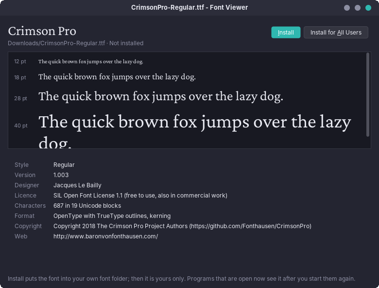

# 81. Font Viewer

Every program in this book draws text, and most of them let the user pick a font. Which fonts are there, what do they look like with my words, does this one have a ß, and how do I get the font I just downloaded into LibreOffice? The Font Viewer answers those questions. It is a small program, but it reads a binary file format by hand, asks fontconfig what the system knows, and is the first amade application that writes into a folder of the system, through a helper that runs as root.

The program has about 4,700 lines of Java and 2,100 lines of tests. It brings nothing new to amade-commons.

## What you build



- **A font list** from fontconfig, each family drawn in its own font, with its kind (serif, sans serif, monospace, handwriting, display, symbols), the number of styles and *yours* for the user's own fonts; a search and filters.
- **A preview** of the user's own text from 12 to 64 pt in any style of the family.
- **All characters** of a font by Unicode block, with a search by name or code and the chosen character large with its base line.
- **Details** read from the font file itself: designer, licence, version, number of characters, format; the languages from fontconfig and the Debian package from `dpkg`.
- **A comparison** of up to six fonts with the same text.
- **A small window for a font file**, opened by a double click in Files, with *Install* for the user and *Install for All Users*.

## What you will learn

- How to ask fontconfig for the fonts and why the program draws them from their files and not by name.
- How to read the table directory, the `name` table and the `cmap` table of a TrueType or OpenType file, with nothing but a `ByteBuffer`.
- How to tell serif from sans serif when the file does not say so.
- How to install a file for the user without a half-written font in the folder.
- How to let a desktop program write into `/usr/local` with pkexec and polkit, and what the helper must never trust.

## The structure

| Package | Contents |
|---|---|
| `bootstrap` | `AmadeFontViewerApplication`, `FontViewerModule`, `Windows` (one main window, any number of file windows) |
| `domain` | `FontFace`, `FontFamily`, `Category`, `FontScope`, `FontDetails`, `Coverage`, `UnicodeBlocks`, `SampleText`, `FontFiles` |
| `repository` | `FontViewerPreferences` |
| `service` | `FontCatalog`, `FontTables`, `SerifShape`, `FontLoader`, `FontInspector`, `FontInstaller`, `FontPlaces`, `PackageOwner` |
| `ui.main`, `ui.parts`, `ui.compare`, `ui.file` | the windows, presenters and the parts they share |

The program starts like every other one; its arguments are font files and an optional `--family=NAME`:

```java
--8<-- "amade-fontviewer/src/main/java/eu/amadeos/apps/fontviewer/bootstrap/AmadeFontViewerApplication.java:main"
```

With files, only the small file windows open. The main window appears when the user asks for it (*Show in Font Viewer*) or when no file was given. `Windows` builds both from one Guice injector, so they share the font cache:

```java
--8<-- "amade-fontviewer/src/main/java/eu/amadeos/apps/fontviewer/bootstrap/FontViewerModule.java:windows"
```

## Asking fontconfig

Java has its own list of fonts, `GraphicsEnvironment.getAvailableFontFamilyNames()`. It is the wrong source for this program for three reasons: it is read once when the JVM starts, so a font installed a minute ago is missing; it says nothing about files, so the program cannot tell the user's fonts from the system's; and it adds Java's logical fonts (`Dialog`, `SansSerif`) that are not fonts at all. Every other program on the desktop, from LibreOffice to Firefox, asks fontconfig. So does the Font Viewer:

```java
--8<-- "amade-fontviewer/src/main/java/eu/amadeos/apps/fontviewer/service/FontCatalog.java:format"
```

`fc-list` prints one line per face: the file, the face's index in a collection, family, style, weight, slant, spacing, format, whether it is a variable font, and the languages. Two details matter when parsing:

- Family and style may be lists (`DejaVu Sans,DejaVu Sans Light`); the first entry is the name a program shows.
- A variable font is listed once for its default and once more for every named instance, with an index above `0xFFFF`. Java draws only the default instance, so the instances are dropped.

The faces are grouped by family and sorted with a `Collator`, so that `abc Display` comes before `Caladea` and the list sorts as people do. When the same style exists twice, the user's copy wins, as it does in fontconfig.

## Drawing from the file

The list draws every family name in its own font. `new Font("Lora", Font.PLAIN, 14)` would look the font up in Java's list, which is stale; a font installed while the program runs would come out as `Dialog`. The Font Viewer loads every font from its file instead:

```java
--8<-- "amade-fontviewer/src/main/java/eu/amadeos/apps/fontviewer/service/FontLoader.java:load"
```

`Font.createFonts` returns all faces of a collection (`.ttc`), and the index from fc-list picks one. Type 1 fonts (`.pfb`) need `Font.TYPE1_FONT`; bitmap fonts (`.pcf`) cannot be read by Java at all, so they are listed but not drawn. The loader caches by file and index. List cells may only use `cached(face)`, which never reads a file; the presenter loads the fonts of the visible rows in the background and repaints.

## Reading the font file

Java's `Font` knows the family name and can tell whether it displays a character. It does not know the designer, the licence or the version, and checking 1.1 million code points with `canDisplay` is slow and even wrong: Java answers *yes* for invisible format characters it handles itself. Everything else is in the font file's tables, and reading them takes about 250 lines.

A TrueType or OpenType file starts with a table directory: a version, a number of tables, and for every table a four-letter tag, an offset and a length. A collection (`ttcf`) puts several directories in one file and starts with their offsets:

```java
--8<-- "amade-fontviewer/src/main/java/eu/amadeos/apps/fontviewer/service/FontTables.java:directory"
```

The version tells TrueType outlines (`0x00010000`, or `true` on old Macs) from PostScript outlines (`OTTO`); a CFF table confirms it. Every offset is checked against the file's length, and a broken file ends in an `IOException`, never in an exception the window does not expect.

### Names

The `name` table holds the strings: copyright (ID 0), family (1), style (2), full name (4), version (5), manufacturer (8), designer (9), description (10), URLs (11, 12), licence (13, 14) and the typographic family (16). Each can be there several times, for several platforms and languages. The program prefers English for Windows, then any Windows language, then Unicode, then Macintosh Roman:

```java
--8<-- "amade-fontviewer/src/main/java/eu/amadeos/apps/fontviewer/service/FontTables.java:name"
```

Windows and Unicode strings are UTF-16 big-endian, Macintosh strings Latin-1. The licence text is long; `FontDetails.shortLicense()` turns it into *SIL Open Font License 1.1*, *Apache License 2.0* or *Ubuntu Font Licence*, and the window adds a plain sentence for the free ones.

### Characters

The `cmap` table maps characters to glyphs, again in several subtables. Format 12 covers all of Unicode in groups of consecutive characters; format 4 covers the Basic Multilingual Plane in segments. The program takes format 12 if there is one, otherwise format 4, and for symbol fonts the symbol subtable:

```java
--8<-- "amade-fontviewer/src/main/java/eu/amadeos/apps/fontviewer/service/FontTables.java:coverage"
```

The result is a `Coverage`, a sorted array of code points without control characters. The Characters page asks it for the code points of one Unicode block with two binary searches, so even a font with 60,000 characters switches blocks at once.



The search for a character by name uses `Character.getName`, which knows the Unicode name of every code point (`LATIN SMALL LETTER SHARP S`); a word like `sharp s` matches when all its words are in the name. A code (`U+00DF`, `00df`) is found directly.

## Serif or sans serif?

The list shows each font's kind, and the filter needs it. The name says a lot: *Mono*, *Courier* and *Code* are monospace, *Sans* is sans serif, *Serif* and *Roman* are serif. After the name, the `OS/2` table's PANOSE numbers can say it: family kind 2 is a text font, and its serif style 2 to 10 means serifs, 11 to 13 sans serif. But many free fonts leave PANOSE empty: Lora, Gloock and Libre Baskerville all have zeros, and with them the program first called every one of them *Sans serif*.

So when name and PANOSE are silent, the program looks at the letters. In a sans serif font, I and l are plain bars: at the foot they are exactly as wide as in the middle. In a serif font they stand on a foot:

```java
--8<-- "amade-fontviewer/src/main/java/eu/amadeos/apps/fontviewer/service/SerifShape.java:shape"
```

The outline of the letter at 100 pt is cut with a thin strip in the middle and one near the base line, and the two widths compared. For DejaVu Sans, Inter and Outfit the ratio is exactly 1.0; for Lora it is 2.6, for Gloock, a display serif with small wedges, 1.55. A threshold of 1.3 separates them, and asking for both letters protects against sans serif fonts whose l has a tail.

## Installing for the user

Installing a font for one user means copying it into `~/.local/share/fonts` and telling fontconfig with `fc-cache`. The copy goes to a hidden `.part` file first and is then moved into place, so that fontconfig, which may be scanning the folder at the same moment, never sees half a font:

```java
--8<-- "amade-fontviewer/src/main/java/eu/amadeos/apps/fontviewer/service/FontInstaller.java:for-me"
```

`targetName` refuses files that do not start like a font (the first four bytes: `00 01 00 00`, `OTTO`, `true`, `ttcf`, or the Type 1 markers) and turns the name into plain ASCII. Removing a font moves it to the trash with `gio trash`, so a click too many can be undone.

## Installing for everybody

`/usr/local/share/fonts` belongs to root. The program must not run as root, and it must not ask for root's password itself. The desktop's way is polkit: a small helper declared in a policy file, started with `pkexec`, which shows the desktop's password dialog (the polkit agent of `amadeos-session`, chapter 60).

The helper is a shell script installed as `/usr/libexec/amade-fontviewer-helper`, and the policy `eu.amadeos.apps.fontviewer.install` allows it to administrators with `auth_admin_keep`, so that a second font a minute later needs no second password. The rules for the helper follow from one fact: it runs as root on behalf of a user who may want to trick it.

- **It never opens a path the user named.** A path could point at `/etc/shadow` through a symbolic link. The Font Viewer reads the font and sends its bytes on standard input; the helper only gets a file name.
- **The name is checked**: ASCII letters, digits and `._+ -`, not starting with a dot, ending in a font extension, at most 200 characters. No slash can get through, so the file cannot land outside the folder.
- **The content is checked**: the first four bytes must be those of a font.
- **It writes only into its own folder**, `/usr/local/share/fonts/amadeos`, and removes only from there. Fonts that came with a package stay the package manager's.

```sh
--8<-- "amade-fontviewer/packaging/amade-fontviewer-helper:install"
```

On the Java side, `runHelper` starts `pkexec` with the helper, writes the bytes and reads the answer, a line `@@done` or `@@error ID MESSAGE`. Exit code 126 means the user closed the password dialog, 127 that they are not allowed; both become an `InstallException` with a reason the window can say in plain words:

```java
--8<-- "amade-fontviewer/src/main/java/eu/amadeos/apps/fontviewer/service/FontInstaller.java:helper"
```

The output is read on a virtual thread while the input is written, so that a helper that writes a lot cannot block on a full pipe. The test of the helper runs the real script with `sh`, without root, by pointing it at a temporary folder through `AMADE_FONTVIEWER_FONTS`; pkexec clears the environment, so this door is closed in real use.

## The window for a file



A double click on a `.ttf` in Files starts `amade-fontviewer FILE`, because the `.desktop` file declares `font/ttf`, `font/otf` and `font/collection` and the image makes it the default program for them. The file window reads the file with `FontTables`, draws it with `FontLoader`, and asks the catalog whether a font with the same family and style is installed already; then it says *Installed* and offers *Show in Font Viewer* instead of the install buttons. Each double click starts its own small program; the file window needs neither the list nor fontconfig to appear, so it is on the screen quickly.

## What amade-commons gives Font Viewer

| Part | Introduced in | Used for |
|---|---|---|
| `AmadeApplication`, `AppInfo`, `CommonsModule` | chapter 10 | start-up, theme, language, executors |
| `Messages`, `Mnemonics`, `LocaleSettings`, `TranslationCheck` | chapter 10 | five languages, the menu letters, the translation test |
| `AmadeUI`, `HorizonUI`, `DesktopTheme` | chapters 10, 42 | the Motif and Horizon look, the colours of the character grid |
| `CommandRunner`, `FinishedProcess` | chapter 20 | `fc-list`, `fc-cache`, `gio trash`, `dpkg -S`, `pkexec` |
| `XdgDirectories`, `AppDirectories`, `PropertiesFile` | chapter 20 | the font folders, `fontviewer.properties` |
| `DesktopLauncher` | chapter 11 | the handbook, the folder of a font |

### And what stays in Font Viewer

- **`FontTables`.** No other program reads font files. If the Book Editor one day embeds fonts in an EPUB, it will need the licence's embedding bits from the `OS/2` table, and that is the moment to move the reader.
- **`CharacterGrid`.** The Special Characters dialog (chapter 49) has a grid of its own, package-private in amade-commons. The Font Viewer's grid draws missing characters grey and shows a whole Unicode block of one font, while the dialog's shows a category in the fallback font of the desktop. The two may become one class with a second user of either.

## Exercises

1. **Variable fonts.** Java draws only the default instance of a variable font. Read the `fvar` table and list its axes (weight, width) and named instances on the Details page. Which part of the preview could use them, and what would it need from Java?
2. **Embedding.** Read `fsType` from the `OS/2` table and show whether a font may be embedded in a PDF or an EPUB. What does WritePad's PDF export do with a font that may not be embedded?
3. **A specimen sheet.** Print the comparison as a page with the font names and a paragraph in each font, with `PrinterJob`. Which part of the window can you reuse, and which must be drawn for the page?
4. **Duplicates.** Find families that are installed twice, once by a package and once by the user, and offer to remove the user's copy. Why is it not enough to compare family names?
5. **WOFF.** Web fonts come as WOFF or WOFF2. WOFF is the same tables, each compressed with zlib. Convert a WOFF file to TTF in the file window before installing it.

## Summary

- Ask fontconfig for the fonts, as every other program on the desktop does, and draw them from their files, so that the list is never stale.
- A font file is a directory of tables; with a `ByteBuffer`, bounds checks and a few dozen lines per table you can read what Java does not tell.
- When the metadata is silent, measure: the shape of two letters tells serif from sans serif.
- Copy to a hidden file and move it into place, so that no other program sees half a file.
- A helper that runs as root gets bytes and a checked name, never a path, and writes only into a folder of its own.
