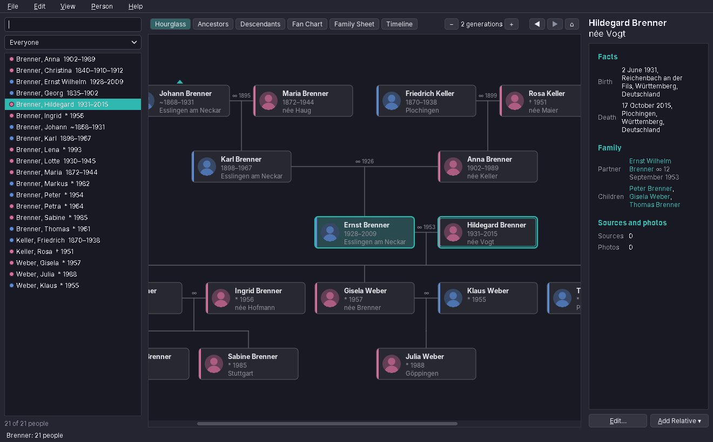
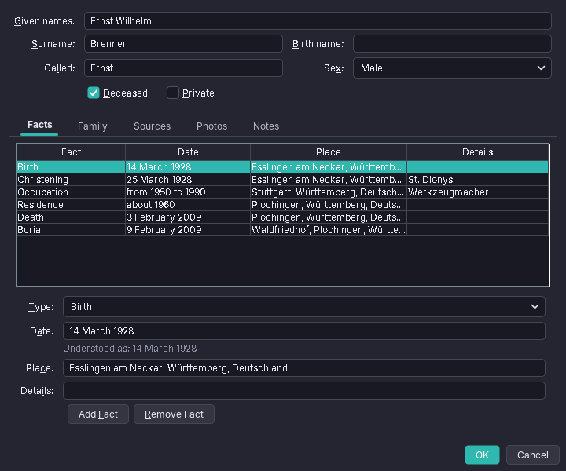
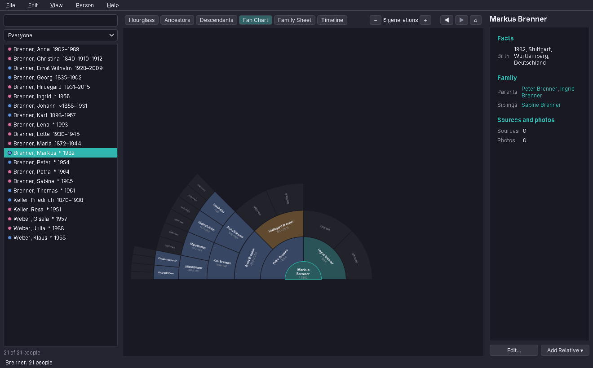
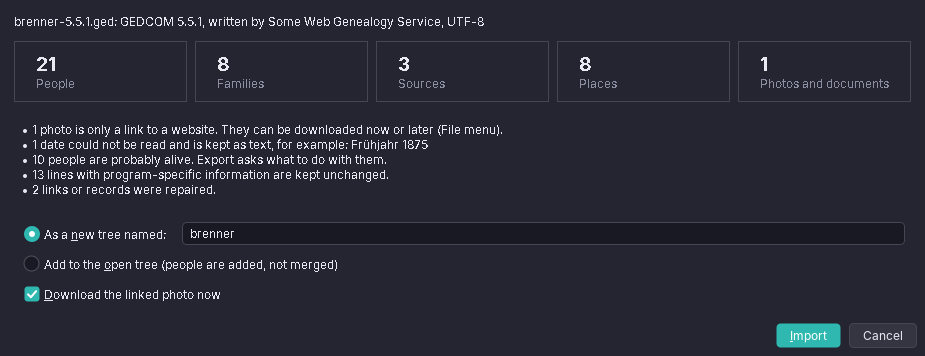

# 82. Family Tree

Family history is one of the oldest reasons people sit down at a computer, and its data has outlived every program that wrote it: a tree typed in 1995 still travels from program to program, and from website to website, as a GEDCOM file. Family Tree reads and writes that format, shows the people in charts and lets the user add and correct them. It is a program about a file format more than about windows: almost every design decision follows from one rule, *never lose a line of the user's file*.

The program has about 10,000 lines of Java and 1,700 lines of tests. It brings nothing new to amade-commons.

## What you build



- **GEDCOM import** of 5.5.1 and 7.0 files and GEDZIP archives in every character set these files come in, with a report before anything is imported.
- **Charts**: hourglass, ancestors, descendants and a fan chart; a family sheet and a timeline as pages.
- **A person editor** with names, facts, marriages, sources, photos and notes, and dates typed the way people write them, in five languages.
- **Undo and redo** for every change, and saving at once with backups.
- **A search** that finds names that sound alike, and the **relationship** between two people in words.
- **GEDCOM export** that leaves out private people and protects living ones.

## What you will learn

- How to read a decades-old text format whose files bend every rule, and keep what you do not understand.
- How to guess a character set when the file's own declaration may be wrong.
- How to build a domain model as *views* on a tree of lines instead of copying the data into objects.
- How to undo changes on a large data set by copying only what a change touches.
- How to parse dates typed in five languages without one locale-specific parser per language.
- How to find the nearest common ancestor of two people and turn it into words.
- How to draw a fan chart with Java2D areas.

## The structure

| Package | Contents |
|---|---|
| `bootstrap` | `AmadeFamilyTreeApplication`, `FamilyTreeModule`, `Windows` |
| `gedcom` | `GedcomNode` (the line tree), `GedcomReader`, `GedcomWriter`, `GedcomConverter` (5.5.1 ↔ 7.0), `Ansel` |
| `domain` | `FamilyTree`, `Person`, `Family`, `Fact`, `PersonName`, `GenDate`, `DateText`, `Relationship`, `Living`, `Search` and the records for sources and photos |
| `repository` | `FamilyTreePreferences` |
| `service` | `TreeStore`, `GedcomImport`, `GedcomExport`, `PhotoDownloader`, `Undo`, `DesktopOpener` |
| `ui.main`, `ui.chart`, `ui.text`, `ui.edit`, `ui.dialogs` | the window and its presenter, the charts, the pages, the person editor and the dialogs |

The program starts like every other one. A GEDCOM file as argument, from a double-click in Files, is imported into the window:

```java
--8<-- "amade-familytree/src/main/java/eu/amadeos/apps/familytree/bootstrap/AmadeFamilyTreeApplication.java:main"
```

```java
--8<-- "amade-familytree/src/main/java/eu/amadeos/apps/familytree/bootstrap/FamilyTreeModule.java:windows"
```

## GEDCOM in five minutes

A GEDCOM file is a list of lines. Each line has a level, an optional cross-reference id between at signs, a tag and an optional value:

```text
0 @I1@ INDI
1 NAME Ernst Wilhelm /Brenner/
1 BIRT
2 DATE 14 MAR 1928
2 PLAC Esslingen, Württemberg, Deutschland
1 FAMS @F1@
0 @F1@ FAM
1 HUSB @I1@
1 WIFE @I2@
1 CHIL @I9@
```

The levels make a tree: a line belongs to the nearest line above it with a smaller level. Level 0 lines are **records**: people (`INDI`), families (`FAM`), sources, photos (`OBJE`), notes. A person does not point to their parents; a family points to its partners and children, and each person points back to the families they are a child in (`FAMC`) and a partner in (`FAMS`). Long values are split over `CONT` (a new line) and `CONC` (the same line) lines.

Two versions matter. **5.5.1** from 1999 is what most programs and websites write. **7.0** from 2021 cleans up the details: UTF-8 only, MIME types for files, `SNOTE` for shared notes, phrases for dates the format cannot express. Family Tree keeps every tree in 7.0 form, converts 5.5.1 on import and back on export for older programs (`GedcomConverter`).

Then there are the **extension tags**, which start with an underscore: `_UID`, `_MARNM` for a married name, `_PRIM` for the primary photo, and hundreds more, one set per program. A genealogy program that drops them loses data the user may have spent years on. So the first decision of this chapter is:

!!! tip "Keep the lines, not just your objects"
    The tree is held as the lines of the file, `GedcomNode`s, and the domain classes are views on them. Whatever the program does not understand stays where it was and is written back unchanged.

## Reading what real programs write

The specification is strict; real files are not. The reader is lenient on purpose and collects a warning for each repair, which the import report shows.

### The character set

A 5.5.1 file says its character set in the header, `1 CHAR UTF-8` or `ANSEL` or `ANSI`. The declaration is wrong surprisingly often: a program writes `ANSI` and UTF-8 bytes, or `UTF-8` and Windows-1252. The reader therefore believes a byte order mark first, then checks whether the bytes are valid UTF-8, and only then falls back to what the file declares:

```java
--8<-- "amade-familytree/src/main/java/eu/amadeos/apps/familytree/gedcom/GedcomReader.java:decode"
```

The test for UTF-8 is strict decoding with `CodingErrorAction.REPORT`. Text in another 8-bit character set with umlauts is almost never valid UTF-8 by accident, so this guess is safe in practice. **ANSEL**, the library character set that GEDCOM 5.5 made the default, has no `Charset` in Java. `Ansel` decodes it with a table; its peculiarity is that accents are separate bytes *before* the letter, while Unicode puts combining marks after it, so the decoder moves each mark behind its letter and composes the result (NFC): `E8 61` becomes *ä*.

### Lines and levels

A regular expression reads the level, the id, the tag and the value of each line. Two stacks, the open nodes and their levels, attach each line to its parent. Three kinds of broken lines are common and repaired with a warning: a line without a level (a line break inside a value, written without `CONT`) is added to the value above; a level that jumps by two is attached to the line above; a line before any record is skipped.

`CONT` and `CONC` exist only in the file. After reading, they are joined into the value, so that the rest of the program sees one string with `\n`; the writer splits long values again:

```java
--8<-- "amade-familytree/src/main/java/eu/amadeos/apps/familytree/gedcom/GedcomReader.java:join"
```

!!! warning "The @@ escape differs between the versions"
    In 5.5.1 every `@` in a value is doubled; in 7.0 only a leading one. Undo the escape according to the version in the header, or e-mail addresses in notes gain or lose at signs on every round trip.

## A model of views

`Person` holds no name, no date and no list of facts. It holds its line and the tree, and reads everything from the line when asked:

```java
--8<-- "amade-familytree/src/main/java/eu/amadeos/apps/familytree/domain/Person.java:view"
```

`Fact`, `Family`, `PersonName` and the others work the same way. A setter changes the lines: `Person.setNames` changes the `NAME` line's value and its `GIVN` and `SURN` parts where they exist, and adds or removes a second `NAME` with `TYPE BIRTH` for a birth name. Parents, partners and children come from `FamilyTree`, which keeps an index of the records by id and of the `FAMC` and `FAMS` links, and rebuilds it after every change.

The price of views is speed: reading the birth date of a person walks the lines each time. The charts show a few dozen people and the list a few thousand, and both are fast enough; where a sort needs the same value many times, the code reads it once into a local record.

## Dates

A GEDCOM date is more than a date. `GenDate` is a record for everything the format can say: exact or partial (`MAR 1928`, `1928`), approximate (`ABT`, `CAL`, `EST`), before and after, between two dates, from and to, in four calendars, with dual years (`1750/51`) and before Christ. What is none of these stays as text, so nothing the user wrote is lost, and the person list can find these dates later.

People do not type `ABT 1890`. They type `um 1890`, `about 1890`, `vers 1890` or `14.3.1928`, and they do not switch the program to German before they do. `DateText.parse` therefore knows the words of all five languages at once, whatever the language of the program:

```java
--8<-- "amade-familytree/src/main/java/eu/amadeos/apps/familytree/domain/DateText.java:parse"
```

The words are in one map from word to kind: `um`, `vers`, `circa`, `hacia` and `intorno al` all mean *about*. The month names come from `DateFormatSymbols` of the five locales, with and without accents. The editor shows how it understood the date right below the field (*understood as: about 1890*), so the user sees at once when a word was not recognised.



!!! tip "One parser for all languages"
    Where the input words do not collide, it is simpler and friendlier to accept all languages at once than to parse by locale. Collisions such as `de` (Spanish *from*, French *of*) are handled by trying the longer forms first and by context: `de` alone starts a range only when a `to` word follows.

## Undo for thousands of records

A tree can have 50,000 people, so copying the tree for each undo step is out of the question. `Undo` copies only what a change touches. Before a change, the code names the records it is going to change, and the step keeps a copy of each:

```java
--8<-- "amade-familytree/src/main/java/eu/amadeos/apps/familytree/service/Undo.java:touch"
```

`touchAround` is the right call for most edits: adding a child changes the family and the person on both ends of each link. Records that did not exist at the start are noted when the step ends, so undo removes them again. Reverting puts the copies back and, at the same time, records the current state as the opposite step, which becomes the redo:

```java
--8<-- "amade-familytree/src/main/java/eu/amadeos/apps/familytree/service/Undo.java:revert"
```

The same mechanism gives the person editor its *Cancel*. The editor changes the person live, so that the summary and the "understood as" hints are always up to date, and the presenter either commits the step or cancels it:

```java
--8<-- "amade-familytree/src/main/java/eu/amadeos/apps/familytree/service/Undo.java:commit"
```

```java
--8<-- "amade-familytree/src/main/java/eu/amadeos/apps/familytree/ui/main/MainPresenter.java:edit"
```

After undo the old `Person` objects point to lines that are no longer in the tree; `again(p)` looks each person up by id in the restored tree.

## Saving

Every change is saved at once. Genealogy users are careful people, and a crash should never cost them an evening's work, or the whole file:

```java
--8<-- "amade-familytree/src/main/java/eu/amadeos/apps/familytree/service/TreeStore.java:save"
```

The file is written to a `.part` file next to it and moved over the old one, so a full disk or a power failure leaves the old file intact. The first save of each session copies the old file into `backups` first; the last ten copies stay. A backup per session, not per change, keeps the folder small and still lets the user go back to yesterday.

## Finding people

Names in old records are spelled as the priest heard them: *Meyer*, *Maier*, *Mayr* and *Meier* may be one family. The search finds names that start with what was typed, and names that **sound alike** by the Kölner Phonetik, a phonetic code made for German names in 1969. It turns letters into digits by their sound, with rules for the letters around them, and then removes repeated digits and vowels:

```java
--8<-- "amade-familytree/src/main/java/eu/amadeos/apps/familytree/domain/Search.java:cologne"
```

*Meyer*, *Maier* and *Mayr* become `67`; *Schmidt* and *Schmitt* become `862`. A word of digits is a year instead, and matches a person with a fact in that year; any other word is also looked for in the places.

## How are we related?

`Relationship.between` finds the nearest common ancestor of two people. A breadth-first walk upwards from each person gives every ancestor with its generation; the common ancestor with the smallest sum of both generations wins:

```java
--8<-- "amade-familytree/src/main/java/eu/amadeos/apps/familytree/domain/Relationship.java:blood"
```

Two numbers say everything: `up`, the generations from the home person to the common ancestor, and `down`, from the other person. 1/0 is a parent, 1/1 a sibling, 2/1 an aunt or uncle, 2/2 a first cousin and 3/2 a first cousin once removed. When the top couple shares only one parent, the relationship is a *half* one. Without a common ancestor, the program tries one marriage on either side, which gives in-laws such as *brother-in-law*.

Turning the numbers into words is a job for the message files, and it differs a lot between languages. English counts cousins and removes (*second cousin once removed*), German has *Großcousine* and *Großonkel*, French repeats *arrière-*. `RelationshipText` uses `MessageFormat` patterns with a few arguments, such as the number of generations and a prefix repeated as often as needed (`great-`, `Groß`, `arrière-`), so each language can say it in its own way without code for each language (chapter 43).

## Who is still alive?

A genealogy file is full of personal data about living people. On export, the user decides what happens to them; first the program has to decide who they are:

```java
--8<-- "amade-familytree/src/main/java/eu/amadeos/apps/familytree/domain/Living.java:living"
```

A person is counted as dead when a death, burial or cremation is recorded, or when they were born more than 110 years ago. Without a birth date, the year is estimated from their other facts, their marriage, their partners, children and parents, 25 years per generation. A person without any date counts as living, to be safe.

The export works on a copy of the tree. It decides first and changes after, because removing a person changes the estimates for others:

```java
--8<-- "amade-familytree/src/main/java/eu/amadeos/apps/familytree/service/GedcomExport.java:privacy"
```

A shortened person keeps only a name, the sex and the family links, so the tree stays connected. The family facts of a living couple go too: a wedding date tells the age.

## The fan chart



The fan chart shows the ancestors as rings of a half circle: the person in the middle, the parents in the first ring, four grandparents in the second, and so on. Each place is a segment: a pie slice of the outer circle minus the inner circle, built with `Area`:

```java
--8<-- "amade-familytree/src/main/java/eu/amadeos/apps/familytree/ui/chart/FanChart.java:segments"
```

Each generation list holds `null` for unknown ancestors, so the places stay where they belong and an empty segment shows where research can go on. The colour comes from the grandparent whose line a segment belongs to. The segments are kept as shapes, so that a click is a `contains` test on the transformed point. The text is drawn rotated along the radius in the outer rings and across it in the inner ones, where the segments are wide.

The box charts (hourglass, ancestors, descendants) share `TreeLayout`, which places boxes on a grid by generation and spreads the children under their parents, and `BoxPainter`, which draws a box with the portrait, the name and the years. Both charts draw into any `Graphics2D`, so printing and *Save as Picture* use the same code as the screen.

## Importing



`GedcomImport` reads the file first and shows a report: what the file holds, which dates could not be read, how many people are probably alive, what the reader repaired. Only then does the user decide between a new tree and adding to the open one. A GEDZIP archive (`.gdz`, or a `.zip` with a `.ged` inside) is unpacked into the tree's `media` folder, with every path checked to stay inside it.

Many websites export photos as links to their own servers. `PhotoDownloader` fetches them with the `HttpClient` from `Network.httpClient()` (chapter 47), which follows the desktop's proxy setting, and keeps the old address under `_URL`. The downloads run in the background with a progress dialog; the records are changed afterwards on the event thread, as one undo step.

## What amade-commons gives Family Tree

| From amade-commons | Introduced in | Used for |
|---|---|---|
| `AmadeApplication`, `AppInfo` | chapter 41 | start-up, theme, language |
| `Messages`, `Mnemonics`, `LocaleSettings`, `Language` | chapters 10, 43 | five languages, the menu letters, *Options → Language* |
| `AmadeUI`, `DesktopTheme`, `EdtExecutor` | chapters 10, 41, 42 | the Motif and Horizon look, colours of the charts, background work |
| `XdgDirectories`, `AppDirectories`, `PropertiesFile` | chapter 20 | the *Family Trees* folder in the user's language, `familytree.properties` |
| `PrintJobs`, `PaperSize` | chapter 46 | printing charts and pages |
| `Network` | chapter 47 | downloading linked photos through the proxy |
| `DesktopLauncher` | chapter 11 | the handbook, the tree folder |

### And what stays in Family Tree

Everything about GEDCOM. No other program reads family trees, and the formats of the other programs (vCard, iCalendar) have their own readers. The idea of keeping unknown lines is the same as in Contacts (chapter 25), which keeps vCard properties it does not know.

## Exercises

1. **Merging two people.** After adding a file to an open tree, the same person may exist twice. Find candidates (same name by Kölner Phonetik, birth years at most two apart) and merge two people into one: facts, names, sources and family links. Which lines must change in the families of the person that goes away, and how does one `Undo.Step` cover it?
2. **A Kekulé list.** Number the ancestors as genealogists do: the person 1, the father 2n, the mother 2n+1. Write the list as a page in `Pages`, grouped by generation. What happens when the same ancestor appears twice (pedigree collapse)?
3. **Places on a map.** GEDCOM 7.0 stores coordinates under `PLAC.MAP`. Show the places of a person's life on the map tiles of the Image Viewer (chapter 35).
4. **Age check.** Warn in the editor when a mother is younger than 12 or older than 55 at the birth of a child, or when someone is baptised before birth. Where does the warning belong: in the domain or in the editor?
5. **Other phonetic codes.** The Kölner Phonetik is made for German names. Add Soundex or Daitch-Mokotoff for names from other languages, and choose by the language of the program. Which of the sample names stop matching?

## Summary

- Keep a file format's lines and make your classes views on them, and nothing the user wrote is lost.
- Believe the bytes before the declaration: check for valid UTF-8 before trusting what a file says its character set is.
- Repair what you can, and tell the user what you repaired.
- Accept the words of all languages at once where they do not collide, and show the user how you understood them.
- Undo by copying only what a change touches, and use the same step for Cancel.
- Write to a temporary file and move it into place; back up once per session.
- Protect the living: decide on a copy, decide first and change after.
