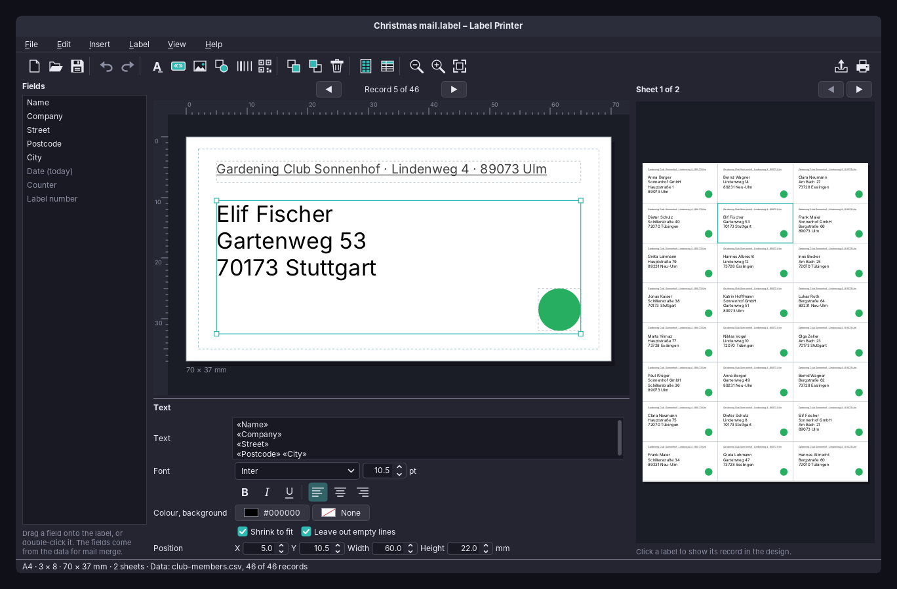
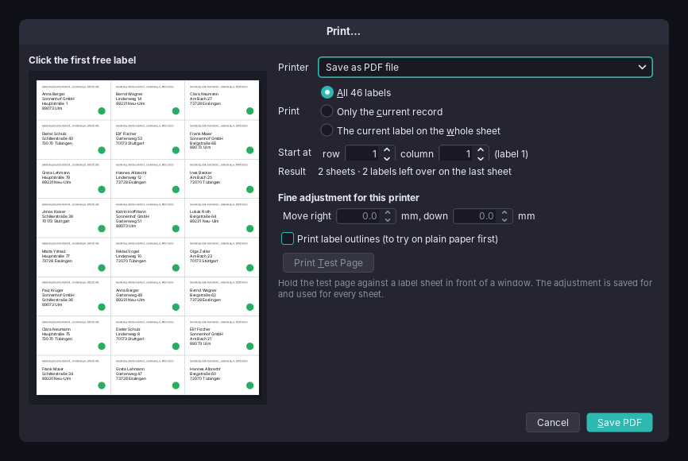
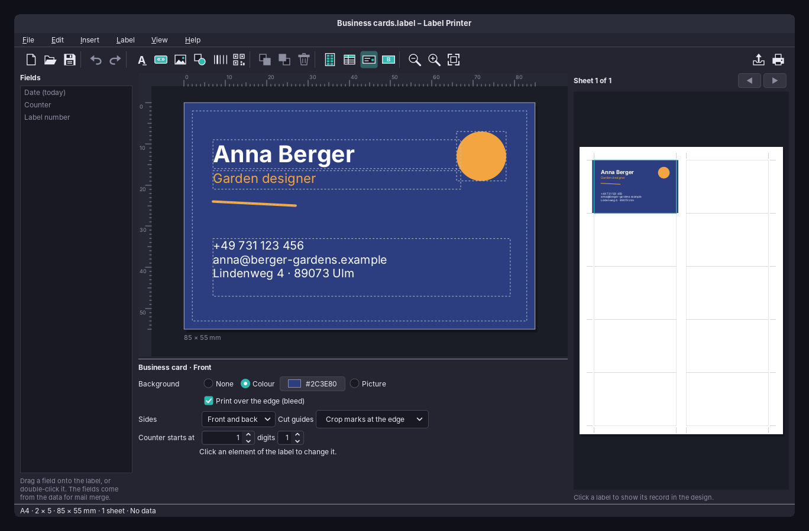

# 83. Label Printer

Printing labels looks like the simplest job a computer can do, until the first sheet comes out of the printer: the addresses sit two millimetres too low, the last label of the list is missing because the sheet was used before, and the business card's back is printed behind the wrong front. Label Printer is a program about **millimetres**. It designs one label, places it on sheets of many labels, fills it from a list (mail merge) and prints it so that every label lands where the sheet has it.

The program has about 7,800 lines of Java and 2,600 lines of tests. It made amade-commons' `ContactCard` grow: a postal address, phone numbers, a job title and the parts of a name, and `ContactDirectory.readFile` for vCard files outside the address books ([below](#what-amade-commons-gives-label-printer)).

## What you build



- **A catalogue of label sheets**, found by the size printed on the package, and a sheet editor for sheets that are not in it.
- **A designer** for texts, fields, pictures, shapes, barcodes and QR codes, positioned in millimetres.
- **Mail merge** from CSV, spreadsheets, vCard files, the Contacts address books or a typed list, with a filter, sorting and copies.
- **Two-sided business cards** with crop marks.
- **Printing** from the first free label of a used sheet, a correction for each printer, a test page and PDF export.

## What you will learn

- How to keep one unit, the millimetre, from the data model to the printer, and draw the screen, the preview, the PDF and the paper with the same code.
- How to validate a model in a record's constructor so that an impossible sheet cannot exist.
- How to guess the separator and the character set of a CSV file.
- How to fill fields in a text, and leave out a line whose fields are all empty.
- How to place labels on several sheets from a start position, and mirror the back of a two-sided sheet.
- How to print with `java.awt.print` at an exact paper size, and make a PDF without a PDF library.

## The structure

| Package | Contents |
|---|---|
| `bootstrap` | `AmadeLabelPrinterApplication`, `LabelPrinterModule`, `Windows` |
| `domain` | `SheetTemplate`, `LabelDesign`, `Side`, `Element` (text, picture, figure, code), `TextStyle`, `Background`, `CutGuides`, `DataSource`, `DataTable`, `MergeSettings`, `Merge`, `Placeholders`, `FieldNames`, `PrintPlan` |
| `repository` | `LabelPreferences` |
| `service` | `SheetCatalog`, `LabelFiles`, `DataLoader`, `CsvReader`, `SpreadsheetReader`, `ContactColumn`, `LabelPainter`, `SheetPainter`, `SheetPages`, `PdfExport`, `DesktopOpener` |
| `ui.main`, `ui.parts`, `ui.dialogs` | the window and its presenter; the design canvas, the properties and the sheet view; the sheet, data and print dialogs |

The domain knows nothing of Swing except `Color` and `Rectangle2D`, and the presenter knows the window only through the `MainView` interface. That split carries the tests: 137 of them, most without a window.

## Everything in millimetres

A label sheet is described the way its package describes it: paper size, labels across and down, the size of a label, the margin to the first label and the gaps between labels. `SheetTemplate` is a record with exactly these values, in millimetres. The sheet editor lets the user type any number into them, so the record checks itself. A sheet whose labels overlap or stick out of the paper cannot be built:

```java
--8<-- "amade-labelprinter/src/main/java/eu/amadeos/apps/labelprinter/domain/SheetTemplate.java:34:51"
```

The sheet editor tries to build the record on every change and shows the message of the `IllegalArgumentException` instead of the drawing. There is no second set of rules in the dialog to keep in step with the model.

!!! tip "Let the record refuse"
    A compact constructor that throws is the cheapest form of validation: every path that makes a sheet goes through it, whether it comes from the catalogue, from the editor or from a `.label` file someone else wrote.

The elements of a design are positioned in millimetres from the label's top left corner (`Box`), and font sizes stay in points, because that is what users know from word processors. `LabelPainter` draws one label into a `Graphics2D` whose unit is the millimetre. Whoever calls it decides what a millimetre is:

- the **design canvas** scales by the zoom and the screen's resolution;
- the **sheet view** scales the whole paper into its panel;
- **printing** scales by 72 / 25.4, the points of `java.awt.print` per millimetre.

So what the user sees is what comes out of the printer, by construction rather than by care.

### Finding a sheet by its size

People do not know an id such as `a4-70x37-3x8`. They hold a package that says *70 x 37 mm* or *63,5 × 38,1* or *24 labels*. The search accepts all of these:

```java
--8<-- "amade-labelprinter/src/main/java/eu/amadeos/apps/labelprinter/domain/SheetTemplate.java:113:132"
```

The catalogue itself is a JSON file in the jar, read with `Json` from amade-commons (chapter 47), and lists about seventy sheets by size only. Manufacturers' names and article numbers stay out: they are trademarks, and a size printed on the package finds the sheet just as well.

## Mail merge

### Reading the list

The data of a mail merge is a `DataTable`: a source name, column names and rows of strings. Five sources fill it: a CSV or TSV file, a spreadsheet, a vCard file, the Contacts address books and a typed list.

CSV files are exported by spreadsheets, address books and websites, in every flavour: comma or semicolon (a German spreadsheet uses `;` because `,` is the decimal separator), UTF-8 with or without a byte order mark, or Windows-1252 from an older program. The user should not have to know which. As in Family Tree (chapter 82), the bytes are believed first: a byte order mark, then strict UTF-8, then Windows-1252:

```java
--8<-- "amade-labelprinter/src/main/java/eu/amadeos/apps/labelprinter/service/CsvReader.java:42:61"
```

The separator is the one that splits the first lines into the same, largest number of fields, counting only outside quotes:

```java
--8<-- "amade-labelprinter/src/main/java/eu/amadeos/apps/labelprinter/service/CsvReader.java:63:82"
```

Spreadsheets need no library either. An `.ods` file is a ZIP with `content.xml`, an `.xlsx` a ZIP with `xl/worksheets/sheet1.xml` and `xl/sharedStrings.xml`. `SpreadsheetReader` reads the first sheet's cells with the JDK's XML parser and knows the two traps: OpenDocument compresses empty cells into `number-columns-repeated`, and Office Open XML keeps text in a shared table and refers to it by number.

The **Contacts** source reads the address books through `ContactDirectory`. Each contact becomes a row, and `ContactColumn` names the columns and how each one is taken from a `ContactCard`:

```java
--8<-- "amade-labelprinter/src/main/java/eu/amadeos/apps/labelprinter/service/ContactColumn.java:9:24"
```

### Fields in a text

A text on the label may hold fields: `«First name» «Last name»`. `Placeholders.fill` replaces each field by its value. Two details make addresses look right: a line whose fields are all empty and which holds nothing else but punctuation is left out (no blank line where a contact has no company), and two spaces left by an empty field become one:

```java
--8<-- "amade-labelprinter/src/main/java/eu/amadeos/apps/labelprinter/domain/Placeholders.java:41:78"
```

A field the data does not know stays as `«Name»`, so the design shows where it goes. Lists from different places call the same column differently: *Vorname*, *First Name*, *Given name*, *prénom*. `FieldNames` knows the usual names of the usual columns in the five languages, so a design made with one list works with the next. The rest the user maps by hand in the data dialog.

### Which records, in which order

`Merge.rows` takes the rows the user did not untick, keeps those that match the filter and sorts them. The filter understands `City = Ulm`, `City != Ulm`, `Name ~ Berg` or any text in any column. The sort is *natural*: postcodes and numbers by value, so 2 comes before 10, and everything else alphabetically:

```java
--8<-- "amade-labelprinter/src/main/java/eu/amadeos/apps/labelprinter/domain/Merge.java:31:40"
```

## Sheets that were used before

Half a sheet of labels is too good to throw away. The print dialog shows the sheet and the user clicks the first free label. A `PrintPlan` then says which label goes where: the labels in order, starting at that position on the first sheet and filling the next sheets from their first position:

```java
--8<-- "amade-labelprinter/src/main/java/eu/amadeos/apps/labelprinter/domain/PrintPlan.java:12:38"
```

The same plan draws the preview on the right of the main window, the drawing in the print dialog and the printed pages. The *Result* line of the dialog (*2 sheets · 2 labels left over*) comes from `sheets()` and `leftOver()`.



Printers do not print exactly where they are told. A shift of one or two millimetres is common, and on a 37 mm label it shows. The dialog has a correction for each printer, kept in `LabelPreferences`, and a test page with the outline and number of every label, to hold against a sheet in front of a window. The correction is a `translate` before the sheet is drawn.

## Business cards: front and back



A two-sided design has a front and a back `Side`, each with its elements and background. The printer prints page 1 on the front of the paper and page 2 on its back, turned over the long edge. So the card that is on the left on the front is on the right when seen from the back, and the back has to be drawn **mirrored**:

```java
--8<-- "amade-labelprinter/src/main/java/eu/amadeos/apps/labelprinter/service/SheetPainter.java:61:66"
```

Only the positions are mirrored; the card's content is not, or its text would be printed backwards.

Business card stock without pre-cut cards needs **cut guides**. *A line around each label* is easy but stays visible on a coloured card if the cut misses it by a hair. *Crop marks at the edge* are the printers' way: short lines in the margin of the sheet, in line with the edges of the cards, and nothing on the cards themselves. A background that bleeds is drawn up to 2 mm beyond the card's edge, but never more than half the gap to the next card, so a slightly crooked cut leaves no white rim.

## Text that fits

An address with a long name must not be cut off. With *Shrink to fit*, `LabelPainter` measures the widest line and the height of all lines and makes the font smaller until both fit, but never below a readable size:

```java
--8<-- "amade-labelprinter/src/main/java/eu/amadeos/apps/labelprinter/service/LabelPainter.java:112:124"
```

The font is measured in the same `Graphics2D` it is drawn with, through its `FontRenderContext`, so the result is the same on the screen and on the paper.

## Barcodes and QR codes

The codes are drawn with ZXing's core library, which turns a text into a matrix of modules. The painter joins the dark modules of each row into rectangles of one `Path2D` and fills it, as vectors and not as a picture, so a QR code stays sharp at any printer resolution. Fields work in codes too, such as a membership number per label:

```java
--8<-- "amade-labelprinter/src/main/java/eu/amadeos/apps/labelprinter/service/LabelPainter.java:229:241"
```

Content a code cannot hold, such as letters in an EAN-13, gives `null`: the design shows a red exclamation mark in its place, and the print leaves the place empty instead of failing.

## Printing at the size of the sheet

`java.awt.print` asks for a `PageFormat`. Its default has the printer's margins, and a label at the edge of the sheet would be cut off. `SheetPages` makes a paper of the sheet's size whose whole area is printable, and lets the labels decide what is drawn where:

```java
--8<-- "amade-labelprinter/src/main/java/eu/amadeos/apps/labelprinter/service/SheetPages.java:47:58"
```

Each page draws one sheet, or for two-sided cards alternately the front and the back of a sheet, scaled from points to millimetres:

```java
--8<-- "amade-labelprinter/src/main/java/eu/amadeos/apps/labelprinter/service/SheetPages.java:79:99"
```

### PDF without a PDF library

The same `Pageable` gives the PDF. `PrintJobs.writePostScript` from amade-commons (chapter 46) prints it into a PostScript file through the JDK's stream print service, and Ghostscript's `ps2pdf` turns that into a PDF at the exact paper size, run through `CommandRunner` (chapter 47) with a time limit:

```java
--8<-- "amade-labelprinter/src/main/java/eu/amadeos/apps/labelprinter/service/PdfExport.java:29:42"
```

The `.deb` package recommends `ghostscript`, and the amadeOS image installs it. Because `CommandRunner` is an interface, the tests use a fake runner and check the command line without Ghostscript.

## A trap: field initialisers

Three start-up crashes of the first version had the same cause, and they are worth knowing for every Swing program. Field initialisers run **before** the body of the constructor. In a shortened form:

```java
public final class DataDialog extends JDialog {
    private final Messages msg;
    private final JTable table = new JTable(new RecordsModel());   // runs first...

    public DataDialog(Window owner, Messages msg) {
        this.msg = msg;                                             // ...this runs later
    }

    private final class RecordsModel extends AbstractTableModel {
        public String getColumnName(int c) { return msg.get("data.column"); }   // msg is still null
    }
}
```

`new JTable(model)` asks the model for its column names at once, and `msg` is still `null`. The fix is to create such components in the constructor, after the fields they need. The tests found all three, because they open every dialog under Xvfb (`xvfb-run ./gradlew test`) instead of only testing the presenter.

## What amade-commons gives Label Printer

| From amade-commons | Introduced in | Used for |
|---|---|---|
| `AmadeApplication`, `AppInfo` | chapter 41 | start-up, theme, language |
| `Messages`, `Mnemonics`, `Language` | chapter 43 | five languages, the menu letters, *Options → Language* |
| `AmadeUI`, `EdtExecutor` | chapters 41, 42 | the Motif and Horizon look, loading data in the background |
| `ToolButtons`, `ToolIcon`, `StandardGlyph` | chapter 46 | the icon toolbar; the label glyphs (text, field, barcode, sheet, front and back) implement `ToolIcon.Glyph` |
| `PrintJobs`, `PaperSize` | chapter 46 | printers, PostScript for the PDF, A4 or Letter by region for the first sheet |
| `CommandRunner` | chapter 47 | `ps2pdf` |
| `Json` | chapter 47 | the sheet catalogue, own sheets, `.label` files |
| `XdgDirectories`, `AppDirectories` | chapter 44 | the Documents and Pictures folders, `labelprinter.properties`, `own-sheets.json` |
| `ContactDirectory`, `ContactCard` | chapter 25 | the Contacts address books as a data source, vCard files |

### What Label Printer added to amade-commons

Addresses on labels need more of a contact than the Mailer and the Calendar did. `ContactCard` gained the parts of the name (`NameParts` from `N`: prefix, given, additional, family, suffix), the job title (`TITLE`), phone numbers and postal addresses (`Phone`, `Address` from `TEL` and `ADR`, the preferred one first), with `address()` and `phone()` for the first of each. `ContactDirectory.readFile(path)` reads the cards of any vCard file, such as a phone's export with hundreds of contacts in one file. The old constructor of `ContactCard` stays, so no other program had to change.

### And what stays in Label Printer

Sheets, mail merge and the CSV reader. The CSV reader is a candidate for amade-commons as soon as a second program imports lists.

## Exercises

1. **Templates.** Offer ready-made designs when a new label is started: return address, name badge, jam jar, business card. Where do they live, and how are they scaled to the sheet the user chose?
2. **A photo per record.** Name badges want a photo of each person. Add a picture element whose file name comes from a field, relative to the data file's folder. What does the preview show while the pictures load?
3. **Columns before rows.** Some users fill a sheet column by column. Add the order to `PrintPlan` and keep `used()` and `leftOver()` right.
4. **Duplex without a duplex printer.** Print all fronts, ask the user to turn the stack, then print the backs in reverse order. Which pages does `SheetPages` hand out, and how does a test check it without a printer?
5. **The CSV reader in amade-commons.** Move `CsvReader` into amade-commons and let Contacts import CSV address lists with it. What has to change in its interface for a second user?

## Summary

- Keep one unit from the model to the printer, and let every caller decide how big a millimetre is.
- Let a record's constructor refuse impossible values, and show its message instead of duplicating the rules in a dialog.
- Believe the bytes before the declaration, and choose a separator by what splits the lines evenly.
- Leave out a line when its fields are empty, not when it is empty.
- One plan for the preview, the dialog and the paper: what the user clicks is what is printed.
- Mirror the positions of the back, not its content.
- Create Swing components that need constructor arguments in the constructor, not in field initialisers.
