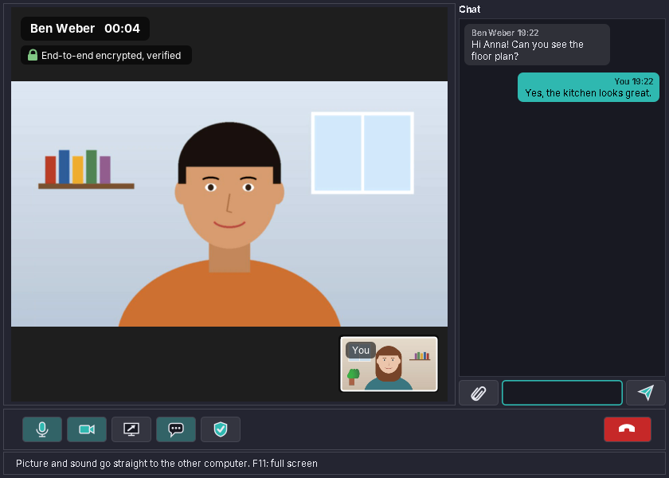
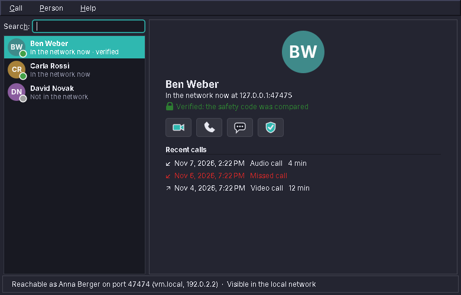
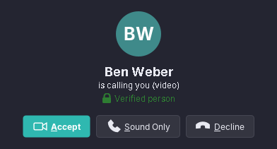
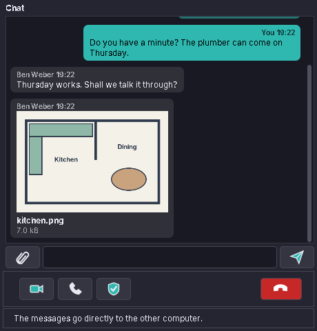

# 90. Calls

Webcam showed one camera on one screen. Calls ([amade-call](https://github.com/amadeos-eu/amade-call)) sends that picture to another computer, with sound, and shows the other person in return. It is the first amade application that two computers run together. Neither of them is a server: they find each other in the local network, check who is on the other end, and then let picture and sound flow straight between them, encrypted.

The program has about 7,500 lines of Java and 2,600 lines of tests. It brings nothing new to amade-commons. What it needs that no other program needed, a WebRTC stack, comes from GStreamer.

## What you build



- **A list of people**: the computers in the network that run Calls (with a green dot), then the people called before, each with the recent calls.
- **Video and audio calls**, by a click on a person or by typing an address. During a call the microphone and camera are switched off and on, the screen is shared instead of the camera, and short messages go through a chat beside the picture.
- **A ringing window** for incoming calls, with *Accept*, *Sound Only* and *Decline*, and a notification with *Call Back* for a call nobody answered.
- **A text chat** without picture and sound, kept encrypted per person, with pictures and files up to 2 GB, and a way from the chat into a call.
- **Calls from Contacts**: *Add to Contacts* stores the person's key in their vCard, and the card in amade-contacts gets buttons for a video call, an audio call and a chat.
- **A safety code** that two people read out to each other to be sure that nobody sits between their computers.
- **Waiting for calls after login**: the program starts in the background, and a second start only shows the window.



## What you will learn

- How two programs find each other in a network with Avahi (mDNS and DNS-SD), with nothing but `avahi-publish` and `avahi-browse`.
- How to use TLS between two computers that have no certificate authority, by checking the *key* instead of a name.
- How to make the fingerprint of a key into numbers that two people can compare on the phone.
- How a small protocol of JSON messages carries a call from *hello* to *bye*, and the WebRTC offer, answer and ICE candidates in between.
- How GStreamer's `webrtcbin` does WebRTC from Java, and the one place where the Java binding loses a callback.
- How to test a network program with two whole programs in one JVM.

## The structure

| Package | Contents |
|---|---|
| `bootstrap` | `AmadeCallApplication` (`--background`, `--test-picture[=FILE]`), `CallModule` |
| `domain` | `PeerKey`, `SafetyCode`, `Person`, `Endpoint`, `CallKind`, `CallRecord`, `ChatLine`, `EndReason` |
| `protocol` | `Signal`, `SignalChannel`, `CallServer`, `Tls` |
| `media` | `GstMedia`, `GstSession`, `Devices`, `MediaSettings`, `Sources` |
| `service` | `Phone`, `Call`, `AvahiDiscovery`, `AvahiBrowse`, `IdentityStore`, `Ringer`, `Autostart`, `SingleInstance` |
| `repository` | `CallPreferences`, `KnownPeers`, `CallLog` |
| `ui.main`, `ui.call`, `ui.dialogs` | the main window and its presenter, the call window, the ringing window, the safety code and the settings |

`Phone` is the telephone of the computer: it owns the key, the call port, the network announcement and the one call that may run at a time. `Call` is one call with its states, from *dialing* to *ended*. `MainPresenter` turns both into windows. It sees them only through three interfaces, `MainView`, `CallView` and `IncomingView`, which is what makes the tests at the end of this chapter possible.

The start is that of every amade program, with one addition. Only one Calls per user may own the call port, so a second start hands its wish to the first one and ends:

```java
--8<-- "amade-call/src/main/java/eu/amadeos/apps/call/bootstrap/AmadeCallApplication.java:main"
```

`SingleInstance` listens on a Unix domain socket in `$XDG_RUNTIME_DIR`; Java has spoken them since version 16 (`UnixDomainSocketAddress`), so no native code is needed. The presenter gets its services from the module:

```java
--8<-- "amade-call/src/main/java/eu/amadeos/apps/call/bootstrap/CallModule.java:presenter"
```

## Who is who: a key per computer

A call program must answer one question before any other: is the computer that answers really the one I wanted to call? Names in a local network prove nothing; anyone can announce *Anna's laptop*. So every computer gets a **key pair** on the first start, and its identity is the key, not the name.

`IdentityStore` makes an Ed25519 key with a self-signed certificate. It does not need a library for that: the JDK's own `keytool` does it in one command, into a PKCS#12 file in `~/.local/share/amadeos/call/` that only the user may read. The identity used everywhere else, `PeerKey`, is the SHA-256 fingerprint of the public key.

### TLS without a certificate authority

The two programs talk over TLS 1.3, and both sides show their certificate (`setNeedClientAuth(true)` on the server socket). A browser would check the certificate against a list of authorities. There is no authority here, so the trust manager accepts any certificate that is signed by its own key:

```java
--8<-- "amade-call/src/main/java/eu/amadeos/apps/call/protocol/Tls.java:any-key"
```

That alone would accept anyone. The real check comes after the handshake: TLS has proved that the other side owns the private key of the certificate it showed, and the program now asks *which* key that is:

```java
--8<-- "amade-call/src/main/java/eu/amadeos/apps/call/protocol/Tls.java:peer-key"
```

When the user calls a person from the list, `Call` knows the key it expects, from the network announcement or from earlier calls. If another key answers, the call ends at once with *Another computer answered at this address*. This is how SSH treats a host it has seen before, and it is the right model for computers without a certificate authority.

!!! warning "Pitfall"
    A trust manager that accepts every certificate is a well-known security bug, and it is one here too, *unless* the program checks the key afterwards. Never accept a connection by its certificate alone and forget the second step.

### The safety code

The first call between two computers has no key to compare with. Someone who answered in the middle would show their own key to both sides. The defence is to let the two people compare the keys themselves, as numbers they can read out:

```java
--8<-- "amade-call/src/main/java/eu/amadeos/apps/call/domain/SafetyCode.java:code"
```

Each half is 15 digits from the first 64 bits of one fingerprint, and the lower key always comes first, so both screens show the same 30 digits. Someone in the middle would need a key of their own whose fingerprint gives the same 15 digits, a search over 10^15 keys that cannot finish while a phone rings. Numbers instead of words also work between two people who do not share a language.

!!! info "Behind the scenes"
    Picture and sound are encrypted by WebRTC itself (DTLS-SRTP), with keys the two GStreamer pipelines make for every call. Their fingerprints travel inside the session description, and the session description travels over the TLS connection checked above. So a matching safety code covers picture and sound too.

## Finding each other

In a home or office network, computers announce services with **multicast DNS** and **DNS service discovery**: printers do it, and so do file servers. On Linux, the Avahi daemon does the work, and its two command line tools are enough for a program. Calls announces itself with `avahi-publish`:

```java
--8<-- "amade-call/src/main/java/eu/amadeos/apps/call/service/AvahiDiscovery.java:publish"
```

The service type is `_amadeos-call._tcp`. The TXT record carries the name people see and the key, so that a computer is known by its key before anyone connects. `avahi-browse --parsable --resolve` prints one line for each computer that appears (`=`) or leaves (`-`), with address, port and TXT record; `AvahiBrowse` turns the lines into events. Two details matter:

- A computer appears once per network interface and IP version. `AvahiDiscovery` keeps all entries per service and reports a person once, preferring an IPv4 address.
- Service names escape special characters as a backslash and three decimal digits of UTF-8 bytes: `J\195\188rgen` is *Jürgen*.

Without Avahi (no daemon, or another network) the list stays empty, the status bar says so, and calls by address still work.

## The conversation before the call

`CallServer` is a TLS server socket on port 47474, or a free port when another program has that one. The caller connects and the two programs exchange **signals**: small JSON objects, each sent as its length in four bytes and its text in UTF-8.

```java
--8<-- "amade-call/src/main/java/eu/amadeos/apps/call/protocol/SignalChannel.java:frame"
```

A frame larger than 256 KB ends the connection: a session description is a few kilobytes, and a peer that sends more is broken or hostile. Unknown message types are skipped, so a newer version can add messages that an older one ignores.

| Signal | From | Meaning |
|---|---|---|
| `hello` | caller | my name, video, audio or chat, whether my camera is on, protocol version |
| `accept` / `decline` | callee | the answer, with the callee's own name; `decline` says *declined* or *busy* |
| `offer`, `answer`, `ice` | both | the WebRTC session descriptions and the network candidates |
| `chat`, `camera`, `screen`, `microphone` | both | a chat line and the state of the switches |
| `file`, `file_data`, `file_end`, `file_cancel` | both | a picture or file: name and size, pieces of 48 kB in Base64, the SHA-256 at the end, or giving up |
| `bye` | either | hang up |

On the callee's side, `Phone` reads the hello first. While another call runs, the answer is *busy*, and the second caller hears exactly that:

```java
--8<-- "amade-call/src/main/java/eu/amadeos/apps/call/service/Phone.java:answer"
```

The incoming `Call` rings until the user answers. Accepting starts the media *before* telling the caller, so the pipeline is ready when the offer comes:

```java
--8<-- "amade-call/src/main/java/eu/amadeos/apps/call/service/Call.java:accept"
```

Candidates can still arrive before the pipeline is running; `Call` keeps them in a list and hands them over once it is.

## Picture and sound with GStreamer

WebRTC is a large stack: ICE to find a way through the network, DTLS to agree on keys, SRTP to encrypt, RTP to carry media, and codecs. GStreamer has all of it in one element, `webrtcbin`, and [gst1-java-core](https://github.com/gstreamer-java/gst1-java-core) reaches it from Java through JNA. Debian packages the parts as `gstreamer1.0-plugins-bad` (webrtcbin) and `gstreamer1.0-nice` (ICE); at the start, `GstMedia.missing` checks for every element by name and the program tells the user which package is missing.

`GstSession` builds the whole pipeline of one call as gst-launch text:

```java
--8<-- "amade-call/src/main/java/eu/amadeos/apps/call/media/GstSession.java:pipeline"
```

- An **input-selector** chooses between the camera and a black picture, so switching the camera off changes no caps and needs no new negotiation. Sharing the screen adds an `ximagesrc` branch as a third input while the call runs.
- A **tee** sends the chosen picture both to the VP8 encoder and to a small `appsink` for the self view.
- The other side's sound goes into an **audiomixer** that starts with a silent source, so the speakers (and the echo canceller's probe) run from the first moment.
- `webrtcdsp` cancels the echo of laptops without headphones. It is optional: when the element is missing, the setting is greyed out.

When `webrtcbin` gets a stream from the other side, it adds a pad; the program then adds a decoder and an `appsink` for the picture, or a branch into the mixer for the sound. The `appsink` delivers `BGRx` bytes, which become a Java image without a copy per pixel:

```java
--8<-- "amade-call/src/main/java/eu/amadeos/apps/call/media/GstSession.java:image"
```

### A callback that disappears

`webrtcbin` creates offers and answers asynchronously: it takes a `GstPromise` and calls the promise's change function when the description is ready. gst1-java-core wraps that as `createOffer(listener)`. In tests, the first call of a program sometimes never got its offer. The log showed *creating offer sdp* and then nothing.

The cause was in the binding: `createOffer` makes the `Promise` (and with it the JNA callback) as a local variable and returns. Nothing in Java refers to it any more, and when GStreamer is slow, as it is the first time while it loads its plugins, the garbage collector collects the callback before GStreamer calls it. The fix is to keep a reference until GStreamer has answered:

```java
--8<-- "amade-call/src/main/java/eu/amadeos/apps/call/media/GstSession.java:describe"
```

!!! warning "Pitfall"
    Every callback you hand to native code through JNA must stay reachable from Java until native code is done with it. A lambda passed to a binding method is only safe if the binding keeps it. When in doubt, keep it yourself.

## The windows

The **call window** puts the other person's picture in a `VideoPanel` that keeps the aspect ratio and draws the self view, the name, the call time and the lock with *End-to-end encrypted* on top. When the other side's camera is off, it shows their initials. The switches below are toggle buttons with Ctrl+D and Ctrl+E, F11 moves the picture into a borderless full-screen window, and the chat opens by itself when a message comes in.

The **ringing window** is a `JFrame`, not a dialog, and always on top: it must appear even when the main window is hidden and the program waits in the background.



Picture frames arrive on GStreamer's threads at 30 per second. The presenter does not queue them for the EDT: it keeps only the newest frame in an `AtomicReference` and schedules a repaint only when none is pending. The window may skip frames, but it never falls behind.

## Chat, pictures and files

A **text chat** is a third kind of call, `CallKind.CHAT`. The hello says `"kind": "chat"`, the callee accepts as usual, and `Call` skips the media: no pipeline, no offer, the call is active as soon as it is accepted. The chat window has the same buttons as a call plus *Video Call* and *Audio Call*. They end the chat and call the same person, and the presenter carries the lines of the chat into the new call window.



**Pictures and files** answered a question that the first version of this chapter left as an exercise: a separate connection, a WebRTC data channel, or the signal connection? Calls sends them over the TLS connection that already exists, in pieces of 48 kB, Base64 inside the usual JSON frames (64 kB each, well below the 256 kB limit). The writer locks per frame, so a chat line slips in between two pieces and arrives at once, even during a 2 GB transfer. Picture and sound do not notice: they have their own stream. `ChatFiles` does both sides:

- The sender announces `file` (a random id, the name, the size), sends the pieces, and ends with `file_end` and the SHA-256 of the whole file.
- The receiver cleans the name (no folders, no control characters, no leading dot), asks the presenter for a free path in `~/Downloads/amade-call/`, and writes into `<name>.part`. Only when size and hash match does the file get its name, with an atomic move.
- `file_cancel` from either side, or the end of the call, deletes the `.part` file.

The presenter decides where a file goes and what a click does. A received program or script is never started:

```java
--8<-- "amade-call/src/main/java/eu/amadeos/apps/call/ui/main/MainPresenter.java:files"
```

**Kept chats.** `ChatHistory` keeps the lines with each person in `~/.local/share/amadeos/call/chats/<key>.chat`, encrypted with AES-256-GCM: a magic header (also the additional authenticated data), a 12-byte IV and the sealed text, one line per message, with a picture's path after it. The key is 32 random bytes in the login keyring, through `SecretToolPasswordStore` from chapter 22. `ChatKey` reads the key back from the keyring before it uses a new one, so a keyring that does not keep secrets means no history, not a history nobody can read after the next login.

**From Contacts.** The identity of a person is their key, so the link to them is the key too: `amadeos-call:<fingerprint>?kind=video`. *Add to Contacts* writes `IMPP:amadeos-call:<fingerprint>` into a vCard of the amadeOS address book and leaves everything else in the file alone. amade-contacts shows a line with three buttons for such an IMPP entry, and each opens the link with `DesktopLauncher`. The desktop file of Calls registers `x-scheme-handler/amadeos-call`, and `SingleInstance` hands a link to the running program.

## Testing two computers in one program

A call needs two ends. The tests start two whole programs in one JVM, each with its own key in a temporary folder, and let them call each other over `127.0.0.1`:

- **`PhoneCallTest`** runs two `Phone`s with the real `GstMedia` on test sources (`videotestsrc`, `audiotestsrc`, `fakesink`): real TLS, real WebRTC, real VP8 and Opus. It checks pictures in both directions, chat, camera off, screen sharing (under Xvfb) and hang-up.
- **`MainPresenterTest`** runs two presenters with fake views and a fake media factory that connects at once: declined, missed and busy calls, unreachable addresses, the safety code, the settings, closing the window while waiting for calls, a chat that turns into a video call, kept chats, a link from Contacts, and a picture and a 1.3 MB file sent over real TLS and compared byte by byte.
- **`MainWindowTest`** gives one of the two programs the real Swing windows: it clicks *Video Call* in the details, answers a ringing window, writes in the chat and hangs up.
- **`SignalChannelTest`** checks the TLS layer alone: both sides see the other's key, a frame larger than allowed ends the connection, unknown messages are skipped.

The same setup makes the screenshots of this chapter: `xvfb-run -a ./gradlew screenshots` starts both programs with a drawn portrait as camera (`--test-picture=FILE` does the same for the real program) and saves the windows.

## What amade-commons gives Calls

| Part | Since | Calls uses it for |
|---|---|---|
| `AmadeApplication`, `AppInfo`, `CommonsModule`, `EdtExecutor` | chapter 10 | start-up and wiring, `--version` |
| `Messages`, `Mnemonics`, `LocaleSettings`, `TranslationCheck` | chapter 10 | five languages, menu letters, the language menu, the translation test |
| `AmadeUI`, `DesktopTheme` | chapter 10 | the look and the theme colours, also in the video panel |
| `AppDirectories`, `XdgDirectories` | chapter 20 | settings, people and call list; the key in the data folder; the autostart entry |
| `@Ui` | chapter 30 | the EDT executor in the presenter |
| `CommandRunner` | chapter 31 | `pactl` for microphones and speakers |
| `Json` | chapter 33 | the signals and the device lists |
| `Notification`, `Notifications` | chapter 67 | the missed call with *Call Back* |
| `SecretToolPasswordStore` | chapter 22 | the key of the kept chats |
| `DesktopLauncher` | chapter 11 | opening pictures and files from the chat; its list of risky extensions |

### And what stays in Calls

- **The device lists.** Webcam finds cameras through `/sys` and ffmpeg, Calls through GStreamer's device monitor. Both list microphones with `pactl`. That part moves to amade-commons when a third program needs it.
- **The signalling.** TLS between keys and framed JSON are written for calls. A second program that talks to other amadeOS computers (sending a file, sharing a clipboard) would be the moment to move `Tls`, `SignalChannel` and the Avahi classes into a library.

## Exercises

1. **Resume a file.** A 2 GB video breaks off at 80 % when the call ends. What would `file` need to carry so that the next call continues from the `.part` file instead of starting again, and how does the receiver prove it has the right first 80 %?
2. **Group calls.** Three people call each other as a mesh: everyone sends to everyone. How many encoders does each computer run, and why does a mesh stop working at about five people?
3. **A call server.** For calls over the internet, both computers connect to a server that only passes on the signals, and a TURN relay carries the media when no direct way exists. Which classes change, and which stay exactly as they are?
4. **A safety code in words.** Some people find words easier to read than digits. Map 15 digits to words from a fixed list. How long does the list have to be, and what happens with two people who speak different languages?
5. **Background blur.** Put a blur in the pipeline before the encoder. Which GStreamer elements could do it, and what does it cost per frame at 720p?

## Summary

- Give every computer a key and use the key, not a name, as its identity.
- TLS without a certificate authority is safe only if you check the other side's key after the handshake.
- Let the people compare the keys once, as digits both screens show in the same order.
- Avahi's command line tools are enough to announce a service and find others; carry the key in the TXT record.
- Keep the signalling small and versioned: framed JSON, a size limit, unknown messages skipped.
- Build the media as one GStreamer pipeline around `webrtcbin`, with a selector instead of renegotiation for switches.
- Keep every callback you hand to native code reachable until native code has called it.
- Test a two-ended program with two ends in one JVM.
